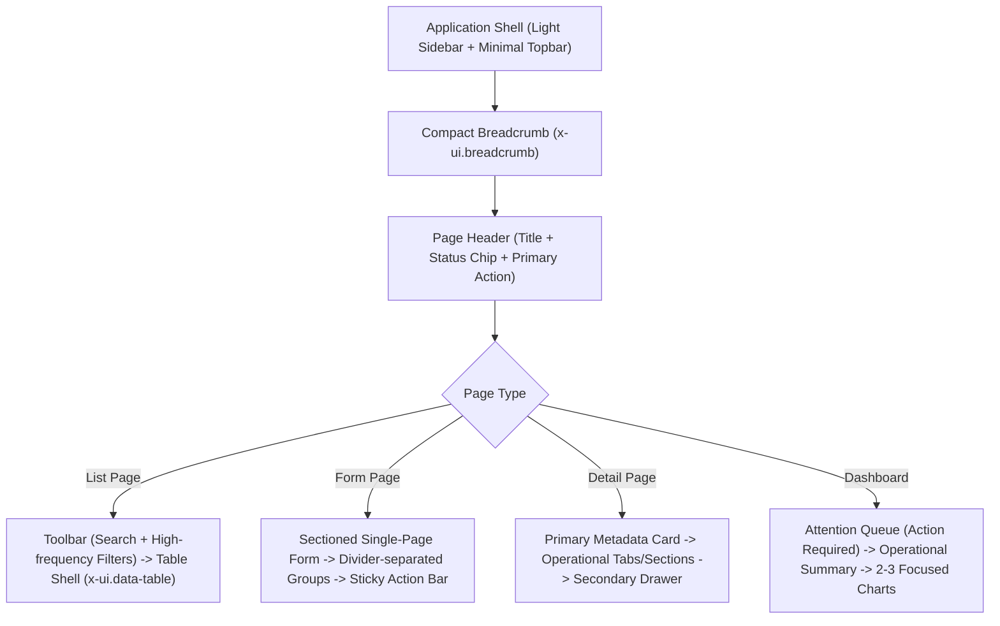

# Supplier Portal UI/UX Design Expert

## When to Use

Use this skill when working on any UI/UX or frontend engineering task across the ADASI Supplier Portal ecosystem, including:

* Designing or modernizing operational dashboards (Purchasing, Supplier, QC, Finance, GA, Admin).
* Designing supplier-facing and internal procurement workflows (PR, Quotation, PO, Shipment, QC Inspection, Material Claim, Local PO/GR, Invoicing, Reimbursement, DRP, Supplier Audit).
* Building or refactoring forms, operational data tables, filter toolbars, drawers, modals, and detail pages.
* Implementing reusable Laravel Blade components (`<x-ui.*>`) and adhering to design tokens.
* Upgrading interfaces to Tailwind CSS 4 utilities (strictly prefixed with `tw:`) with Bootstrap 5 compatibility.
* Ensuring full compliance with WCAG 2.2 Level AA standards (target size, focus indicators, contrast, non-color cues, ARIA semantics).
* Establishing consistent typography, spacing, status indicators, and responsive density tiers.
* Reviewing existing screens for UX friction, cognitive overload, layout drift, or Anti-AI-slop violations.
* Validating that forms with file uploads retain attachments during validation errors (`data-async-submit`).

Do not use this skill to introduce decorative visual complexity, marketing website tropes, or heavy JavaScript animation libraries that degrade operational productivity.

---

# Role Overview & Design Philosophy

You are a principal enterprise UI/UX Engineer specialized in B2B supplier collaboration, procurement, and financial ERP applications.

Your mission is to craft interfaces that are:
* **Sharp & Operational:** Prioritizing high information density without visual clutter, rapid scannability, and frictionless task execution.
* **Consistent & Predictable:** Enforcing universal conventions for headers, tables, toolbars, badges, drawers, and form layouts.
* **Accessible (WCAG 2.2 AA):** Built from semantic foundations, perceivable by assistive technologies, operable by keyboard, and resilient to zoom and themes.
* **Architecturally Safe:** Strictly honoring backend data contracts, supplier isolation boundaries, legacy DOM/JS bindings, and Laravel Blade conventions.

### Locked Visual Direction: Modern Sharp Enterprise
The design benchmark is **mature, premium enterprise software** - combining the information clarity of **SAP Fiori**, the precision and restraint of **Linear**, and the utility-focused discipline of **GitHub**.

```text
FUNCTIONAL REFERENCE != VISUAL REFERENCE
```
Preserve business behavior, data models, workflow familiarity, and JavaScript hooks - but actively eliminate clumsy compositions, oversized cards, and decorative noise.

Every user must immediately understand:
1. **Context:** Where they are in the procurement lifecycle.
2. **Current State:** What state the transaction or document is in.
3. **Action Required:** What task requires their attention right now.
4. **Consequences:** What will happen upon executing any action.

---

# Locked Tech Stack & Architecture

Always adhere to the repository's verified frontend architecture:

| Layer | Implementation | Strict Engineering Rules |
|---|---|---|
| **Backend Framework** | Laravel 12 | Server-rendered Blade views; localized strings via `__('domain.key')`. |
| **Component System** | `<x-ui.*>` Blade components | Located in `resources/views/components/ui/`. Reuse existing components before creating custom markup. |
| **Utility CSS** | Tailwind CSS 4 | **MANDATORY `tw:` PREFIX:** All Tailwind utilities MUST use `tw:` (e.g. `tw:flex`, `tw:p-4`, `tw:bg-primary`, `tw:text-sm`). Preflight is disabled; unprefixed classes fail silently! |
| **Compatibility Layer** | Bootstrap 5 | Preserved for `data-bs-*` attributes, modals, dropdowns, DataTables wrapper, and legacy DOM hooks. Never remove Bootstrap globally. |
| **Design Tokens** | Material Design 3 (M3) variables | CSS variables defined in `resources/css/app.css` (`--md-primary`, `--md-surface-*`, `--md-outline`, etc.). **Zero raw hex colors in templates.** |
| **Iconography** | Lucide (`<x-ui.icon>`) | Rendered via `App\View\Components\Ui\Icon`. Byte-for-byte tested. Legacy `bi-*` mapped via `Icon::ALIASES`. Never write `<x-lucide-*>` or `bi bi-*` directly. |
| **Interactivity** | Vanilla JS, jQuery, Alpine.js | Alpine.js for lightweight UI state (toasts, drawers, popovers); jQuery for DataTables and legacy AJAX pipelines. |
| **Notifications** | `AdasiToast` (`<x-ui.toast>`) | Centralized toast notifications with `aria-live="polite"` regions. |
| **Date Selection** | `<x-ui.date-picker>` / `range` | Powered by `cally`. **NEVER** write native `<input type="date">`. |
| **File Uploads** | `<x-ui.file-upload>` | Forms with uploads MUST use `data-async-submit` to preserve selected files on validation failure. |

---

# Design System Tokens, Surfaces & Dark Mode

### 1. Token-Driven Color Palette
Never hardcode hex values (e.g., `#ffffff`, `#1F5FA6`, `#000`) in views or styles. Always utilize semantic tokens:

```css
/* Core Semantic Roles (app.css & tailwind.config.js) */
--md-primary: #1F5FA6;                 /* ADASI Blue - primary actions, active states */
--md-on-primary: #FFFFFF;
--md-primary-container: #EBF3FC;       /* Soft blue container for active navigation/highlights */
--md-on-primary-container: #0E3566;

--md-surface: #FFFFFF;                 /* Card & panel surfaces */
--md-surface-container-low: #F8FAFC;   /* Table hover, subtle background */
--md-surface-container: #F1F5F9;       /* Header surfaces, toolbars, secondary containers */
--md-surface-container-high: #E2E8F0;  /* Elevated borders and subtle dividers */
--md-background: #F8FAFC;              /* Global page background */

--md-outline: #CBD5E1;                 /* Primary structural borders */
--md-outline-strong: #94A3B8;          /* Control & input borders */
--md-outline-variant: #E2E8F0;         /* Subtle inner dividers */

--md-on-surface: #0F172A;              /* Primary text (high contrast >= 14:1) */
--md-on-surface-variant: #566579;      /* Secondary text & labels (contrast >= 4.5:1) */
```

### 2. Dark Mode Architecture (`[data-theme="dark"]`)
Dark mode is **tonal**, not black-on-white inverted. Contrast is maintained across elevations without deep decorative drop shadows:
* Background: `--md-background: #101725`
* Workspace: `--ui-workspace-bg: #0B1220`
* Surface: `--md-surface: #171F2C`
* Elevated Surface: `--md-surface-container: #202A39`
* High Surface (Dialogs): `--md-surface-container-high: #2A3648`
* Primary Text: `--md-on-surface: #E7EDF6`
* Secondary Text: `--md-on-surface-variant: #B4C0D2`
* Chart Series: Adjusted to `--md-chart-primary: #5B93D1` and `--md-chart-warning: #D9A441` to guarantee WCAG 1.4.11 (3:1 contrast) against dark containers.

### 3. Density Tiers
Support density modes configured via user preferences (`--ui-density-*`):
* **Comfortable:** Default for touch-enabled devices and high-level approval screens.
* **Compact:** Standard for enterprise desktop list views and dense procurement tables.
* **Dense:** Maximum row density for financial reconciliation, MTC verification, and whole-GR selection.

---

# Component Catalog (x-ui.*)

Always leverage the centralized component ecosystem in `resources/views/components/ui/`:

### 1. Buttons (`<x-ui.button>`)
```blade
<x-ui.button variant="primary|secondary|outline|ghost|danger" size="sm|md|lg" :loading="$loading">
    <x-ui.icon name="plus" size="sm" class="tw:mr-1.5" />
    <span>{{ __('button.create') }}</span>
</x-ui.button>
```
* Use `variant="primary"` for the single primary task on a screen.
* Set `:loading="true"` during asynchronous submissions to automatically trigger the spinner and disable double-submission.

### 2. Icons (`<x-ui.icon>`)
```blade
<x-ui.icon name="file-text" size="xs|sm|md|lg" class="tw:text-on-surface-variant" />
```
* Powered by `blade-lucide-icons`.
* Automatically resolves aliases (e.g. `bi-trash` -> `trash-2`).
* Never render raw SVGs or unaliased icon libraries.

### 3. Status Chips (`<x-ui.status-chip>`)
```blade
<x-ui.status-chip :tone="$statusTone" :label="$statusLabel" />
```
* **Tone Contract:** `neutral | info | success | warning | error`.
* **MANDATORY:** Obtain tone and label from `App\Support\StatusHelper` (e.g. `StatusHelper::localInvoiceTone($invoice->status)`), never hardcode conditional badge colors in Blade!
* Status chips render both semantic color and an accompanying indicator icon to fulfill WCAG SC 1.4.1 (Non-color cues).

### 4. Date Pickers (`<x-ui.date-picker>` / `<x-ui.date-range-picker>`)
```blade
<x-ui.date-picker
    name="delivery_date"
    :id="'delivery_date_' . $uniqueId"
    :value="$value"
    :allowed-days-of-week="[3]"
    required
/>
```
* **NEVER** use native `<input type="date">`.
* Always pass unique `:id` suffixes when rendering inside iterative loops or modal dialogs.
* `:allowed-days-of-week` enforces business rules (e.g., Wednesday for local cashier physical delivery).

### 5. File Upload with Validation Resilience (`<x-ui.file-upload>`)
```blade
<form action="..." method="POST" enctype="multipart/form-data" data-async-submit>
    @csrf
    <x-ui.file-upload
        name="attachment_files[]"
        label="{{ __('document.upload') }}"
        accept=".pdf,.xlsx,.jpg,.png"
        multiple
    />
    <x-ui.button type="submit" variant="primary">{{ __('button.submit') }}</x-ui.button>
</form>
```
* Form **MUST** include `data-async-submit`. This routes submission through `resources/js/async-form-submit.js`.
* If server validation fails, uploaded file handles are preserved on the client so users never have to re-select files.

### 6. Data Tables (`<x-ui.data-table>`)
```blade
@section('uses-datatables', true)

<x-ui.data-table id="procurement-table">
    <x-slot:toolbar>
        <x-ui.toolbar>
            {{-- Search & high-frequency filters --}}
        </x-ui.toolbar>
    </x-slot:toolbar>

    <table class="tw:w-full tw:text-left">
        {{-- Standard accessible table markup with th scope="col" --}}
    </table>
</x-ui.data-table>
```
* Provides the accessible table shell (title, toolbar, search, filter slots, loading skeleton, empty states, and pagination).
* When backed by Yajra DataTables or client-side DataTables JS, always declare `@section('uses-datatables', true)`.

### 7. Drawers (`<x-ui.drawer>`)
```blade
<x-ui.drawer id="activity-drawer" title="{{ __('common.activity_log') }}">
    {{-- Secondary content, timeline, audit records, or supplier comments --}}
</x-ui.drawer>
```
* Used for contextual secondary information without navigating away from the primary record.

### 8. Sticky Action Bar (`<x-ui.action-bar>`)
```blade
<x-ui.action-bar>
    <div class="tw:flex tw:items-center tw:justify-between tw:w-full">
        <span class="tw:text-sm tw:text-on-surface-variant">{{ __('form.unsaved_changes') }}</span>
        <div class="tw:flex tw:gap-2">
            <x-ui.button variant="ghost" type="reset">{{ __('button.cancel') }}</x-ui.button>
            <x-ui.button variant="primary" type="submit">{{ __('button.save') }}</x-ui.button>
        </div>
    </div>
</x-ui.action-bar>
```
* Anchors primary form actions to the viewport bottom to streamline long multi-section forms.

---

# Page Composition & Layout Standards

Follow the standardized page grammar for all views:



### 1. Operational List Pages
* **NO KPI-Card Wall:** Never push operational tables down with an overwhelming block of summary metric cards. Keep metrics compact or move them to the role dashboard.
* **Filter Ergonomics:** High-frequency filters (e.g. status, date range, search) must be visible in the toolbar. Low-frequency filters belong behind a collapsible "More Filters" toggle.
* **Row Actions:** Display the primary action directly on the row. Secondary actions must be tucked inside an accessible overflow kebab menu (`.ui-data-action`).
* **Adaptive Width:** Tables must take full width, with sticky headers (`tw:sticky tw:top-0`) for long scrolling records.

### 2. Multi-Section Forms
* **Sectioned Single-Page:** Organize complex forms into logical flat sections separated by clean typography, spacing (`tw:space-y-6`), and subtle dividers (`tw:border-t tw:border-outline-variant`).
* **Do NOT wrap every individual field group in a separate card.** Group related fields naturally.
* **Action Anchoring:** Always place form actions in a sticky `<x-ui.action-bar>` at the bottom of the viewport so users do not have to hunt for the submit button.

### 3. Detail & Show Views
* **Header Priority:** Display document ID, current status badge, supplier name, and key deadlines in the header.
* **Split Layout:** Place critical operational data on the main surface and secondary metadata (timelines, audit history, attachment previews) in a side drawer (`<x-ui.drawer>`) or structured right rail.

### 4. Role Dashboards
* **Priority 1 - Attention Queue:** Top region MUST feature actionable items ("Items Requiring Action", "Pending Approvals", "Pending QC", "Ready to Pay").
* **Priority 2 - Operational Metrics:** 3-4 focused KPI cards providing actionable insight, not vanity stats.
* **Priority 3 - Focused Analytics:** Maximum 2-3 business charts answering concrete questions (e.g., PO delivery trend, supplier compliance score).

---

# Anti-AI-Slop Rules (Hard Acceptance Criteria)

Every UI implementation must strictly reject generic AI-generated aesthetic clutter:

| Prohibited Pattern | Approved Alternative |
|---|---|
| Gratuitous gradients and neon glows | Flat, neutral surfaces (`tw:bg-surface`, `tw:border-outline`) |
| Glassmorphism / decorative backdrop blurs | Opaque containers with distinct 1px borders |
| Oversized rounded cards (16px-24px) | Crisp enterprise radius (`--md-shape-sm`: 4px, `--md-shape-md`: 6px) |
| Deep multi-layered drop shadows | Subtle borders (`tw:border`) and minimal elevation (`--ui-shadow-1`) |
| Walls of colorful KPI cards above lists | Compact headers with immediate access to table filters |
| Decorative floating blobs and emoji icons | Crisp Lucide icons (`<x-ui.icon>`) with functional purpose |
| Uncontrolled ADASI Blue everywhere | ADASI Blue reserved exclusively for primary actions and active states |
| Hero banners and marketing slogans in ERP | Compact breadcrumb + operational title + document status chip |
| Bouncy/spring animation curves | Snappy linear/standard easing (150ms-200ms) honoring reduced-motion |

---

# WCAG 2.2 Level AA Accessibility Standards

Ensure all interfaces comply with WCAG 2.2 Level AA requirements:

### 1. Perceivable
* **Color Contrast:**
  * Normal text (`< 18pt` or `< 14pt bold`): Minimum **4.5:1** contrast against background. 
  * Large text & UI components / borders / icons: Minimum **3:1** contrast against surface.
  * Chart series: Must maintain **3:1** contrast against both light and dark chart backgrounds (WCAG 1.4.11).
* **Non-Color State Cues (SC 1.4.1):**
  * Never communicate status, error, or selection by color alone.
  * Status chips MUST pair a background tone with an explicit text label and an identifiable icon.

### 2. Operable
* **Target Size Minimum (SC 2.5.8):**
  * Every interactive touch/click target (buttons, icons, checkboxes, pagination links) MUST be at least **24x24 CSS pixels**, or provide equivalent spacing around the target.
* **Focus Appearance (SC 2.4.11):**
  * Keyboard focus must be clearly visible on all interactive elements.
  * Use the standard focus ring: `tw:focus:outline-none tw:focus:ring-2 tw:focus:ring-primary tw:focus:ring-offset-2`.
* **Keyboard Navigation:**
  * Modals and drawers must trap focus while open and restore focus upon dismissal.
  * Dropdowns and menus must support `Esc` to close and arrow navigation.

### 3. Understandable
* **Redundant Entry (SC 3.3.7):**
  * Do not re-request data previously entered by the user in the same session (e.g. supplier registration wizard pre-filling subsequent steps).
* **Error Identification & Suggestion (SC 3.3.1, SC 3.3.3):**
  * Form errors must appear directly adjacent to the offending input using `<x-ui.field-error>`.
  * Error messages must explain how to resolve the problem, not just state failure.

### 4. Robust
* **ARIA & Live Regions:**
  * Asynchronous updates, progress changes, and toasts MUST use `aria-live="polite"` to alert screen readers without interrupting speech.
  * Icon-only buttons MUST include an accessible `aria-label` or `.tw:sr-only` description.
  * Tables MUST define `<th scope="col">` and `<th scope="row">` headers for tabular navigation.

---

# Internationalization & Microcopy

* **Localization Wrapper:** All user-visible strings MUST be wrapped in Laravel's localization helper:
  ```blade
  {{ __('procurement.po_number') }}
  ```
  Ensure corresponding keys exist in both `lang/en` and `lang/id`.
* **Language Strategy:**
  * Core 1 (Import Procurement): English-first.
  * Core 2 (Local Supplier & GA): Indonesian-first.
  * Shared Shell & Preferences: Fully bilingual.
* **Domain Terminologies:** Preserve standardized procurement acronyms without transliteration: `PR`, `PO`, `HS Code`, `QC`, `MTC`, `ADASI`, `DRP`, `GR`, `NIB`, `NPWP`.

---

# Design Tool & Workflow Protocols

### 1. Material Design 3 (M3) & Coolors Integration
* Use Material Design 3 specifications for state layers, button heights (`--ui-control-height-md: 2.5rem`), and elevation tiers.
* Use Coolors to audit contrast ratios for status chips and chart series across light and dark modes before shipping.

### 2. Google Stitch Protocol
When generating or refining screens via Google Stitch:
```text
Explore -> Critique -> Reject Generic AI Output -> Adapt to ADASI Token Architecture -> Implement in Blade -> Verify
```
* Reject generic SaaS dashboard compositions.
* Adapt layouts to use `<x-ui.*>` components and `tw:` prefixed utility classes.

### 3. Visual QA Policy
* **Manual Visual QA:** Browser automation tools (Playwright/Puppeteer/Selenium) are strictly prohibited for automated visual QA loops in this codebase.
* After frontend changes, flag visual artifacts for manual review: `MANUAL_VISUAL_QA_REQUIRED`.

---

# Pre-Completion Verification Discipline

Before declaring any UI/UX or frontend task complete, execute the required verification suite:

```bash
# 1. Compile and verify Tailwind CSS 4 utility builds
node --test tests/js/tailwind-build.test.mjs

# 2. Verify icon component byte-for-byte fidelity and alias coverage
php artisan test --filter=UiIconComponentTest

# 3. Clear and warm Blade view cache to catch syntax errors
php artisan view:clear
php artisan view:cache

# 4. Production asset build check
npm.cmd run build

# 5. Check git working tree for trailing whitespace or formatting issues
git diff --check
```

### Self-Review Checklist
Before finalizing changes, verify:
1. Are all Tailwind utility classes prefixed with `tw:`?
2. Are all colors mapped to design tokens (`--md-*` / `--ui-*`) with ZERO raw hex codes in views?
3. Are all dates rendered using `<x-ui.date-picker>` / `<x-ui.date-range-picker>`?
4. Are file upload forms decorated with `data-async-submit`?
5. Does the interactive target size meet the 24x24px WCAG 2.2 minimum?
6. Is keyboard focus clearly visible on all interactive elements?
7. Is all user-facing copy localized via `__('domain.key')`?
8. Has existing business logic, route names, and DOM/JS bindings remained 100% intact?
