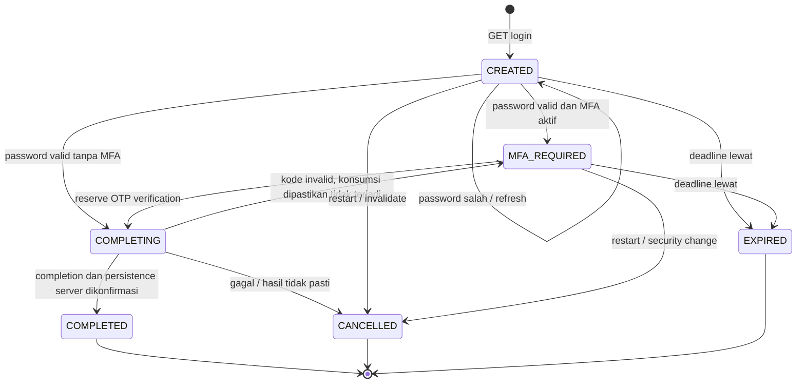

# GATE 1 — ADASI Login Transaction Flow Plan

Tanggal audit: 19 Oktober 2026. **Planning only; Gate 2 belum disetujui.**

Baseline tunggal: `master`, commit **`317dc0092bc8e08a8eeaca40803a7b327877b88d`**. Semua referensi source aplikasi di bawah mengacu pada commit ini, bukan branch lain atau snapshot laporan lama.

Label bukti: **VERIFIED** = dibaca pada sumber/config/ref yang disebut; **TESTED** = benar-benar dieksekusi pada audit ini; **INFERRED** = implikasi source yang belum direproduksi; **PROPOSED** = kontrak Gate 2; **NOT VERIFIED / NOT EXECUTED** = belum dibuktikan melalui lingkungan yang sesuai. VERIFIED source tidak berarti runtime/browser/produksi telah diuji.

## 1. Executive Summary

Internal Login Transaction Flow layak tanpa identity provider eksternal, OAuth/OIDC, paket baru, atau perubahan role/scope. Nilai utamanya adalah identitas percobaan yang sama pada password–MFA–redirect, penolakan form lama, satu klaim penyelesaian per transaksi, dan korelasi audit. Panjang URL bukan kontrol keamanan.

**Rekomendasi PROPOSED: Option C, authoritative cache record dengan session binding; satu flow aktif per logical browser session.** Gunakan primitive cache/lock Laravel yang sudah tersedia. Target deployment pertama adalah cache database bersama dan session database yang sudah didukung repo; tidak membuat tabel login baru. Dukungan driver/topologi tetap harus dibuktikan sebelum enable. Local `.env` saat audit menyatakan file/file, berbeda dari default/template database/database; tidak diubah pada Gate 1.

CSRF, password lokal, MFA opsional per role, replay guard TOTP/recovery, limiter lintas identitas, perilaku Turnstile login, session regeneration/revocation, known devices, concurrent-session controls, approval akun supplier, redirect guard dan splash tetap dipertahankan. Temuan penting adalah state pending MFA berupa singleton tanpa identitas form; completion beberapa tahap tidak merupakan transaksi atomik tunggal. Ada perbedaan pemeriksaan `account_status` antara password dan tahap sesudahnya. Ini temuan source, bukan klaim eksploitasi yang sudah direproduksi.

**Batas jaminan:** desain menargetkan at-most-one accepted completion claim per flow, bukan exactly-once seluruh side effect login atau jaminan respons sampai ke browser. Lock controller saja tidak memenuhi penerimaan concurrency. Koordinasi harus mencakup session load, rotasi, save dan cookie response; request lama harus ditolak sebelum menulis session/cookie lama.

Gate 1 menghasilkan rencana dan matriks verifikasi lengkap. Browser, feature suite, dan real-concurrency baseline **NOT EXECUTED** karena sandbox eksekusi yang diwajibkan skill belum tersedia. Pelaksanaan tersebut merupakan prasyarat Gate 2/enable, bukan PASS yang diasumsikan. Tidak ada autentikasi, konfigurasi, dependency, database atau deployment yang diubah.

## 2. Verified Master Baseline

| Bukti | Hasil audit |
|---|---|
| Repository | `https://github.com/poyipoy/supplierportal.git` |
| Branch saat mulai | `master` |
| HEAD/local master | `317dc0092bc8e08a8eeaca40803a7b327877b88d` |
| Remote-tracking `origin/master` | SHA yang sama |
| Remote aktual | `git ls-remote origin refs/heads/master` mengembalikan SHA yang sama; remote dihubungi langsung |
| Commit date | `2026-10-19T15:40:19+07:00` (08:40:19 UTC), author/committer diperiksa dengan `git show -s` |
| Subject | `feat(dashboard): implement dashboard layout editor, interface density system, and user preference enhancements` |
| Working tree awal | `git status --porcelain=v1 --untracked-files=all` kosong; `git diff --stat` kosong |
| Baseline verification method | Cocokkan HEAD, local master, tracking ref, dan remote advertisement; object SHA sudah tersedia sehingga tidak perlu fetch, checkout, reset, stash atau merge |
| Pembacaan source | `git show <SHA>:<path>`, numbered source reads; sumber working tree hanya dipakai setelah kecocokan clean baseline dipastikan |
| Framework terkunci | `composer.lock`: `laravel/framework v12.69.3`, source ref `58ea544a2a80dc03c168e13a5dc9a1d176a88717` |
| Framework pendukung | Installed `SessionGuard.php`, `Session/Store.php`, `Session/Middleware/StartSession.php`, `Routing/UrlGenerator.php` dan `Cache/DatabaseStore.php` dibandingkan secara tekstual dengan upstream pada ref lock tersebut; kelimanya cocok setelah normalisasi LF. Tidak mengeksekusi framework |

`AGENTS.md`, `CLAUDE.md`, framework kognitif Laravel dan instruksi yang relevan dibaca. Tidak ditemukan nested `AGENTS.md` pada area yang diperiksa. Penunjuk `app/Http/Middleware/CLAUDE.md` diperiksa. `customization-update` tidak dibuka, diperiksa diff-nya atau dijadikan referensi. SHA adalah latest remote yang tersedia saat observasi, bukan janji bahwa remote tidak akan berubah sesudah audit.

Laporan `docs/audits/LOGIN-URL-SELF-CONTAINED-RESEARCH-20261019.md` tersedia pada baseline dan dibaca seluruhnya. Klaim eksperimen di sana diperlakukan sebagai hasil historis, tidak dihitung sebagai tes Gate 1 ini. Source signed URL dicocokkan kembali; batas signature/expiry tetap berlaku.

## 3. Existing Authentication Architecture

### 3.1 Entry points, configuration and ownership

| Source baseline | VERIFIED responsibility |
|---|---|
| `routes/web.php:727–733` | GET `login` → create, POST `login.store` → store; `guest` dan `no-store` |
| `routes/web.php:741–745` | GET/POST MFA memakai `mfa.pending`, `no-store`; POST `auth.mfa-code`; group ini tidak memakai guest |
| `routes/web.php:759–760` | POST logout pada grup auth; nama route dipertahankan. `:326` adalah logout akses registrasi yang terpisah dan tidak diubah |
| `bootstrap/app.php:30–83` | HTTP routes web, middleware session/auth, web append dan aliases; event auto-discovery off |
| `config/auth.php:38–43` | Guard `web`, driver `session`, provider users |
| `resources/views/auth/login.blade.php:12–80` | POST + `@csrf`, email/password/remember, Turnstile bersyarat; tidak ada flow field |
| `resources/views/auth/two-factor-challenge.blade.php:12–19` | POST + `@csrf` + `code`; tidak mengirim identitas challenge/form/user |
| `config/auth_security.php:96–101` | Pending MFA 600 detik, window TOTP 1, delapan recovery codes |
| `config/auth_security.php:107–125` | Absolute timeout default 480 menit, concurrent-session cap default 3, known-device lifetime default 400 hari, audit retention 180 hari |
| `config/session.php` | Default driver database, lifetime default 120 menit; produksi menetapkan encryption, Secure, HttpOnly, SameSite Lax |
| `config/cache.php:18–54` | Default database; database/file stores dan lock configuration tersedia |

Middleware CSRF bawaan web ada pada framework `Configuration/Middleware.php:482–492`. Bootstrap aplikasi tidak mengecualikan login. Routing/middleware ini diinspeksi dari source; `route:list` tidak dieksekusi.

### 3.2 Verified lifecycle matrix

| Tahap | Responsibility, session keys, checks | Events/side effects dan coverage existing yang diinspeksi |
|---|---|---|
| 1. Anonymous GET login | `AuthenticatedSessionController::create():22–27`; guest, no-store; session locale dan `auth_turnstile_required` menentukan UI | `AuthenticationTest::test_login_screen_can_be_rendered`; `AuthSplashTest` clean/feedback cases |
| 2. Credential submission | `LoginRequest:27–65` normalisasi email Unicode/lowercase, rules email/password/remember/Turnstile; `:71–128` limiter sebelum password | Existing login security tests menguji normalisasi dan limiter; form CSRF belum dibuktikan via HTTP pada audit ini |
| 3. Failed credentials | Dummy hash path untuk unknown/inactive; syarat `is_active && account_status === ACTIVE` pada `LoginRequest:97`; gagal menaikkan limiter dan mengisi flash Turnstile/errors | `login_failed` atau `captcha_failed`; tarpit bounded; `LoginSecurityTest:20,67,134–239,351,381,399–461` |
| 4. Correct password, no MFA | `AuthenticatedSessionController:37–50` memanggil `CompleteLoginService`, mengambil `url.intended`, lalu safe redirect | AuthenticationTest normal/remember; audit success dari event guard; tidak eksplisit membersihkan pending MFA lama |
| 5. Correct password, MFA | `TwoFactorService:31–58` sanitasi intended, forget `url.intended`, forget guard user, regenerate session, simpan `auth.two_factor_pending={user_id,remember,intended,started_at}` | Tetap guest; tidak ada password di pending; `TwoFactorAuthenticationTest:19–43` |
| 6. MFA gagal/expired | `EnsurePendingTwoFactorChallenge:19–31` cek pending/deadline, clear dan redirect bila hilang/expired; `TwoFactorChallengeController:27–45` validate code, fresh user `is_active` + MFA enabled | `mfa_challenge_failed`; retry pada pending yang sama; expiry memakai `< now`, bukan `<=`; tests `:45–115` |
| 7. MFA berhasil | `TwoFactorService:133–174` transaksi DB + user row lock, `verifyKeyNewer`, simpan last step atau hapus recovery hash; controller `:48–56` clear pending, emit success, complete | `mfa_challenge_succeeded` / `mfa_recovery_code_used`, kemudian guard login; recovery/TOTP replay tests |
| 8. Auth completion/rotation | `CompleteLoginService:22–67`: request attr `auth_security.login_completed`, guard login, regenerate, `auth_session_version`, `auth_absolute_started_at`, known device, cap/remember rotation, notification, optional `ui.auth_splash` | `login_success`, new-device/cap events; `KnownDeviceSecurityTest`, `SessionSecurityTest`, `AuthAuditSecurityTest` |
| 9. Intended redirect | `TwoFactorService::safeIntendedUrl():275–322` cek scheme/host/port untuk absolute URL, lalu blok polling/API/document categories; bukan pengganti authorization destination | `AuthenticationTest:75–102`, `TwoFactorAuthenticationTest:77–99`; edge URL parsing belum diaudit menyeluruh |
| 10. Logout/reauth | controller `:70–87` guard logout → invalidate → regenerateToken → optional splash → login; security middleware juga invalidate saat timeout/revoked/deactivated | `logout`, `session_timeout`, `session_revoked`, `account_deactivated`; AuthenticationTest logout, SessionSecurityTest, AuthSplashTest |

Tabel ini merupakan VERIFIED source dan test inventory, bukan hasil eksekusi suite.

### 3.3 Remember, audit, splash and failure ordering

- `EnforceAuthSessionSecurity:31–45`: recalled MFA account pada HTML memulai challenge baru dengan `rotateRememberCookie=true`; JSON mengakhiri session. `TwoFactorService:42–47` logout/invalidate/regenerateToken sebelum pending baru. Non-MFA recall menggunakan perilaku guard existing; tidak memanggil completion interaktif dua kali.
- `AuthSecurityServiceProvider:39–44,65–67,100–112`: listeners didaftarkan eksplisit; limiter MFA berdasarkan user/pending user, bukan identitas flow. `LoginRateLimiter:203–240` menggunakan email+IP, email, IP, subnet dan global counters; flow baru tidak boleh memberi budget baru.
- Login Turnstile **gagal terbuka pada ProviderError** yang diaudit: `LoginRequest:76–88` hanya menolak `Invalid`; `TurnstileVerifier:42–58` mengembalikan ProviderError untuk server/connection error. Existing tests `LoginSecurityTest:183–229` secara eksplisit menetapkan perilaku ini. Jangan mengimpor fail-closed registrasi ke login sebagai efek samping.
- Guard versi terkunci `SessionGuard:567–604` mengisi session dan `regenerate(true)`, menyiapkan recaller, memancarkan Login event, kemudian setUser. `CompleteLoginService:27` melakukan regenerate tambahan. Stable session attribute bertahan; raw session ID berubah lebih dari sekali.
- Audit `LogAuthenticationEvent:25–35` menulis login_success saat guard Login event; untuk recalled MFA sebelum completion event itu disaring. `AuthAuditLogger:15–28` metadata allowlist belum berisi flow correlation; write errors ditangkap `:36–52`.
- OTP/recovery consumption commit **sebelum** `CompleteLoginService`. Login audit, known-device DB write, session eviction, remember token, cache flow dan persistence session bukan satu transaksi atomik. Ordinary audit/device/delivery errors sebagian ditangkap (`KnownDeviceService:30–52`, `NotificationService:97–115`); jangan menyatakan semua notification errors pasti menggagalkan login. Session-inventory/storage failures tetap dapat muncul sesudah guard login.
- `ShareAuthSplashState:124–130` menerima issuance hanya dari named POST login/MFA/logout. Pending MFA menghalangi post-login splash (`:164–169`); feedback mencegah splash menutupi error (`:175–197`). `config/ui.php:4–11`: default off, pending TTL 30 detik, min 2000 ms. `resources/js/auth-splash.js` mempertahankan readiness, reduced-motion, inert/focus/body-busy dan loader token semantics. Flow bukan splash marker dan tidak menjadi bukti autentikasi.

## 4. Baseline Test Findings

### 4.1 Safety assessment and execution status

**Tidak ada target-controlled PHP, Artisan, PHPUnit, Node, browser harness atau DB query yang dieksekusi pada Gate 1 ini.** Local OS memiliki `wsl.exe`, tetapi keberadaannya tidak membuktikan sandbox tanpa jaringan eksternal, read-only source/toolchain, environment allowlist dan resource limits. Docker/WindowsSandbox executable tidak ditemukan pada command lookup. Sandbox yang memenuhi semua kontrol belum terverifikasi.

Skill `.agents/skills/security-audit/SKILL.md`, bagian Universal execution safety: “If every control cannot be enforced, do not execute target code”. User juga melarang perubahan DB, test permanen dan semua perubahan selain dokumen ini. Karena itu audit tidak menjalankan existing RefreshDatabase suites terhadap DB lokal. Ini bukan auto-review rejection atau tes gagal; statusnya **NOT EXECUTED — isolation prerequisite unmet**.

`phpunit.xml:21–44` menyetel MySQL `adasi_portal_test`, array session/cache, array mail dan null broadcast. Itu konfigurasi file, bukan bukti koneksi aktif aman. `AuthenticationTest:12`, `TwoFactorAuthenticationTest:17`, LoginSecurity/AuthAudit tests memakai RefreshDatabase. Array cache/session single process tidak membuktikan real concurrency. `TestingEnvironmentDatabaseSafetyTest:15–33` dan guard `AppServiceProvider:82–97` diinspeksi, bukan dijalankan. Bahkan safety test memiliki event simulasi destructive command; tidak diperlukan untuk document-only verification.

### 4.2 Required baseline scenarios

Semua kasus berikut **NOT EXECUTED**. Kolom source bukan reproduksi. Gunakan dua cookie jars nyata dalam disposable isolated HTTP harness; jangan mengandalkan test client yang mempertahankan user guard tanpa request reset.

| ID / Skenario | Pengamatan source / baseline hypothesis | Fixture dan hasil yang harus direkam |
|---|---|---|
| B01 Dua login tabs, session sama | Form tidak memiliki identity percobaan | Jar sama, dua HTML snapshots; CSRF, session rotations dan response cookies |
| B02 Submit tab pertama | No MFA langsung login, MFA hanya staged | Account A active; record user/guest, redirect, pending, audit |
| B03 Submit tab kedua | Setelah cookie berubah, guest redirect atau stale-CSRF dapat mendahului controller | Submit snapshot lama dengan cookie terbaru dan cookie lama secara terpisah; jangan menebak status |
| B04 Dua MFA account berbeda | Pending key singleton dapat diganti ketika credential submit masih guest | A/B memakai secret berbeda, intended berbeda dan remember berbeda; record pending identity tanpa secret |
| B05 Complete MFA tab lama | POST hanya code mengacu pada pending terkini | OTP A ketika pending B; wajib pastikan tidak menganggap tab A memberi proof A bagi B; source menyiratkan code A ditolak untuk secret B, runtime belum dibuktikan |
| B06 Refresh MFA | Tidak ada state transition pada show; timeout tetap | Fresh/near-expired/expired pending; deadline tidak diperpanjang oleh refresh |
| B07 Browser back ke login lama | No-store bukan jaminan bfcache/history tidak menampilkan snapshot | Back/forward, restored form dan autofill; rekam UI/error/splash |
| B08 Old POST sesudah regenerate | CSRF rotates saat regenerate pada versi framework ini | Simpan form token lama, gunakan cookie baru; expected security: tidak menerima proof dari konteks berbeda |
| B09 URL pada browser lain | Baseline `/login` memang public; MFA memerlukan pending session | Jar kedua bersih; normal login boleh, pending/challenge milik jar pertama tidak boleh diwarisi |
| B10 Login overlap request lain | Tidak ditemukan route block/global shouldBlock pada baseline | Barrier dua proses; completion versus second login, logout, locale/polling/document; amati stale session write dan cookie order |

Tambahan: A MFA pending lalu B non-MFA; A/B intended `/profile` vs halaman authorized lain; remember true/false dan recall MFA/non-MFA; disable/status/version/password/MFA changes di antara tahap. Uji dengan fake outbound HTTP/mail/broadcast, bukan real Turnstile atau akun nyata.

### 4.3 Finding classification

| Temuan | Klasifikasi saat Gate 1 |
|---|---|
| Pending singleton; form MFA tidak membawa correlation identity | **Architectural limitation — VERIFIED source** |
| Non-MFA completion tidak membersihkan pending MFA existing | **Architectural limitation — VERIFIED source**; dampak tab/splash **INFERRED / NOT VERIFIED** |
| Pemeriksaan account_status ACTIVE tidak konsisten setelah password | **Verified source gap / Potential risk**; bukan confirmed authentication bypass |
| Race deaktivasi/revocation setelah user check | **Potential risk**, memerlukan deterministic fixture |
| Double completion, stale-cookie overwrite, multi-tab UX failure | **NOT VERIFIED**, belum direproduksi |
| Confirmed defect / Reproduced UX limitation | **Tidak ada yang dinyatakan reproduced** dalam audit ini |
| Not reproduced | Tidak dipakai sebagai pengganti NOT EXECUTED; belum ada eksperimen yang dapat menyanggah hipotesis |

## 5. Problem Statement & Evidence

Kebutuhan adalah lifecycle percobaan login yang dapat diidentifikasi, bukan perubahan metode autentikasi atau pengamanan melalui URL panjang. Baseline sudah melindungi banyak kondisi: tidak sah mengklaim login belum punya CSRF, timeout MFA, OTP replay guard, audit, limiter atau session rotation.

Evidence gap yang flow bisa tangani: `auth.two_factor_pending` tunggal tanpa correlation form; intended berasal dari session; no-MFA dan MFA memiliki cleanup berbeda; audit lintas tahap belum memiliki transaction correlation. Scope flow harus menegakkan hubungan tersebut dan stale-stage/duplicate-completion contract. Menyatakan benefit keamanan terukur memerlukan tes Gate 2.

Source mismatch spesifik: password `LoginRequest:97` mensyaratkan ACTIVE, controller MFA `:34` hanya active + MFA, verifier user lock `TwoFactorService:138–141` hanya MFA, `CompleteLoginService:22–27` tidak revalidate. Middleware session `:27` juga hanya is_active. Desain completion menambahkan pemeriksaan final user/status/security-version pada batas trusted yang sama; tidak mengubah supplier approval/role/scope policy. Perubahan session middleware di luar jalur login perlu review terpisah, bukan refactor oportunistik.

Acceptance yang membedakan manfaat baru dari baseline: old-flow POST ditolak sebelum credential/OTP consumption; flow terminal tidak dapat diklaim lagi; password/MFA memilih intended yang sama; satu accepted claim pada overlap nyata; audit memiliki correlation tanpa rahasia; failed/fresh/expired flow menghasilkan error yang dapat dimengerti.

## 6. Architecture Alternatives

### 6.1 Comparison

| Criteria | A — Existing auth + targeted fixes | B — Flow dalam session | C — Authoritative cache flow | D — Dedicated DB flow |
|---|---|---|---|---|
| Security | Baseline controls tetap; per-form identity belum ada | Session binding alami; opaque ID dan stage checks | Opaque ID + owner/epoch/state/deadline terpusat | Sama dengan C + durable relational constraints |
| Replay | OTP guard existing; belum explicit completion claim | Lost updates bila dua request membaca payload sama | Shared lock + unique completion claim/tombstone; miss fails closed | Conditional update/row locks/unique claims |
| Complexity | Paling rendah | Rendah sampai concurrency/session rotation masuk scope | Menengah; satu service dan scoped session coordinator | Lebih tinggi: model/schema/index/pruning/rollback |
| Performance | Baseline | Payload session bertambah, session serialization | Cache lookup/lock/read/write + bounded coordinator lookups; ukur p50/p95 | INSERT/SELECT FOR UPDATE/UPDATE tiap tahap; DB retention |
| Storage | Existing session/audit | Existing session, bounded map | Cache TTL records + hash aliases; session menyimpan secret owner/reference | Tabel baru persistent; migrasi additive, indeks expiry/owner/state |
| Concurrency | Baseline tidak mengklaim serialization | DB session driver sendiri tidak cukup; `pull` bukan CAS | Atomic claim memungkinkan authority di luar payload session; tetap perlu session fence | Atomic DB transitions tetap tidak mengatomikkan cookie/session/network |
| Compatibility | Tertinggi | Session regeneration preserve attrs; invalidate clears | Stable owner survives permitted rotations; invalidation cancels | Foreign key/deletion/retention/user changes perlu desain |
| UX | Perbaiki kasus yang dibuktikan saja | Stale checks mungkin; duplicate context bisa overwritten | Deterministic active flow/expired/restart/duplicate semantics | Sama; persistent history bukan kebutuhan pengguna saat ini |
| Deployment | Tidak ada store baru | Bergantung session dan request locking | Shared consistent store + atomic locks/claim; tidak boleh array/null/failover-array | DB privileges/migrations, backup, cleanup dan availability |
| Testing | Characterization/regression existing | Array tests mudah tetapi tidak prove overlap | Shared real store dua proses + HTTP cookie tests | Real MySQL transactions/concurrency dan migration tests |
| Rollback | Kecil | Feature off hapus/abaikan namespace session | Feature off, batalkan pending, expire namespace; auth sessions valid dipertahankan | Feature off dulu; jangan drop tabel saat code lama mungkin aktif |

A tetap fallback operasional yang benar jika bukti manfaat/host prerequisites tidak terpenuhi. B tidak dipilih untuk jaminan lintas request karena session read-modify-write dan SID rotation memerlukan shared synchronization juga; session map saja tidak menjadi authoritative ledger. D tidak dipilih karena durabilitas histori flow jangka panjang belum menjadi kebutuhan; database cache/locks yang sudah didukung cukup sebagai kandidat transient store. D baru ditinjau ulang jika persyaratan durable transaction receipt atau atomic OTP+flow DB commit benar-benar diperlukan; bukan otomatis dibuat pada Gate 2.

### 6.2 Actual store evidence and lock semantics

- **VERIFIED config:** `.env.example` menggunakan session/cache database; config defaults sama. Local allowlist read hanya `SESSION_DRIVER=file`, `SESSION_LIFETIME=120`, `CACHE_STORE=file`; cached config file `bootstrap/cache/config.php` tidak ada. Ini bukan inspeksi secret atau produksi.
- Cache database table + locks migration sudah ada (`database/migrations/0001_01_01_000001_create_cache_table.php`). File presence bukan bukti ledger/physical tables terpasang.
- `SessionInventoryService:75–78` selalu membaca SQL sessions table. Local file session tidak menjadikan cap/inventory SQL otomatis mewakili live file sessions. Produksi driver/efektivitas cap **NOT VERIFIED**; enable mensyaratkan database session atau proof adapter existing yang sesuai, bukan diam-diam mengklaim cap berhasil.
- Framework `StartSession:74–98,109–131`: request blocking lock key memakai incoming SID; lock diambil sebelum load dan dilepas setelah save. Tanpa opt-in, request session dapat berjalan paralel. Controller `finally` selesai sebelum normal session save.
- Framework `Store:605–641`: regenerate/migrate mempertahankan attributes; invalidate flushes. `Cache::pull` adalah get lalu forget; `session()->pull` mengubah payload request yang telah dimuat, bukan global atomic consumption.
- Laravel [session blocking](https://laravel.com/docs/12.x/session#session-blocking) dan [cache locks](https://laravel.com/docs/12.x/cache#atomic-locks) mendukung primitive ini, tetapi multi-host memerlukan common authoritative store. Array store tidak lintas proses; local file tidak lintas host. File miss/expiry/flush berbeda dari klaim LRU eviction yang tidak dibuktikan.

## 7. Recommended Architecture & Rationale

**Pilih C untuk rencana Gate 2, pending approval**, dengan satu active flow per logical pre-auth browser session, ephemeral cache authority dan minimal session-bound reference. Tidak memakai generic repository/interface, provider OAuth, JWT, registry package, tabel baru atau protokol PKCE palsu.

Kontrak yang dipilih:

1. Feature flag `auth_security.login_transaction.enabled` default false; saat false jalur lama tetap berjalan dan pending flow-enabled dibersihkan saat cutover terkontrol. Jangan fallback ke login tanpa flow saat storage sedang gagal tetapi flag masih on.
2. GET `/login` membuat/resume flow yang sama jika masih CREATED; query `?flow=<opaque-id>` menunjuk flow; setelah password valid, tujuan MFA menyertakan flow yang sama. POST membawa hidden `flow` dan CSRF; tidak memproses password/OTP pada invalid flow. URI dan nama route existing tetap.
3. URL hanya memiliki public flow identifier, 32 random bytes encoded base64url tanpa padding (43 karakter, validasi exact alphabet/length). Ini bukan session ID/CSRF/bearer. Context, user setelah proof, remember dan intended disimpan server-side. Tidak perlu `expires`, `signature`, `client_id`, `state`, `code_challenge`.
4. One-active policy: dua tab awal resume flow yang sama. Setelah MFA_REQUIRED, credential form lama tidak dapat mengganti account/context; harus restart eksplisit melalui POST yang terlindung CSRF. Restart membatalkan flow lama dan membuat ID baru. Tidak membuat akun berbeda per tab. Latest-completion wins antar akun bukan perilaku yang dituju.
5. Initial target is existing **database cache + database session**, not general default failover. Reuse existing tables; bila store belum provisioned, jangan enable atau menjalankan migrasi otomatis. Single-host file support hanya opsi evaluasi kemudian dengan bukti isolation/locks/cap yang setara; bukan release target tersirat.
6. Satu `LoginTransactionService` mengelola payload/transition/claim; satu integration component pada session lifecycle diperlukan agar locking tidak berhenti di controller. Rincian batasnya di §11, dan menjadi misi verifikasi pertama. Jika perlu rewrite session engine atau tambahan persistent auth cookie, berhenti dan minta review desain; jangan menyembunyikannya sebagai implementasi kecil.

Signature optional dievaluasi dan **tidak dipilih**. Semua security context sudah server-side; signature tidak memberi one-use/browser binding. Laravel menyatakan ia memverifikasi URL “has not been modified since it was created”. Expiry hanya batas waktu. Signature menjadi berarti bila kelak ada parameter immutable yang dibawa client; parameter itu tetap harus divalidasi sebelum signing. [Laravel signed URLs](https://laravel.com/docs/12.x/urls#signed-urls).

## 8. Transaction State Machine

### 8.1 State, payload and bounds

States persisten minimum: **CREATED, MFA_REQUIRED, COMPLETING, COMPLETED, EXPIRED, CANCELLED**. PASSWORD_VERIFIED tidak disimpan sebagai reusable proof state untuk non-MFA; keberhasilan password langsung mengklaim completion di request yang sama. EXPIRED dapat menjadi computed terminal status pada read + tombstone, bukan mandatory DB enum.



PROPOSED payload version `1`: hashed flow lookup, owner reference hash, owner generation, state, created_at, expires_at, optional mfa_started_at/mfa_expires_at, user ID setelah password/recaller proof, remember boolean, safe intended relative URL, credential proof source (`password`/`recaller`), snapshot auth_session_version dan keyed fingerprint password+MFA configuration, safe audit correlation, completion attempt nonce/phase/result timestamps. Tidak menyimpan password, OTP, recovery plaintext, session IDs mentah, recaller token atau Turnstile token. Fingerprint server-side tidak dikirim/logged; bukan pengganti fresh validation.

PROPOSED lifetimes: CREATED maksimum 600 detik sejak pembuatan; masuk MFA sebelum deadline memberi MFA deadline tetap `mfa_started_at + 600`, menjaga existing 10-minute challenge allowance; upper bound flow 1200 detik. Refresh/failed submit tidak sliding-extend. Expiry baru `now >= expires_at`; equality boundary berbeda dari baseline dan harus diuji/dinyatakan. Maksimum 1 active flow per owner, maksimum 2 terminal receipts yang dapat diresume hanya sebagai pesan (tanpa authentication) selama 600 detik; aliases/tombstones minimal session lifetime 120 menit + enforced request maximum 30 detik + 60 detik margin, disesuaikan live config. Tidak menyimpan histori login di cache melampaui kebutuhan replay fence; audit tetap retensi existing.

### 8.2 Transition contract

| Transition / trigger | Allowed prior, validation/context | Retry, expiry, concurrency | Audit dan recovery |
|---|---|---|---|
| Create/resume GET | No active → CREATED; guest, valid session, allocation limit; snapshot sanitized intended, locale | Resume tidak mengganti context/deadline; bounded owner lock; no proof consumed | flow_created sekali; invalid query jangan lookup metadata akun |
| Wrong password | CREATED; valid owner/generation/CSRF; existing limiter/Turnstile/password path | Tetap CREATED; original deadline; increment existing buckets; no fresh-flow budget | Existing login_failed/captcha_failed + correlation; password tidak flash |
| Password → MFA | CREATED; fresh eligible account, MFA snapshot, intended+remember dibekukan | Owner lock + transition; old credential POST ditolak sebelum hash; session regenerate tetap sah | Existing pending diselaraskan dengan flow reference; flow_mfa_required |
| Password → claim | CREATED; credentials valid, fresh active/ACTIVE/version/fingerprint under user check | Write acknowledged unique claim sebelum auth side effects; losing request tidak complete | flow_completion_claimed; failure setelah claim terminal restart |
| MFA reserve/invalid | MFA_REQUIRED → COMPLETING; matched pending/flow/user/deadline + user limiter | Reserve sebelum verifier; invalid dengan confirmed no consumption boleh return MFA_REQUIRED milik attempt sama; jangan reset limiter/deadline | mfa_challenge_failed; indeterminate DB outcome → CANCELLED, bukan reusable proof |
| MFA valid | COMPLETING milik attempt; row-locked TOTP/recovery rules existing, recheck eligibility/version | Kode consumed sekali; jangan rollback state ke MFA_REQUIRED setelah consumption diketahui/meragukan | Existing mfa success/recovery event dengan completion result terpisah |
| Finalize | COMPLETING; claim owner/epoch valid, account still eligible, completion path, server session save success | Tidak ada second owner takeover/retry CompleteLoginService; mark COMPLETED hanya setelah persistence acknowledgement | flow_completed; response lost tetap consumed, user membuka login lagi |
| Expire | CREATED/MFA_REQUIRED; server clock absolute | No credential/OTP processing, no deadline refresh | flow_expired pada attempted use sekali; cache disappearance sama-sama restart |
| Cancel/restart/logout | CREATED/MFA_REQUIRED; CSRF restart atau server invalidation | Cancel old, new owner/flow after invalidate; COMPLETING tidak dibatalkan/diganti paralel | flow_cancelled reason allowlist; no old binding resurrection |

GET tidak menyelesaikan autentikasi atau mengonsumsi proof. POST restart baru hanya jika disetujui sebagai route tambahan `login.restart`, terbatas guest/pending, no-store dan creation limiter. Tanpa itu gunakan form restart yang diarahkan ke existing POST dengan action tervalidasi; pilih satu saat review route M01, bukan kedua jalur paralel. Rekomendasi rencana ini: route POST terpisah agar kontrak login.store tetap jelas.

## 9. Session Binding Strategy

Generate secret owner reference 32 random bytes pada server di session `auth.login_transaction_owner`; cache menyimpan keyed hash/reference, bukan secret mentah. Public flow ID terpisah. Pemeriksaan harus cocok pada owner, generation, expected active flow dan stage; perbandingan string sensitif constant-time. IP/User-Agent hanya anomaly data, tidak dipakai sebagai binding wajib karena NAT/proxy/mobile berubah.

| Existing transition | Binding behavior PROPOSED |
|---|---|
| Pre-MFA `session()->regenerate()` | Attributes bertahan, owner tetap; coordinator memperbarui alias/generation untuk ID baru, menolak ID lama |
| Guard login `regenerate(true)` lalu explicit regenerate | Owner tetap untuk request pemenang; bind final session setelah persistence, semua old aliases tombstoned; user auth metadata tetap |
| Remember-MFA logout + invalidate | Old owner/flow terminal, secret lama hilang; buat owner dan MFA flow baru hanya dari trusted recaller account setelah pipeline existing berjalan; jangan restore secret lama dari URL/cache |
| Logout / timeout / revocation | Cancel active flow/owner generation sebelum invalidate jika tersedia; inactive alias tidak boleh merekonstruksi session; pending proof dibuang |
| Cookie hilang/berubah/different browser | URL saja ditolak sebagai resume; tampil restart biasa, tidak mengimpor pending user atau intended privat |
| Session expiry | Missing owner adalah gagal binding; jangan merekonstruksi PASSWORD_VERIFIED/MFA_REQUIRED dari cache saja |
| Non-MFA remembered automatic auth | Pertahankan guard recall existing; tidak membuat flow dari query/menjalankan CompleteLoginService lagi. Flow interaktif lama dibatalkan/dibersihkan bila browser sudah authenticated |

Stable binding attribute berbeda dari raw SID. Server-only SID alias dibuat memakai HMAC SID sebagai lookup, tidak pernah dipublikasikan. Alias hanya membantu koordinasi/freshness; ia bukan bukti autentikasi. Setelah session load tetap harus memeriksa secret owner. Meneruskan URL flow dari attacker session ke victim session tidak boleh memindahkan owner atau intended.

Satu active flow dipilih karena cookie auth memang dibagi tabs, existing pending singleton dan kebutuhan minimum adalah menolak penggantian konteks diam-diam. Multi-independent-flows menambah cancellation/cap/conflict state dan tidak menyediakan independent accounts; ditolak untuk fase pertama. Tradeoff UX: tab kedua melanjutkan flow aktif atau mendapat stale/restart message, bukan bebas mengganti akun sambil pending MFA.

## 10. MFA Integration Design

Kedua controller interaktif wajib melewati `LoginTransactionService` dan common completion contract. `CompleteLoginService::complete(Request, User, bool)` tetap menjadi titik session/security/splash existing; jangan menyalin isinya ke controller. Existing non-login pemanggil public TwoFactor methods tetap kompatibel.

Pending session lama tetap tersedia sebagai adapter bagi middleware/provider/splash, tetapi diperluas dengan `flow_id` reference dan credential security snapshot. Authoritative context dari cache; mismatch pending/cache/POST ditolak, tidak dipilih salah satunya secara diam-diam. Metadata user/remember/intended tidak diambil dari hidden input.

Urutan MFA PROPOSED: validate flow/owner/stage/expiry + CSRF → account-keyed limiter → reserve completion attempt → fresh user under existing user lock → recheck `is_active`, ACTIVE, expected auth_session_version, credential/MFA fingerprint → existing TOTP newer-step/recovery consumption → verify eligibility/claim still valid → common completion. No-MFA menjalankan pemeriksaan final yang sama setelah password valid, langsung claim+completion. Jangan menerima perubahan MFA dari enabled ke disabled di antara tahap sebagai izin melewati challenge; cancel/restart.

Jangan menambah password/OTP storage atau reusable `mfa_passed=true` yang dapat diresume sesudah kegagalan. Jika kode valid sudah dikonsumsi tetapi completion gagal, transaksi terminal; user mulai ulang dan memakai TOTP pada step berikutnya atau recovery code lain. Recovery terpakai tidak dimasukkan kembali. Jika persistence OTP ambigu, gunakan kebijakan yang sama. Jika kode invalid dan diketahui tidak ada konsumsi, pending kembali MFA_REQUIRED dengan deadline semula.

Account deactivate/status/version/password/MFA changes harus diperiksa pada batas final. Row lock memagari perubahan yang berpartisipasi pada transaksi DB yang sama; jangan menahan transaksi DB saat network notification atau mengklaim lock itu melindungi session/cache. Bila eligibility berubah sesudah commit pada request lain, existing revocation/session middleware tetap berlaku; tidak ada janji distributed atomic revocation tanpa bukti writer contract.

Reminder compatibility: MFA recalled HTML memulai flow baru setelah invalidation; AJAX tetap existing terminate behavior. `remember` value dibekukan dari credential request atau trusted recaller path, tidak dapat dinaikkan lewat MFA POST. MFA limiter harus resolve authenticated/pending user dari verified flow sebelum memilih bucket; invalid flow memakai bounded guest/IP protection. Jangan memasukkan flow ID ke email/IP/user limiter keys.

## 11. Atomicity & Concurrency Strategy

### 11.1 Invariants and storage contract

I1: flow ID tidak memberikan authentication atau akses MFA tanpa session owner, CSRF dan proof yang sesuai. I2: transaksi terminal tidak bisa kembali CREATED/MFA_REQUIRED. I3: setiap flow memiliki paling banyak satu accepted successful completion claim. I4: request lama tidak dapat memulihkan proof/pending/owner lama; request yang masih berada dalam coordination boundary sebelum cookie emission tidak boleh menimpa login pemenang. I5: original limiter keys tidak berubah. I6: setiap guard completion memakai user snapshot yang fresh dan eligible. I7: metadata security/splash existing tidak hilang. Respons yang sudah keluar dari boundary sebelum enrollment memiliki batas terpisah yang dijelaskan di bawah.

Cache record authoritative, session hanya reference/adapter. Key namespace versioned, scoped application dan environment; hash public ID sebelum key, HMAC binding/SID untuk aliases, tidak memuat email atau user ID pada URL. Gunakan satu store eksplisit untuk record, owner generation, terminal marker dan locks. **Dilarang failover ke array/null, per-host cache saat multi-host, global cache flush untuk cleanup, dan menganggap `pull()` atomic.** Database cache records bukan DB transaction bersama user/OTP/session.

PROPOSED completion claim memakai primitive atomic `add` pada key attempt per flow, ditambah owner lock/state check; successful claim marker tidak dihapus sebelum flow deadline + replay retention. Database `add` memakai constraint unique cache key; primitive harus dibuktikan pada installed driver. Rejected/invalid MFA reserve terpisah dari successful-consumption marker: reserve boleh kembali pending hanya bila verifier dipastikan tidak mengubah proof. Setelah proof sukses, unique successful claim/COMPLETING tidak boleh dibuka lagi. Implementasi harus menuliskan claim authoritative sebelum guard login; state update dan marker failure bersifat fail-closed. Jika cache kehilangan record/marker secara parsial, jangan menganggap kondisi itu sebagai flow baru atau kesempatan retry: consistency mismatch memaksa cancel/restart. Gate 2 harus menguji partial deletion, bukan hanya full cache flush.

Atomic add bukan pengganti lock yang melindungi snapshot record mutable. Pada pinned `Cache/DatabaseStore.php:212–223`, MySQL path memakai `insertOrIgnore` dan primary cache key; yang dibuktikan adalah source primitive, bukan concurrency deployment. Write path harus menyatakan expected owner generation/state/attempt. Wajib memeriksa return value setiap cache write. Satu claim yang timeout tidak boleh diambil alih worker lain untuk menjalankan CompleteLoginService lagi; stale COMPLETING berakhir CANCELLED/restart. Cache/lock outage saat feature on mengembalikan unavailable/restart, tidak menonaktifkan feature otomatis.

### 11.2 Required session coordination boundary

Rencana komponen: `app/Http/Middleware/CoordinateLoginTransactionSession.php`, adapter sempit untuk `StartSession` di `bootstrap/app.php`, feature-gated. Ia harus tetap menggunakan Laravel session manager/handler; tidak membangun session engine, token cookie atau serializer baru. Disabled path langsung delegate parent. Enabled path hanya melakukan coordination untuk auth entry dan session yang sedang/baru terdaftar pada auth-flow cohort; tidak mengubah authorization modules.

Algoritme PROPOSED yang harus dibuktikan pada M01/M02:

1. Setelah cookie decryption dan sebelum session load, baca **incoming session cookie**, bukan flow query, untuk lookup trusted SID alias → owner reference/generation. Tidak membaca `request->user()` sebelum StartSession. Jangan memakai flow milik orang lain untuk memilih lock owner; ini dapat menciptakan lock-contention abuse.
2. Auth entry yang belum memiliki alias memakai bounded initial SID lock. No-cookie first visit membuat session/owner baru; dua request tanpa cookie tidak dianggap satu browser session sampai cookie bootstrap selesai. Fresh-visit race ini harus memiliki UX restart yang aman.
3. Untuk enrolled SID, acquire owner lock sebelum load, re-read generation/alias setelah memperoleh lock, lalu load session dan cek secret owner. Unknown/retired/terminal mismatch tidak diterjemahkan menjadi resumed proof. Session rotations diperbolehkan hanya oleh active winner dan dicatat pada request context.
4. Tahan owner coordination sampai controller, inner middleware, session save dan response cookie preparation selesai. Transisi tidak dilindungi hanya oleh lock dalam controller. Mapping final SID dipasang sebelum response keluar; incoming/intermediate retired aliases diberi tombstone. Retry dengan old SID tidak dialihkan ke authenticated session baru dan tidak menerima cookie penggantinya.
5. **Late-writer fence:** request non-auth yang sudah load sebelum enrollment/rotation harus lookup ulang incoming SID alias/generation tepat sebelum session write/cookie emission. Jika baru terdaftar atau generation sudah berubah, discard stale session mutation dan hilangkan session/recaller Set-Cookie request itu. Jangan mengirim expired cookie yang justru menghapus cookie pemenang. UI document dapat menampilkan restart link; AJAX memakai 409/401 sesuai apakah masih authenticated. Background request tidak mengonsumsi flow/splash.
6. Request pada session final dapat berjalan normal setelah auth-coordination window, tetapi retained aliases/tombstones tetap menolak request lama. Fresh user session tidak dibangun dari alias saja. Cleanup tidak boleh menghapus tombstone ketika masih ada request yang dapat menulis SID lama.
7. Standard parent save/handler errors dan queued auth cookies harus ditangani pada boundary yang sama. Untuk failed/unknown completion, jangan kirim success redirect/splash/recaller. Unqueue hanya cookie auth/device yang diterbitkan request gagal, bersihkan guard lokal dan session baru miliknya; jangan logout global atau menghapus session pemenang request lain.

Semua session writers dalam cohort melewati pre-save fence, termasuk auth GET, MFA, locale/document/polling dan security/logout paths; exception response juga diuji. Untuk writer yang sudah berjalan sebelum cohort muncul, pemeriksaan generation pada save wajib bekerja tanpa mengandalkan snapshot awal. Lock order konsisten: incoming SID bootstrap gate jika diperlukan → owner/flow coordination → user row lock; tidak acquire lock terbalik pada logout/cleanup. Tidak ada user DB transaction yang menunggu network delivery.

Ini lebih kuat daripada `->block()` saja. Raw-SID lock melindungi request yang memakai SID sama, tetapi identitas lock berubah ketika regenerate; request yang sudah membaca payload dan respons yang tiba tidak berurutan tetap membutuhkan fence. Lock melindungi data, bukan urutan TCP response browser. Hilangkan cookie dari stale loser yang masih berada dalam boundary untuk mencegah overwrite; jika tidak terbukti, enable diblokir. Jangan menambahkan global serialization permanen untuk semua authenticated user sebagai jalan pintas.

**Batas yang tidak dapat ditarik kembali:** respons yang selesai dibentuk/dikirim sebelum cohort enrollment dapat tertunda di jaringan dan kemudian membawa Set-Cookie lama. Server tidak dapat mencabut header yang sudah dikirim. Desain ini tidak menjanjikan bahwa authenticated cookie pemenang selalu bertahan terhadap respons seperti itu. Jika cookie lama kembali, tombstone/freshness check harus mencegah proof lama dipakai dan memberi jalan reauthenticate; kemungkinan kehilangan kontinuitas UX tetap residual. T28 memisahkan overlap di dalam fence (winner tidak ditimpa) dari already-issued response (tidak ada auth/proof resurrection, restart dapat diperlukan). Menyelesaikan urutan semua cookie lintas respons yang sudah terbit memerlukan protokol browser/session lebih luas dan bukan benefit yang diklaim flow ini.

Lease PROPOSED 60 detik, acquire wait maksimum 2 detik; server wajib hard-bound request worker maksimum 30 detik dan outbound verifier timeout existing 3 detik. Angka lease bukan bukti correctness: jika hard bound tidak dapat ditegakkan, atau proses dapat terus menulis sesudah lease hilang, jangan enable. Attempt/generation fence tetap diperiksa sebelum guard/write. Tidak ada lease takeover untuk flow yang sudah proof-consumed. Slow request/lock contention menghasilkan pesan retry tanpa konsumsi proof. Profil latency gate: ukur extra cache round trips dan p95 pada worker/DB nyata; tidak ada angka performa yang diklaim hasil ukur.

### 11.3 Completion/failure ordering

| Failure point | State/side effects yang mungkin sudah terjadi | Required recovery PROPOSED |
|---|---|---|
| Store/lock unavailable sebelum verifier | Belum ada proof consumption | Tolak dengan 503/try again; jangan hash/OTP/guard; batas limiter abuse tetap |
| Password valid, claim write gagal | Hash check mungkin selesai, belum login | Guest; restart/try again sesuai definite state; no cached password proof |
| Invalid OTP, no DB mutation | Reserve saja | Return MFA_REQUIRED hanya dengan attempt owner valid; retry bounded dan original deadline |
| Valid OTP/recovery commit, state write/claim uncertain | Proof dapat sudah terpakai | CANCELLED/unknown terminal; jangan pakai proof yang sama untuk retry; restart |
| Claim accepted, sebelum guard login crash | COMPLETING/claim tetap | Tidak execute ulang dari URL; bounded expiry → restart |
| Guard login lalu known-device/cap/remember failure | Session in memory, audit/device/token/eviction bisa sudah terjadi | Clear local guard/new session/queued recaller, cancel transaction; audit completion_failed correlated; jangan rollback OTP atau menghidupkan sesi yang dieviction |
| Ordinary notification/audit write fails and is caught | Auth pipeline dapat tetap sukses | Ikuti failure isolation existing; safe operational logging, bukan resend login atau duplicate proof |
| Session persistence throws/ack gagal | Flow claimed; guard/DB side effects bisa ada | Suppress cookie/success response; invalidate only new candidate session bila dapat dibuktikan milik request; terminal restart |
| Session saved, terminal cache write fails | Server session mungkin sudah ada, browser belum diberi cookie | Revoke candidate server session/unqueued recaller jika possible; no success; terminal claimed flow tidak direplay; jangan mengklaim rollback total |
| COMPLETE response lost | Server login dan consumption bisa sukses tanpa browser menerima cookie | Terminal receipt tidak pernah menjadi login capability; next GET memakai cookie yang benar jika ada atau mulai ulang |
| Logout saat completion berjalan | Owner coordination menentukan satu urutan | Logout sesudah winner save mengakhiri session; stale completion tidak menghidupkan sesi/cookie lama |

Store acknowledgement berarti server handler berhasil menyimpan; bukan jaminan disk durability/browser delivery. Pinned `Session/Store.php:181–191` memanggil handler write tanpa meneruskan return boolean. Karena itu keberhasilan `session()->save()` yang tidak melempar exception saja tidak membuktikan write berhasil. Pada release target database, coordinator wajib memverifikasi candidate row miliknya melalui private handler/readback atau result acknowledgement yang diuji tanpa serializer baru, dan menolak silent false writes. Exact private auth payload/metadata tidak boleh masuk output. Gate M02/M05 tidak lulus tanpa fault test ini. `COMPLETED` hanya setelah ack, tetapi successful claim sudah terminal untuk replay bahkan ketika akhir menjadi failure. Tidak menyebut auth event `login_success` sebagai bukti usable browser session; existing event dipancarkan lebih awal. Tambahkan transaction result event agar perbedaan ini terlihat, tidak menghapus histori existing.

Jangan membungkus seluruh CompleteLoginService dalam `DB::transaction` lalu menyebut masalah selesai: cache, session handler, cookies dan network tidak ikut rollback. Tidak menambah outbox/retry subsystem; login uncertain meminta restart.

## 12. Security Threat Model

Scope: anonymous web actor, pemilik legitimate session, malicious URL sender, concurrent requests, dan storage failure. Tidak menganggap TLS/cookie theft/XSS selesai oleh flow. Risiko di tabel adalah analisis desain; tidak diberi severity vulnerability tanpa reproduksi.

| Threat / precondition | Existing defense | Proposed additional defense | Residual risk / required verification |
|---|---|---|---|
| URL tampering; dapat edit query | Credential/CSRF/session checks | Exact flow format, authoritative lookup+owner/stage; URL tidak memuat trusted context | Malformed/duplicate query values diuji; no auth metadata returned |
| Enumeration; banyak request ID acak | Limiter login | 256-bit random IDs, fixed error, lookup/creation IP limits | Resource abuse tetap mungkin; fixture invalid IDs dan hit-count bounds |
| URL copying / cross-browser reuse | Cookie session dan pending | Session secret owner + generation, no auto-import | Cookie theft terpisah; jar B tidak dapat resume jar A |
| Session fixation; supplied old SID | Regenerate saat MFA/login, invalidate logout | Old SID aliases retired, no adoption from query | Encrypted cookie stealing/XSS belum tertangani; old-SID barrier tests |
| Session theft; cookie diketahui | Timeout/revocation/security middleware | Tidak mengklaim flow menyelesaikannya; bind proof snapshots | Pemilik cookie dapat bertindak sebagai browser; scope residual eksplisit |
| Login CSRF; cross-site POST | `@csrf` + web middleware | Pertahankan CSRF, optional origin policy tidak menggantikan token | Signed/flow URL bukan CSRF token; real CSRF-on HTTP tests |
| Flow substitution; kirim ID flow lain | Tidak ada flow pada baseline | Owner+pending+POST ID sama, context server-side, stale stage reject | Same-owner old form juga ditolak; no user_id hidden trust |
| Replay completed transaction | OTP newer-step/recovery deletion | Unique accepted claim/terminal state + bounded receipts | Cache partial loss harus fail closed; marker/state disagreement tests |
| Concurrent completion; overlapping valid requests | OTP row lock melindungi kode, bukan completion keseluruhan | Shared owner lock + unique claim + pre-save generation fence | Lease/process limits dan browser cookie ordering harus terbukti |
| Stale form/back/tab | CSRF rotation, no-store | Stage/deadline checks before proof, explicit restart | bfcache dapat tampil lama; live input/test required |
| Credential stuffing | Email/IP/subnet/global limiter, tarpit, Turnstile | Flow creation bounded; credential keys tidak berubah | Public flow start tidak memblokir bot; limiter tests lintas flows |
| Rate-limit bypass via new flow | Identity-keyed existing counters | No reset on restart/cancel; MFA bucket from verified user | Invalid-flow attempt budget tersendiri tidak mengganti identity budget |
| MFA bypass; alter state/remember/user | Server pending + verified OTP | Consistent final contract; no-MFA only fresh password if MFA still disabled | No reusable mfa_passed; injected mismatch/role/status tests |
| Expired MFA | Existing 600-second deadline | Flow stage deadline strict `>=`, no sliding refresh | Boundary equality change intentional; test 599/600/601 |
| Unsafe redirect | safeIntendedUrl, role/scope destination middleware | Snapshot safe local URL, revalidate on exit; no free return_url | Parser edge cases/backslash/encoded network paths require tests; no general safe-prefix claim |
| Log/history/Referer leakage | no-store, strict-origin-when-cross-origin | Only public opaque ID, no-referrer on login/MFA/restart; safe hashed correlation | History/access log still may contain ID; proxy log setup NOT VERIFIED |
| Flow-creation exhaustion | Existing login rate limit doesn't cover all GET creation | 1 active owner, max records, creation limiter proposal 10/min/IP, 5/min/owner; reuse GET | Shared NAT tradeoff needs review; bot can get new cookies, overall resource budget required |
| Session regeneration races | Guard rotations/security middleware | Pre-load+pre-save coordinator, old-SID tombstones, no stale Set-Cookie | Feature cannot enable on controller lock only; two-process cookie-order fault cases |
| Account disabled/status/version changed mid-login | Password active+ACTIVE, MFA active check, session version | Fresh eligibility/version/fingerprint on locked user at final proof/claim | Admin change after commit handled existing revocation, not promised global atomicity |

**Dilarang di URL:** password, OTP, recovery codes, session IDs, CSRF tokens, bearer authentication tokens. Jangan mencatat plaintext credential proof atau full sensitive URL. OWASP menyatakan: “A CSRF token must not be leaked in the server logs or in the URL.” [OWASP CSRF](https://cheatsheetseries.owasp.org/cheatsheets/Cross-Site_Request_Forgery_Prevention_Cheat_Sheet.html#transmitting-csrf-tokens-in-synchronized-patterns). Cookie session direkomendasikan agar tidak bocor melalui URL/history/log; [OWASP Session Management](https://cheatsheetseries.owasp.org/cheatsheets/Session_Management_Cheat_Sheet.html).

No-referrer mengurangi Referer leakage; tidak menghapus history/logs. Kebijakan baseline mengirim URL penuh untuk same-origin requests menurut [W3C Referrer Policy](https://www.w3.org/TR/referrer-policy/#referrer-policy-strict-origin-when-cross-origin). Mengubah metadata ke signed JWT/base64 tidak otomatis menyembunyikannya.

## 13. UX Behavior Specifications

Gunakan layout/components existing, tanpa redesign. ID flow ada di address bar bila dipakai routing, tetapi tidak ditampilkan sebagai nomor yang harus dipahami/disalin pengguna. Localized copy masuk `lang/en/auth.php` dan `lang/id/auth.php`; error ber-role alert, fokus menuju ringkasan, tombol keyboard accessible. Jangan expose account existence, user pending, state internal atau alasan security granular.

| Interaction | PROPOSED behavior / sample Indonesian and English copy |
|---|---|
| First `/login` | Bootstrap/resume, redirect satu kali ke same-origin flow URL; form familiar. Jangan loop bila cookie ditolak |
| Submit password | Same flow, standard loader; disable duplicate button sebagai UX saja, server tetap enforce |
| Incorrect password | Existing generic credential feedback; same flow dan deadline; password kosong, remember/email boleh old() sesuai existing |
| MFA | Same flow, existing code/recovery field; no post-login splash sebelum success |
| Expired transaction | “Sesi masuk ini telah berakhir. Silakan mulai lagi.” / “This sign-in attempt has expired. Please start again.”; explicit restart link/form |
| Old tab/form | “Formulir masuk ini sudah tidak berlaku. Buka halaman masuk terbaru.” / “This sign-in form is no longer current. Open the latest sign-in page.”; jangan silent account switch |
| Refresh | Resume current stage, no new deadline, no reset counters; pending directs to MFA if appropriate |
| Browser back | Visible stale snapshot boleh ada; submit rejected before proof consumption, kemudian restart/resume UI |
| Duplicate submit | Loser tidak consume OTP/login lagi atau mengirim stale cookie; 409 untuk JSON, document informatif tanpa JS dependency |
| Successful login | Existing authorized intended redirect; splash existing bound to actual destination, no flow ID in splash markup |
| Logout | Existing POST+CSRF → invalidate → login; old flows terminal; post-logout splash existing |
| Session expiry | Generic session-ended/restart; no cached proof restoration |
| Copied URL in other browser | Generic cannot resume + fresh login entry; tidak mengambil ownership otomatis dari URL |
| Already authenticated | Guest redirect existing; stale MFA route tidak boleh mengganti account; clear obsolete pending/cohort without second login |
| Storage unavailable | “Proses masuk belum dapat dilanjutkan. Coba lagi sebentar.” / “Sign-in cannot continue right now. Please try again shortly.”; no redirect storm |

Flash errors/status mencegah clean-login splash menutupi feedback sesuai middleware existing. Login/MFA validation memakai AdasiLoader, bukan success splash. Pertahankan min-visible 2000 ms, reduced-motion, focus/inert/body state, bfcache handling, dan jangan memanggil `AdasiLoader.reset()` untuk mengakhiri flow. No-store/no-referrer berlaku pada GET, POST, restart dan error responses. Locale/guest preference existing tetap, cookie-blocked case punya penjelasan tanpa membuat loop.

## 14. Integration and File Impact Matrix

Seluruh perubahan berikut **PROPOSED Gate 2**, bukan perubahan pada Gate 1. Nama file baru adalah rencana, belum ada pada baseline.

| File/component | Existing responsibility → proposed change/reason | Security/compatibility and tests |
|---|---|---|
| `routes/web.php` | Login/MFA/logout names tetap; add POST `login/restart` (`login.restart`), no-store/CSRF/appropriate guest-pending policy | Flag-off compatibility; no auth/scopes changes; route contract tests |
| `bootstrap/app.php` | Register feature-gated session coordinator in correct cookie/session position | Verify alias/order; parent when disabled; route middleware count/order characterization |
| `app/Http/Controllers/Auth/AuthenticatedSessionController.php` | GET start/resume, POST validate flow then existing credentials, restart handler, logout cancel before invalidate | Same controller/public routes; no generic auth rewrite; normal/wrong/logout cases |
| `app/Http/Requests/Auth/LoginRequest.php` | Flow syntactic rules/dispatch only when on; password logic/normalization/limiter retained | Flow failure must occur before proof; no flow key in identity limiter; security tests |
| `app/Services/Auth/LoginTransactionService.php` (new) | One owner/payload/state/claim/context service | No repository/interface/driver abstraction; fault/expiry/parallel claim tests |
| `app/Http/Middleware/CoordinateLoginTransactionSession.php` (new) | Scoped Laravel StartSession adapter for before-load/before-save/after-save boundaries | Must prove cookie/alias generation fence; broad authorization unchanged; disable delegates parent |
| `app/Services/Auth/TwoFactorService.php` | begin challenge adds verified flow snapshot; scoped login proof validation reuses existing TOTP/recovery algorithm | Public enrollment/disable methods unchanged; no duplicated crypto; replay/security change tests |
| `app/Http/Controllers/Auth/TwoFactorChallengeController.php` | Flow consistency, reserve/verify/common completion, already-authenticated/stale handling | No `mfa_passed` capability; real CSRF/old tab/recovery tests |
| `app/Http/Middleware/EnsurePendingTwoFactorChallenge.php` | Check flow+legacy pending/deadline when flag on | Preserve flag-off behavior and localized generic expiry |
| `app/Services/Auth/CompleteLoginService.php` | Keep security/splash effects; accept request-bound authorized completion once; consistent cleanup of all pending | Preserve signature/callers; no guard twice, no fake total transaction; failure injection |
| `app/Http/Middleware/EnforceAuthSessionSecurity.php` | Trusted recaller-MFA flow creation after invalidate; cancel on termination | Existing non-MFA recall/JSON behavior and auth version checks unchanged |
| `app/Providers/AuthSecurityServiceProvider.php` | Verified flow pending user for existing MFA limiter; creation limiter; event listeners registered explicitly | No reset/bypass of existing budgets; rate-limit tests |
| `app/Services/Auth/AuthAuditLogger.php`, `app/Listeners/LogAuthenticationEvent.php`, `app/Models/AuthAuditLog.php` | Allowlist safe correlation/result and flow lifecycle event codes | Existing audit semantics retained; no raw IDs/secrets; strict allowlist tests |
| `config/auth_security.php` | Default-off namespace, lifetimes/bounds/store/lock config | No env/config change now; fail deployment checks if unsupported store; test defaults |
| `config/cache.php`, `config/session.php`, `.env` | Inspect-only baseline; planned deployment selects already-supported shared drivers explicitly | No global defaults edited casually; actual deployment switch separately authorized/verified; no migrations |
| `resources/views/auth/login.blade.php`, `resources/views/auth/two-factor-challenge.blade.php` | Hidden flow, action URL, accessible stale/restart notice only | CSRF stays hidden POST, no credentials in URL, known fields/autofill unchanged |
| `resources/views/layouts/auth.blade.php`, `app/Http/Middleware/AddSecurityHeaders.php` | Preserve visual/loader; scoped no-referrer for flow pages including errors | No visual redesign or global referrer change; header/render tests |
| `app/Http/Middleware/ShareAuthSplashState.php`, `config/ui.php`, `resources/js/auth-splash.js` | Prefer no changes; ensure clean pending and existing route names satisfy contract | Existing AuthSplashTest + JS/browser checks; no altered timing/token behavior |
| `lang/en/auth.php`, `lang/id/auth.php`; audit labels in security language files if used | Paired copy for new messages/events | Translation parity/placeholders/accessibility tests |
| `app/Console/Commands/PruneLoginTransactions.php` (new), `routes/console.php` | Untuk recommended DB cache, scoped `login-transactions:prune` tiap 10 menit dalam timezone bisnis, withoutOverlapping; batch maksimum 500 expired keys di namespace miliknya | Native DB cache TTL tidak membuktikan physical deletion; jangan cache flush/prune key aplikasi lain; test aktif/expired/claim/tombstone dan idempotency |
| `tests/Feature/Auth/*`, planned dedicated tests and worker under `tests/Support/` | Characterization, flow boundary, failure/concurrency/browser coverage | No permanent test files created in Gate 1; Gate 2 only |

Audit UI consumers telah di-resolve: `app/Http/Controllers/Admin/AuthAuditLogController.php:20,31,47–49`, `resources/views/admin/auth-audit-logs/index.blade.php`, serta `lang/en/security.php:53` dan `lang/id/security.php:53` memakai event registry/`audit_events`. Tambah pasangan label saat menambah event, tanpa dashboard baru. Cleanup database cache hanya memakai store connection/table/prefix yang disetujui dan predicate namespace+expiration parameterized; live marker/tombstone tidak dihapus sebelum horizon, tidak memindai payload user. Session cap service remains; database session deployment prerequisite identified rather than rewritten. Import/Local Supplier policies, account registration, payment engine and role/scope modules are out of change scope.

## 15. Gate 2 Implementation Missions

**All missions pending explicit approval.** Do not begin by writing feature code. Any baseline SHA drift must be reviewed and documented before M01.

| Mission | Goal / affected files | Prerequisites and implementation outline | Acceptance / tests | Risk / rollback |
|---|---|---|---|---|
| M01 — Baseline and contracts | Tests, pinned framework source; no production feature yet | Safe disposable sandbox + provisioned test DB; characterize B01–B10, all existing auth controls; review coordinator API hooks and route restart contract | Evidence differentiates architectural limitation/UX defect; real CSRF and two cookie jars; contract I1–I7 agreed | High sensitivity; if sandbox/driver/order cannot prove invariants, stop enable; no source rollback beyond test-only work |
| M02 — Transient storage and coordination | New service/middleware, config namespace, bootstrap gated registration | M01; explicit shared database store; implement bounded records/aliases/expiry/unique claims + session load/save fence; no new schema | Array logic tests plus real DB cache lock/add and old-SID overlap; partial record loss fails closed | Concurrency critical; default flag off, remove gated registration to revert; no other cache keys deleted |
| M03 — Login and restart integration | Login controller/request/view/routes/languages | M02; GET start/resume, POST hidden flow validation before credentials; CSRF POST restart; preserve normalization/limiter/Turnstile | Non-MFA login/wrong/retry/new-flow limiter/all B01–B03; disabled route behavior | Auth regression; flag off and cancel pending enabled flows |
| M04 — MFA and recaller | TwoFactor service/controller/pending middleware/security middleware/provider | M03; same flow context, trusted recall after invalidation, eligibility snapshots; preserve original proof algorithm | MFA/recovery replay, old tab, expiry boundary, remember combinations, account/status/version changes | Proof consumption risk; never restore consumed code; rollback pending attempts to fresh login |
| M05 — Common completion and failure policy | CompleteLoginService + coordinator | M04; definitive claim, pending cleanup both branches, no duplicate guard, save/cookie result handling | Barrier completion overlap, logout overlap, store/OTP/session/notification fault cases, cap/devices metadata | Highest risk; no automatic resume of COMPLETING; flag off, retire flow namespace; authenticated valid sessions retained |
| M06 — Audit correlation | Logger/listener/model/event translations | M05; safe request-bound hash correlation and transaction result; no redefining legacy login_success | Strict metadata allowlist; no credential/raw-SID/full-URL leaks; expected event count under duplicate submit | Observability loss; rollback additive event use, keep historical audit rows |
| M07 — UX/header/splash compatibility | Login/MFA/auth layout, scoped headers, lang | M06; existing look, focus/error/restart, no loops, no-referrer, no-store; no loader redesign | Refresh/back/bfcache, duplicate, cookie-disabled, translations, reduced motion, splash gating/timing | Medium UI regression; flag off renders original markup; no restored old proof |
| M08 — Adversarial verification | Auth tests + support workers/browser harness | M07; execute §16 matrix against real shared store and process barriers, scoped review | Every security invariant PASS, UX cases classified; failures resolved without relaxed thresholds | Unknown failures; rollback code while still disabled; no production live probes |
| M09 — Regression | Existing auth/session/device/audit/splash/isolation suites | M08; serial disposable MySQL, network fakes, explicit config check | Focused suites, translation/routes/build as applicable; source diff constrained; no baseline failure called pre-existing without evidence | Broad runtime impact; do not enable with unresolved security FAIL |
| M10 — Deployment/rollback rehearsal | Operational checklist within approved release materials/config | M09 and deployment authorization; verify tables/permissions/worker hard timeout/cache namespace on restored staging; rolling-version plan | Enable/disable with pending CREATED/MFA/COMPLETING, store outage and lost response; metrics and rollback evidence | High operational risk; controlled disable, drain active completions, expire owned records only; never drop shared tables |

No implementation commit, install, deploy or config change is authorized by this plan. Gate 2 approval authorizes only the reviewed implementation scope; production enable/deployment remains a separate action.

## 16. Acceptance Criteria & Test Matrix

### 16.1 Safe execution prerequisites and commands

Before executing any target code: OS-enforced no external network, read-only pinned source/toolchain, allowlisted empty environment, scratch-only writable paths, resource/process/wall limits; application DB/host credentials inaccessible. Isolated loopback server+client+test-only DB service may communicate only inside that sandbox. MySQL schema pre-provisioned using a separately approved fixture process; no destructive commands against application data. One DB suite at a time. No automatic dependency downloads.

Verify effective config and live DB identity with safe allowlist inside the sandbox: exact disposable database, no DB_URL/cached-config override; fake HTTP/mail/notifications/broadcast so no real Turnstile or Pusher. Use testing-only key/salt and fake active users with known secrets. Existing `RefreshDatabase` suites only if disposable DB ownership and permitted lifecycle are established; otherwise use externally supplied disposable fixture and transactional rollback tests. Do not merely point `.env.testing` at a shared DB.

**Planned commands, NOT EXECUTED on Gate 1** (run only after prerequisites and Gate 2 approval):

```powershell
php artisan test --filter=TestingEnvironmentDatabaseSafetyTest
php artisan test tests/Feature/Auth --compact
php artisan test --filter=FrontendAssetLoadingTest
php artisan test --filter=TranslationParityTest
php artisan test --filter=SupplierDataIsolationTest
php artisan test --filter=LocalInvoiceScopeIsolationTest
php artisan route:list --no-ansi
php vendor/bin/pint --test <approved-changed-php-files>
php -l <approved-changed-php-file>
php artisan view:cache
node --test tests/js/auth-splash.test.mjs
npm.cmd run build
git diff --check
```

New tests planned `tests/Feature/Auth/LoginTransactionFlowTest.php`, `LoginTransactionFailureTest.php`, `LoginTransactionConcurrencyTest.php`, and `tests/Support/login-transaction-worker.php`. Exact new names can follow repo conventions; each case below has required assertions so file names alone cannot count as coverage. Existing `tests/Support/auth-splash-browser-check.mjs` is inspected only; do not run against app DB or assume its old scenario count is current.

### 16.2 Executable behavior specifications

All tests below are **PROPOSED / NOT EXECUTED**. `S` = security invariant, `U` = UX expectation, `C` = compatibility. A single serial PASS cannot prove concurrency.

| ID / Type | Inputs and sequence | Assertions / authoritative evidence |
|---|---|---|
| T01 S/C Normal non-MFA | Active/ACTIVE account, GET flow then correct POST | Exactly one accepted claim/guard completion; authenticated user, security metadata, safe redirect, no pending MFA |
| T02 S/C Normal MFA | Correct password, verify fresh OTP on same flow | Guest before code; MFA_REQUIRED → completion, original intended/remember, audit correlation |
| T03 S Wrong password | Bad password same flow | Generic error, guest, same deadline, correct limiter increments, no accepted claim |
| T04 S Retry/rate limit | Alternate old/new flow IDs, restart, email variants, IP/subnet fixtures | Existing thresholds/normalization apply; successful flow doesn't reset IP/subnet/global counters |
| T05 S/C Turnstile | Below/above threshold; fake Passed/Invalid/ProviderError/Disabled | Exact existing fail-open ProviderError and audit; Invalid blocks; no token in cache/audit/URL |
| T06 S Invalid flow | Missing, wrong alphabet/length, array/duplicate fields, unknown ID | No credential/OTP consumption or private metadata; bounded response; missing POST flow forbidden when enabled |
| T07 S/U Expired | Freeze time at created/MFA deadline −1, =, +1 | Strict expiry; no sliding refresh; generic restart; no new proof consumption |
| T08 S Signature applicability | Chosen design has no signed flow parameters | NOT APPLICABLE for feature; prove arbitrary expires/signature does not override server record. If signing approved later, tamper every signed parameter and expiry tests become mandatory |
| T09 S Reused complete | Resubmit same flow after success/logout/new cookie | No second claim/guard login or notification; no restored proof; terminal receipt has no authority |
| T10 S Copied URL | Jar B opens flow from jar A; then copies hidden flow into own CSRF-valid POST | Cannot resume/access A metadata or use A proof; B may explicitly start its own fresh login |
| T11 S Concurrent complete | Two processes barrier after reading same flow, valid same proof | One accepted completion, one terminal/conflict response; exact audit/device/recaller counts; inspect shared state |
| T12 S TOTP replay | OTP used on flow A, logout, new flow same OTP | Rejected by existing newer-step guard; no regression or last-step rollback |
| T13 S Recovery replay | Same recovery code in serial and overlapping requests | One proof consumption; code never restored even on completion failure |
| T14 S/U Old MFA tab | Flow A pending, explicit restart B, submit A snapshot with latest cookies | Reject before OTP consumption/user switch; no intended/remember cross-contamination |
| T15 S/U Two login tabs | Two CREATED snapshots same jar; first advances MFA, second posts different account | Same active flow/resume policy, stale credential POST cannot replace pending user; cookies still shared |
| T16 S Regeneration | Capture owner secret only inside test assertions; begin MFA and complete with rotated IDs | Logical owner survives legitimate regenerate, old SID rejected, invalidate drops owner; raw binding never output |
| T17 S/C Remember | Interactive remember true/false; recalled MFA HTML/JSON; non-MFA recall | Same existing cookie rotation/challenge/JSON behavior; no duplicate complete; remember cannot be escalated in MFA POST |
| T18 S Disable/status change | Disable/is_active, change account_status, password, MFA config or auth version at barrier between proof/check/complete | Rejected or revoked according to documented order; no stale proof accepted after known change; final user lock assertions |
| T19 S/C Safe redirect | Allowed internal destination and role/scope fixtures | Exact intended preserved if allowed; destination policy still enforced; no permission from flow |
| T20 S External redirect | Absolute external/protocol-relative, scheme/port mismatch, backslash/control/encoded path variants | Safe fallback; no external Location; signed unsafe target never treated as authorized |
| T21 C/U Splash | clean login, errors, pending MFA, successful login/logout, flag on/off, reduced motion | Existing marker binding/TTL/minimum/readiness/token/focus/inert rules; failure feedback never covered |
| T22 S/C Audit | wrong password → MFA wrong → success; duplicate submit | Same safe correlation across stages, distinct terminal result; whitelist only; legacy audit not silently redefined |
| T23 S/C Logout/reauth | Complete then logout; race logout against completion; new login | Old flow/aliases cannot resurrect login; expected session version/cookies; new owner after invalidate |
| T24 S Storage failures | Inject cache get/add/put/lock, DB verifier, session save/false write, inventory failure | Fail closed; no automatic legacy fallback; consumed proof not reusable; no success cookie/redirect on failed completion |
| T25 S Cleanup/expiry | Expired/complete/active records and aliases under clock; call scoped cleanup twice | Idempotent, deletes only own expired namespace, preserves live flow/claimed transition/tombstone horizon; physical rows bounded |
| T26 S Metadata leakage | Capture rendered HTML, Location, cookies, app/proxy test logs, referrer requests | No forbidden secrets/raw SID/owner; only opaque public ID, no-referrer/no-store including errors; no full sensitive URL logging |
| T27 C Disabled | Flag false, old POST forms without flow, stale flow-enabled session | Existing login/MFA/remember/logout/splash tests pass; pending with flow reference forced restart even when flag off, not accepted by legacy MFA handler; no dangling lookup |
| T28 S/C Late request/session race | Delay GET/poll/locale/POST session save before enrollment and after rotation; separately delay already-issued response; force response orders | In-boundary stale loser emits no old cookie/write and winner survives. Already-issued stale cookie may require reauth but never restores old proof/identity; distinguish both outcomes explicitly |
| T29 S Lock/lease/process | Hold owner lock, kill claimant, delay beyond bounds, trigger late wakeup | No takeover of proof-consumed completion, bounded wait/503, terminal restart; stale writer cannot mutate after fence loss |
| T30 U/C Refresh/back/cookies | Refresh each stage, back/forward+bfcache, cookie blocked | No loop, no new deadlines, accessible restart, no account existence leaks; no ID shown as required UX |
| T31 S Resource bound | Repeated fresh GET/restart with same and new cookies on fixture IPs | Max-one active per owner, proposal IP/owner allocation limits, bounded storage after retention |
| T32 S Partial store loss | Delete only flow, owner, claim marker or alias separately in disposable store | Never reconstruct proof or re-execute prior accepted completion; inconsistency cancels/restarts |
| T33 S/C Session controls | Known/new device, cap with DB sessions, absolute timeout, revoke/temporary password | Existing behavior preserved; correct SQL inventory reflects active session store; no raw ID exposed |

### 16.3 Deterministic concurrency protocol

Use two separate PHP worker processes against the **same private database session/cache stores**, isolated HTTP server workers if testing cookies. Barrier signals are scratch-local files/IPC with explicit deadlines; release both only after both report reached stage. Parent retains safe event counts, store state and hashed cookie identities; no token output. Three schedules minimum: same snapshot → claim race; winner rotates/saves while loser waits; loser response delivered after winner. Test different incoming SID/new SID across one owner and an unrelated request that loaded before enrollment. Include process death after unique claim, after OTP DB commit, after guard event, before/after session save and terminal write. No arbitrary sleeps as proof of overlap.

Unit tests for FSM and serial code replay are separate evidence. PHPUnit default array stores are not acceptable for T11/T28/T29/T32. Browser checks must use actual browser tabs and distinct browser contexts/cookie jars; serial HTTP fixtures cannot claim real bfcache/password-manager behavior.

## 17. Deployment and Rollback Strategy

Deployment **NOT AUTHORIZED** by Gate 1. Gate 2 code defaults off. Before any enable: recheck exact reviewed commit, real effective session/cache stores, database/cache lock tables and permissions, shared topology, environment namespaces, trusted proxies/cookie scope, HTTPS, clock synchronization, logs/referrer settings, hard worker timeout, max runtime < lock lease, staging load and driver fault tests. Verify existing cap uses the deployed session table. No automatic migration/install/cache flush.

Use one consistent code version/config epoch for enabled auth requests. Mixed old/new workers may accept flow-less POST or save stale pending; do not enable during rolling heterogeneity. Drain in-flight auth requests or route cohort consistently before switch. Config/cache changes on local file defaults require explicit operational approval; do not silently change `.env` during implementation.

Measure: flow started/resumed/expired/cancelled/completed/failed counts, duplicate rejected, binding mismatch, cache/lock failure, lock wait p95 and auth latency delta. These are proposed metrics, not collected performance data. Do not label normal expiry/cookie changes as attacks without corroboration. Collect only safe correlation/reason codes and sampled bounded operational data; no plaintext secrets or full URLs.

Rollback: stop new enabled-flow allocation; drain/finish or terminal-cancel in-flight COMPLETING under coordination; do not resume ambiguous proof. Disable feature in a controlled release, preserve valid authenticated sessions and existing audit/device data, discard enabled pending flow/MFA with generic restart. Feature-disabled GET/POST work without flow. Disabled-path compatibility must still reject old pending carrying a flow reference before legacy MFA processing; do not turn off its minimal cleanup check with the feature. New credential submissions from old enabled form may request restart, then use fresh legacy form; ordinary legacy forms without flow remain compatible. Allow owned cache keys to expire or run scoped cleanup after lease/tombstone horizon. Never drop shared cache/session/user tables or restore consumed OTP/recovery codes. Do not rotate APP_KEY or change role/scope to roll back this feature. Test disabling while CREATED/MFA_REQUIRED/COMPLETING/COMPLETED exist. If cache unreachable, serve bounded failure during switch rather than accepting a half-enabled alternate path.

## 18. Risks, Tradeoffs & Open Questions

| Item | Evidence / decision / remaining validation |
|---|---|
| Overall change risk | **High authentication regression risk**, not a severity assigned to a confirmed vulnerability; concurrency/session adapter is most sensitive |
| Benefit magnitude | Architectural context limitation verified; frequency and business impact NOT VERIFIED; M01 may justify reducing deployment priority, not skipping required invariants |
| Shared hosting topology | Production session/cache/worker limits NOT VERIFIED. Preferred C requires shared database store and enforced execution bounds; keep feature off until proof |
| Local file sessions vs SQL inventory | VERIFIED config mismatch, not proof production cap fails; explicitly resolve target before testing cap/enable |
| Cache durability | C uses existing transient infrastructure, accepts forced restart on loss; no durable login receipt/history requirement. If owner/marker consistency cannot survive supported faults, reconsider D with explicit migration approval |
| Session coordinator complexity | Concrete contract given, exact behavior must be proved with pinned framework hooks and fault tests before auth integration; controller-only lock rejected |
| Already-issued response | Header yang sudah terbit tidak dapat dicabut server; delayed old cookie dapat memerlukan reauth. Flow fence menjamin tidak ada stale proof resurrection, bukan perfect browser cookie delivery |
| Partial completion | OTP/audit/token/session/cache effects not one atomic transaction; terminal restart trades convenience for no reuse of proof |
| One active flow | Simpler and compatible with shared cookies; user cannot independently replace account while MFA pending without explicit restart |
| Auto recall non-MFA | Existing guard behavior preserved; no unsolicited second login/known-device notification from flow adapter |
| Account status gap | Source verified; exploitation and all state writer contracts NOT VERIFIED. Final flow eligibility is included, unrelated live-session policy expansion is not |
| Redirect edge cases | Existing guard retained but not certified exhaustive; adversarial cases are mandatory before claims of stronger redirect safety |
| Tests sandbox | No OS-enforced safe target execution demonstrated. This is an explicit testing prerequisite, not an unresolved source-baseline issue |

Assumptions: no durable cross-app identity requirement; one logical authenticated browser session per cookie profile is intended; existing cache/locks tables may be provisioned but must be verified; approved Gate 2 can add bounded service/middleware/view/tests without new packages; owner-only transient flow context is not intended business/audit history. None of these assumptions authorizes changing production.

No current blocker prevents delivering this planning document. Runtime/pre-enable blockers are **safe isolated test environment**, **verified target store/topology/session inventory compatibility**, and **passing completion/session fence fault tests**. These may not be marked PASS by reading this plan. If M01 disproves feasibility without broader redesign, return for architecture review before proceeding; do not narrow at-most-one/replay requirements to obtain green tests.

## 19. Explicit Decisions Requiring Approval

Gate 2 requires approval of this concrete proposal, not repeated interviews about the earlier research:

1. Option C using existing shared database cache/session, one active flow, no new tables/packages or external identity provider; operational store switch requires its own authorization.
2. Opaque `?flow=<id>` URL, no signature/PKCE decoration; public ID alone never grants access; POST restart route and same flow reference on forms.
3. CREATED 600 seconds, fresh MFA allowance 600 seconds, max absolute flow 1200 seconds, strict equality expiry; terminal receipt/tombstone/lease bounds as specified and creation limiter defaults subject to target load verification.
4. Scoped session lifecycle coordinator is necessary to enforce I4; approve that impact only if M01 proves it can be implemented through supported framework seams without a session engine rewrite.
5. Terminal restart on ambiguous completion, no OTP/recovery restoration; consistent final eligibility recheck and pending cleanup both branches; ordinary caught notification errors retain existing isolation.
6. Existing Turnstile login ProviderError behavior and all role/scope/supplier approval policies remain. Broad auth-policy changes or live-session account_status enforcement outside this flow need separate review.
7. Gate 2 begins with characterization and sandbox/store proof; production enable/deployment/commit are not authorized implicitly by Gate 1 acceptance.

No feature implementation is approved as of this document. Approval of Gate 2 is the only user action requested after review; this document does not execute it.

## 20. Evidence & Verification Status

### 20.1 Evidence register

| ID | Evidence and authoritative scope | Status |
|---|---|---|
| E01 | `git ls-remote origin refs/heads/master`, `git rev-parse HEAD refs/remotes/origin/master`, `git show -s` and clean initial porcelain | **TESTED read-only Git verification**; exact baseline §2 |
| E02 | Pinned routes/auth source/config/views/provider/listeners/tests + root instruction docs | **VERIFIED source**; not application execution |
| E03 | `composer.lock` framework version/ref and text comparison of upstream guard/store/StartSession/UrlGenerator/DatabaseStore at exact ref | **VERIFIED five source matches**; no vendor code executed |
| E04 | Local safe allowlist session/cache declarations, no cached config file; cache schema migration source | **VERIFIED local declared config**; no runtime/production DB verification |
| E05 | Existing previous research and auth-splash plan/readiness contracts | **INSPECTED historical design**, not current PASS counts |
| E06 | Official Laravel 12.x docs, OWASP cheat sheets, W3C policy | **VERIFIED external reference** for mechanism semantics, not target deployment |
| E07 | Application feature/unit/browser/concurrency suites | **NOT EXECUTED** due §4 safety prerequisites |
| E08 | Runtime endpoint/real multi-tab/bfcache/production/DB ledger/session cap | **NOT VERIFIED**; no confirmed exploit or reproduced UX claim |
| E09 | Document headings, local baseline path/line links, requirement coverage and whitespace/scope checks | **TESTED document-only checks**; results in §20.3, not application verification |

Official references checked 19 October 2026 (Laravel 12.x moving docs describe major-version contract; patch source is pinned separately):

- [Laravel session blocking](https://laravel.com/docs/12.x/session#session-blocking): default concurrency and explicit lock scope.
- [Laravel cache atomic locks](https://laravel.com/docs/12.x/cache#atomic-locks): supported primitives and common store requirement.
- [Laravel signed URLs](https://laravel.com/docs/12.x/urls#signed-urls): integrity/expiry, not one-use or binding.
- [Laravel authentication](https://laravel.com/docs/12.x/authentication#manually-authenticating-users): session auth and regeneration.
- [Pinned StartSession source](https://github.com/laravel/framework/blob/58ea544a2a80dc03c168e13a5dc9a1d176a88717/src/Illuminate/Session/Middleware/StartSession.php): pre-load blocking, post-controller save.
- [Pinned Store source](https://github.com/laravel/framework/blob/58ea544a2a80dc03c168e13a5dc9a1d176a88717/src/Illuminate/Session/Store.php): regenerate versus invalidate.
- [Pinned SessionGuard source](https://github.com/laravel/framework/blob/58ea544a2a80dc03c168e13a5dc9a1d176a88717/src/Illuminate/Auth/SessionGuard.php): event/cookie/session ordering.
- [OWASP CSRF prevention](https://cheatsheetseries.owasp.org/cheatsheets/Cross-Site_Request_Forgery_Prevention_Cheat_Sheet.html): login pre-session, framework protections, token transmission.
- [OWASP session management](https://cheatsheetseries.owasp.org/cheatsheets/Session_Management_Cheat_Sheet.html): cookie binding, regeneration, logging and residual theft risks.
- [OWASP authentication](https://cheatsheetseries.owasp.org/cheatsheets/Authentication_Cheat_Sheet.html): generic failures, throttling, reauthentication.
- [OWASP redirects](https://cheatsheetseries.owasp.org/cheatsheets/Unvalidated_Redirects_and_Forwards_Cheat_Sheet.html#preventing-unvalidated-redirects-and-forwards): approved destination mapping/validation.
- [W3C Referrer Policy](https://www.w3.org/TR/referrer-policy/#referrer-policy-strict-origin-when-cross-origin): same-origin full URL behavior.

Research used available web search/open, upstream source and local Git/source inspection. Exa/Firecrawl were not available; no registry install/search was necessary. Two bounded read-only agents supplied source observations before their execution quota ended; parent checked material claims. This is scoped auth architecture/security planning, not a full-codebase penetration test or six-phase security-audit coverage certification. The user-mandated single-document boundary takes precedence over the skill's generic multi-artifact report workflow.

Mandatory skills applied: boost; security-audit; laravel-patterns; laravel-security; laravel-security-audit; auth-implementation-patterns; backend-security-coder; deep-research; coding-standards; codex-fable5. Generic skill examples (JWT/Passport, repository layers, policy registration, password rules) do not override verified project contracts. No plugin/helper installation or hidden identity claims.

### 20.2 Requirement completion crosswalk

| Objective mission / deliverable | Evidence in this plan |
|---|---|
| Repository/master baseline and dirty-work preservation | §2, E01; no alternate branch reference |
| M01 authentication baseline, all ten stages/components | §3 lifecycle/config/event/session tables |
| M02 ten multi-tab/stale scenarios, remember/intended, classifications | §4 B01–B10 and §16 T14–T18/T28–T30; execution limitation explicit |
| M03 four options and signed enhancement | §6 comparison, §7 selected design/limits |
| M04 lifecycle, limits, states and transitions | §8 state machine/transition table |
| M05 binding/rotation/invalidation, MFA/non-MFA and failure order | §9–§11; no distributed atomicity claim |
| M06 all named threats and URL prohibitions | §12 threat matrix |
| M07 thirteen UX cases, localization/accessibility/splash | §13 |
| M08 all integration points and scope boundaries | §14 |
| M09 small Gate 2 missions with goal/files/prereq/acceptance/tests/risk/rollback | §15 M01–M10 |
| All acceptance tests and deterministic overlap | §16 T01–T33 + barrier protocol |
| Deployment/rollback, unknowns, approvals, source status | §17–§20 |
| Strict only-file change; no Gate 2 | This document only; final scope check required |

Planning can be complete while proposed implementation tests remain unexecuted: this is not a release approval or proof of current browser behavior. If final document/source checks reveal a missing mandatory planning decision, status must remain draft until corrected. Missing production access is carried as an enable prerequisite, not invented evidence.

### 20.3 Final document checks

Final parent-side verification on 19 October 2026:

- **PASS:** 20 required sections in order; 10 baseline scenario IDs, 10 Gate 2 missions and 33 acceptance case IDs; manual objective crosswalk in §20.2. Counting IDs is a structure check; table contents were separately reviewed against the objective.
- **PASS:** 46 existing baseline path/line references checked for existence/bounds; proposed new files and explicitly absent cached config were excluded intentionally. Source statements were separately reconciled against pinned code; a line-bound check does not prove their meaning.
- **PASS:** UTF-8 document, no replacement characters, terminal newline and no trailing whitespace, checked by trusted parent-side text inspection; no target code imported.
- `git diff --check`: exit 0. Because this is an untracked new document, the direct whitespace check above is the relevant content check. `git diff --no-index --check -- NUL <document>` produced no whitespace diagnostics and exit 1 for the expected new-file difference; it is not reported as a zero-exit test.
- **PASS:** final `git status --porcelain=v1 --untracked-files=all` shows only `?? docs/auth/GATE-1-LOGIN-TRANSACTION-FLOW-PLAN.md`; tracked and staged diff-name checks empty. No other task file changed.
- **PASS:** final live `git ls-remote origin refs/heads/master` at approximately **09:19 UTC / 16:19 WIB** still matches baseline `317dc0092bc8e08a8eeaca40803a7b327877b88d`; HEAD unchanged.
- **NOT EXECUTED:** application PHP/Artisan/Node tests, real-concurrency/browser checks, runtime DB/production verification. Reasons and exact proposed cases remain in §4/§16. Prior-turn helper experiments or historical test counts are not counted as current Gate 1 execution.

**GATE 1 PLANNING COMPLETE — PENDING USER APPROVAL FOR GATE 2. STOP at Gate 1.**


---

# ADDENDUM — 19 Oktober 2026 — Post-M01 Architecture Decision

**Status: DESIGN REVISION ONLY — implementation belum disetujui.**

Addendum ini adalah keputusan terbaru untuk persetujuan pekerjaan berikutnya. Bagian 1–20 di atas dipertahankan sebagai desain Gate 1 historis, termasuk pilihan C dan usulan CoordinateLoginTransactionSession. Urutan implementasinya direvisi oleh bukti M01; invariant I1–I7 tidak diubah atau dianggap selesai.

## A1. Baseline, evidence freeze and precedence

- Latest remote master diverifikasi langsung: **317dc0092bc8e08a8eeaca40803a7b327877b88d**, commit 19 Oktober 2026 15:40:19 WIB. HEAD dan tracking ref cocok; tidak memakai customization-update.
- Input utama: [M01 feasibility report](GATE-2-M01-BASELINE-FEASIBILITY-REPORT.md), SHA-256 **1C73E39AE2723D3A622E858F88730C45DF71D8D4C9FB8D5F075C8A605A2E8D9E**. Laporan ini mengungguli hasil BLOCKED lama pada kasus yang sudah mempunyai bukti runtime.
- Original Gate 1 document sebelum addendum: SHA-256 **AE04F22B50649B809D18CF973B05AA44B7714C84B55A5D478664B6C4C5E8AAD8**; seluruh byte prefix tersebut dipertahankan.
- Working tree saat revisi dimulai: dua dokumen untracked Gate 1/M01, tanpa tracked/staged edits. Revisi hanya menambahkan addendum ini; M01 report/raw results dan pekerjaan lain tidak ditulis ulang.
- M01 memuat **60 recorded checks: 56 PASS, empat FAIL pada oracle/fixture awal** yang tetap tersimpan beserta koreksi terfokus. Mereka bukan empat application failures, dan bukan blanket all-green certification. Reproduction-check PASS berarti perilaku berhasil diamati, bukan berarti aman.
- Bukti mencakup real Laravel HTTP Kernel, cookie jars dan separate worker processes dengan barriers. Real browser tabs/bfcache/visual QA, production, multi-host dan arbitrary process-crash durability belum dibuktikan.
- Tidak ada characterization, database access, environment discovery, WSL/Docker checks atau feature implementation yang diulang untuk revisi dokumentasi ini.

Raw evidence yang diperiksa kembali berada pada `C:\Users\BAHRIALGI\AppData\Local\Temp\adasi-m01-22789f57cc6b\evidence\retained-results`. File dibaca sebagai data; harness tidak dijalankan kembali. Evidence aliases berikut memudahkan pengaitan; exact case names di A2 tetap menjadi identitas observasi:

| Evidence | Raw artifact SHA-256 |
|---|---|
| E1 — results-characterization.json | cc2215a5231d5eb79173089f5e34fac2fab999bfec210f9bf0935125e8b2cbcb |
| E2 — results-concurrency.json | f933c400c0bc7338416e4721c00033200b177c85ebd11e53e6448efeca2c48c9 |
| E3 — results-latewriters.json | da509bd437e6e8a56478d2ec906468a3ec2777a2a4baaa31203e7de27735520e |
| E4 — results-contracts.json | 70f2bd0f364afd3bdb8ea170be6500abfdfce04cf8c4e65e0dc013a02d2c1a21 |

## A2. Frozen findings and smallest potential corrections

Semua affected source paths di bawah adalah pada pinned master. Klasifikasi adalah sifat/konsekuensi temuan, bukan CVSS atau klaim exploit. Perubahan kode autentikasi tetap mempunyai release risk tinggi.

| ID / exact reproduction evidence | Source and security contract | Classification / smallest potential correction |
|---|---|---|
| F01 Pending replacement — E1 “C04 pending replacement reproduced”: guest menyelesaikan password A, lalu mengirim password B yang benar dengan CSRF terkini; pending user menjadi B. “C05 A code cannot complete current B challenge” juga PASS. | app/Services/Auth/TwoFactorService.php:31–57, app/Http/Controllers/Auth/AuthenticatedSessionController.php:37–42; proof harus dipakai untuk pending user yang benar. | Reproduced same-browser context limitation, bukan MFA bypass. Minimal strict-attempt correction: bound challenge/form identity atau explicit cancel/restart policy. **Bukan default M02A**; valid password B saat masih guest tetap dapat mengganti pending, residual dicatat. |
| F02 Obsolete pending — E1 “C06 non-MFA login preserves prior pending reproduced”: password MFA E staged, lalu successful non-MFA C; authenticated C masih membawa pending E. | CompleteLoginService.php:22–67 dan AuthenticatedSessionController.php:45–50; successful authentication harus mengakhiri pending login yang obsolete. | Reproduced correctness defect. **M02A:** common pending-login cleanup pada committed completion path untuk kedua branch, sebelum guard mutation dan side effects yang dapat gagal. Tidak flush seluruh session/auth namespace. |
| F03 Account replacement — E1 “C06 old pending MFA can switch authenticated account reproduced”: sesudah F02, POST challenge E dengan CSRF terkini dan OTP E valid mengubah current account C menjadi E. | app/Http/Controllers/Auth/TwoFactorChallengeController.php:17–56, app/Http/Middleware/EnsurePendingTwoFactorChallenge.php:14–26, routes/web.php:741–745; login challenge bukan jalur mengganti akun yang sudah authenticated. | Reproduced identity-continuity defect pada same browser dengan password+OTP yang valid; tidak membuktikan anonymous takeover. **M02A:** authenticated-state rejection sebelum OTP dan pada completion boundary; discard obsolete pending saja, jangan logout current account. Berlaku juga jika pending/current user sama. |
| F04 Eligibility inconsistency — E1 “C10 status-only change still accepted reproduced”: setelah password valid, fixture mengubah account_status menjadi REJECTED tetapi is_active tetap true; MFA completion diterima. “C10 deactivated user rejected” membuktikan is_active=false sudah ditolak. | LoginRequest.php:97 versus MFA controller:34, TwoFactorService.php:138–141 dan CompleteLoginService.php:22–27; documented authentication eligibility adalah active **dan** ACTIVE. | Reproduced negative-fixture invariant gap. Real writer yang menciptakan kombinasi status tersebut/exploitability **belum diverifikasi**. **M02A:** predicate sama pada password, row-locked login-MFA check dan fresh final completion check; tidak mengubah supplier review/approval. |
| F05 File stale pending — E3 “P03 file stale writer recreated old pending MFA”: GET memuat pending, completion menghapus/merotasi session, GET lama kemudian save; MFA GET lama kembali 200 dengan pending. “P03 DB stale writer did not recreate deleted session row” adalah hasil berbeda pada jadwal DB yang sama. | Pinned FileSessionHandler.php:72–91, DatabaseSessionHandler.php:130–145, StartSession.php:109–131; full I4 melarang stale pending/proof restoration. | Reproduced lifecycle race, bukan bukti second-OTP bypass; completion kedua tidak dicoba. Potential full correction: authority/fence di luar stale payload. **Tidak diselesaikan oleh cleanup Option A**; driver swap atau session coordinator tidak otomatis disetujui. |
| F06 Old cookies — E2 “P06 response-cookie order changes effective account”; E3 “P06 database late cookie loses authenticated continuity” dan “P06 file late cookie loses authenticated continuity”: response-cookie lama diterapkan sesudah winner. Winner server session tetap authenticated. | Pinned StartSession.php:221–249; full in-boundary I4 cookie guarantee berbeda dari stale proof acceptance. | Reproduced HTTP/cookie-jar continuity limitation; real browser network/bfcache belum diuji. Native blocking membantu participating same-SID requests, bukan semua generations/responses. Potential targeted response fencing harus dibuktikan terpisah; headers yang sudah dikirim tidak dapat ditarik kembali. **Residual Option A.** |
| F07 Partial completion — E4 “P08 OTP commit precedes injected completion failure”: injected SessionInventory failure sesudah guard menghasilkan 500; OTP consumed, pending cleared, independent follow-up tetap authenticated. | TwoFactorService.php:137–174, MFA controller:54–56, CompleteLoginService.php:24–67; proof consumption dan ancillary completion bukan satu transaksi. | Controlled failure/consistency observation, bukan bukti failure alami di production. **M02A:** cleanup tidak boleh tertunda di belakang side effects; tidak retry guard/OTP otomatis atau restore proof. At-most-once completion/rollback seluruh efek tetap **tidak dijamin**. |

Rujukan aplikasi lengkap untuk shorthand di tabel: `app/Http/Requests/Auth/LoginRequest.php`, `app/Http/Controllers/Auth/AuthenticatedSessionController.php`, `app/Http/Controllers/Auth/TwoFactorChallengeController.php`, `app/Services/Auth/TwoFactorService.php`, dan `app/Services/Auth/CompleteLoginService.php`. Framework shorthand memakai `vendor/laravel/framework/src/Illuminate/Session/FileSessionHandler.php`, `Session/DatabaseSessionHandler.php`, dan `Session/Middleware/StartSession.php` pada package/ref yang tercatat di §2.

## A3. Revised architecture decision

**Pilih Option A untuk scope M02A yang terbatas: F02, F03, F04 dan containment cleanup F07.** Ini bukan implementasi Login Transaction Flow dan bukan pernyataan semua F01–F07 selesai.

| Alternative | What it can address | What is still unresolved / disposition |
|---|---|---|
| A — targeted existing-auth corrections | Shared eligibility, common pending cleanup, reject obsolete MFA when request is authenticated; preserve existing auth lifecycle. | Guest pending replacement, cross-SID completion authority, file restoration, late cookies dan total failure atomicity tetap open. **Selected for next approval only.** |
| B — minimal session-bound attempt | Form/pending nonce, bounded context dan stage/expiry checks berpotensi membuat F01 lebih eksplisit. Native blocking tersedia untuk SID yang sama. | Stale payload dapat menyimpan nonce lama; session-only nonce/pull bukan global one-use proof. I2–I4 belum terbukti. **Review optional di M02C, bukan tambahan otomatis M02A.** |
| Lean C — independent cache authority | One authoritative record/terminal claim dapat menjadi kandidat menolak stale context dan duplicate claim. M01 membuktikan atomic add satu winner pada DB/file, bukan whole transaction. | Session binding, expiry, partial record loss, OTP ordering, cookie/fencing dan retention masih perlu kontrak/tests. **Optional separately reviewed work.** Tidak otomatis memerlukan SID registry atau StartSession replacement. |

Keputusan Gate 1 §7/§11/§15 direvisi karena konteks/eligibility defects bisa dikoreksi dengan existing boundaries, native lock sudah mencakup load–save, dan full coordinator merupakan subsystem baru yang belum terbukti minimum. Runtime evidence sekarang menggantikan alasan BLOCKED lama untuk mekanisme yang sudah diuji. I1–I7 tetap acceptance contract bagi full transaction feature.

Default M02A **tidak** menambah flow ID/URL, tabel, migration, package, config/driver switch, cache ledger, new auth cookie, new restart route, global session serialization atau custom StartSession. Native route blocking adalah opsi hardening terpisah setelah verifikasi M02B dan approval tambahan, bukan syarat tersembunyi untuk mengklaim core fixes berhasil.

## A4. Targeted correctness design — proposed, not implemented

### A4.1 Smallest file impact

| Proposed file | Required responsibility / compatibility |
|---|---|
| app/Models/User.php | Satu pure predicate, misalnya isAuthenticationEligible(): active dan ACTIVE, tanpa query, role/scope filter atau state mutation. |
| app/Http/Requests/Auth/LoginRequest.php | Pakai predicate yang sama; pertahankan normalisasi, dummy-hash verification, urutan limiter/Turnstile dan generic failure. Tidak mempercepat miss/inactive path. |
| app/Services/Auth/TwoFactorService.php | Login-specific verification entry yang memakai existing user row lock dan satu crypto routine; eligible check sebelum step/recovery mutation. Reuse private locked verifier, jangan duplikasi algorithm. Existing verifyUserCode(User, code) dan profile caller tetap kompatibel. |
| app/Http/Middleware/EnsurePendingTwoFactorChallenge.php | Setelah web session-security/recaller conversion, tolak authenticated login-challenge requests sebelum OTP verifier/guard. Existing throttle ordering/keys dipertahankan; no speculative middleware-priority rewrite. Missing/expired pending behavior tetap. |
| app/Http/Controllers/Auth/TwoFactorChallengeController.php | Ulangi state precondition sebelum proof dan completion; pakai login-only eligibility verification, response mapping yang jelas, existing intended/remember snapshot. |
| app/Services/Auth/CompleteLoginService.php | Common final admission/cleanup untuk MFA dan non-MFA; public complete(Request, User, bool): void tetap. Existing security metadata/device/cap/audit/splash tetap. |
| lang/en/auth.php, lang/id/auth.php | Hanya jika perlu copy stale-context baru; generic, paired, tidak mengungkap pending account. No login-page redesign. |

Tidak mengubah supplier policy/service, RoleMiddleware, SupplierScopeMiddleware, MFA enrollment/disable algorithms, routes atau EnforceAuthSessionSecurity sebagai default. app/Http/Controllers/Auth/ProfileTwoFactorController.php:63–74 juga memanggil verifyUserCode; jangan menambahkan login-only restriction secara indiscriminatif pada aksi tersebut.

### A4.2 Completion and cleanup order

1. Pada interactive completion, current request harus guest. Already-authenticated request tidak boleh memanggil guard login lagi, mengganti akun, reset absolute timer atau mengeluarkan recaller/device baru.
2. Re-read user berdasarkan verified users.id tepat sebelum guard mutation. User harus ada, active dan ACTIVE. Jangan mengambil supplier profile sebagai owner/eligibility authority.
3. Jangan diam-diam mengadopsi changed password/auth_session_version/MFA configuration sebagai proof baru. Bandingkan dengan snapshot user yang benar-benar diverifikasi pada request ini; mismatch meminta fresh login. Tidak membandingkan last-used-step/recovery count sebagai configuration, karena valid verification memang mengubahnya.
4. Setelah final admission berhasil dan completion berkomitmen untuk mencoba login, **forget hanya PENDING_LOGIN_KEY sebelum guard writes**. Ini supersession point yang dipilih. Sesudah titik ini, failure tidak mengembalikan pending/proof lama. Existing MFA-controller cleanup boleh tetap ada karena idempotent; tidak perlu refactor oportunistik.
5. Jalankan guard/regeneration/security metadata dan existing side effects dalam order yang dipertahankan. Cleanup sebelum side effects menutup obsolete-pending path walau later completion gagal.
6. Pada ineligible rejection sebelum supersession, clear pending milik rejected subject bila ada; jangan menghapus challenge unrelated yang masih sah hanya karena percobaan akun lain gagal. Ini request-snapshot handling, bukan cross-request CAS.
7. Tidak membungkus network/session/cache/cookies dalam DB transaction lalu mengklaim atomicity. Ordinary audit/device/notification failure isolation tetap. Tidak menambah automatic completion retry, consumed-code restoration atau global logout compensation.

Snapshot request di atas **tidak** membuktikan password/security version belum berubah antara initial password dan MFA POST pada request berbeda; existing pending tidak menyimpan proof revision. Guarantee lintas request itu tetap M02C/I1–I3/I6 follow-up, bukan disisipkan sebagai persistent state baru ke M02A.

Untuk MFA, ambil immutable request-local snapshot konfigurasi sebelum verifier dapat mengganti attributes pada User instance; cek ulang di locked-login entry sebelum consumption dan di final completion. Jangan membandingkan objek yang telah di-refresh dengan dirinya sendiri lalu menyebutnya stale-proof protection. Non-MFA memakai snapshot user yang lolos Hash::check pada request itu. Snapshot tidak dipersist, tidak dikirim ke browser/log, dan tidak menambah state machine. Satu private locked-verification routine digunakan generic verifier dan login wrapper; generic profile caller tidak menerima login admission rules baru.

### A4.3 MFA entry and response contract

| Situation | Proposed response and state |
|---|---|
| Authenticated C + pending A, GET atau POST MFA; termasuk A=C | Clear obsolete pending saja. HTML menuju existing dashboard resolver untuk current account; JSON 409 generic stale-context response. Tidak memanggil verifier/guard, logout, invalidate atau regenerate current C. Tidak mempercayai pending intended sebagai redirect current C. |
| Guest + active/ACTIVE pending user | Existing code validation dan replay/recovery routine tetap; remember/intended berasal dari server pending, bukan input browser. |
| Missing/expired/malformed pending | Existing generic restart/login path; deadline 600 detik dan baseline equality behavior dipertahankan dalam M02A. Tidak memperpanjang deadline karena refresh. |
| User missing/inactive/non-ACTIVE pada fresh atau locked check | Reject sebelum OTP consumption bila perubahan sudah terlihat pada locked check, clear rejected pending, generic login error. HTML kembali login; JSON 422 dengan generic field error. |
| Eligibility/configuration berubah setelah OTP consumed tetapi sebelum final guard admission | Reject guard login, clear rejected pending, fresh login diperlukan. OTP/recovery yang consumed tidak dipulihkan. Perubahan sesudah last trusted check tetap tunduk pada revocation existing, bukan linearizable guarantee baru. |
| Invalid OTP pada eligible guest | Existing generic code error dan limiter; pending tetap sesuai existing retry/lifetime. |
| Uncaught side-effect/storage failure sesudah guard | Pertahankan error observability; jangan menyebutnya invalid credentials atau retry proof otomatis. M02A tidak menjanjikan bahwa setiap 500 berarti guest; F07 residual tetap. |

Pakai existing ValidationException/redirect conventions, tanpa exception hierarchy baru. Login-only eligibility denial dapat memakai canonical login error field; MFA controller memetakan hanya known eligibility denial ke login/422. Jangan catch seluruh Throwable sebagai generic credential failure; DB/storage/ancillary faults tetap dapat didiagnosis.

Resolved middleware order harus diuji di M02B: trusted recaller conversion mendahului authenticated-challenge rejection dan rejection mendahului verifier/guard. Named MFA throttle yang berjalan lebih awal mengikuti pipeline existing boleh tetap mengembalikan 429; jangan menjanjikan selalu 409 atau mengubah bucket untuk menghindarinya. Error/redirect mapping di atas berlaku setelah preconditions CSRF/throttle/security middleware lolos.

**F01 explicit policy:** guest yang mengirim kredensial B valid saat pending A masih dapat membuat pending B, sesuai baseline. Strict one-active-attempt/no-replacement policy memerlukan keputusan nonce/restart/authority terpisah M02C. M02A tidak menjanjikan mengikat setiap tab atau form pada satu attempt.

### A4.4 Legitimate recalled-MFA must remain valid

Verified source path: app/Http/Middleware/EnforceAuthSessionSecurity.php:31–45 → TwoFactorService::beginLoginChallenge(..., rotateRememberCookie=true):42–57 → logout, invalidate, regenerateToken → fresh pending → redirect MFA sebagai guest.

Karena itu guard baru ditempatkan **setelah** trusted recaller conversion, bukan unconditional early guest middleware yang menghalangi conversion. Tidak ada exemption “viaRemember berarti boleh memakai challenge lama”; actual guest + fresh server pending tetap wajib.

- ACTIVE remembered MFA user pada HTML tetap mendapat fresh challenge tanpa meminta password tambahan di jalur existing; valid OTP/recovery menyelesaikan common completion.
- JSON recall MFA tetap mengakhiri session/401 sesuai baseline.
- Remembered non-MFA dan regular authenticated-session policy tidak diperluas dalam M02A. account_status enforcement pada seluruh live/auto-recalled sessions adalah surface review terpisah; tidak ada klaim final-password/MFA fixes otomatis menutupnya.
- Jangan menyimpan/restorasi owner/pending dari sebelum invalidate. Jangan menghapus remembered-login handling atau mengubah remember-token rotation.
- Rejected stale challenge dari current C tidak menimbulkan second login_success/new-device event, timer reset atau false MFA-success event.

### A4.5 Established supplier approval policy

VERIFIED pada pinned master: app/Http/Requests/Auth/LoginRequest.php:97 memerlukan active+ACTIVE. app/Services/SupplierRegistrationService.php:628–669 memakai transaksi/locks, menset ACTIVE dan is_active=true pada approval serta menetapkan minimal satu valid scope.

Predicate login hanya menyamakan admission dengan rule yang sudah ada. Tidak mengaktifkan supplier, menetapkan scope, mempercepat review, mengubah status attempt atau memberi role baru. Status-only fixture F04 tidak membuktikan operational writer biasa mengubah status tanpa is_active; jangan mengarang business-policy conclusion dari fixture tersebut.

## A5. Session/concurrency boundary and unchanged I1–I7

| Concern | Native primitive evidence | Guarantee of selected Option A |
|---|---|---|
| Stale proof accepted while request already authenticated | Request-state check dapat menghentikan verifier/guard pada boundary existing. | Target F03 fixed untuk request yang benar-benar melihat authenticated state. Old-cookie guest tidak otomatis dikenali sebagai current C. |
| Pending restoration | Session forget/regenerate bukan authoritative cross-request cancellation; file late writer terbukti. | Cleanup request-local ditargetkan; F05 global restoration tetap OPEN. |
| Duplicate completion | Native blocking bekerja pada same incoming SID; cache add satu winner; session/cache pull bukan atomic consume. | Tidak ada transaction claim di A; global at-most-one completion tetap OPEN. |
| Browser cookie continuity | Cookie issuance sesudah controller; different SID locks dan already-issued responses tidak disatukan. | F06/I4 cookie guarantee tetap OPEN, termasuk in-boundary schedules yang belum difence. |
| Failure after consumed OTP | OTP DB commit mendahului completion effects; save false dapat tidak diakui oleh Store. | No proof restoration/retry; whole-operation rollback/exactly-once tetap OPEN. |

Native route blocking dapat menjadi bounded hardening untuk participating login/MFA GET/POST dan logout pada SID sama. Pengaktifan production bukan bagian default M02A: perlu bukti existing store/topology, wait/lease/failure behavior dan new targeted tests. Tidak mengganti driver/config otomatis, tidak serialize semua web requests, dan tidak menganggap every GET read-only. Recall yang dimulai pada protected route serta nonparticipating writers tetap memerlukan analisis.

Invariant asli dipertahankan berikut; status bukan penurunan requirement:

| ID / original contract | After Option A — proposed status, not implemented PASS |
|---|---|
| I1 — flow ID tidak memberikan authentication atau akses MFA tanpa session owner, CSRF dan proof yang sesuai | Full flow binding **DEFERRED/OPEN** karena A tidak menyediakan flow ID. Existing CSRF/proof tetap wajib; bukan vacuous PASS. |
| I2 — transaksi terminal tidak bisa kembali CREATED/MFA_REQUIRED | **OPEN**; A tidak mempunyai authoritative terminal transaction state. |
| I3 — setiap flow memiliki paling banyak satu accepted successful completion claim | **OPEN**; request guest guard/idempotent forget bukan global claim/CAS. |
| I4 — request lama tidak dapat memulihkan proof/pending/owner lama; in-boundary request sebelum cookie emission tidak boleh menimpa login pemenang | **PARTIAL TARGET ONLY / OPEN**. Already-authenticated stale challenge ditolak, tetapi file restoration, old-cookie guest dan cookie fencing belum selesai. Already-issued-response limit yang tertulis di §11 tetap berlaku. |
| I5 — original limiter keys tidak berubah | **PRESERVE + TEST GATE**; tidak ada key/budget reset baru. Full optional flow integration belum diuji. |
| I6 — setiap guard completion memakai user snapshot yang fresh dan eligible | **TARGETED CHECK + TEST GATE** pada admission yang dipilih; tidak menjanjikan atomicity terhadap perubahan sesudah last check atau keamanan proof revision lintas request. |
| I7 — metadata security/splash existing tidak hilang | **PRESERVE + TEST GATE**; clear satu pending key saja; tidak flush metadata/cookies/loader state. |

M02A dapat dipilih sebagai limited correction dengan explicit acceptance terhadap residual ini. Itu tidak memberi hak melabeli full Login Transaction Flow atau seluruh I1–I7 sebagai selesai.

## A6. Revised implementation missions — pending approval

### M02A — Targeted authentication correctness fixes

**Goal:** tutup F02–F04 dan jaga cleanup F07 pada request yang dimaksud, tanpa cache transaction/session-engine work.

**Files:** A4.1; existing route names, role/scope, config, approval services dan profile MFA behavior tetap. No new service/repository/interface/package/schema. Pure model predicate dan login-specific wrapper berada pada kelas existing; public verification/completion callers tetap kompatibel dan hanya ada satu crypto/replay routine.

**Acceptance:** common cleanup sebelum guard mutation setelah eligible admission; authenticated MFA GET/POST tidak dapat mengganti akun/consume proof; password/locked-MFA/final admission memakai active+ACTIVE; changed in-request proof configuration tidak diadopsi diam-diam; legitimate recalled MFA tetap bekerja; generic localized errors; existing metadata, replay, limiter, Turnstile, audit dan splash dipertahankan.

**Test strategy:** focused cases A01–A16 di A7 sesudah perubahan, menggunakan safe disposable fixture dan existing relevant suites. Source-only checks tidak menggantikan request/barrier assertions. Tidak mengulang seluruh M01 discovery.

**Rollback:** revert only approved M02A hunks; preserve user work, audit history, consumed codes dan valid sessions. In-flight corrected pending boleh memerlukan fresh login; jangan restore serialized pending/OTP atau rotate APP_KEY/driver sebagai rollback. Tidak ada schema rollback.

**Release risk:** HIGH consequence meskipun small diff. Block release pada regression target acceptance, broken recall, leakage atau new concurrency regression. Tidak mengklaim known residual I2–I4 sudah terselesaikan.

### M02B — Focused regression and concurrency verification

**Goal:** buktikan fixes dan tidak ada regression; rekam residual secara terpisah. Bukan approval membuat coordinator atau mengubah deployment.

**Files:** proposed tests/Feature/Auth/TargetedAuthenticationCorrectnessTest.php dan isolated support worker bila diperlukan; existing AuthenticationTest, TwoFactorAuthenticationTest, LoginSecurityTest, SessionSecurityTest, AuthAuditSecurityTest, KnownDeviceSecurityTest, AuthSplashTest. Tidak membuat semua file/test baru jika coverage existing sudah cukup.

**Acceptance:** positive/negative/cross-context paths A7; actual overlapping processes untuk changed boundaries; before-locked-check dan before-final-admission barriers; expected old-code behavior menjadi regression test. Native-block experiment pada file-cache/full web stack boleh dijalankan sebagai **new hypothesis** yang belum dicakup M01, hanya di test fixture.

**Why new execution is justified:** kode M02A berubah; authenticated-reject behavior, common cleanup timing, login-only wrapper/profile compatibility dan recall ordering belum ada pada M01. Tidak perlu rerun WSL/Docker discovery atau seluruh characterization tanpa alasan.

**Rollback:** buang fixture milik run setelah evidence aman; hentikan hanya owned private instance (verifikasi actual MySQL child PID/datadir/UUID, bukan monitor PID saja). Test-only patches tidak masuk production. Jangan mengubah thresholds/counter semantics agar tests hijau.

**Release risk:** environment targeting dan false confidence. M01 admission/resource limitations harus diperbaiki atau dinyatakan; no production/dev DB. Classification PASS/FAIL/BLOCKED/NOT TESTED tetap eksplisit; known full-flow residual tidak disulap menjadi security PASS.

### M02C — Reassess necessity of internal Login Transaction Flow

**Goal:** gunakan corrected baseline untuk menilai manfaat tambahan B/lean C terhadap F01/F05/F06/F07 dan I1–I4/I6 yang masih open.

**Files/deliverable:** separate approved architecture decision/update, bukan runtime code otomatis.

**Acceptance:** pilih stop dengan A, minimal B, atau lean C berdasarkan measurable residual; tentukan binding, claim/expiry/failure/cleanup contracts dan browser/cookie scope; nilai supported middleware/hooks sebelum custom StartSession. Jika coordinator akhirnya diperlukan, blast radius dan bukti necessity harus jelas.

**Test strategy:** test-only mechanism experiments yang menjawab pertanyaan baru; prototype bukan izin implementing full feature. No repeat baseline just to produce a green count.

**Rollback:** tidak ada runtime rollback untuk decision-only mission. Optional feature implementation, store/config switch, coordinator atau deployment memerlukan approval baru.

**Release risk:** scope expansion/disproportionate complexity; tidak membangun subsistem baru untuk panjang URL.

## A7. Acceptance matrix for M02A/M02B

Semua baris berikut **PROPOSED / NOT EXECUTED pada revisi ini**. M01 remains frozen evidence, bukan bukti proposed fixes sudah PASS. Full Gate 1 tests tetap berlaku untuk eventual optional flow.

| ID | Test / new hypothesis | Required result |
|---|---|---|
| A01 | Non-MFA completion dengan pending akun lain | Auth user baru benar, PENDING_LOGIN_KEY hilang sebelum post-guard side effects/splash; metadata lain utuh. |
| A02 | Eligible MFA TOTP/recovery completion | Normal login; existing anti-replay/one-use tetap; common cleanup idempotent. |
| A03 | Already-auth C + pending A, MFA GET/POST; A=C dan A berbeda | No verifier/guard invocation; current user/timer/recaller tetap; HTML dashboard resolver; no second success audit/device. |
| A04 | A03 JSON dan forged/absent CSRF | State conflict 409 hanya untuk valid-context request; CSRF failure tetap 419 sebelum proof. Tidak bocorkan pending identity. |
| A05 | Old authenticated challenge setelah non-MFA C login | F03 reproduction tidak lagi mengganti current C saat C terlihat authenticated. Jangan generalize ke old-cookie guest. |
| A06 | Active flag/status matrix pada password/MFA/final admission | False/non-ACTIVE/missing user ditolak generik. Dummy-hash path/normalization preserved. |
| A07 | Eligibility berubah sebelum locked OTP check | Reject sebelum TOTP step/recovery consumed; pending rejected user dibuang, no guard login. |
| A08 | Eligibility/password/version/MFA config berubah sebelum final admission | No silent upgraded snapshot; deny guard; consumed proof tidak direstore. New hypothesis terkait final boundary. |
| A09 | Failure sebelum eligible supersession versus sesudah supersession | Failed unrelated attempt tidak membuang legitimate pending secara sembarangan; setelah commit cleanup tidak direstore. |
| A10 | Recalled MFA HTML melalui protected route dan direct MFA entry | Trusted conversion logout/invalidate dahulu, fresh guest pending lalu valid code; bukan early authenticated rejection/loop. |
| A11 | Recalled MFA JSON dan remembered non-MFA | Existing 401 termination/normal recall behavior dipertahankan; no guard duplication. |
| A12 | Invalid/replayed TOTP/recovery pada eligible guest | Existing code errors/counters, exact one-use crypto routine, pending lifetime tidak sliding. |
| A13 | Valid guest B password mengganti pending A | Baseline policy tetap eksplisit; code A tidak menyelesaikan B. Ini residual F01, bukan strict attempt-binding PASS. |
| A14 | Limiter, fake Passed/Invalid/ProviderError Turnstile, fresh identities | Keys/thresholds tidak berubah; HTML primary lockout dan JSON tetap 429; existing ProviderError compatibility. |
| A15 | Internal/external intended, roles/scopes, immutable email | Safe existing resolver/authorization preserved; account-status predicate tidak mengaktifkan supplier atau menetapkan scope. |
| A16 | Common cleanup + audit/device/cap/splash and controlled fault | Existing events/metadata retained; no secrets, no false success marker on failure, no automatic proof/guard retry; F07 partial outcome distinguished. |
| B01 | Profile MFA disable/enrollment memakai generic verifier | Existing verifyUserCode callers tidak diberi login-only behavior tak sengaja. |
| B02 | Concurrent changed MFA/login/logout boundaries, real stores | Assert guarantees target A dan zero new regression. Duplicate completion beyond target tetap reported OPEN. |
| B03 | New hypothesis: changed cleanup/guards dapat mengubah stale-context acceptance pada file/DB | Uji hanya changed boundary/claim; gunakan frozen M01 jika path tidak berubah. Catat residual F05/F06; jangan menyatakan cleanup menyelesaikan I4 atau mempromosikan full-flow release. |
| B04 | Optional native same-SID block dengan configured file/DB cache | Observe load/save inclusion, lease/wait/failure and recall order; fixture only, bukan production enable otomatis. |
| B05 | Browser back/refresh/bfcache, accessibility dan splash readiness | Browser-specific evidence saat environment tersedia; no reduced-motion/focus/minimum-timing claim dari kernel tests. |
| B06 | Source/route/translation/diff/build checks sesuai changed files | Smallest relevant checks; no migration/DB config changes; hasil historical logs tidak dipakai sebagai PASS. |

Targeted acceptance gagal → perbaiki approved scope atau kembali review. Original full-flow invariants yang open tidak diturunkan ambangnya. Limited release harus disetujui sebagai limited correction; full Login Transaction Flow tidak mempunyai release GO dari matriks ini.

## A8. Decisions requiring user approval

Recommended approval package untuk M02A:

1. **Approve limited Option A** untuk F02/F03/F04 dan cleanup containment F07; bukan janji seluruh seven findings atau I1–I7 selesai.
2. **Approve supersession point** sesudah final eligible admission dan sebelum guard mutation. Failure sesudah titik itu meminta fresh attempt, tidak memulihkan pending lama.
3. **Approve authenticated-challenge behavior**: retain current account, discard obsolete pending, HTML safe dashboard / JSON 409; no logout atau profile-state reset.
4. **Approve same predicate/final freshness guards** tanpa mengubah supplier approval, role/scope, public verifier compatibility atau global live-session/non-MFA recall policy.
5. **Retain baseline guest replacement policy** F01 pada M02A. Strict restart/nonce/no-replacement policy adalah keputusan M02C terpisah.
6. **No automatic cache flow/coordinator/native-block enable/driver change.** M02B verification dan M02C design review terpisah; implementation/deployment berikutnya tetap membutuhkan authorization.
7. **Accept documented residual scope** untuk review targeted fix; ini tidak memberi label full-flow security/production-ready. Broad failure rollback dan global cookie continuity tidak diubah diam-diam.

Tidak ada approval M02A yang diberikan oleh addendum ini sendiri. Dokumen sudah konkret untuk direview; tidak diperlukan implementasi sebelum pengguna menyetujuinya.

## A9. Documentation verification and stop

Verified pada revisi: latest remote SHA, pinned affected source/callers/supplier approval rule, M01 report/raw result hashes dan original invariants. Tidak ada runtime tests, DB query/config mutation, migration, dependency install, deployment atau M02 code yang dijalankan. Future acceptance matrix adalah rencana, bukan executed PASS.

Final document-only verification: original Gate 1 byte prefix dipertahankan, M01 report hash tetap, append-only addendum satu lokasi canonical, path/line references dan Markdown/whitespace diperiksa, tidak ada perubahan source atau unrelated work.

Completion crosswalk: Mission A → A1–A2 (tujuh findings, raw identity/hash, path/contract/classification/correction); Mission B → A3/A5 (opsi A/B/lean C dan unchanged invariants); Mission C → A4 (cleanup, authenticated guard, eligibility, recall dan approved supplier rule); Mission D → A5 (proof/restoration/duplicate/cookie/failure boundaries); Mission E → A6–A8 (files, acceptance, verification, rollback, risk dan approval untuk M02A/B/C). A7 mempunyai 22 future acceptance rows; jumlahnya adalah struktur rencana, bukan hasil tes baru. `git diff --check` hanya tracked-delta check karena dokumen ini untracked; direct UTF-8/trailing-whitespace/prefix-hash checks menjadi verifikasi isi yang relevan.

**POST-M01 ARCHITECTURE REVISION COMPLETE — PENDING M02A APPROVAL**
