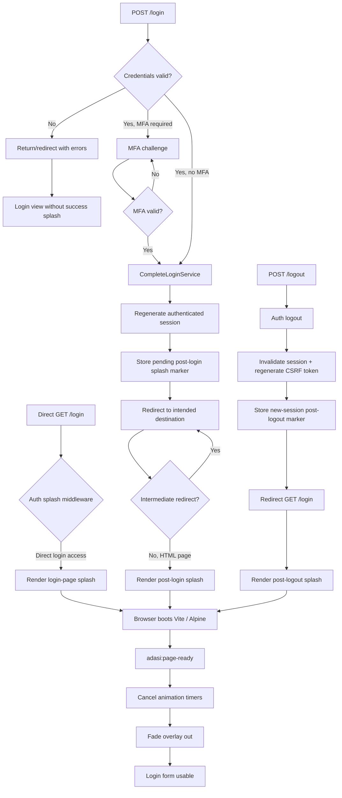
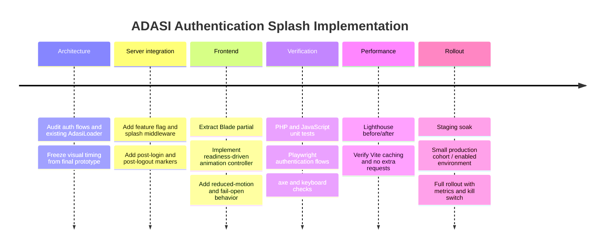

# Server-Side Controlled ADASI Wordmark Splash Screen for a Laravel Supplier Portal

## Executive Summary

The recommended production design is **server-controlled, client-animated, readiness-driven, and fail-open**.

Laravel should decide **whether the splash exists in the HTML at all**. The browser should only handle the ADASI wordmark wave animation and remove it immediately when the destination page reaches a defined **application-ready** milestone. The splash should **not wait for one complete animation cycle**, should **not wait for every image, DataTable, AJAX request, or optional widget**, and should never become part of the authentication or authorization decision.

For the current Supplier Portal, this architecture fits particularly well because the application already runs Laravel 12, Vite, Alpine, and a mature token-based `AdasiLoader`. fileciteturn11file0L1-L2 fileciteturn12file0L1-L2 The existing loader already handles navigation, forms, AJAX, slow-operation fallbacks, focus, `aria-busy`, and bfcache restoration, so the new authentication splash should be a **separate, narrowly scoped presentation component**, not a replacement for the general loader. fileciteturn15file0L1-L2

The final HTML prototype you supplied already has the right visual model: individual ADASI letters rise and sink sequentially, with approximately 1.6-second rise/sink durations, ~90 ms stagger, reduced-motion handling, timer cleanup, and looping behavior. The production adaptation should preserve the visual sequence while changing the control model from “demo loop until stop” to **“loop only while the page is not ready; cancel immediately when ready.”** fileciteturn0file0

The recommended trigger matrix is:

| Situation | Render ADASI splash? | Server reason | Exit condition |
|---|---:|---|---|
| Direct `GET /login` | Yes | `login-page` | Application-ready event |
| Failed login returning validation/authentication errors | Prefer **No** | — | — |
| Login → MFA challenge | No post-login splash yet | — | Authentication is not complete |
| Successful login without MFA | Yes | `post-login` | Destination page ready |
| Successful MFA completion | Yes | `post-login` | Destination page ready |
| Normal dashboard refresh | No | — | — |
| Ordinary navigation between authenticated pages | No auth splash | — | Existing `AdasiLoader` remains responsible |
| Logout succeeds and redirects to login | Yes | `post-logout` | Login page ready |
| AJAX/DataTables/background requests | No auth splash | — | Existing loaders/indicators |
| JavaScript fails | Splash must relinquish control | fail-open | CSS/no-JS hard fail-safe |

Laravel sessions are the best mechanism for post-login/post-logout handoff because they are specifically designed to carry state across HTTP requests. Laravel supports storing, retrieving, deleting, flashing, regenerating, and invalidating session data. citeturn12view0 For this portal I recommend a **short-lived ordinary session marker plus middleware-controlled one-time consumption**, rather than relying solely on Laravel flash data. Flash data is normally deleted after the subsequent request, which can be inconvenient if the post-authentication destination itself issues another redirect. citeturn12view0

The key UX point is that **“page ready” should normally mean DOM parsed + the main Vite module executed + Alpine/core synchronous initialization completed + one paint opportunity**, not `window.load`. `DOMContentLoaded` occurs after parsing and module/deferred script execution but does not wait for images, subframes, or asynchronous scripts; MDN explicitly cautions against using `load` when `DOMContentLoaded` is sufficient. citeturn15view0

A hard 8–10 second client fail-safe, an accessible skip control exposed after roughly 2 seconds, `prefers-reduced-motion`, bfcache handling, cancellation of every pending timer, and a feature-flag kill switch should make the splash incapable of trapping a user even if frontend initialization fails. W3C guidance recommends reducing or disabling non-essential animation for people who request reduced motion, and `prefers-reduced-motion` is designed specifically to expose that preference. citeturn10search2turn17view0

**Assumptions used in this report:** the target remains the current `poyipoy/supplierportal` `master` codebase inspected during this research; the production app continues using Laravel 12 rather than upgrading as part of this work; authenticated application pages normally use `layouts.app`, authentication pages use `layouts.auth`; the final visual timings of your uploaded prototype remain the design baseline; and the splash is intended as branding/initialization feedback, **not as an artificial delay or security boundary**. The repository currently confirms Laravel `^12.0`, Vite `^7.0.7`, and the expected app/auth layouts and authentication services. fileciteturn11file0L1-L2 fileciteturn12file0L1-L2 fileciteturn9file0L1-L12

## Design Principles and Best Practices

The strongest implementation follows one rule:

> **The server controls eligibility; the client controls motion; actual readiness controls dismissal.**

That avoids confusing three separate concerns: authentication state, loading state, and animation state.

**Performance.** The splash should introduce no extra backend endpoint, polling request, database table, image fetch, or server-side “loading status” call. The wordmark can be pure HTML/CSS, and its JS should ship inside the existing Vite entry point. The repository already uses `resources/css/app.css` and `resources/js/app.js` as its Vite production entries, so a small imported splash module fits the existing asset graph without creating an additional blocking bundle. fileciteturn13file0L1-L2 Laravel's Vite integration builds and versions production assets, and `@vite` resolves the appropriate development or compiled assets. citeturn14view1

The moving letters should continue to animate through `transform: translateY(...)`, rather than repeatedly changing layout properties such as `top`, `height`, or margins. The overlay should be `position: fixed`, so it does not participate in normal document layout. This also means the splash itself should produce essentially no layout shift in the underlying page.

**Do not add a fake minimum duration.** Your requirement that the splash disappears as soon as the page is usable is correct. If the page is ready after 400 ms, dismiss it after 400 ms; if initialization lasts 2.8 seconds, let the wave continue for 2.8 seconds. The animation cycle is decoration, not a transaction that must finish.

One nuance matters: a **server-rendered target-page splash cannot appear before the target response begins arriving**. During the POST `/login` network wait, the browser is still showing the old login document. The portal's existing `AdasiLoader` currently tracks normal form navigation after a 150 ms delay, so it can still supply pre-navigation feedback while the server is authenticating. fileciteturn15file0L1-L2 Do not show the *successful-login* ADASI splash immediately when the user presses Sign In, because at that point authentication has not succeeded; doing so would visually imply success before the server knows the result.

**Accessibility.** The letters themselves are decorative and should be `aria-hidden="true"`. A separate screen-reader text such as “Loading Supplier Portal” can live in a `role="status"` container. W3C notes that `role="status"` provides an implicit polite live region, and recommends explicit `aria-atomic="true"` when the whole status should be announced. citeturn17view2 Do not repeatedly update the status for every wave cycle; that would cause useless announcements.

While the full-screen overlay is active, the underlying application can be temporarily made `inert` **by JavaScript only**. `inert` causes user input and focus/assistive-technology interaction with the underlying element to be ignored, which is appropriate for a temporarily unavailable interface. citeturn17view1 It should not be emitted server-side as permanent markup, because a JS failure would then leave the page inaccessible.

**Reduced motion.** Under `prefers-reduced-motion: reduce`, remove the rising/sinking transforms entirely. Display a static ADASI wordmark while the page initializes, then hide it when ready. MDN describes the media feature as a mechanism for detecting a user's request to remove, reduce, or replace non-essential motion, and W3C explicitly recommends respecting it for potentially problematic motion. citeturn17view0turn10search2

Your prototype already contains reduced-motion logic; keep that behavior in the production extraction rather than creating a second animation implementation. fileciteturn0file0

**Skip/fail-safe behavior.** A full-page preloader can fall under an accessibility exception where interaction genuinely cannot occur while loading, but providing a stop/skip mechanism is still a good defensive design, especially if animation can continue for several seconds. WCAG guidance requires controls for certain automatically moving content lasting more than five seconds when displayed alongside other content, and recognizes preload animations as a special case where loading genuinely prevents interaction. citeturn10search5turn10search4

For this portal I would hide the skip button initially, reveal it after approximately **2 seconds**, and make it keyboard accessible. The hard timeout should be separate—approximately **10 seconds**—and should reveal the underlying page regardless of readiness status.

**Progressive enhancement.** Failure should always expose the real login/dashboard page, never a permanently white overlay. Therefore:

- with JavaScript disabled, the splash should not block the page;
- if Vite fails to initialize, CSS should fail-open after a maximum period;
- if a timer callback throws, the hard timeout still removes blocking behavior;
- if a page is restored from the browser back/forward cache, the splash should be immediately reset rather than resuming an old animation state.

The existing `AdasiLoader` already handles the bfcache `pageshow` case by resetting its overlay, which is a useful precedent to follow. fileciteturn15file0L1-L2

**Integration mechanism comparison:**

| Mechanism | Server controls it? | Survives redirect? | One-shot behavior | Security/privacy | Main drawbacks | Recommendation |
|---|---:|---:|---:|---|---|---|
| Laravel session marker | **Yes** | **Yes** | Explicitly consumable | Not exposed in URL; tied to session | Must handle redirect chains/stale marker | **Best choice** |
| Laravel flash session | Yes | Yes, normally one request | Built in | Good | May expire on an intermediate redirect unless kept/reflashed | Good for simple flows |
| Query parameter, e.g. `?splash=login` | No meaningful trust | Yes | Manual | Appears in URL/history/logs; user-editable | Cache/referrer/log pollution | Avoid |
| Cookie | Browser + server | Yes | Manual | Sent with requests; user-modifiable unless protected | Persistent state and unnecessary request bytes | Only for durable user preference |
| `localStorage` | **No** | Client-only | Manual | Origin persistent; client-controlled | Server cannot decide Blade output; stale across sessions | Not for trigger |
| Direct controller/View variable | Yes | No | Natural | Excellent | Cannot cross login/logout redirects alone | Best for direct `/login` only |
| Request attribute from middleware | Yes | Per request | Natural | Excellent | Requires session marker to bridge redirect | **Best rendering gate** |

Laravel documents sessions as the cross-request state mechanism and provides `put`, `pull`, `forget`, flash, regeneration, and invalidation operations. citeturn12view0 The recommended model combines a short-lived session marker with a request attribute so that Blade itself remains a simple renderer.

## Laravel Server-Side Integration Architecture

The current authentication flow is already well structured for this change.

`AuthenticatedSessionController::store()` authenticates the credentials and either starts the MFA challenge or calls `CompleteLoginService::complete()`. fileciteturn7file0L1-L2 The MFA challenge controller calls the **same** `CompleteLoginService` only after a valid MFA/recovery code, so marking post-login splash state inside that service automatically covers both MFA and non-MFA authentication without duplicating logic. fileciteturn25file0L1-L2

`CompleteLoginService` already logs the user in, regenerates the session, establishes authentication session metadata, handles known devices and session limits, and sends security events. fileciteturn8file0L1-L2 Laravel recommends regenerating session IDs around authentication to mitigate session-fixation risks. citeturn12view0

Logout is also already correct: it calls `Auth::guard('web')->logout()`, invalidates the session, regenerates the CSRF token, then redirects to login. fileciteturn7file0L1-L2 That matches Laravel's documented logout semantics. citeturn13view0

The current routing separates GET and POST login as `login` and `login.store`; the GET route already has `no-store`, and logout remains POST. fileciteturn31file0L1-L16 fileciteturn32file0L1-L11

The recommended request flow is:



### Recommended session marker

Use an ordinary, short-lived server-side marker:

```php
$request->session()->put('ui.auth_splash', [
    'reason' => 'post-login',
    'issued_at' => now()->timestamp,
]);
```

Why not just `flash()`? Laravel flash data is specifically available through the next HTTP request and then deleted. citeturn12view0 That is excellent when the next request always renders the destination page. A normal marker with explicit middleware consumption is more robust when an intended URL may issue an additional redirect; the middleware simply leaves it pending until it sees an eligible final HTML GET.

Include an expiration time—roughly **30 seconds** is sufficient—so abandoned/stale navigation cannot cause a surprise splash later.

### Middleware gate

Create:

`app/Http/Middleware/ShareAuthSplashState.php`

```php
<?php

namespace App\Http\Middleware;

use Closure;
use Illuminate\Http\Request;
use Symfony\Component\HttpFoundation\Response;

final class ShareAuthSplashState
{
    public function handle(Request $request, Closure $next): Response
    {
        if (! config('ui.auth_splash.enabled', true)) {
            return $next($request);
        }

        $pending = $request->session()->get('ui.auth_splash');
        $ttl = (int) config('ui.auth_splash.pending_ttl_seconds', 30);

        if (is_array($pending)) {
            $issuedAt = (int) ($pending['issued_at'] ?? 0);

            if ($issuedAt <= 0 || (now()->timestamp - $issuedAt) > $ttl) {
                $request->session()->forget('ui.auth_splash');
                $pending = null;
            }
        }

        // Only document GETs are allowed to render the splash.
        $eligibleDocument = $request->isMethod('GET')
            && ! $request->expectsJson();

        // A fresh visit to the login page gets the splash, but a validation /
        // authentication-error return should expose the error immediately.
        $directLogin = $eligibleDocument
            && $request->routeIs('login')
            && ! $request->session()->has('errors');

        $reason = is_array($pending)
            ? ($pending['reason'] ?? null)
            : ($directLogin ? 'login-page' : null);

        if ($eligibleDocument && is_string($reason)) {
            $request->attributes->set('ui.auth_splash', [
                // Keep this generic: never place user/account data here.
                'reason' => $reason,
            ]);
        }

        $response = $next($request);

        // Consume only after a final HTML document has been produced.
        // Redirects deliberately keep the pending marker alive.
        if (
            is_array($pending)
            && $request->attributes->has('ui.auth_splash')
            && ! $response->isRedirection()
            && str_contains(
                strtolower((string) $response->headers->get('Content-Type')),
                'text/html'
            )
        ) {
            $request->session()->forget('ui.auth_splash');
        }

        return $response;
    }
}
```

Laravel's `web` middleware stack includes session and CSRF behavior, and Laravel 12 supports appending application middleware to the web group from `bootstrap/app.php`. citeturn8search0turn8search1 The current application already appends locale, hash-ID, auth-session security, security-header, and supplier-domain middleware there. fileciteturn23file0L1-L2

**Placement:** in `bootstrap/app.php`, add the import near the existing middleware imports and append `ShareAuthSplashState::class` in the `web(append: [...])` array, preferably immediately after `ApplyUserLocale::class`.

```php
use App\Http\Middleware\ShareAuthSplashState;

// ...

$middleware->web(append: [
    ApplyUserLocale::class,
    ShareAuthSplashState::class,
    DecodeHashids::class,
    EnforceAuthSessionSecurity::class,
    AddSecurityHeaders::class,
    EnforceSupplierDomain::class,
]);
```

### Post-login marker

In the current `app/Services/Auth/CompleteLoginService.php`, place the marker **after session regeneration and authentication session metadata are established**—currently around the first third of `complete()`, immediately after the existing `session()->put([...auth metadata...])` block. This anchor is safer than relying on an absolute line number as the file evolves. fileciteturn8file0L1-L2

```php
$request->session()->regenerate();

$request->session()->put([
    'auth_session_version' => (int) $user->auth_session_version,
    'auth_absolute_started_at' => now()->timestamp,
]);

$request->session()->put('ui.auth_splash', [
    'reason' => 'post-login',
    'issued_at' => now()->timestamp,
]);
```

Do **not** put this in `AuthenticatedSessionController::store()` only. Doing so would miss the separate MFA-success path. Both paths already converge in `CompleteLoginService`, making it the correct single integration point. fileciteturn5file2L29-L40 fileciteturn25file0L1-L2

### Post-logout marker

In `AuthenticatedSessionController::destroy()`, keep the existing security order and put the new marker **after** `invalidate()` and `regenerateToken()`. That guarantees the marker belongs to the new post-logout session, not the session being destroyed. fileciteturn7file0L1-L2

```php
public function destroy(Request $request): RedirectResponse
{
    Auth::guard('web')->logout();

    $request->session()->invalidate();
    $request->session()->regenerateToken();

    $request->session()->put('ui.auth_splash', [
        'reason' => 'post-logout',
        'issued_at' => now()->timestamp,
    ]);

    return redirect()->route('login');
}
```

Laravel's CSRF token is session-bound and changes when the session is regenerated, so the splash integration should leave existing CSRF handling entirely untouched. citeturn13view3

### Blade partial

Create:

`resources/views/partials/auth-splash.blade.php`

```blade
@php
    $authSplash = request()->attributes->get('ui.auth_splash');
@endphp

@if ($authSplash)
    <div
        id="authSplash"
        class="auth-splash"
        data-auth-splash
        data-splash-reason="{{ $authSplash['reason'] }}"
        data-hard-timeout="{{ config('ui.auth_splash.hard_timeout_ms', 10000) }}"
        data-fade-ms="{{ config('ui.auth_splash.fade_ms', 220) }}"
        role="status"
        aria-live="polite"
        aria-atomic="true"
    >
        <div class="auth-splash__viewport">
            <div class="auth-splash__wordmark" aria-hidden="true">
                @foreach (str_split('ADASI') as $letter)
                    <span class="auth-splash__letter">{{ $letter }}</span>
                @endforeach
            </div>
        </div>

        <span class="visually-hidden">
            {{ __('common.loading_supplier_portal') }}
        </span>

        <button
            type="button"
            class="auth-splash__skip"
            data-auth-splash-skip
            hidden
        >
            {{ __('common.skip_loading_animation') }}
        </button>
    </div>
@endif
```

Do not put user name, supplier number, email address, role, session ID, authentication method, device ID, or MFA result in this DOM. `data-splash-reason` should contain only a generic UI reason such as `login-page`, `post-login`, or `post-logout`.

Include this **immediately after `<body>`** in:

```blade
{{-- resources/views/layouts/auth.blade.php --}}
<body ...>
    @include('partials.auth-splash')

    <main class="auth-shell" ...>
```

and:

```blade
{{-- resources/views/layouts/app.blade.php --}}
<body ...>
    @include('partials.auth-splash')

    <a href="#main-content" class="ui-skip-link">...</a>
```

The current auth layout already owns all authentication pages, while the application layout has the main `#main-content` shell. fileciteturn16file0L1-L2 fileciteturn22file5L79-L96

If repository audit finds authenticated intended destinations using `layouts.guest`, put the same conditional partial there as well. Because the server does not render any splash markup without the request attribute, this costs essentially only the Blade conditional on ordinary pages.

### Configuration and rollback flag

Add:

`config/ui.php`

```php
<?php

return [
    'auth_splash' => [
        'enabled' => env('AUTH_SPLASH_ENABLED', true),
        'pending_ttl_seconds' => 30,
        'hard_timeout_ms' => 10000,
        'slow_after_ms' => 2000,
        'fade_ms' => 220,
    ],
];
```

Production rollback then becomes:

```dotenv
AUTH_SPLASH_ENABLED=false
```

followed by the normal configuration-cache refresh used in your deployment pipeline.

This is much safer than reading `env()` directly in Blade or JavaScript and means the kill switch does not require reversing authentication changes.

### File placement map

The approximate line references below are based on the current repository snapshot; **the code anchor is authoritative** because line numbers move as files change.

| File | Current placement recommendation |
|---|---|
| `app/Services/Auth/CompleteLoginService.php` | Inside `complete()`, immediately after the existing session regeneration/auth metadata block; approximately lines 25–31 in the current compact file |
| `app/Http/Controllers/Auth/AuthenticatedSessionController.php` | Inside `destroy()`, immediately after `regenerateToken()` and before `return redirect()->route('login')`; approximately lines 70–78 |
| `app/Http/Middleware/ShareAuthSplashState.php` | New file |
| `bootstrap/app.php` | Add import beside other middleware; add middleware in the existing `web(append: [...])` block around its current middleware configuration section |
| `resources/views/partials/auth-splash.blade.php` | New file |
| `resources/views/layouts/auth.blade.php` | Include partial as the first body child |
| `resources/views/layouts/app.blade.php` | Include partial as the first body child, before the skip link/current application shell |
| `resources/css/app.css` | Import/add non-critical splash animations and skip/fade styling |
| `resources/js/auth-splash.js` | New module |
| `resources/js/app.js` | Import `./auth-splash`; dispatch readiness after application initialization |
| `resources/lang/*/...` | Add accessible “Loading Supplier Portal” and skip labels |
| `tests/Feature/AuthSplashTest.php` | New feature tests |
| `tests/js/auth-splash.test.mjs` | New timer/state-machine tests |
| `tests/Feature/FrontendAssetLoadingTest.php` | Extend only if the new partial becomes another layout invariant |

The existing repository explicitly requires `partials.loader-logo` to remain before `@vite` on layouts loading `app.js`, and has a feature test enforcing that invariant. Do not remove or reorder that requirement accidentally while adding the splash. fileciteturn10file0L1-L10 fileciteturn10file5L56-L66

## Client Runtime, Readiness, Accessibility, and Performance

The production client module should be a small state machine, not a collection of unrelated `setTimeout()` callbacks.

Your prototype already uses a timer collection and run identifier; retain that philosophy. fileciteturn0file0

A suitable production structure is:

```js
// resources/js/auth-splash.js

const DEFAULT_HARD_TIMEOUT = 10_000;
const DEFAULT_SLOW_AFTER = 2_000;

export function bootAuthSplash(win = window) {
    const doc = win.document;
    const overlay = doc.querySelector('[data-auth-splash]');

    if (!overlay) {
        return null;
    }

    const letters = [...overlay.querySelectorAll('.auth-splash__letter')];
    const skip = overlay.querySelector('[data-auth-splash-skip]');
    const reducedMotion = win.matchMedia('(prefers-reduced-motion: reduce)');

    const timers = new Set();
    const inertState = new Map();

    let finished = false;
    let runId = 0;

    const hardTimeout = Number(overlay.dataset.hardTimeout)
        || DEFAULT_HARD_TIMEOUT;

    const fadeMs = Number(overlay.dataset.fadeMs) || 220;

    const schedule = (callback, delay) => {
        const id = win.setTimeout(() => {
            timers.delete(id);
            callback();
        }, delay);

        timers.add(id);
        return id;
    };

    const clearTimers = () => {
        for (const id of timers) {
            win.clearTimeout(id);
        }
        timers.clear();
    };

    const makePageInert = () => {
        const targets = doc.querySelectorAll(
            '.auth-shell, #sidebar, .top-navbar, #main-content'
        );

        targets.forEach((node) => {
            inertState.set(node, node.inert);
            node.inert = true;
        });

        doc.body.setAttribute('aria-busy', 'true');
    };

    const restorePage = () => {
        inertState.forEach((wasInert, node) => {
            if (node.isConnected) {
                node.inert = wasInert;
            }
        });

        inertState.clear();
        doc.body.removeAttribute('aria-busy');
    };

    const removeOverlay = () => {
        overlay.remove();
    };

    const finish = (reason = 'ready', immediate = false) => {
        if (finished) return;
        finished = true;
        runId += 1;

        clearTimers();
        restorePage();

        performance.mark?.('adasi-auth-splash-ready');

        if (immediate || reducedMotion.matches) {
            removeOverlay();
        } else {
            overlay.classList.add('is-leaving');

            let removed = false;

            const removeOnce = () => {
                if (removed) return;
                removed = true;
                removeOverlay();
            };

            overlay.addEventListener('transitionend', removeOnce, {
                once: true,
            });

            // transitionend is not guaranteed if CSS is interrupted.
            schedule(removeOnce, fadeMs + 100);
        }

        performance.mark?.('adasi-auth-splash-hidden');

        try {
            performance.measure?.(
                'adasi-auth-splash-visible',
                'adasi-auth-splash-start',
                'adasi-auth-splash-hidden',
            );
        } catch {
            // Telemetry must never affect UI availability.
        }

        win.dispatchEvent(new CustomEvent('adasi:auth-splash-hidden', {
            detail: { reason },
        }));
    };

    const startWaveLoop = () => {
        if (reducedMotion.matches || finished) {
            letters.forEach((letter) => {
                letter.classList.add('is-visible');
            });
            return;
        }

        const currentRun = ++runId;

        const ENTER_DELAY = 50;
        const STAGGER = 90;
        const RISE_MS = 1600;
        const ALL_VISIBLE_MS = 300;
        const SINK_MS = 1600;
        const LOOP_PAUSE_MS = 100;

        letters.forEach((letter) => {
            letter.classList.remove('is-visible', 'is-sinking');
        });

        letters.forEach((letter, index) => {
            schedule(() => {
                if (finished || currentRun !== runId) return;
                letter.classList.add('is-visible');
            }, ENTER_DELAY + index * STAGGER);
        });

        const allUpAt =
            ENTER_DELAY +
            (letters.length - 1) * STAGGER +
            RISE_MS +
            ALL_VISIBLE_MS;

        letters.forEach((letter, index) => {
            schedule(() => {
                if (finished || currentRun !== runId) return;
                letter.classList.add('is-sinking');
            }, allUpAt + index * STAGGER);
        });

        const cycleEnd =
            allUpAt +
            (letters.length - 1) * STAGGER +
            SINK_MS +
            LOOP_PAUSE_MS;

        schedule(() => {
            if (!finished && currentRun === runId) {
                startWaveLoop();
            }
        }, cycleEnd);
    };

    performance.mark?.('adasi-auth-splash-start');

    makePageInert();
    startWaveLoop();

    schedule(() => {
        if (!finished && skip) {
            skip.hidden = false;
        }
    }, DEFAULT_SLOW_AFTER);

    schedule(() => {
        finish('hard-timeout');
    }, hardTimeout);

    skip?.addEventListener('click', () => finish('skip'), {
        once: true,
    });

    win.addEventListener(
        'adasi:page-ready',
        () => finish('ready'),
        { once: true },
    );

    win.addEventListener('pageshow', (event) => {
        if (event.persisted) {
            finish('bfcache', true);
        }
    }, { once: true });

    const motionChanged = () => {
        if (reducedMotion.matches) {
            runId += 1;
            clearTimers();

            letters.forEach((letter) => {
                letter.classList.add('is-visible');
                letter.classList.remove('is-sinking');
            });

            // Re-establish the important fail-safe timers after clearing
            // animation timers in a production implementation.
        }
    };

    reducedMotion.addEventListener?.('change', motionChanged);

    return {
        finish,
        destroy() {
            runId += 1;
            clearTimers();
            restorePage();
            reducedMotion.removeEventListener?.('change', motionChanged);
            removeOverlay();
        },
    };
}

bootAuthSplash();
```

The sample intentionally illustrates the lifecycle rather than serving as a drop-in replacement for your final animation file. In the implementation, the hard-timeout/slow timers should be stored separately from cycle timers so a reduced-motion state change cannot accidentally clear the fail-safe.

The important properties are:

1. `finish()` is **idempotent**.
2. It clears active animation work immediately.
3. It does **not** wait for the current letter to reach the surface or sink.
4. It has a transition-end fallback.
5. It restores exactly the previous `inert` state rather than blindly setting everything to `false`.
6. It handles bfcache.
7. It can be destroyed cleanly.
8. No timer determines authentication state.

The CSS should preserve the prototype's wave behavior but make exit independent:

```css
.auth-splash {
    position: fixed;
    inset: 0;
    z-index: 9999;
    display: grid;
    place-items: center;
    background: #fff;
    opacity: 1;
    pointer-events: auto;
    transition: opacity 220ms ease;
}

.auth-splash.is-leaving {
    opacity: 0;
    pointer-events: none;
}

.auth-splash__viewport {
    overflow: hidden;
    padding-block: 0.15em;
}

.auth-splash__wordmark {
    display: flex;
    font: 900 clamp(2rem, 8vw, 4.5rem) / 1 Arial, sans-serif;
    letter-spacing: 0.04em;
    color: #ed1018;
}

.auth-splash__letter {
    display: inline-block;
    transform: translateY(130%);
    transition:
        transform 1600ms cubic-bezier(.22, 1, .36, 1);
    will-change: transform;
}

.auth-splash__letter.is-visible {
    transform: translateY(0);
}

.auth-splash__letter.is-sinking {
    transform: translateY(130%);
}

@media (prefers-reduced-motion: reduce) {
    .auth-splash,
    .auth-splash__letter {
        animation: none !important;
        transition: none !important;
    }

    .auth-splash__letter {
        transform: none !important;
    }
}
```

The final prototype should remain the visual source of truth for exact sizing and timing. fileciteturn0file0

### Defining “page ready”

Do **not** make the splash wait on:

```js
window.addEventListener('load', ...)
```

unless a particular page literally cannot function without all images and other dependent resources. `DOMContentLoaded` waits for parsing and deferred/module scripts but not images, frames, or async scripts, while `load` waits significantly further into resource loading. citeturn15view0turn15view1

For this portal, the main JS bundle already starts Alpine and then boots other application code. fileciteturn26file0L1-L11 It also already has `DOMContentLoaded`-aware boot logic for page-specific modules. fileciteturn27file0L1-L11

At the bottom of the main synchronous boot path, add:

```js
function signalPageReady() {
    // Two frames allow the initialized DOM to reach a rendered frame
    // before the white overlay begins fading.
    requestAnimationFrame(() => {
        requestAnimationFrame(() => {
            window.dispatchEvent(new CustomEvent('adasi:page-ready'));
        });
    });
}

if (document.readyState === 'loading') {
    document.addEventListener('DOMContentLoaded', signalPageReady, {
        once: true,
    });
} else {
    signalPageReady();
}
```

This means:

```text
HTML parsed
    ↓
Vite module executed
    ↓
Alpine.start()
    ↓
Core synchronous setup complete
    ↓
DOMContentLoaded
    ↓
One/two paint opportunities
    ↓
adasi:page-ready
    ↓
cancel wave immediately
    ↓
fade splash
```

Optional charts, AJAX datasets, notification polling, DataTables and background requests should continue after the splash disappears. The existing loader has specialized handling for global AJAX and DataTables, so waiting for those through the auth splash would duplicate existing infrastructure and unnecessarily inflate perceived startup time. fileciteturn15file0L1-L2

### Critical CSS versus Vite CSS

Inline only the **smallest blocking geometry** needed to ensure the white overlay and hidden lower letters are correct before the main stylesheet becomes available. Keep the full animation/skip styling in `app.css`.

For example:

```blade
<style>
[data-auth-splash] {
    position: fixed;
    inset: 0;
    z-index: 9999;
    background: #fff;
}
</style>

<noscript>
    <style>
        [data-auth-splash] { display: none !important; }
    </style>
</noscript>
```

That prevents a flash of the dashboard/login form before the overlay but still ensures no-JS users get the actual page.

Do **not** inline the entire `app.css` or animation controller. Laravel supports inline Vite contents, but doing so for the whole application would defeat efficient shared asset caching. citeturn14view1

## Deployment, Caching, Security, and Observability

The repository already has an unusually useful foundation for this feature: `AddSecurityHeaders` applies `Cache-Control: no-store, private` to dynamic responses unless explicitly public and adds other security headers. fileciteturn24file0L1-L2 This means login/dashboard HTML containing a transient splash marker is not intended for intermediary caching—a desirable property because a cached HTML document must not replay a stale post-login/post-logout splash or expose user-specific content.

Static Vite assets should have the opposite policy. Laravel's Vite integration serves compiled/versioned assets in production, and Vite's production output uses generated asset names suitable for cache busting. citeturn14view1turn11search12 MDN recommends using versioned/hashed URLs with a long `max-age` and `immutable` for static resources that will never change at the same URL. citeturn11search0

A production web-server rule should therefore approximate:

```nginx
location /build/assets/ {
    expires 1y;
    add_header Cache-Control "public, max-age=31536000, immutable";
}
```

while dynamic HTML remains:

```http
Cache-Control: no-store, private
```

Do not give `manifest.json` or unversioned public assets a one-year immutable policy unless your deployment strategy guarantees the URL changes when content changes.

The project already uses the official Laravel Vite plugin and a simple two-entry configuration, so **no new Vite entry point is needed**. fileciteturn13file0L1-L2 Add:

```js
// resources/js/app.js
import './auth-splash';
```

and put the animation CSS into the existing CSS graph. Laravel's `@vite` directive automatically selects the development server during development and compiled/versioned files in build mode. citeturn14view1

**CSP.** The current project has its own CSP generation in `AddSecurityHeaders`, currently allowing inline scripts/styles in its configured policy. fileciteturn24file0L1-L2 The splash should not expand that policy further. A future CSP-hardening phase can use Laravel Vite's built-in `useCspNonce()` support for generated Vite script/style tags. citeturn13view1 CSP tightening is valuable, but it should be a separate security change from the splash rollout to avoid conflating risk.

**CSRF and authentication.** No new GET route should mutate authentication state, and no splash-specific code should bypass CSRF. Laravel's web middleware validates CSRF tokens for state-changing requests, and the current login Blade already includes `@csrf`. citeturn13view3 fileciteturn20file0L1-L2 Logout is already a POST form with a CSRF token in the navbar. fileciteturn29file1L12-L21

The splash must not:

- store authentication information in `localStorage`;
- accept an arbitrary URL query parameter as proof that login succeeded;
- modify guards, rate limits, MFA state, intended URL validation, known-device registration or authorization middleware;
- contain sensitive metadata in `data-*` attributes;
- turn logout into GET;
- send user identity or session identifiers to third-party telemetry.

The existing login controller uses a safe intended URL resolution after authentication, and that behavior should remain unchanged. fileciteturn7file0L1-L2

### Asset/cache deployment matrix

| Resource | Recommended cache policy | Reason |
|---|---|---|
| Authenticated HTML | `no-store, private` | User-specific, transient state |
| Login HTML | `no-store, private` | Auth/security page and transient splash state |
| Vite hashed JS/CSS | `public, max-age=31536000, immutable` | URL changes when asset contents change |
| Vite manifest | Revalidate / deployment-controlled | Points to current generated assets |
| Unhashed public image | Shorter cache or explicit versioned URL | Same filename may change |
| ADASI splash wordmark | Pure text/CSS | Avoids an extra image request |
| Critical splash CSS | Inline, tiny | Earliest overlay without a request |

The uploaded splash using a text wordmark is particularly beneficial here because it requires no splash-logo fetch. fileciteturn0file0

### Analytics instrumentation

Use the browser Performance API rather than timestamps mixed across server and client clocks. `performance.mark()` creates high-resolution timeline marks, and `performance.measure()` can calculate durations between them. citeturn11search11turn11search8

Capture:

```js
performance.mark('adasi-auth-splash-start');
// ...
performance.mark('adasi-page-ready');
// ...
performance.mark('adasi-auth-splash-hidden');

performance.measure(
    'adasi-auth-splash-visible',
    'adasi-auth-splash-start',
    'adasi-auth-splash-hidden'
);
```

Recommended event schema:

```json
{
  "event": "auth_splash_completed",
  "reason": "post-login",
  "exit": "ready",
  "duration_ms": 846,
  "reduced_motion": false
}
```

Allowed `exit` values might be:

```text
ready
skip
hard-timeout
bfcache
disabled
```

Do not include:

```text
user_id
supplier_id
email
session_id
IP address supplied by JS
MFA code or method
intended URL query string
```

If telemetry must be sent during unload, `navigator.sendBeacon()` is designed for small asynchronous analytics POSTs. citeturn16search6 For an existing Laravel CSRF-protected analytics endpoint, a same-origin `fetch(..., { keepalive: true })` with the existing CSRF token may be easier because `sendBeacon()` does not let you freely set request headers.

Core Web Vitals should be measured independently. Google's current guidance identifies LCP, INP and CLS as the Core Web Vitals, with “good” thresholds of **LCP ≤ 2.5 s, INP ≤ 200 ms, and CLS ≤ 0.1**, evaluated at the 75th percentile. citeturn10search0

Suggested operational dashboard:

| Metric | Healthy starting target | Warning | Critical/action |
|---|---:|---:|---:|
| LCP p75 | ≤ 2.5 s | > 2.5 s | Sustained regression / poor range |
| INP p75 | ≤ 200 ms | > 200 ms | Sustained > 500 ms |
| CLS p75 | ≤ 0.10 | > 0.10 | Sustained > 0.25 |
| `app_ready_ms` p95 | Baseline + ≤15% | >25% vs baseline for 15 min | >50% vs baseline |
| Splash visible p95 | ≤ ~3 s initially | >3 s | >5 s sustained |
| Splash hard-timeout rate | <0.1% | ≥0.5% | ≥2% |
| Splash skip rate | <2–3% | ≥5% | ≥10% |
| Splash JS exception rate | <0.05% | ≥0.1% | ≥0.5% |
| Login/logout server 5xx rate | Near zero | ≥0.25% | ≥1% |
| Post-login splash absent when expected | <0.1% | ≥0.5% | ≥1% |
| Splash shown on ordinary authenticated refresh | 0% | Any repeatable occurrence | Release blocker |

The Web Vital thresholds above are standards-backed targets; the splash-specific percentages are **proposed initial operational SLOs**, not industry standards. They should be adjusted after one to two weeks of real baseline data.

“Time to Interactive” is less useful as the primary production metric than modern INP plus your own `app_ready_ms`. Lighthouse cannot measure real-user INP in its simulated no-interaction run and uses laboratory proxies such as Total Blocking Time instead. citeturn10search0

## Testing, Fail-Safes, and Rollback

The feature should be tested at four layers: PHP behavior, JS lifecycle behavior, browser-level authentication flow, and accessibility/performance.

### Laravel feature/integration tests

Create `tests/Feature/AuthSplashTest.php`.

At minimum, test these scenarios:

| Scenario | Expected assertion |
|---|---|
| Direct GET `/login` | Splash markup exists |
| GET login with validation/auth error | Error visible immediately; no unnecessary login-success splash |
| Invalid credentials | No `post-login` session marker |
| Valid login without MFA | Pending marker set, target HTML renders splash once |
| Refresh authenticated target | No splash |
| User with MFA after password accepted | No `post-login` marker at challenge page |
| Successful MFA | `CompleteLoginService` creates marker and final destination renders splash |
| Failed MFA | No success marker |
| Logout | User unauthenticated, old session invalidated, new post-logout marker created |
| GET login after logout | Post-logout splash rendered |
| Further login refresh | Normal login-access rule, not stale logout reason |
| Redirect chain after login | Marker survives intermediate redirect |
| Expired 30-second marker | Marker discarded |
| JSON/XHR response | No splash markup |
| Feature flag off | No splash anywhere |
| CSRF | Existing login/logout protection still passes |

Laravel's test APIs can assert session state, and its session documentation explicitly notes support for test assertions such as `assertSessionHas`. citeturn12view0

The 2FA test is especially important because the current controller only calls `CompleteLoginService` after the challenge succeeds. fileciteturn25file0L1-L2 That is precisely why the service is the correct post-login trigger location.

### JavaScript unit tests

The repository already contains JS tests for `AdasiLoader`, including repeat mounting and loader lifecycle behavior. fileciteturn6file3L44-L54 Follow the same pattern for `tests/js/auth-splash.test.mjs`.

Test:

- no DOM marker → module is a no-op;
- five letters rise in A-D-A-S-I order;
- sink order is A-D-A-S-I;
- stagger remains configured;
- `adasi:page-ready` during the first rising letter cancels all remaining cycle timers;
- readiness during sinking cancels the cycle;
- multiple readiness events call cleanup once;
- skip immediately removes the block;
- hard timeout always releases the page;
- reduced motion never starts translate animations;
- runtime change to reduced motion cancels motion;
- timer collection is empty after completion;
- `inert` state is restored to its previous value;
- `aria-busy` is removed;
- transition fallback removes overlay when `transitionend` never fires;
- bfcache `pageshow.persisted` releases splash immediately.

### Playwright E2E and axe

Playwright's web assertions automatically retry while a UI transitions, which is useful for asserting that the splash eventually becomes hidden without brittle arbitrary sleeps. citeturn16search1 It can also emulate `prefers-reduced-motion: reduce`, making this accessibility requirement directly testable. citeturn16search11

Suggested E2E:

```ts
test('post-login splash disappears when application becomes ready', async ({ page }) => {
    await page.goto('/login');

    await expect(page.locator('[data-auth-splash]')).toBeVisible();
    await expect(page.locator('[data-auth-splash]')).toBeHidden();

    await page.getByLabel('Email').fill('supplier@example.test');
    await page.getByLabel('Password').fill('secret');
    await page.getByRole('button', { name: /sign in/i }).click();

    await expect(page.locator('[data-auth-splash]')).toBeVisible();
    await expect(page.locator('[data-auth-splash]')).toBeHidden();

    await expect(page.locator('#main-content')).toBeVisible();
});
```

Do not assert exact 90 ms/1600 ms timing in E2E; exact timers are better tested at the JS unit level. E2E should test observable behavior and lifecycle.

Create a reduced-motion project:

```ts
export default defineConfig({
    projects: [
        {
            name: 'chromium-reduced-motion',
            use: {
                browserName: 'chromium',
                reducedMotion: 'reduce',
            },
        },
    ],
});
```

Run axe on both the **splash-active** and **splash-hidden** states. Playwright's accessibility guidance recommends combining automated checks with manual accessibility review because automated tools catch only a subset of accessibility issues. citeturn10search1

Test manually with keyboard and at least one screen reader that:

- no letters are individually announced;
- “Loading Supplier Portal” is not announced repeatedly;
- skip is reachable once shown;
- hidden app content cannot receive focus during overlay;
- focus is usable after release;
- reduced-motion mode shows a static wordmark;
- browser zoom at 200%/400% does not clip an essential control.

### Lighthouse and performance tests

Lighthouse provides automated performance, accessibility and best-practice audits and can audit authenticated pages as well as public pages. citeturn10search8

Capture **before and after** runs on:

- `/login`;
- a representative supplier dashboard;
- a heavier purchasing/finance dashboard;
- simulated Slow 4G / CPU slowdown;
- desktop and mobile viewport.

Set a release budget such as:

```text
No statistically meaningful LCP regression attributable to splash
No CLS regression
No new long task caused by animation
Splash JS <= ~5 KB gzip target
Splash CSS <= ~3 KB gzip target
Zero additional HTTP requests for splash itself
Accessibility score does not regress
```

The byte targets are project budgets rather than standards; the important contractual requirement is that the splash remains small and introduces no separate runtime network dependency.

### Fail-open matrix

| Failure | Required behavior |
|---|---|
| JS bundle completely fails | `<noscript>`/CSS fail-open exposes real page |
| Splash JS throws during setup | Hard CSS/JS timeout stops blocking |
| Custom `adasi:page-ready` never fires | 10 s hard timeout |
| `transitionend` never fires | `fadeMs + fallback` removal |
| Browser restored from bfcache | Immediate splash removal |
| Reduced-motion media query | Static wordmark; no wave |
| Analytics endpoint unavailable | Ignore failure; never delay UI |
| Session marker malformed/expired | Forget marker and render normal page |
| Intermediate server redirect | Preserve pending marker |
| Feature issue after deployment | `AUTH_SPLASH_ENABLED=false` |
| Old Vite asset cached | Hashed filename ensures new deployment URL |
| User clicks Skip | Immediately release page; record aggregate `skip` exit |

### Rollback procedure

The safest rollback has three levels.

**Level A — runtime kill switch:** set `AUTH_SPLASH_ENABLED=false`, refresh configuration cache, verify `/login`, login and logout. This stops server rendering, while the JS module becomes a no-op because `[data-auth-splash]` is absent.

**Level B — frontend rollback:** revert the splash Blade/CSS/JS import while keeping session marker writes temporarily. A stale marker is harmless because nothing renders it; middleware TTL removes it.

**Level C — complete rollback:** revert middleware registration and session writes from `CompleteLoginService` and `destroy()`.

No schema migration, database rollback, queue change, or authentication-model migration should be required. That is a major advantage of this architecture.

For atomic deployments, keep at least the previous compiled Vite build/release available until traffic has switched to the new release. Hashed asset URLs make aggressive immutable caching safe only if referenced versions actually remain retrievable during the deployment/rollback window. The cache-busting principle is the basis for using immutable long-lived static assets. citeturn11search0

## Implementation Roadmap and Rollout Checklist

The complete change is small enough to implement incrementally, but authentication-adjacent UI deserves conservative rollout.

Estimated engineering effort is roughly **15–22 hours** including automated tests and production validation, excluding extended stakeholder visual review.

| Milestone | Work | Files | Estimated effort |
|---|---|---|---:|
| Architecture baseline | Confirm final prototype timings, auth redirects, layouts, loader interaction | existing files only | 1–1.5 h |
| Server trigger state | Add config, middleware, login/logout markers and expiry | `config/ui.php`, middleware, `CompleteLoginService.php`, controller, `bootstrap/app.php` | 2–3 h |
| Blade extraction | Convert prototype into conditional partial and minimal critical CSS | partial + auth/app layouts | 1.5–2 h |
| Client state machine | Wave loop, immediate ready cancellation, skip, timeout, inert, reduced motion, bfcache | `auth-splash.js`, `app.js`, `app.css` | 3–4 h |
| Backend tests | Direct login, success, MFA, errors, logout, redirect, expiry, kill switch | PHP feature tests | 2–3 h |
| JS tests | Timers, cleanup, reduced motion, timeout, readiness, bfcache | JS tests | 2–3 h |
| Browser/a11y testing | Playwright + axe + keyboard/manual checks | E2E configuration/tests | 2–3 h |
| Performance/caching | Lighthouse baseline, cache headers, production build inspection | server config / deployment | 1–1.5 h |
| Observability | Performance marks, aggregated events, dashboard/alerts | analytics code/config | 1–2 h |
| Controlled rollout | Staging → pilot → full enablement | feature flag/deploy | 1 h engineering + observation |



The suggested implementation sequence is:

**First, freeze the visual contract.** Treat the uploaded final HTML as the animation reference, including its ADASI order, smooth no-bounce motion and approximate timings. fileciteturn0file0 Do not redesign animation while integrating authentication.

**Second, add the feature flag and middleware before changing authentication.** Verify that middleware has no effect unless a marker or direct login-page request exists.

**Third, add `post-login` in `CompleteLoginService`, not both authentication controllers.** This automatically covers conventional and MFA-completed login because both flows converge there. fileciteturn7file0L1-L2 fileciteturn25file0L1-L2

**Fourth, add `post-logout` only after session invalidation/token regeneration.** Never move the visual feature ahead of logout security operations. fileciteturn7file0L1-L2

**Fifth, render the same Blade component from both root layouts.** Do not duplicate animation HTML between login and dashboard.

**Sixth, integrate the JS module through the existing Vite entry.** The repository already expects `app.js` and the loader-logo partial in these layouts; preserve that invariant. fileciteturn10file2L23-L32 fileciteturn10file4L45-L53

**Seventh, define readiness explicitly.** The splash disappears after the DOM/core application is initialized—not after every downstream request. MDN's event semantics support using DOM/application readiness rather than full-window load for this purpose. citeturn15view0

**Eighth, add fail-safes before enabling production.** The feature should be impossible to transform into a permanent blocking screen.

**Ninth, measure real behavior.** Google recommends assessing Core Web Vitals using field data at the 75th percentile; combine those metrics with your custom splash duration and timeout/skip rates. citeturn10search0

**Final rollout checklist:**

| Check | Required before production |
|---|---|
| Direct `/login` displays ADASI splash | ✓ |
| Failed credential error is not unnecessarily obscured | ✓ |
| Normal successful login displays splash exactly once | ✓ |
| Successful MFA displays splash exactly once | ✓ |
| MFA challenge itself does not falsely indicate login completion | ✓ |
| Logout invalidates session before setting the new marker | ✓ |
| Logout redirects to login and displays post-logout splash | ✓ |
| Dashboard refresh has no auth splash | ✓ |
| Ordinary menu navigation has no auth splash | ✓ |
| Existing `AdasiLoader` AJAX/DataTables behavior still passes tests | ✓ |
| Animation stops immediately when `adasi:page-ready` fires | ✓ |
| No minimum full-cycle delay exists | ✓ |
| Reduced-motion renders no vertical wave | ✓ |
| Skip becomes available during unusually long startup | ✓ |
| Hard timeout exposes page | ✓ |
| bfcache restore cannot resurrect overlay | ✓ |
| Underlying controls are not focusable while splash is active | ✓ |
| `aria-busy`/`inert` are fully restored | ✓ |
| No sensitive values appear in splash DOM/telemetry | ✓ |
| Login/logout remain CSRF-protected POST actions | ✓ |
| No new database migration or polling endpoint exists | ✓ |
| Production Vite build succeeds | ✓ |
| Hashed assets receive long-lived immutable cache headers | ✓ |
| Dynamic login/dashboard responses remain `no-store, private` | ✓ |
| Lighthouse and axe show no material regression | ✓ |
| Feature-flag kill switch tested in staging | ✓ |
| Timeout, skip, JS-error and Core Web Vital dashboards exist | ✓ |

The resulting architecture keeps Laravel authoritative over **when** the ADASI splash is allowed to appear, keeps authentication/session security untouched, lets the browser perform only lightweight transform-based animation, and—most importantly—makes the visual layer subordinate to actual page readiness. The wave can therefore be halfway through the first “A”, halfway through sinking “S”, or in a later loop when readiness occurs: the controller cancels outstanding animation work immediately, performs a short fade, restores interaction, and exposes the already-initialized Supplier Portal without waiting for the animation to finish.