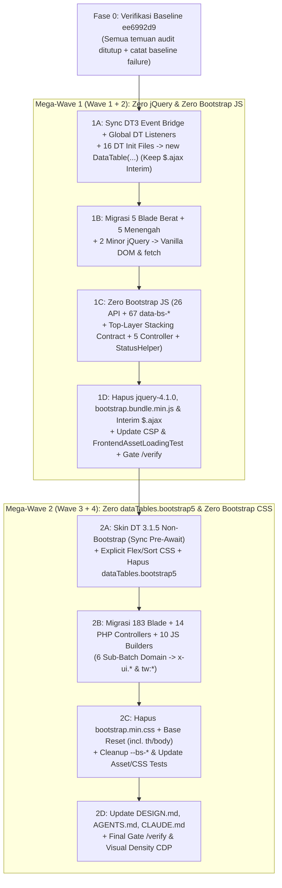

# Master Implementation Plan: 100% De-jQuery & De-Bootstrap 5 Migration

- **Repository:** ADASI Supplier Portal (`poyipoy/supplierportal`)
- **Target Branch / Verified Baseline:** `migrate-jquery-DT` at commit `ee6992d9` (`feat(ui,deps): upgrade jQuery to 4.1.0 and DataTables to 3.1.5`) `[Verified]`
  - **Baseline Discrepancy Note:** The planning prompt referenced commit `df6c41d9`, which does not exist in local git history (`git rev-parse --verify df6c41d9` fails) `[Verified]`. All line numbers, inventories, and audit closure checks in this plan are anchored directly to `HEAD ee6992d9`.
- **Date:** 2026-11-24 (Revised **v2.0** on 2026-11-25 incorporating all 8 Exact Plan Patches from `docs/audits/PLAN-REVIEW-DE-JQUERY-DE-BOOTSTRAP-20261124.md`)
- **Mode:** Planning Blueprint (strictly read-only; zero production code or DB changes during plan authoring)
- **Active Stack (Frozen):** PHP 8.2+, Laravel 12, MySQL (`adasi_portal_test` for PHPUnit, single-suite sequential execution only), Blade, Tailwind CSS `4.3.3` (`tw:` prefix, Preflight disabled), Alpine.js `3.4.2`, Vite `7.3.7`, DataTables `3.1.5` (dependency-free core), SweetAlert2 `11.7.32`, Chart.js `4.5.1`, `yajra/laravel-datatables-oracle`.

---

## 1. Ringkasan Eksekutif, Matriks Risiko, & Keputusan Arsitektur

### 1.1 Ringkasan Eksekutif & Inventaris Terverifikasi (`HEAD ee6992d9`)

Pemuatan jQuery dan Bootstrap 5 di seluruh aplikasi saat ini terisolasi pada satu layout tunggal: `resources/views/layouts/app.blade.php` (`:355` `bootstrap.min.css`, `:359` `dataTables.bootstrap5.min.css`, `:455` `bootstrap.bundle.min.js`, `:492` `jquery-4.1.0.min.js`, `:496` `dataTables.min.js`, `:497` `dataTables.bootstrap5.min.js`) `[Verified]`. Layout autentikasi (`resources/views/layouts/auth.blade.php`) dan tamu (`resources/views/layouts/guest.blade.php`) sudah 100% bebas jQuery & Bootstrap (`auth.css:225-302` menjadi referensi reset minimal), sedangkan `resources/views/layouts/public-document.blade.php` sudah tidak memuat `bootstrap.min.css` namun 2 view anaknya (`resources/views/receipts/verify-{ga,supplier}.blade.php`) masih menyisakan kelas Bootstrap yang ikut dibersihkan di Mega-Wave 2 `[Verified]`.

Audit langsung dan adversarial review terhadap codebase pada `ee6992d9` mengunci inventaris presisi berikut:

| Dimensi Migrasi | Estimasi Awal | Hasil Audit Presisi `ee6992d9` `[Verified]` | Implikasi Eksekusi |
| :--- | :---: | :---: | :--- |
| File jQuery aktif (`$` / `jQuery`) | 38 | **36 aktif** (+ 1 komentar di `resources/js/bootstrap.js`) | Mencakup modul global JS/layout, **16 file initializer DataTables** (`1` JS `local-po-gr-table.js` + `15` Blade yang menginisialisasi `19` tabel) + `2` pembaca API (`advanced-export.js`, `async-export.js`), 5 Blade berat, 5 Blade menengah, dan 2 Blade minor. |
| File Bootstrap JS API & event `.bs.*` | 18 | **26 file** (11 JS + 15 Blade) | **+8 file tersembunyi** (termasuk `quotation-availability-guard.js`, `exchange-rates.js`, `local-procurement-import.js`, `server-tabs.js`, `unsaved-changes.js`, `workspace-embed-bridge.js`, `workspace-shell.js`, `advanced-export.js`). |
| File dengan atribut `data-bs-*` | 67 | **67 file** (Blade + JS + 5 PHP Controller + `StatusHelper`) | Termasuk `modal` (22 toggle / 30 dismiss), `dropdown` (18), `tooltip` (9 + `[data-sidebar-tooltip]`), `tab`/`pill` (4), `collapse` (3), `offcanvas` (1). |
| File dengan kelas CSS Bootstrap | 201 Blade | **183 Blade non-PDF** (`181` di `app`/`auth` + `2` di `receipts/`), **14 PHP Controller DataTables**, & **10 JS DOM Builders** | `.card-body`/`.card-header` sudah **0 file** (`60` pakai `<x-ui.card>`), `.badge` di Blade tinggal **12 file** (`84` pakai `<x-ui.status-chip>`), `.modal-dialog`/toggle **35 file**, `.collapse` **3 file** (`0` PDF). |
| Kontrak Test Terikat jQuery / Bootstrap | Tidak dirinci | **22+ suite PHPUnit/Node + 10 file `tests/Support/`** | Wajib diperbarui sinkron pada sub-fase tempat kontrak berubah agar CI hijau di setiap gate. |

### 1.2 Peta Ketergantungan & Alur Eksekusi 2 Mega-Wave



### 1.3 Keputusan Arsitektur & Analisis Trade-off

#### Keputusan 1: Event Binding DataTables 3.1.5 Tanpa jQuery `[Verified]`
Hasil inspeksi langsung `storage/framework/testing/dataTables-3.1.5.min.js` (`function We`, `function Pe`, `function U`, `class H`) membuktikan fakta runtime kritis berikut:
- Ketika `window.jQuery` tidak tersedia, DT 3.1.5 men-dispatch native `new Event('preXhr', { bubbles, cancelable: true })` (nama event **`'preXhr'`**, bukan `'preXhr.dt'`), lalu menyematkan `event.namespace = 'dt'`, `event._args = [settings, data, ajaxOpts]`, dan `event.dt = api`.
- Event `preXhr`, `xhr`, `dt-error`, `draw`, `init`, `preInit`, `order` men-dispatch dengan `bubbles: true`; sedangkan event **`processing`** men-dispatch dengan **`bubbles: false`** langsung pada elemen `<table>` saja.
- Akibatnya, `document.addEventListener('preXhr.dt', ...)` **tidak akan pernah terpanggil** tanpa jQuery `[Verified]`.

| Alternatif | Kelebihan | Risiko / Trade-off | Keputusan |
| :--- | :--- | :--- | :--- |
| **A. Shared `resources/js/datatables-events.js` memakai `DataTable.Dom.s(target).on/off` + fallback native `event.namespace === 'dt'` & `event._args` (dan `table.on(...)` di level instance)** | Mendukung namespace penuh (`draw.dt.adasiLocaleInfo`, `processing.dt.adasiLoader`), unpack `(e, ...args)` otomatis sesuai kontrak DT3, fallback aman di Node unit test tanpa bundle DT3, serta cocok dengan `table.on(...)` publik untuk 18 initializer. | Mengandalkan properti `DataTable.Dom` untuk global observer (terverifikasi diekspos resmi di `x.Dom = H` pada DT 3.1.5). | **DIPILIH** |
| B. Pure `document.addEventListener('preXhr', ...)` manual di setiap modul | Tidak menyentuh `DataTable.Dom`. | Duplikasi pengecekan `e.namespace`/`e._args` di 7 file, mudah rusak untuk `.off()` per-namespace, dan rawan lupa bahwa `processing` tidak bubble. | Ditolak |

#### Keputusan 2: Arsitektur Modal Pengganti Bootstrap Modal (`35` Blade + `11` JS) & Top-Layer Stacking Contract `[Verified]`
Repo sudah memiliki `<x-ui.dialog>` (berbasis Alpine `<div>` + `AdasiOverlayModality`) dan 30 modal Bootstrap (`.modal > .modal-dialog > .modal-content`) yang memakai trigger deklaratif `data-bs-toggle="modal"` dan kontrol imperatif (`window.bootstrap.Modal.getOrCreateInstance(el).show()/hide()`).

| Alternatif | Kelebihan | Risiko / Trade-off | Keputusan |
| :--- | :--- | :--- | :--- |
| **A. Pertahankan `<x-ui.dialog>` untuk dialog deklaratif + modul ringan `resources/js/adasi-modal.js` berbasis native `<dialog>.showModal()` untuk 30 modal imperatif/kompleks DENGAN Top-Layer Stacking Contract wajib** | Native `<dialog>.showModal()` menyediakan top-layer, focus trap, `::backdrop`, `Esc`, dan focus restoration bawaan; mempertahankan `window.AdasiModal.getOrCreateInstance(el)` dengan event `adasi:modal-show`/`adasi:modal-shown`/`adasi:modal-hidden`. | Karena `.showModal()` menjadikan seluruh `document.body` di luar `<dialog>` bersifat `inert` dan tertutup `::backdrop`, **5 subsistem ber-`z-index`** (`AdasiAlert`/SweetAlert2, `<x-ui.session-expired-modal>`, `calendar.js` pada 12 modal, `AdasiToast`, `#adasiLoader`) wajib mengikuti **Top-Layer Stacking Contract** di Sub-Phase 1C.1 agar tidak deadlock. | **DIPILIH** |
| B. Mengonversi seluruh 30 modal imperatif menjadi Alpine `x-data` murni di `<x-ui.dialog>` (berbasis `<div>` `z-index`) | Menghindari Top Layer browser. | Overhead tinggi untuk modal yang berinteraksi ketat dengan lifecycle imperatif (`exchange-rates.js`, `local-procurement-import.js`, `advanced-export.js`, `local-po-gr-table.js`), dan kehilangan jaminan modalitas native `<dialog>`. | Ditolak |

#### Keputusan 3: Skin DataTables 3.1.5 Non-Bootstrap (Mega-Wave 2A) `[Verified]`
Inspeksi langsung `dataTables.bootstrap5.min.js` (hanya **1.465 byte**) membuktikan bahwa file tersebut hanya menetapkan `DataTable.defaults.renderer = 'bootstrap'`, memetakan beberapa kelas wrapper, dan mendaftarkan 2 renderer pagination (`ul.pagination > li.dt-paging-button.page-item > button.page-link`). Sementara `resources/css/app.css` sudah memiliki 35 aturan `.dt-*` dan indikator sort header (`app.css:5227-5234`).

| Alternatif | Kelebihan | Risiko / Trade-off | Keputusan |
| :--- | :--- | :--- | :--- |
| **A. Pure-Token ADASI Skin (`resources/js/datatables-skin.js` dieksekusi sinkron di awal `app.js` SEBELUM `top-level await` + aturan eksplisit `.dt-layout-row` flex & `.dt-column-order` di `resources/css/app.css`)** | Mengeliminasi **2 aset CDN sekaligus** (`dataTables.bootstrap5.min.js` & `.css`) tanpa menambah `dataTables.dataTables.min.css`, 0 konflik cascade dengan token ADASI, mempertahankan struktur HTML `ul.pagination > li.page-item > .page-link` sehingga paritas dengan `vendor/pagination/tailwind.blade.php` & `PaginationViewTest` terjaga 100%. | Wajib dieksekusi sebelum `await Promise.allSettled(pageComponents)` di `app.js` agar berjalan sebelum `DOMContentLoaded` milik `@stack('scripts')`, serta wajib menambahkan `display: flex` eksplisit pada `.dt-layout-row` dan `width: 100%` pada `table.dataTable` di `app.css`. | **DIPILIH** |
| B. Memuat `cdn.datatables.net/3.1.5/css/dataTables.dataTables.min.css` dengan SRI `sha384-` | Menjaga stylesheet bawaan DT3. | Menambah 1 request CDN baru, membawa warna hex hard-coded DT3 yang harus di-override lagi untuk dark theme & 5 level density, serta memakai markup tombol pagination default DT3 yang tidak identik dengan `PaginationViewTest`. | Ditolak (simpan sebagai fallback cepat jika ditemukan edge-case `.dt-scroll` tak terduga). |

#### Keputusan 4: Base CSS Reset & Workaround PostCSS `vite.config.js` (Mega-Wave 2C) `[Verified]`
Inspeksi `resources/css/auth.css:225-302`, `resources/css/app.css:1`, `vite.config.js:12-40`, dan `tests/js/tailwind-build.test.mjs:73-103` membuktikan:
- `resources/css/auth.css:225-302` sudah memiliki base reset non-Bootstrap yang teruji di produksi (`box-sizing: border-box`, `scrollbar-gutter: stable`, typography body/heading/p/label/form, `[hidden]:not([hidden="until-found"]) { display: none !important }`, serta `:where(.tw\:border, ...)`).
- Plugin PostCSS `strip-tailwind-border-style-var` di `vite.config.js:12-40` ada **bukan karena Bootstrap**, melainkan karena `@import "tailwindcss/preflight.css"` sengaja tidak diimpor (`app.css:1` & `auth.css:2`). Tanpa Preflight, Tailwind v4 menghasilkan `border-style: var(--tw-border-style)` sementara `--tw-border-style` belum terdefinisi, sehingga `tw:border` menjadi tidak bergaris jika plugin itu dihapus tanpa mengaktifkan Preflight.

| Alternatif | Kelebihan | Risiko / Trade-off | Keputusan |
| :--- | :--- | :--- | :--- |
| **A. Pertahankan Preflight OFF, salin fondasi reset minimal dari `auth.css:225-302` ke `app.css` (+ reset wajib `th { text-align: inherit }`, `table`, `ul/ol`, `hr`, `fieldset`, `dialog`, serta pertahankan `body { background-color: var(--md-background) }`), dan pertahankan plugin PostCSS `vite.config.js` + `tailwind-build.test.mjs`** | Nol risiko regresi cascade terhadap 6.988 baris CSS custom (`.sidebar`, `.ui-*`, `.workspace-*`), mencegah header tabel `<th>` menjadi rata tengah (default UA browser), dan menjaga `tests/js/tailwind-build.test.mjs` tetap hijau. | Plugin PostCSS 28 baris di `vite.config.js` tetap ada selama Preflight sengaja dinonaktifkan. | **DIPILIH** |
| B. Aktifkan `@import "tailwindcss/preflight.css"` dan hapus plugin PostCSS `vite.config.js` | Menghapus workaround 28 baris di `vite.config.js`. | Risiko regresi visual masif pada heading, list, button, border, dan margin di ratusan view legacy yang tidak ter-override `tw:*`, plus melanggar kontrak `tests/js/tailwind-build.test.mjs:73-83`. | Ditolak untuk Mega-Wave 2 (hanya layak dipertimbangkan sebagai inisiatif terpisah pasca-migrasi). |

### 1.4 Matriks Panduan `modern-web-guidance` & Kebijakan Fallback Browser `[Verified]`

Seluruh desain komponen pengganti Bootstrap JS disusun berdasarkan hasil `modern-web-guidance` (Baseline Widely Available + fallback eksplisit untuk fitur Newly / Limited Availability tanpa menambah library npm pihak ketiga):

| Komponen | Guide ID (`modern-web-guidance`) | Primitif Web Platform | Status Baseline | Kebijakan Fallback & Guardrail Wajib |
| :--- | :--- | :--- | :--- | :--- |
| **Modal Dialog** | `dialog`, `light-dismiss-a-dialog`, `platform-controls-dismiss-dialog`, `prevent-page-scroll-under-modal-dialog`, `declarative-dialog-popover-control` | Native `<dialog>` + `.showModal()` + `::backdrop` + `closedby="any"` + `overscroll-behavior: contain` | `<dialog>` Widely Available; `closedby` & `dialog:modal` scroll containment Limited (belum di Safari) | 1. Jangan pasang `role="dialog"`/`aria-modal` di `<dialog>`. 2. Scope `display` hanya di `dialog[open]`. 3. Jangan kunci scroll dengan `overflow: hidden` di `html`/`body` (terjaga oleh `modern-web-guidance-guardrails.test.mjs:110`). 4. Wajib fallback outside-click `pointerdown`+`pointerup` bounding-rect saat `!('closedBy' in HTMLDialogElement.prototype)`. 5. Reset `dialog.returnValue = ''` di event `close` & blokir `cancel` (`Escape`) saat `Swal.isVisible()` atau kalender aktif terbuka. |
| **Dropdown Menu** | `viewport-aware-dropdowns`, `menu`, `declarative-dialog-popover-control` | `popover="auto"` + `popovertarget` + CSS Anchor Positioning (`position-area`, `position-try-fallbacks`) | Popover API Widely Available (2025); CSS Anchor Positioning Newly/Limited Available | 1. Jangan set `inset: auto` atau `margin: 0` tanpa syarat pada `[popover]` yang memakai `position-area`; bungkus di `@supports (position-area: block-end)`. 2. Gunakan 1 variabel aktif `--adasi-active-dropdown-anchor` (tanpa inline `style` per baris) + ID ber-namespace entitas (`dd-mat-`, `dd-hs-`, dst.). 3. Di `@supports not (position-area: block-end)`, jalankan fallback `getBoundingClientRect()` fixed-position flip/clamp pada event `toggle`. 4. Jangan pasang `role="menu"`/`menuitem` kecuali kontrak keyboard penuh diterapkan (`UserAccountNavigationTest.php:44`). |
| **Tooltip** | `interest-triggered-tooltips`, `position-aware-tooltips` | `popover="manual"` + `role="tooltip"` + `aria-describedby` + CSS Anchor Positioning `@supports` | `interestfor` & `popover="hint"` Limited (belum di Firefox/Safari) | 1. Buat `#adasiTooltipPopover` secara lazy via JS per `document` (agar aktif di iframe `WorkspaceShell` `?_embed=1`). 2. Penuhi **WCAG 1.4.13** (Dismissible `Esc`, Hoverable, Persistent). 3. Kelola `aria-describedby` sebagai token list tanpa menimpa ID error validasi form (`exchange-rates.js:81-85`). 4. Sinkronkan `data-ui-tooltip` pada `adasi:locale-changed`. |
| **Tabs** | `tabs`, `search-hidden-content` | `role="tablist"` / `role="tab"` / `role="tabpanel"` + `aria-selected` + roving `tabindex` + `hidden` | `focusgroup` Limited (Chrome/Edge 150 saja) | 1. Implementasi `adasi-tabs.js` ringan untuk roving keyboard (`ArrowLeft`/`ArrowRight`/`Home`/`End`, wrapping) + klik + `aria-selected`. 2. Style tab aktif dari `[aria-selected="true"]` agar visual dan state aksesibel tidak pernah berbeda. 3. Indikator aktif wajib memakai border/shape (bukan warna/box-shadow saja) agar aman di `forced-colors`. |
| **Collapse / Disclosure** | `accordion`, `search-hidden-content` | Native `<details>` / `<summary>` (atau Alpine `x-show` + `aria-expanded` untuk trigger terpisah) | `<details>` Widely Available (2020) | 1. Jangan letakkan elemen heading (`h1`-`h6`) di dalam `<summary>`. 2. Untuk `<x-ui.filter-bar>` di mana tombol toggle terpisah dari tray filter, gunakan Alpine `x-show` + `aria-expanded` + `aria-controls`. |
| **Drawer / Offcanvas** | `navigation-drawer`, `dialog` | `<x-ui.drawer>` / `AdasiOverlayModality` (`inert` ancestor walk) | `inert` Widely Available (2023) | Migrasi `#chatDrawer` (`partials/chat-drawer.blade.php`) ke pola `<x-ui.drawer>` + `AdasiOverlayModality` dengan tetap menjaga ID `#chatDrawer`, fokus kembali ke `activeOpenerButton`, `AdasiButton.stopLoading`, dan selektor morph `locale-switcher.js:487`. |

### 1.5 Matriks Risiko & Mitigasi

| ID | Risiko | Severity | Area Terdampak | Mitigasi Spesifik |
| :--- | :--- | :---: | :--- | :--- |
| **R-00** | Deadlock Top-Layer `<dialog>.showModal()` menutup & meng-`inert`-kan `AdasiAlert`/SweetAlert2, `<x-ui.session-expired-modal>`, `<x-ui.date-picker>`, `AdasiToast`, & `#adasiLoader` | **CRITICAL** | `adasi-alert.js`, `calendar.js` (12 modal), `session-expired-modal`, `toast-container`, `adasi-loader.js` | Terapkan **Top-Layer Stacking Contract** di 1C.1 (`Swal` `target: topDialog \|\| document.body`, `calendar.js` mount ke `closest('dialog[open]') \|\| document.body`, `session-expired-modal` `<dialog>`/`popover`, `toast` & `loader` `popover="manual"`). |
| **R-01** | Regresi silent `[HIGH-01]` atau hilangnya deteksi `401`/`419` pada `$.ajax` interim & race `top-level await` di `app.js` | **CRITICAL** | `session-sync.js`, `adasi-loader.js`, `embed-readiness.js`, `app.js`, `layouts/app.blade.php` | Daftarkan observer DT & `datatables-skin.js` secara sinkron di awal `app.js` **sebelum** `await Promise.allSettled(pageComponents)`; pertahankan `if (win.jQuery)` `ajaxComplete`/`ajaxPrefilter` sampai Sub-Phase 1D; gunakan guard `window.DataTable?.Dom?.s` di `layouts/app.blade.php`. |
| **R-02** | CSP violation atau aset gagal termuat saat menghapus CDN di `layouts/app.blade.php` & `AddSecurityHeaders.php` | **HIGH** | `AddSecurityHeaders.php:76`, `layouts/app.blade.php:355-497`, `FrontendAssetLoadingTest` | Hapus `https://code.jquery.com` di CSP hanya pada Sub-Phase 1D setelah verifikasi `git grep` jQuery = 0; sinkronkan `FrontendAssetLoadingTest` tepat di 1A, 1D, 2A, dan 2C. |
| **R-03** | Tabrakan DOM ID `popovertarget` di halaman multi-tabel (`admin/material-hs-code`) atau putusnya dismissal `WorkspaceShell` | **HIGH** | 5 PHP controller dropdown, `workspace-shell.js:5162`, `navbar.blade.php:272` | Wajibkan namespace entitas pada ID popover (`dd-mat-`, `dd-hs-`, `dd-user-`, `dd-pr-`, `dd-shp-`) dan pancarkan `adasi:dropdown-show` ke `workspace-shell.js` & `navbar.blade.php`. |
| **R-04** | Regresi 5 level Interface Density, header tabel `<th>` menjadi rata tengah, atau dark overlay ladder patah saat `bootstrap.min.css` dicabut | **HIGH** | `resources/css/app.css`, 183 Blade, 14 PHP Controllers, `preferences.test.mjs`, `density-contract.test.mjs` | Sertakan `th { text-align: inherit; text-align: -webkit-match-parent; }` & `body { background-color: var(--md-background); }` pada base reset 2C; migrasikan 14 PHP controller DataTables di 2B; update seluruh 22+ suite test kontrak sesuai Tabel 5.2. |
| **R-05** | Kerusakan paritas i18n (`lang/en` vs `lang/id`) atau aturan `DESIGN.md` (raw hex, missing `tw:` prefix, raw SVG) | **MEDIUM** | Blade views, 14 PHP Controllers, & JS UI builders | Jalankan `TranslationParityTest`, `button-governance.test.mjs`, `text-contrast.test.mjs`, dan grep audit `tw:` / raw hex di setiap gate sub-fase. |

### 1.6 Batasan Scope Keras (JANGAN LAKUKAN)

1. **DILARANG** mengubah logika bisnis backend, query Eloquent/SQL, perhitungan nominal/kurs/berat, skema database, migrasi, atau lapisan otorisasi (`SupplierScopeMiddleware`, `RoleMiddleware`, `HashidCodec`, `Gate`, Policy). Perubahan di direktori `app/` dan `public/assets/js/` dibatasi secara ketat hanya pada:
   - Markup HTML dropdown & kelas CSS presentasi murni (`d-*`, `fw-*`, `small`, `text-*`, `ms-*`, `me-*` -> `tw:*` / `.ui-*`) pada string HTML kolom DataTables di **14 Controller** (`HsCodeRuleController`, `MaterialMasterController`, `UserController`, `PurchaseRequisitionController`, `SupplierShipmentController`, `VsBestPriceComparisonController`, `Purchasing\ShipmentController`, `Purchasing\PurchaseOrderController`, `Purchasing\MaterialClaimController`, `Supplier\ClaimController`, `Supplier\QuotationController`, `SupplierPriceHistoryController`, `SupplierPurchaseOrderController`, `SupplierRegistrationReviewController`),
   - Atribut tooltip HTML di `app/Support/StatusHelper.php:881` (**DILARANG** mengubah string kembalian `'bg-*'` pada metode `StatusHelper::*Badge()` / `*Meta()`, `Quotation`, `Conversation`, `ConversationPresenter`, maupun `PriceComparisonSharedTrait` karena dikunci unit test dan sudah dipetakan otomatis ke tone semantik oleh `StatusHelper::badge()` & `<x-status-badge>`),
   - Header CSP di `app/Http/Middleware/AddSecurityHeaders.php:76`,
   - Penambahan opsi `target: topOpenDialog || document.body` di `public/assets/js/adasi-alert.js` (serta migrasi `public/assets/js/async-export.js` dari jQuery DataTables API ke `window.DataTable`).
2. **DILARANG** meng-upgrade atau mengganti SweetAlert2 `11.7.32`, Chart.js `4.5.1`, Alpine.js `3.4.2`, Tailwind `4.3.3`, DataTables `3.1.5`, atau paket Composer (`yajra/laravel-datatables-oracle`).
3. **DILARANG** menambah library JS/CSS pihak ketiga baru (tidak ada Floating UI, Tippy.js, Headless UI, atau paket polyfill npm).
4. **DILARANG** melanggar `TranslationParityTest` (`lang/en` & `lang/id` simetris) atau `DESIGN.md` (0 raw hex, semua utility Tailwind berprefiks `tw:`, semua ikon lewat `<x-ui.icon>`).
5. **DILARANG** menjalankan dua suite PHPUnit secara paralel terhadap database MySQL `adasi_portal_test`.

---

## 2. Fase 0: Verifikasi Prasyarat & Penutupan Temuan Audit (`df6c41d9` -> `ee6992d9`)

### 2.1 Status Seluruh Temuan `REVIEW-JQUERY-4-1-0-DATATABLES-3-1-5-20261124.md`

Seluruh temuan dari audit telah diverifikasi langsung terhadap source code pada `HEAD ee6992d9` `[Verified]`:

| ID Temuan | Status pada `ee6992d9` | Bukti Verifikasi Langsung (`file:baris`) | Catatan Carry-Forward ke Mega-Wave 1 |
| :--- | :---: | :--- | :--- |
| **`[HIGH-01]`** `ajax.error` override memutus deteksi `dt-error.dt` | **CLOSED** `[Verified]` | `resources/js/session-sync.js:293-320` (`observeDataTableAjaxLifecycle` + `chainAjaxComplete`), `resources/js/adasi-loader.js:664-710`, `resources/js/embed-readiness.js:271-284,398-409` sudah me-wrap `ajaxOpts.error` & `complete` via `preXhr.dt`. | **WAJIB DIPERTAHANKAN** di Sub-Phase 1A: `local-po-gr-table.js:95` & `purchasing/comparison/_scripts.blade.php:1903` masih memakai custom `ajax.error`; saat migrasi `preXhr.dt` ke `datatables-events.js` (tanpa jQuery), pastikan mutasi `ajaxOpts.error` / `complete` tetap aktif di DT 3.1.5 native XHR! |
| **`[HIGH-02]`** `local-import-browser-check.mjs` gagal di lokal | **CLOSED** `[Verified]` | `tests/Support/local-import-browser-check.mjs:69-77,106-123` sudah me-rewrite `/build/assets/{app,portal-forms}-*.{js,css}` dari `public/build/manifest.json` dan men-cache aset SRI CDN. | Di Sub-Phase 1D, hapus ketergantungan skrip ini pada `window.jQuery` dan `window.bootstrap.Modal`. |
| **`[MEDIUM-01]`** `DataTable.ajax.defaults.headers` tertimpa | **CLOSED** `[Verified]` | `resources/views/layouts/app.blade.php:644-648` sudah me-merge `...(window.DataTable?.ajax?.defaults?.headers \|\| {})` sebelum `...(ajaxOpts.headers \|\| {})`. | Pertahankan urutan merge saat menghapus jQuery dari `layouts/app.blade.php`. |
| **`[MEDIUM-02]`** Sisa API Hungarian DT 1.x & artefak 1.13.6 | **CLOSED** `[Verified]` | 0 kemunculan `nTableWrapper`, `nTable`, `oLanguage`, `bInitialised`, `sAjaxSource`, `oFeatures` di `resources/` & `public/build/assets/`; `storage/framework/testing/jquery.dataTables-1.13.6.min.js` sudah terhapus. | Tetap nol. |
| **`[MEDIUM-03]`** Live locale switch info/pagination label | **CLOSED** `[Verified]` | `layouts/app.blade.php:2,561` membaca `document.documentElement.dataset.paginationLabel`; `resources/js/locale-switcher.js:332-343,386-401,477-481` memperbarui atribut dan me-bind `draw.dt.adasiLocaleInfo`. | Di Sub-Phase 1A, migrasikan `jQuery(document).on('draw.dt.adasiLocaleInfo', ...)` di `locale-switcher.js` ke `datatables-events.js`. |
| **`[LOW-01]`** CRLF line ending pada 5 Blade | **CLOSED** `[Verified]` | Seluruh 5 Blade berformat `LF`. | Jaga `LF` di seluruh edit. |
| **`[LOW-02]`** `.dt-orderable-none` padding sort icon | **CLOSED** `[Verified]` | `resources/css/app.css:5227-5234` memisahkan `.dt-orderable-none` dari `padding-inline-end: 2.25rem !important`; dikunci oleh `CalendarComponentTest.php:167-168`. | Pertahankan kontrak ini pada Mega-Wave 2A. |

### 2.2 Baseline Failure Pra-Migrasi yang Sudah Ada di `ee6992d9` (JANGAN Dicampur dengan Regresi Mega-Wave)

Dokumentasi audit mencatat 7 kegagalan pra-migrasi pada `ee6992d9` (tidak disebabkan oleh upgrade DT 3.1.5 dan tidak boleh dianggap sebagai regresi baru, kecuali jika sub-fase menyentuh file terkait) `[Verified from Audit Doc]`:
1. `InforTableNameStripingContractTest.php:151` (`resources/views/profile/partials/density-preview.blade.php:34` belum memakai `.ui-infor-name-cell`)
2. `RegionalDataTablesContractTest.php:121`
3. `RegionalMaterialClaimDataTablesContractTest.php:121`
4. `tests/js/button-governance.test.mjs:317` (`resources/views/components/export/advanced-modal.blade.php:154-155`)
5. `tests/Support/cancelled-recovery-browser-check.mjs:154` (timeout recovery modal)
6. `tests/Support/manual-po-pr-browser-check.mjs` (`manual-po-pr-worker.php` `SQLSTATE[HY000]`)
7. `tests/Support/workspace-shell-browser-check.mjs:564` (timeout navigasi `/purchasing/dashboard` ke `/purchasing/requisitions`)

### 2.3 Gate Masuk Mega-Wave 1
- [ ] Buat tag checkpoint git sebelum memulai: `git tag pre-de-jquery-mw1 ee6992d9`
- [ ] Pastikan working tree bersih dari perubahan tak terkait (biarkan folder untracked `assets/` dan `tmp/` tidak ter-stage).
- [ ] Konfirmasi `npm.cmd run build` dan `php artisan test tests/Feature/TestingEnvironmentDatabaseSafetyTest.php` lulus.

---

## 3. Mega-Wave 1 (Wave 1 + 2): Zero jQuery & Zero Bootstrap JS

Tujuan Mega-Wave 1: menghapus 100% pemuatan `jquery-4.1.0.min.js` dan `bootstrap.bundle.min.js` serta origin `https://code.jquery.com` dari CSP, sementara tampilan visual `bootstrap.min.css` dan `dataTables.bootstrap5.min.css` masih aktif sementara hingga Mega-Wave 2.

---

### Sub-Phase 1A: Shared DT3 Event Bridge, Modul Global JS, & 16 File Initializer DataTables

**Cold-Start Context Brief:**
- Baca terlebih dahulu: `resources/views/layouts/app.blade.php:495-655`, `resources/js/app.js`, `resources/js/session-sync.js:285-370`, `resources/js/adasi-loader.js:645-720`, `resources/js/embed-readiness.js:265-425`, `resources/js/locale-switcher.js:320-490`, `resources/js/local-po-gr-table.js`, `tests/js/app-lazy-modules.test.mjs`, `tests/Feature/FrontendAssetLoadingTest.php:176-210`, `tests/Feature/Architecture/DataTablesSingleSearchContractTest.php`, `tests/Feature/PaginationViewTest.php:145-170`.
- **3 Invarian Kritis Sub-Phase 1A:**
  1. **JANGAN** mengandalkan `document.addEventListener('preXhr.dt', ...)` untuk event DT3 tanpa jQuery.
  2. **Urutan Eksekusi ESM (`top-level await`):** `resources/js/app.js` memiliki `await Promise.allSettled(pageComponents)` (`app-lazy-modules.test.mjs:16`). Seluruh registrasi global observer DataTables (`session-sync.js`, `adasi-loader.js`, `embed-readiness.js`, `locale-switcher.js`) dan ekspos `window.AdasiDataTableEvents` **WAJIB dieksekusi secara sinkron di bagian atas `app.js` SEBELUM `await Promise.allSettled(pageComponents)`** agar sudah terpasang sebelum handler `DOMContentLoaded` di `@stack('scripts')` menginisialisasi tabel! Skrip klasik sinkron di `layouts/app.blade.php:500-653` berjalan saat HTML body sedang di-parse (sebelum `app.js`), sehingga **DILARANG** memanggil `window.AdasiDataTableEvents` dari skrip inline `layouts/app.blade.php`; gunakan guard langsung `if (window.DataTable?.Dom?.s)` (aman pada ~80% halaman tanpa `@section('uses-datatables')` di mana `window.DataTable === undefined`).
  3. **Preservasi Interim `$.ajax` Sampai 1D:** **JANGAN** menghapus `$(doc).on('ajaxComplete', ...)` di `session-sync.js:340`, `$.ajaxPrefilter` di `adasi-loader.js:658`, maupun `$.ajaxPrefilter` Ngrok di `layouts/app.blade.php:635` pada Sub-Phase 1A! Biarkan ketiganya tetap berada di dalam `if (win.jQuery)` hingga Sub-Phase **1D** agar ke-14 panggilan `$.ajax` pada 5 Blade berat tetap terlindungi deteksi sesi `401`/`419`, CSRF, Ngrok, dan loader selama masa transisi 1A-1B maupun saat rollback parsial (`handledXhrs = new WeakSet()` di `session-sync.js:324` mencegah duplikasi).

#### 1A.1 Buat Helper Event DT3 Tanpa jQuery: `resources/js/datatables-events.js` (Baru, ~50 baris)
- Ekspos `onDataTableEvent(target, eventNames, handler)` dan `offDataTableEvent(target, eventNames, handler)`.
- Jalur utama: jika `window.DataTable?.Dom?.s` tersedia, delegasikan ke `window.DataTable.Dom.s(target).on(eventNames, handler)` / `.off(...)` sehingga namespace (`draw.dt.adasiLocaleInfo`, `processing.dt.adasiLoader`) dan unpacking `(e, ...args)` bekerja 100% identik dengan maupun tanpa jQuery.
- Jalur fallback (untuk unit test Node yang mem-mock `EventTarget` tanpa bundle DT3): **wajib** memecah multi-event terpisah spasi terlebih dahulu (`eventNames.trim().split(/\s+/).filter(Boolean)`, mis. `'draw.dt error.dt dt-error.dt'` di `embed-readiness.js:410`), lalu pecah tiap token menjadi `{ baseName, namespaces }`, bind via `target.addEventListener(baseName, wrapped)` yang memfilter namespace dan memanggil `handler.call(target, e, ...(e._args || []))`.
- Ekspos `window.AdasiDataTableEvents = Object.freeze({ on: onDataTableEvent, off: offDataTableEvent })` secara sinkron di baris awal `resources/js/app.js` untuk skrip CDP QA.

#### 1A.2 Migrasi Modul Global JS & Layout (`10` file)

| File `[Verified]` | Hits jQuery | Pola Lama | Pola Pengganti Tanpa jQuery |
| :--- | :---: | :--- | :--- |
| `resources/views/layouts/app.blade.php` (`:500-653`) | 10 | `if (window.jQuery?.fn?.dataTable)`, `window.jQuery(document).on('draw.dt' / 'preInit.dt' / 'preXhr.dt')`, `$.extend`, `$.ajaxPrefilter` | Ganti blok DT (`:503-578` & `:641-650`) menjadi `if (window.DataTable?.Dom?.s)` + `DataTable.util.object.assignDeep(DataTable.defaults, window.AdasiDataTable.defaults())` + `window.DataTable.Dom.s(document).on('draw.dt', ...)` (menjaga kontrak `PaginationViewTest.php:155` `on('draw.dt'`) dan `window.DataTable.Dom.s(tableNode).off('order.dt.adasiUi').on(...)`. Pertahankan merge `DataTable.ajax.defaults.headers` `[MEDIUM-01]`, dan biarkan `if (window.jQuery) $.ajaxPrefilter(...)` (`:634-640`) sampai **1D**. |
| `resources/js/embed-readiness.js` (`:297-425`) | 13 | Guard `if (!$) return;` + `$(doc).on('preInit.dt preXhr.dt draw.dt error.dt dt-error.dt init.dt xhr.dt processing.dt')` | Lepaskan ketergantungan pada `win.jQuery`: bind via `onDataTableEvent(doc, ...)` & `onDataTableEvent(tableNode, 'processing.dt.adasiEmbed', ...)`, baca `win.DataTable?.tables?.({ api: true })`, dan pertahankan `chainAjaxComplete` `[HIGH-01]` (terverifikasi `pe()` di `dataTables-3.1.5.min.js` memanggil `he(n.complete, r, t)`). |
| `resources/js/session-sync.js` (`:322-370`) | 9 | Guard `if (typeof win.jQuery !== 'function') return;` membungkus `ajaxComplete` + `xhr.dt` / `dt-error.dt` / `preXhr.dt` | Pisahkan fungsi `observeDataTables(win, doc, ...)` memakai `onDataTableEvent(doc, ...)` sehingga berjalan walau `win.jQuery === undefined` (mempertahankan `observeDataTableAjaxLifecycle` + `chainAjaxComplete` `[HIGH-01]`); biarkan `if (typeof win.jQuery === 'function') win.jQuery(doc).on('ajaxComplete', ...)` tetap aktif sementara sampai **1D**. |
| `resources/js/adasi-loader.js` (`:654-715`) | 9 | Blok `if ($)` membungkus `$.ajaxPrefilter` + observer DT (`preInit.dt`, `preXhr.dt`, `processing.dt`) | Keluarkan seluruh observer DataTables dari `if ($)` ke `onDataTableEvent(win.document, ...)` & non-bubbling `onDataTableEvent(tableNode, 'processing.dt.adasiLoader', ...)` (mempertahankan `chainAjaxComplete` `[HIGH-01]`); biarkan `if ($) $.ajaxPrefilter(...)` sampai **1D**. |
| `resources/js/locale-switcher.js` (`:345-485`) | 1 | `jQuery(document).on('draw.dt.adasiLocaleInfo', ...)` + `DataTable.tables({ api: true })` | Ganti listener ke `onDataTableEvent(document, 'draw.dt.adasiLocaleInfo', ...)` dan iterasi `window.DataTable?.tables?.({ api: true })`. |
| `resources/js/workspace-embed-bridge.js` (`:285-330`) | 3 | Cek `window.jQuery?.fn?.dataTable` / komentar | Gunakan `window.DataTable?.tables?.({ api: true })` & `document.querySelectorAll(...)`. |
| `resources/js/workspace-shell.js` (`:3325-3360`) | 2 | Cek `win.jQuery?.fn?.dataTable` untuk sync locale/theme | Gunakan `win.DataTable?.tables?.({ api: true })`. |
| `resources/js/advanced-export.js` (`:230-260`) | 2 | `window.jQuery?.fn?.DataTable?.isDataTable(...)` & `.DataTable().search()` | Gunakan `window.DataTable?.isDataTable(el)` -> `new window.DataTable(el, { retrieve: true })`. |
| `public/assets/js/async-export.js` (`:160-190`) | 3 | `window.jQuery(table).DataTable().page.info().recordsDisplay` | Sama seperti `advanced-export.js`: pakai `window.DataTable?.isDataTable(table)` + `new window.DataTable(table, { retrieve: true })`. |
| `resources/js/bootstrap.js` | 1 (komentar) | Komentar referensi jQuery lama | Hapus komentar usang. |

#### 1A.3 Migrasi 16 File Initializer DataTables (`$(...).DataTable(...)` -> `new DataTable(...)`)

Standar penggantian seragam untuk seluruh **16 file initializer** (`1` JS + `15` Blade yang menginisialisasi `19` instance tabel; `purchasing/pr/_supplier_picker_modal.blade.php` dan `purchasing/po/show.blade.php` tidak menginisialisasi DataTables sehingga murni dikerjakan di Sub-Phase 1B):
- **Wajib `DOMContentLoaded` di Blade:** bungkus inisialisasi di `@push('scripts')` dalam `const boot = () => { ... }; if (document.readyState === 'loading') document.addEventListener('DOMContentLoaded', boot); else boot();` agar modul `app.js` selesai memasang observer `preXhr.dt` sebelum request AJAX pertama DataTables ditembakkan!
- Inisialisasi: `const table = new DataTable('#tableId', { ... });` (atau `new DataTable(tableEl, { ... })`).
- Cek instance ulang: `if (DataTable.isDataTable(tableEl)) { new DataTable(tableEl, { retrieve: true }).destroy(); }`
- Event level tabel: `table.on('draw.dt', () => ...)` / `table.on('xhr.dt', (e, settings, json) => ...)` / `table.on('order.dt', ...)`.
- Event delegation baris tabel: `tableEl.addEventListener('click', (e) => { const btn = e.target.closest('.btn-delete'); if (!btn) return; ... });`.
- **Pengecekan khusus `[HIGH-01]` & opsi mati:** pada `resources/js/local-po-gr-table.js:95` dan `resources/views/purchasing/comparison/_scripts.blade.php:1903`, pastikan custom `ajax.error` tetap bekerja bersama wrapper `preXhr.dt` saat `window.jQuery === undefined`, dan hapus opsi mati `responsive: true` pada `purchasing/comparison/_scripts.blade.php`.

Daftar lengkap 16 file initializer DataTables (`1` JS + `15` Blade = `19` instance tabel) `[Verified]`:
1. `resources/js/local-po-gr-table.js` (1 tabel: `#poGoodsReceiptsTable`)
2. `resources/views/purchasing/comparison/_scripts.blade.php` (1 tabel: `#vsBestTable`)
3. `resources/views/supplier/shipments/index.blade.php` (1 tabel: `#supplierShipmentTable`)
4. `resources/views/purchasing/periods/index.blade.php` (1 tabel: `#periodsTable`)
5. `resources/views/qc/inspections/index.blade.php` (2 tabel: `#waitingTable`, `#historyTable`)
6. `resources/views/purchasing/pr/index.blade.php` (1 tabel: `#prTable`)
7. `resources/views/admin/auth-audit-logs/index.blade.php` (1 tabel: `#authAuditTable`)
8. `resources/views/admin/users/index.blade.php` (1 tabel: `#usersTable`)
9. `resources/views/purchasing/shipments/index.blade.php` (1 tabel: `#shipmentTable`)
10. `resources/views/purchasing/po/index.blade.php` (1 tabel: `#poTable`)
11. `resources/views/purchasing/claims/index.blade.php` (2 tabel: `#actionTable`, `#historyTable`)
12. `resources/views/supplier/quotations/period.blade.php` (1 tabel: `#prTable`)
13. `resources/views/supplier/claims/index.blade.php` (1 tabel: `#claimTable`)
14. `resources/views/supplier/po/index.blade.php` (1 tabel: `#poTable`)
15. `resources/views/supplier/price-history/index.blade.php` (1 tabel: `#overviewTable`)
16. `resources/views/admin/material-hs-code/_script.blade.php` (2 tabel: `#materialsTable`, `#rulesTable` -> init DT di 1A, sisa DOM/`$.ajax` di 1B)

#### 1A.4 Sinkronisasi Test Kontrak di Sub-Phase 1A
- `tests/Feature/FrontendAssetLoadingTest.php:188,208`: **WAJIB diupdate di Sub-Phase 1A** (jangan ditunda ke 1D!) dari `/\.(?:DataTable|dataTable)\s*\(/` menjadi `/new\s+(?:window\.)?DataTable\s*\(/` dengan tetap mempertahankan `assertCount(15, $initializers)`.
- `tests/Feature/Architecture/DataTablesSingleSearchContractTest.php:59,81`: ubah regex `/\.DataTable\s*\(\s*\{/s` menjadi `/new\s+(?:window\.)?DataTable\s*\(\s*[^,]+,\s*\{/s`.
- `tests/js/adasi-loader.test.mjs:878-886`, `tests/js/session-sync.test.mjs:410-460`, `tests/js/locale-switcher.test.mjs:616-725`, `tests/js/workspace-shell.test.mjs:2636-2728`, `tests/js/local-po-gr-recovery.test.mjs:49-53`: tambah kasus uji **tanpa `window.jQuery`** (dengan mock `DataTable.Dom.s` & native `Event` + `e._args` + `e.namespace = 'dt'`) untuk membuktikan `[HIGH-01]` & locale redraw tetap 100% aktif.

**Gate Sub-Phase 1A:**
- `npm.cmd run build`
- `node --test tests/js/adasi-loader.test.mjs tests/js/session-sync.test.mjs tests/js/locale-switcher.test.mjs tests/js/workspace-shell.test.mjs tests/js/local-po-gr-recovery.test.mjs tests/js/app-lazy-modules.test.mjs`
- `php artisan test tests/Feature/FrontendAssetLoadingTest.php && php artisan test tests/Feature/Architecture/DataTablesSingleSearchContractTest.php && php artisan test tests/Feature/PaginationViewTest.php && php artisan test tests/Feature/DataTablesLocalizationTest.php && php artisan test tests/Feature/DataTablesPreferenceTest.php`

---

### Sub-Phase 1B: Migrasi 5 Blade jQuery Berat, 5 Menengah, & 2 Minor -> Vanilla DOM & `fetch`

**Cold-Start Context Brief:**
- Baca terlebih dahulu kontrak `fetch` proyek di `resources/js/async-form-submit.js`, `resources/js/session-sync.js`, dan `resources/js/adasi-loader.js`.
- **Kontrak Wajib `fetch` Pengganti `$.ajax` / `$.get` / `$.post`:**
  - Wajib kirim header `'X-Requested-With': 'XMLHttpRequest'`, `'Accept': 'application/json'`, dan untuk mutasi (`POST`/`PUT`/`PATCH`/`DELETE`) sertakan `'X-CSRF-TOKEN': document.querySelector('meta[name="csrf-token"]')?.content ?? ''` + `credentials: 'same-origin'`.
  - Tangani status non-OK secara eksplisit (`419`/`401` ditangani otomatis oleh interceptor `fetch` di `session-sync.js`; `422` parse `payload.errors` untuk tampilkan validasi; `5xx`/network tampilkan toast/alert via `window.AdasiAlert` atau `window.AdasiToast`).
  - Untuk membangun baris DOM dinamis (kalkulasi material, item PR/PO/Quotation), gunakan `document.createElement` / `<template>` / `textContent` (JANGAN string-concatenate data tak terpercaya ke `innerHTML` guna mencegah XSS).
  - Jangan pakai `$(document).ready(...)` -> gunakan pola standar `if (document.readyState === 'loading') document.addEventListener('DOMContentLoaded', boot); else boot();`.

#### 1B.1 5 Blade jQuery Berat (Eksekusi 1 PR / Commit Terpisah per 1-2 File)

| File `[Verified]` | Hits jQuery | Baris | Panggilan AJAX | Fokus Migrasi & Risiko Kritis |
| :--- | :---: | :---: | :---: | :--- |
| `resources/views/purchasing/pr/_material_shape_script.blade.php` | **205** | 1.127 | `$.ajax` x4 | Kalkulasi dimensi/berat/shape material (plate, bar, pipe, tube), validasi input dinamis, sinkronisasi modal & tabel item PR, serta 3 panggilan Bootstrap modal (koordinasikan dengan 1C). Pisahkan helper kalkulasi murni agar mudah diuji dan hindari jQuery `.val()`/`.trigger('change')` -> `el.value = ...; el.dispatchEvent(new Event('change', { bubbles: true }))`. |
| `resources/views/admin/material-hs-code/_script.blade.php` | **131** | 434 | `$.ajax` x5, `$.get` x1 | CRUD Material Master & HS Code Rules + toggle status + delete + reload 2 DataTables (`#materialsTable`, `#rulesTable`). Ganti seluruh `$.ajax`/`$.get` ke helper `requestJson()` berbasis `fetch`, delegasi klik dari `tableEl.addEventListener('click', ...)`, dan `new FormData(form)` untuk payload. |
| `resources/views/supplier/quotations/create.blade.php` | **127** | 2.952 | `$.ajax` x1 | Form quotation supplier dengan perhitungan harga/kurs/subtotal per baris, availability toggle (`quotation-availability-guard.js`), dan import Excel. Hati-hati terhadap urutan event `input`/`change` dan kompatibilitas dengan `unsaved-changes.js` (`event.isTrusted` / snapshot). |
| `resources/views/purchasing/po/show.blade.php` | **108** | 2.428 | `$.ajax` x3 | Detail PO, manajemen shipment/lampiran/revisi item, tab & modal (5 panggilan BS JS). Ganti `$.ajax` ke `fetch` + `FormData`, ganti `.fadeIn()`/`.slideDown()` ke toggle class `tw:hidden` / transisi CSS. |
| `resources/views/purchasing/pr/_import.blade.php` | **38** | 396 | `$.ajax` x1 | Upload file Excel import PR (`FormData`), preview baris error/valid, dan kontrol modal import (2 panggilan BS JS). Pastikan `Content-Type` TIDAK di-set manual saat mengirim `FormData` via `fetch`. |

#### 1B.2 5 Blade jQuery Menengah & 2 Blade Minor

| File `[Verified]` | Hits jQuery | Fokus Migrasi |
| :--- | :---: | :--- |
| `resources/views/qc/inspections/create.blade.php` | 37 | Form pengukuran QC (input dinamis pass/NG, kalkulasi status). Verifikasi terhadap `tests/Support/QcMeasurements.php` & suite feature QC. |
| `resources/views/purchasing/pr/create.blade.php` | 29 | Manipulasi baris item PR, interaksi dengan `_material_shape_script` dan `_supplier_picker_modal`. |
| `resources/views/purchasing/pr/edit.blade.php` | 28 | Sama seperti `pr/create.blade.php` untuk mode edit draft PR. |
| `resources/views/purchasing/pr/_supplier_picker_modal.blade.php` | 20 | Pencarian & pemilihan multi-supplier, checkbox sync, integrasi input hidden form PR. |
| `resources/views/purchasing/po/create.blade.php` | 15 | Kalkulasi total/delivery schedule pembuatan PO. |
| `resources/views/purchasing/pr/show.blade.php` | 2 | Event minor -> `addEventListener`. |
| `resources/views/supplier/claims/show.blade.php` | 2 | Event minor -> `addEventListener`. |

**Gate Sub-Phase 1B:**
- Audit grep wajib nol jQuery di `resources/views/` & `resources/js/` (kecuali `layouts/app.blade.php` tag `<script>` CDN yang dicabut di 1D):
  `git grep -n -E "\b(jQuery|\$\s*\(|\$\.(ajax|get|post|ajaxSetup|fn\.dataTable))" resources/ public/assets/js/` -> **0 hasil di luar tag `<script>` CDN `layouts/app.blade.php:492`**.
- `npm.cmd run build`
- Jalankan suite PHPUnit terkait secara sekuensial: PR, PO, Quotation, QC Inspection, Material HS Code, dan `TranslationParityTest`.

---

### Sub-Phase 1C: Zero Bootstrap JS (26 File API/Event + 67 `data-bs-*` + Top-Layer Stacking + 5 Controller + `StatusHelper`)

**Cold-Start Context Brief:**
- Baca terlebih dahulu: `resources/js/overlay-modality.js`, `resources/js/app.js`, `public/assets/js/adasi-alert.js`, `resources/js/calendar.js:35-48,735-750`, `resources/js/quotation-availability-guard.js:60-90`, `resources/js/workspace-shell.js:5155-5175`, `resources/views/components/ui/{dialog,drawer,tab-list,filter-bar,session-expired-modal,toast-container}.blade.php`, `resources/views/partials/{navbar,sidebar,chat-drawer,notification-panel}.blade.php`, dan seluruh test kontrak di Bagian 5.2.
- Seluruh 4 modul ringan baru (`adasi-modal.js`, `adasi-dropdown.js`, `adasi-tooltip.js`, `adasi-tabs.js`) memakai **event delegation penuh di level `document`** (aman terhadap swap `innerHTML` `AdasiServerTabs` dan paginasi DataTables tanpa re-init manual atau kebocoran listener) dan di-import dari `resources/js/app.js` (0 dependensi eksternal).

#### 1C.1 Modals: `resources/js/adasi-modal.js` + Native `<dialog>`, Top-Layer Stacking Contract & Cleanup `overlay-modality.js`
- **Cakupan Terverifikasi:** `35` Blade modal (30 dengan `.modal-dialog`, 22 `data-bs-toggle="modal"`, 30 `data-bs-dismiss="modal"`) + `10` file JS modal (`advanced-export.js` [11], `local-po-gr-table.js` [10], `local-procurement-import.js` [6], `exchange-rates.js` [4], `overlay-modality.js` [2], `quotation-availability-guard.js` [3: `:72,82,85`], `unsaved-changes.js` [1], `workspace-embed-bridge.js` [1], `app.js` [dropdown/tooltip], `server-tabs.js` [tooltip]) + `15` Blade script.
- **Arsitektur `resources/js/adasi-modal.js`:**
  - Gunakan elemen native `<dialog class="ui-native-dialog ..." closedby="any">` (atau `closedby="none"` untuk pengganti `data-bs-backdrop="static"`, terverifikasi 1 pemakaian).
  - Trigger deklaratif: ganti `data-bs-toggle="modal" data-bs-target="#foo"` -> `data-ui-modal-open="#foo"`, dan `data-bs-dismiss="modal"` -> `data-ui-modal-close`.
  - API imperatif ringan `window.AdasiModal.getOrCreateInstance(el)` dengan metode `.show()`, `.hide()`, `.dispose()`, `.isOpen()` (memeriksa `el.open` bukan `.classList.contains('show')`).
  - Event standar (pengganti `show.bs.modal` / `shown.bs.modal` / `hidden.bs.modal`):
    - `adasi:modal-show` (cancelable, sebelum `showModal()`)
    - `adasi:modal-shown` (setelah `showModal()` & frame fokus siap)
    - `adasi:modal-hidden` (pada native `close` event, mereset `dialog.returnValue = ''`)
  - **WAJIB: Top-Layer Stacking Contract (Mencegah Deadlock `<dialog>.showModal()`):**
    1. **`public/assets/js/adasi-alert.js` (`:39-49,87,114,157`):** pada `baseOptions()`, deteksi `<dialog open>` paling atas (`const topDialog = [...document.querySelectorAll('dialog[open]')].at(-1);`) dan kirim `target: topDialog || document.body` ke `SweetAlert.fire(...)` agar `.swal2-container` di-mount di dalam subtree `<dialog>` yang aktif (tidak tertutup `::backdrop` dan tidak `inert`!). Di `adasi-modal.js`, tambahkan listener `cancel` pada `<dialog>` yang memanggil `event.preventDefault()` apabila `window.Swal?.isVisible?.()` bernilai `true` atau ada `[data-calendar-open="true"]` terbuka di dalamnya, sehingga tombol `Escape` hanya menutup popup teratas!
    2. **`resources/js/calendar.js` (`:44,738-745`):** ubah `movePanelToLayer()` & `ensureMobileScrim()` agar me-mount `this.panel` dan `mobileScrim` ke `this.wrapper.closest('dialog[open]') || document.body` (menyelamatkan seluruh **12 modal** yang memuat `<x-ui.date-picker>` / `<x-ui.date-range-picker>`).
    3. **`resources/views/components/ui/session-expired-modal.blade.php` (`:64-70`):** promosikan `[data-session-expired-modal]` ke Browser Top Layer menggunakan native `<dialog>` (`showModal()`) atau `popover="manual"` + `showPopover()` (dan panggil ulang `showPopover()` bila ada `<dialog>` baru terbuka selama sesi expired) agar dialog re-autentikasi **Sambungkan Kembali** selalu berada di puncak Top Layer dan tetap interaktif.
    4. **`resources/views/components/ui/toast-container.blade.php` (`:5-9`) & `resources/js/adasi-loader.js` (`:645`):** promosikan `.adasi-toast-region` dan `.adasi-loader-overlay` memakai atribut `popover="manual"` non-modal (`showPopover()` saat aktif, dan re-promote saat `adasi:modal-shown` terpanggil) agar toast maupun `#adasiLoader` tidak pernah tersembunyi di belakang `::backdrop`.
  - **Fallback & Guardrail `modern-web-guidance` + Integrasi Layout wajib:**
    - Jangan pasang `role="dialog"` atau `aria-modal="true"` pada `<dialog>`. Scope `display: flex` HANYA pada `dialog.ui-native-dialog[open]`.
    - Fallback `closedby="any"` saat `!('closedBy' in HTMLDialogElement.prototype)`: lacak `pointerdown` & `pointerup` di luar `getBoundingClientRect()` permukaan dialog (abaikan klik di dalam `.swal2-container` atau `.ui-calendar-panel`).
    - Scroll containment: `dialog.ui-native-dialog:modal { overscroll-behavior: contain; }` & `::backdrop { overflow: hidden; overscroll-behavior: contain; }`; **DILARANG** menambah `overflow: hidden` pada `html`/`body`.
    - Integrasi `resources/views/layouts/app.blade.php`:
      - `:477`: ganti listener `show.bs.modal` penghapus `.ui-page-fade` ancestor menjadi `adasi:modal-show`.
      - `:821`: ganti `link.hasAttribute('data-bs-toggle')` pada guard `return_url` Purchasing menjadi `link.hasAttribute('data-ui-modal-open') || link.hasAttribute('data-ui-tab') || link.hasAttribute('popovertarget')`.
      - `:1052`: ganti `if (document.querySelector('.modal.show')) return;` pada global keyboard shortcuts (`Alt+D`, `Alt+[`, `Alt+]`, `?`) menjadi `if (document.querySelector('dialog[open], [data-ui-dialog] section:not([style*="display: none"])')) return;`.
    - Integrasi `resources/js/unsaved-changes.js:502,534`: ganti `hidden.bs.modal` -> `adasi:modal-hidden`, dan ganti `[data-bs-toggle], [data-bs-dismiss]` -> `[data-ui-modal-open], [data-ui-modal-close], [data-ui-tab], [popovertarget]`.
    - Integrasi `resources/js/quotation-availability-guard.js:72,82,85`: ganti `[data-bs-target="#quotationImportModal"]` -> `[data-ui-modal-open="#quotationImportModal"]`, `data-bs-dismiss` -> `data-ui-modal-close`, dan `windowRef?.bootstrap?.Modal?.getInstance?.(importModal)?.hide?.()` -> `windowRef?.AdasiModal?.getOrCreateInstance?.(importModal)?.hide?.()`.
    - Integrasi `resources/js/overlay-modality.js`: **HAPUS** `bootstrapModals`, `bindBootstrapModalModality`, dan listener `show.bs.modal`/`hidden.bs.modal`; serta pada `releaseOverlaysWithin()` (`:354`), ubah cleanup agar menutup setiap `dialog.ui-native-dialog[open]` (`AdasiModal.getOrCreateInstance(d).hide()`) dan `[popover]:popover-open` (`hidePopover()`) saat `AdasiServerTabs` melakukan swap fragmen!
- **Update Test Kontrak 1C.1:**
  - `tests/js/modern-web-guidance-guardrails.test.mjs` (hapus tes `bindBootstrapModalModality`; tambahkan tes guardrail `adasi-modal.js`, Top-Layer `Swal` target, `closedby` fallback, no `role="dialog"` pada `<dialog>`, no `bootstrap.Modal` di seluruh repo).
  - `tests/js/advanced-export-columns.test.mjs`, `tests/js/exchange-rates.test.mjs`, `tests/js/local-po-gr-recovery.test.mjs`, `tests/js/local-po-preview-localization.test.mjs`, `tests/js/unsaved-state-reload.test.mjs`, `tests/js/button-governance.test.mjs:324` (`data-ui-modal-close`).
  - `tests/Feature/LocalInvoice/LocalPoGrTableTest.php:114-147`, `tests/Feature/LocalInvoice/CancelledInvoiceRecoveryTest.php:198`, `tests/Feature/Procurement/PoGenerationKillSwitchTest.php:191`.

#### 1C.2 Dropdowns: `resources/js/adasi-dropdown.js` (Popover API + Single Active Anchor + Entity ID Namespace)
- **Cakupan Terverifikasi (`18` lokasi `data-bs-toggle="dropdown"` + `2` listener `show.bs.dropdown`):**
  - **5 PHP Controller (wajib pertahankan escaping `e()` & ID unik ber-namespace entitas!):**
    1. `app/Http/Controllers/Admin/HsCodeRuleController.php:67-69` -> prefix ID `dd-hs-{$rule->id}`
    2. `app/Http/Controllers/Admin/MaterialMasterController.php:64-66` -> prefix ID `dd-mat-{$material->id}` *(wajib beda dari `dd-hs-` karena `#materialsTable` & `#rulesTable` berada di satu halaman `admin/material-hs-code`!)*
    3. `app/Http/Controllers/Admin/UserController.php:69-71` -> prefix ID `dd-user-{$user->hash}`
    4. `app/Http/Controllers/Purchasing/PurchaseRequisitionController.php:138-159` -> prefix ID `dd-pr-{$pr->hash}`
    5. `app/Http/Controllers/Supplier/SupplierShipmentController.php:139-152` -> prefix ID `dd-shp-{$shp->hash}`
    - *Rekomendasi DRY:* tambahkan metode `RowAction::overflowMenu(string $menuId, array $itemsHtml, string $ariaLabel)` di `App\Support\Ui\RowAction` (reuse kelas eksisting yang dikunci `RowActionContractTest`).
  - **Chrome, Shell & 11 Blade:** `partials/navbar.blade.php:272,280,310,382` (user menu + lazy loader `notifications.summary` + unread badge `aria-label`), `partials/sidebar.blade.php:115-195` (portal context switcher), `resources/js/workspace-shell.js:5162-5169` (`show.bs.dropdown` overlay dismissal!), `resources/js/app.js:459-460`, `resources/views/layouts/app.blade.php:704` (`updateBadges()` `aria-label` sync), `conversations/`, `local-invoices/`, `purchasing/`, `supplier/` (4 file), `admin/` (1 file).
- **Arsitektur `resources/js/adasi-dropdown.js`:**
  - Menu memakai `popover="auto"` (atau `popover="manual"` + light-dismiss luar untuk `data-ui-auto-close="outside"` pada Logout All Devices / notification panel).
  - Trigger memakai `popovertarget="<menuId>"` + `aria-expanded="false"` + `aria-controls="<menuId>"` + `data-ui-dropdown-trigger`.
  - Pancarkan event `adasi:dropdown-show` (`bubbles: true`, pada `beforetoggle` saat `newState === 'open'`), lalu:
    - Migrasikan `resources/js/workspace-shell.js:5162` dari `show.bs.dropdown` ke `adasi:dropdown-show` (menutup tab context menu, `AdasiCalendar.closeActive()`, dan `dismissEmbedOverlays()`).
    - Migrasikan `partials/navbar.blade.php:272,280,310` & `layouts/app.blade.php:704` dari `show.bs.dropdown` / `button[data-bs-toggle="dropdown"]` ke `adasi:dropdown-show` dan `button[data-ui-dropdown-trigger]`.
  - **Positioning (`modern-web-guidance` `viewport-aware-dropdowns`, Zero Inline Style):**
    - Gunakan **satu variabel CSS anchor aktif tunggal** `--adasi-active-dropdown-anchor` yang disetel melalui atribut `[data-ui-dropdown-open="true"]` pada trigger aktif saat `beforetoggle`, sehingga `app.css` cukup memiliki satu aturan statis di dalam `@supports (position-area: block-end)` (`position-anchor: --adasi-active-dropdown-anchor; position-area: block-end span-inline-start; position-try-fallbacks: flip-block, flip-inline, flip-block flip-inline;`, **TANPA** `inset: auto` / `margin: 0` di luar `@supports` dan **0 inline `style="..."`** pada ke-5 PHP controller!).
    - Jalur fallback (`!CSS.supports('position-area', 'block-end')`): pada event `toggle` (`newState === 'open'`) serta `scroll`/`resize` pasif, hitung `trigger.getBoundingClientRect()` dan posisikan `position: fixed` dengan flip vertikal/horizontal agar tidak pernah terpotong oleh container tabel `overflow-x: auto`.
  - **ARIA & Keyboard Contract:** jangan pasang `role="menu"` / `role="menuitem"` pada action panel (menjaga `UserAccountNavigationTest.php:44`); untuk overflow menu baris tabel dukung `ArrowDown`/`ArrowUp`/`Home`/`End` serta `Tab` menutup popover.
- **Update Test Kontrak 1C.2:** `tests/Feature/UserAccountNavigationTest.php:23`, `tests/Feature/Auth/LogoutAllDevicesTest.php:77`, `tests/Feature/PrItemRemarkTest.php:142`.

#### 1C.3 Tooltips: `resources/js/adasi-tooltip.js` (WCAG 1.4.13 Compliant + Iframe-Safe + Live Locale Sync)
- **Cakupan Terverifikasi:** `layouts/app.blade.php:458-468` (`initAdasiTooltips`), `resources/js/app.js:302-310` (`[data-sidebar-tooltip]`), `resources/js/locale-switcher.js`, `resources/js/server-tabs.js:932-939`, `app/Support/StatusHelper.php:881`, `partials/sidebar.blade.php:75-76,123-124`, serta `6` Blade dengan `data-bs-toggle="tooltip"`.
- **Arsitektur `resources/js/adasi-tooltip.js`:**
  - Ganti `data-bs-toggle="tooltip" data-bs-title="..."` -> `data-ui-tooltip="..."` (dan pada sidebar collapse pertahankan `data-sidebar-tooltip` + `data-ui-tooltip="..."`).
  - Buat elemen `<div id="adasiTooltipPopover" role="tooltip" popover="manual" class="ui-tooltip">` **secara lazy via JavaScript per `document`** (JANGAN ditaruh di blok `@if(!$isWorkspaceEmbed)` pada `layouts/app.blade.php:447`, agar seluruh halaman di dalam iframe `WorkspaceShell` `?_embed=1` maupun layout lain otomatis memiliki host tooltip sendiri!).
  - **Preservasi Token `aria-describedby`:** kelola atribut `aria-describedby` pada trigger sebagai `Set` token terpisah spasi (tambahkan `'adasiTooltipPopover'` saat terbuka dan hapus hanya token `'adasiTooltipPopover'` saat tertutup) agar tidak pernah menimpa ID error validasi form (`<x-ui.input>` / `exchange-rates.js:81-85`)!
  - **Kepatuhan WCAG 1.4.13 penuh:** *Dismissible* (`Escape` tanpa menggeser fokus), *Hoverable* (delay hide ~150ms dibatalkan bila pointer masuk ke tooltip), *Persistent* (sampai `focusout` / `mouseleave` / `Escape`).
  - Positioning: `@supports (position-area: block-start)` dengan variabel aktif `--adasi-active-tooltip-anchor` + fallback `getBoundingClientRect()`.
  - Integrasi `locale-switcher.js`, `server-tabs.js:932-939` (hapus `reinitTooltips`), dan `StatusHelper.php:881` (`data-ui-tooltip`).
- **Update Test Kontrak 1C.3:** `tests/Feature/RenderedComponentTest.php:285,296`.

#### 1C.4 Tabs: `resources/js/adasi-tabs.js`
- **Cakupan Terverifikasi:** `resources/views/components/ui/tab-list.blade.php`, `resources/views/admin/material-hs-code/_script.blade.php:404`, `resources/views/purchasing/po/show.blade.php:2028`, `resources/views/qc/inspections/index.blade.php:191`, `resources/views/purchasing/claims/index.blade.php:97` (`shown.bs.tab`), dan `resources/views/partials/notification-panel.blade.php:9` (`data-bs-toggle="pill"`).
- **Arsitektur `resources/js/adasi-tabs.js`:**
  - Ganti `data-bs-toggle="tab"` / `data-bs-toggle="pill"` -> `data-ui-tab` dan `data-bs-target="#pane"` -> `data-ui-tab-target="#pane"` (mempertahankan `role="tablist"`, `role="tab"`, `role="tabpanel"`, `aria-controls`, `aria-labelledby`, `aria-selected`).
  - Keyboard roving penuh: `ArrowLeft` / `ArrowRight` (wrap, abaikan tab `disabled`), `Home`, `End`, `Enter`/`Space`, update `tabindex` (`0` / tanpa atribut pada tab terpilih, `-1` pada tab tidak terpilih).
  - Panel toggling via atribut `hidden` dan pancarkan event `adasi:tab-shown` (`bubbles: true`, `detail: { target, previousTarget }`) agar DataTables pada pane baru di `purchasing/claims/index.blade.php:97`, `qc/inspections/index.blade.php`, dan `purchasing/po/show.blade.php` memanggil `columns.adjust()` secara akurat.
  - Visual aktif tab di-style dari `[role="tab"][aria-selected="true"]` dengan indikator bentuk/border yang aman pada `forced-colors: active`.
- **Update Test Kontrak 1C.4:** `tests/Feature/ClaimAndInspectionListLayoutTest.php:42,47-48,97-100`.

#### 1C.5 Collapse (`3` Blade) & Offcanvas (`1` Blade)
1. `resources/views/components/ui/filter-bar.blade.php:87`: ganti `data-bs-toggle="collapse"` + `.collapse` -> Alpine `x-data="{ open: @js($initiallyOpen) }"` dengan `x-on:click="open = !open"`, `:aria-expanded="open.toString()"`, `x-show="open"`, `x-cloak`.
2. `resources/views/finance/ga-claims/show.blade.php:179-186`: ganti `#revisionCollapse` -> native `<details>`/`<summary>` (tanpa heading di dalam `<summary>`) atau Alpine `x-show` dengan `aria-expanded`.
3. `resources/views/supplier/price-history/historical.blade.php:109-116`: ganti `#dimensionFilters` -> Alpine `x-data="{ showDimensions: @js(request()->hasAny(['thickness', 'd_inner', 'd_outer', 'width', 'length'])) }"` + `x-show="showDimensions"` + `:aria-expanded`.
4. `resources/views/partials/chat-drawer.blade.php` (`bootstrap.Offcanvas` + `data-bs-dismiss="offcanvas"` + `hidden.bs.offcanvas`): migrasikan ke `<x-ui.drawer>` / `AdasiOverlayModality.activate(drawerEl)` dengan tetap menjaga ID `#chatDrawer`, `activeOpenerButton`, `AdasiButton.stopLoading`, event `adasi:drawer-hidden`, dan selektor morph `locale-switcher.js:487`. Update `tests/Feature/UiManagedSubmitAndChatDrawerButtonTest.php:177-180`.

**Gate Sub-Phase 1C:**
- `git grep -n -E "bootstrap\??\.(Modal|Dropdown|Tooltip|Popover|Tab|Collapse|Offcanvas|Alert|Toast)|data-bs-|(show|shown|hide|hidden|hidePrevented)\.bs\." resources/ app/ public/assets/js/` -> **0 hasil**.
- `npm.cmd run build`
- `node --test (Get-ChildItem tests/js/*.test.mjs).FullName`
- PHPUnit sekuensial: `ClaimAndInspectionListLayoutTest`, `LocalPoGrTableTest`, `CancelledInvoiceRecoveryTest`, `PoGenerationKillSwitchTest`, `UiManagedSubmitAndChatDrawerButtonTest`, `UserAccountNavigationTest`, `LogoutAllDevicesTest`, `RenderedComponentTest`, `RowActionContractTest`, `PrItemRemarkTest`.

---

### Sub-Phase 1D: Pencabutan `jquery-4.1.0.min.js`, `bootstrap.bundle.min.js`, Interim `$.ajax` Hooks, CSP Cleanup & Gerbang `/verify` Mega-Wave 1

**Daftar Perubahan Eksak:**
1. `resources/views/layouts/app.blade.php`:
   - Hapus baris `:455` (`<script src="https://cdn.jsdelivr.net/npm/bootstrap@5.3.3/dist/js/bootstrap.bundle.min.js" ...>`).
   - Hapus baris `:492` (`<script src="https://code.jquery.com/jquery-4.1.0.min.js" ...>`).
   - Hapus blok interim `if (window.jQuery) $.ajaxPrefilter(...)` (`:634-640`).
   - Pastikan urutan skrip tersisa: `@vite(['resources/css/app.css', 'resources/js/app.js'])`, `dataTables.min.js` (`:496`), `dataTables.bootstrap5.min.js` (`:497`, sementara sampai 2A; terverifikasi biner 1.465 byte berjalan 100% tanpa `window.jQuery`), `sweetalert2`, `adasi-alert.js` (hapus listener `focusin` Bootstrap lama di `adasi-alert.js:211-216`), `pusher`/`echo`, `chart.js`.
2. Hapus blok interim `if (win.jQuery)` `ajaxComplete` / `ajaxPrefilter` di `resources/js/session-sync.js:340-342` dan `resources/js/adasi-loader.js:655-662` (serta stub `jqueryStub()` di `tests/js/session-sync.test.mjs`).
3. `app/Http/Middleware/AddSecurityHeaders.php:76`:
   - Hapus `https://code.jquery.com` dari `script-src` (terverifikasi tidak ada di direktif lain).
4. `tests/Support/export-column-designer-fixtures.php:128`:
   - Hapus tag `<script ... bootstrap.bundle.min.js>` (digantikan `adasi-modal.js` via bundle Vite).
5. Update Test & Skrip CDP Mega-Wave 1:
   - `tests/Feature/FrontendAssetLoadingTest.php`:
     - `:150` jumlah URL CDN unik lintas `resources/views/`: `11` -> **`9`** (tersisa: `chart.umd.min.js`, `bootstrap.min.css`, `dataTables.bootstrap5.min.css`, `sweetalert2.min.css`, `dataTables.min.js`, `dataTables.bootstrap5.min.js`, `sweetalert2.all.min.js`, `pusher.min.js`, `echo.iife.js`).
     - `:166` hapus assertion `code.jquery.com/jquery-4.1.0.min.js`; tambah assertion `assertStringNotContainsString('code.jquery.com', $layout)` dan `assertStringNotContainsString('bootstrap.bundle.min.js', $layout)`.
   - `tests/Feature/SecurityHeadersTest.php`: assert header CSP tidak lagi memuat `https://code.jquery.com`.
   - Update skrip CDP/measure (`density-browser-measure.js`, `density-operational-measure.js`, `export-column-designer-browser-{check,cleanup,measure}.js`, `local-import-browser-check.mjs` termasuk penghapusan cek properti privat `._isTransitioning` pada baris `:260,268`, `local-import-ux-browser-check.mjs`, `local-po-pr-browser-check.mjs`, `cancelled-recovery-browser-check.mjs`, `workspace-shell-browser-check.mjs`): ganti `window.jQuery?.(document).on('draw.dt...')` -> `window.AdasiDataTableEvents.on(...)`, `window.bootstrap.Modal` -> `window.AdasiModal`, dan hapus pengecekan `window.jQuery.active`.

**Gerbang `/verify` Mega-Wave 1 (WAJIB LULUS 100% sebelum masuk Mega-Wave 2):**
- `git tag mw1-complete` hanya setelah seluruh gate di Bagian 5.1 untuk Mega-Wave 1 hijau, termasuk zero `ReferenceError: $ is not defined` / `jQuery is not defined` / `bootstrap is not defined` di console browser CDP, verifikasi interaktif `AdasiAlert` + `<x-ui.date-picker>` + `AdasiToast` di atas `<dialog>.showModal()`, dan `modern-web-guidance-browser-check.mjs` (axe-core WCAG 2.2 AA = 0 critical/serious violations).

---

## 4. Mega-Wave 2 (Wave 3 + 4): Zero `dataTables.bootstrap5` & Zero Bootstrap CSS

Tujuan Mega-Wave 2: menghapus 100% `dataTables.bootstrap5.min.js`, `dataTables.bootstrap5.min.css`, dan `bootstrap.min.css`, memigrasikan seluruh 181 Blade non-PDF + 10 JS DOM builders ke `<x-ui.*>` dan utility `tw:*` sesuai `DESIGN.md`, serta membersihkan seluruh token/aturan mati `--bs-*` dari `resources/css/app.css`.

---

### Sub-Phase 2A: Skin DataTables 3.1.5 Non-Bootstrap (Pure-Token ADASI)

**Cold-Start Context Brief:**
- Baca terlebih dahulu: `resources/css/app.css` bagian DataTables (`35` aturan `.dt-*` pada `:3635-3915, 5218-5245, 5718-5905`), `resources/js/app.js`, `tests/js/app-lazy-modules.test.mjs`, `resources/views/vendor/pagination/tailwind.blade.php`, `resources/views/components/ui/data-table.blade.php`, `tests/Feature/PaginationViewTest.php`, `tests/Feature/Architecture/DataTablesSingleSearchContractTest.php`, `tests/Feature/CalendarComponentTest.php:140-186`.

**Langkah Implementasi:**
1. **Buat `resources/js/datatables-skin.js` (~35 baris) & Eksekusi Sinkron Sebelum `top-level await`:**
   - **KRITIS:** import dan panggil `applyAdasiDataTablesSkin(window.DataTable)` di bagian sinkron paling atas `resources/js/app.js` **SEBELUM `await Promise.allSettled(pageComponents)`**! Jika diletakkan setelah `await`, handler `DOMContentLoaded` milik `@stack('scripts')` akan jalan lebih dulu sebelum renderer `'adasi'` terdaftar (dan buat fungsi aman no-op bila `window.DataTable` bernilai `undefined` pada halaman non-DT).
   - Tetapkan `DataTable.defaults.renderer = 'adasi'`.
   - Petakan `DataTable.ext.classes` ke kelas semantik ADASI/DT3 (tanpa kelas Bootstrap seperti `form-control form-control-sm`, `form-select form-select-sm`, `row mt-2 justify-content-between`, `col-md-auto`):
     - `container: 'dt-container ui-dt-container'`
     - `search.input: 'ui-dt-search-input'`
     - `length.select: 'ui-dt-length-select'`
     - `layout.row: 'dt-layout-row ui-dt-layout-row'`
     - `layout.cell: 'dt-layout-cell ui-dt-layout-cell'`
     - `layout.tableRow: 'dt-layout-table'`
     - `layout.start: 'dt-layout-start'`
     - `layout.end: 'dt-layout-end'`
     - `layout.full: 'dt-layout-full'`
     - `paging.container: 'dt-paging'`
   - Daftarkan `DataTable.ext.renderer.pagingContainer.adasi` (`<ul class="pagination">`) dan `DataTable.ext.renderer.pagingButton.adasi` (`<li class="dt-paging-button page-item [active|disabled]"><button type="button" class="page-link" ...>`) sehingga HTML pagination DataTables tetap 100% seragam dengan `resources/views/vendor/pagination/tailwind.blade.php` dan `PaginationViewTest`.
2. **Lengkapi Pure-Token DT3 CSS Eksplisit di `resources/css/app.css`** (hanya menggunakan `--md-*` & `--ui-*`, zero raw hex):
   - **Wajib ditambahkan eksplisit (sebelumnya disuplai `dataTables.bootstrap5.min.css` / `.row`):**
     - `table.dataTable { width: 100% !important; border-collapse: collapse; }`
     - `.dt-container > .dt-layout-row { display: flex; flex-wrap: wrap; align-items: center; justify-content: space-between; gap: var(--ui-space-3); }` (dan stack kolom penuh pada `< 768px`, kecuali `.dt-layout-table` yang `display: block; width: 100%;`).
     - `.dt-layout-start, .dt-layout-end { display: flex; flex-wrap: wrap; align-items: center; gap: var(--ui-space-2); }` dan `.dt-layout-full { width: 100%; }`.
     - Positioning relatif pada `table.dataTable thead > tr > :is(th, td):is(.dt-orderable-asc, .dt-orderable-desc, .dt-ordering-asc, .dt-ordering-desc)` + positioning absolut `span.dt-column-order` untuk ikon SVG mask sort ADASI.
   - Styling `.ui-dt-search-input` & `.ui-dt-length-select` dengan `--ui-input-border` (kontras >= 3:1), `--ui-input-bg`, `--ui-input-fg`, focus ring `--md-focus-ring`.
   - Styling `.dt-processing` (tetap disembunyikan demi `.ui-dt-loading-bar`/`.ui-dt-loading-pill` ADASI), `.dt-empty`, `.dt-scroll-head`/`.dt-scroll-body`, serta jaga eksak aturan `.ui-data-table .dt-container table.dataTable { margin-top: 0 !important; margin-bottom: 0 !important; }` (`DataTablesSingleSearchContractTest.php:102`) dan pemisahan `.dt-orderable-none` (`CalendarComponentTest.php:167-168`).
   - Pastikan `.ui-dt-single-page` tetap menyembunyikan tombol navigasi 1 halaman sesuai kontrak `PaginationViewTest`.
3. **Hapus 2 aset CDN dari `resources/views/layouts/app.blade.php`:**
   - Hapus `:359` (`dataTables.bootstrap5.min.css`)
   - Hapus `:497` (`dataTables.bootstrap5.min.js`)
4. **Update `tests/Feature/FrontendAssetLoadingTest.php`:**
   - Hapus assertion `dataTables.bootstrap5.min.css` & `dataTables.bootstrap5.min.js` (`:171-173`); kurangi jumlah aset CDN (`9 -> 7`).

**Gate Sub-Phase 2A:**
- `npm.cmd run build`
- `php artisan test tests/Feature/FrontendAssetLoadingTest.php && php artisan test tests/Feature/PaginationViewTest.php && php artisan test tests/Feature/Architecture/DataTablesSingleSearchContractTest.php && php artisan test tests/Feature/DataTablesLocalizationTest.php && php artisan test tests/Feature/DataTablesPreferenceTest.php && php artisan test tests/Feature/CalendarComponentTest.php`
- Cek visual tabel DataTables via CDP (`modern-web-guidance-browser-check.mjs`) pada light + dark mode dan 5 level density (`spacious`..`dense`).

---

### Sub-Phase 2B: Migrasi Bertahap 183 Blade Non-PDF, 14 PHP Controllers & 10 JS DOM Builders (6 Sub-Batch Terukur)

#### 2B.0 Peta Pemetaan Eksak Bootstrap -> `<x-ui.*>` / Utilitas `tw:*` (Wajib Patuhi `DESIGN.md`)

> **Aturan Keras `DESIGN.md` & Guardrail `StatusHelper`:** (1) Seluruh utility Tailwind wajib prefix `tw:`; (2) Dilarang raw hex; (3) Ikon hanya `<x-ui.icon>`; (4) Border kontrol wajib `--ui-input-border` (>= 3:1); (5) Tidak ada teks dengan token `outline` atau opacity fade (`text-contrast.test.mjs:232`); (6) Pertahankan kelas semantik `.ui-data-action`, `.ui-tabular-nums`, `.ui-focus-ring`, `.ui-infor-name-cell`; (7) **JANGAN** mengubah string kembalian `'bg-*'` pada metode `StatusHelper::*Badge()` / `*Meta()` maupun `PriceComparisonSharedTrait` (dikunci oleh unit test `StatusHelperPoArrivalMetaTest`, `LocalizationImportRenderingTest:138,141`, `PoItemMaterialProgressTest:1061`); ubah pemanggil di Blade/Controller agar memanggil `StatusHelper::badge($class, $label)` atau `<x-ui.status-chip>`.

| Kelompok Bootstrap | Kelas Lama | Pengganti Kanonis ADASI (`<x-ui.*>` / `tw:*` / `.ui-*`) | Catatan Penting |
| :--- | :--- | :--- | :--- |
| **Form Controls** (`104` Blade) | `.form-control`, `.form-select`, `.form-check-input`, `.form-label`, `.input-group`, `.is-invalid`, `.invalid-feedback` | Form standar: `<x-ui.input>`, `<x-ui.select>`, `<x-ui.textarea>`, `<x-ui.field-error>`. Input tabel padat / inline khusus: buat kelas semantik ringan `.ui-input`, `.ui-select`, `.ui-check`, `.ui-input-group` di `app.css` (adopsi dari `auth.css:305-367` menggunakan `--ui-input-border`, `--ui-control-height-*`). | Pertahankan kontras border >= 3:1 (light & dark) dan skalabilitas 5 level density. |
| **Tables** (`101` Blade) | `.table`, `.table-sm`, `.table-hover`, `.table-bordered`, `.table-striped`, `.table-responsive`, `.align-middle` | Bungkus dengan `<x-ui.data-table>` (yang sudah menyediakan `.ui-data-table` + `.ui-table-scroll`). Untuk tabel non-DT (ringkasan/rincian form), pakai `.ui-table` (atau `tw:w-full tw:border-collapse`) + wrapper `tw:overflow-x-auto` dan sel `tw:align-middle`. | Jangan hapus `.ui-data-table table thead th` density scaling (`density-contract.test.mjs:37`); update `:36` & `InforTableNameStripingContractTest:26-27` di 2C. |
| **Buttons** (`37` Blade) | `.btn`, `.btn-sm`, `.btn-close`, `.btn-group`, `.btn-check` (9 baris whitelisted di `button-governance.test.mjs:410-422`) | `<x-ui.button variant="..." size="...">` atau `.ui-data-action` (di tabel). Untuk 5 `.btn-check` radio toggle (`supplier-audits/edit`, `comparison/_historical_content`, `price-history/historical`), ganti ke pola segmented control aksesibel (`peer` radio + label token seperti `supplier-audit-yn.test.mjs:113`!). Untuk 4 `.input-group` append button, ganti ke wrapper flex `tw:inline-flex` + `<x-ui.button>`. | Menghapus seluruh whitelist pengecualian di `button-governance.test.mjs:410-422`! |
| **Modals** (`35` Blade) | `.modal`, `.modal-dialog`, `.modal-lg`, `.modal-dialog-centered`, `.modal-dialog-scrollable`, `.modal-content`, `.modal-header`, `.modal-body`, `.modal-footer` | `<x-ui.dialog>` (deklaratif) atau `<dialog class="ui-native-dialog ui-native-dialog--{sm,md,lg,xl}">` dengan part `.ui-dialog__header`, `.ui-dialog__body`, `.ui-dialog__footer` di `app.css` (menggunakan `--ui-dialog-bg`, `--ui-dialog-scrim`, `--ui-shadow-2`). | Struktur sudah disiapkan di 1C.1; 2B membersihkan sisa class `.modal-*` Bootstrap. |
| **Alerts & Badges** (`9` Alert, `12` Badge) | `.alert`, `.alert-danger/warning/success/info`, `.badge`, `.text-bg-*` | `<x-ui.alert tone="...">` dan `<x-ui.status-chip>` / `StatusHelper::badge()`. | Pastikan setiap badge status punya teks eksplisit (bukan warna saja, WCAG 1.4.1). |
| **Cards & List Groups** (`9` `.card`, `12` `.list-group`) | `.card`, `.list-group`, `.list-group-item` | `<x-ui.card>` dan `tw:divide-y tw:divide-outline-variant tw:rounded-ui-md tw:border tw:border-outline-variant tw:bg-surface` (`li` dengan `tw:px-3 tw:py-2.5`). | `card-body`/`card-header` sudah 0 di `ee6992d9`. |
| **Grid System** (`48` `.row`, `14` `.col-*`) | `.row`, `.g-2/.g-3/.g-4`, `.col-12`, `.col-md-6`, `.col-lg-4`, `.container-fluid` | `tw:grid tw:grid-cols-12 tw:gap-3` (atau `tw:gap-4`) + `tw:col-span-12 tw:md:col-span-6 tw:lg:col-span-4` (atau `tw:grid-cols-1 tw:md:grid-cols-2 tw:lg:grid-cols-3` bila kolom seragam). | Cek breakpoint: Bootstrap `sm=576, md=768, lg=992, xl=1200` vs Tailwind `sm=640, md=768, lg=1024, xl=1280`; uji reflow di `320px`, `375px`, `768px`, `1024px`, `1280px`, `1440px`. |
| **Utilities** (`144` Blade + `14` PHP Controllers) | `d-none`, `d-flex`, `d-inline-flex`, `d-lg-none`, `justify-content-between`, `align-items-center`, `gap-2`, `mb-3`, `mt-2`, `ms-1`, `me-1`, `p-3`, `w-100`, `text-muted`, `text-danger`, `text-end`, `fw-semibold`, `fw-bold`, `small`, `visually-hidden`, `text-decoration-none`, `border`, `rounded` | `tw:hidden`, `tw:flex`, `tw:inline-flex`, `tw:lg:hidden`, `tw:justify-between`, `tw:items-center`, `tw:gap-2`, `tw:mb-3`, `tw:mt-2`, `tw:ms-1`, `tw:me-1`, `tw:p-3`, `tw:w-full`, `tw:text-on-surface-variant`, `tw:text-error`, `tw:text-end`, `tw:font-semibold`, `tw:font-bold`, `tw:text-ui-xs`, `tw:sr-only`, `tw:no-underline`, `tw:border`, `tw:rounded-ui-sm`. | Perhatikan `tw:hidden` vs `d-none` pada JS toggle & test (`ClaimAndInspectionListLayoutTest.php:73` dan `LocalInvoiceScopeIsolationTest.php:443`). |

#### 2B.1 Pembagian 6 Sub-Batch PR Terukur (Jangan 1 PR Raksasa!)

Setiap sub-batch dibatasi ~20-38 file, diselesaikan dengan `npm.cmd run build` + PHPUnit domain terkait + pemeriksaan visual/a11y sebelum lanjut ke sub-batch berikutnya:

1. **Sub-Batch 2B-1: Shared Chrome, UI Components, Auth/Public Receipts & 10 JS DOM Builders (~33 file):**
   - `resources/views/layouts/app.blade.php` (termasuk **inline JS DOM builders** pada `:700-741` `.notif-badge`/`.chat-badge` `d-none`, `:1103-1130` tabel shortcut `?`, dan `:1253-1390` Pusher Echo notification item builder!), `resources/views/partials/` (8: termasuk normalisasi suffix warna ikon notifikasi historis `text-primary|success|warning|danger` -> `tw:text-*` di `notification-panel.blade.php`), `resources/views/components/` (7), `resources/views/vendor/pagination/` (2), `resources/views/auth/` (4), serta **`resources/views/receipts/`** (`verify-ga.blade.php`, `verify-supplier.blade.php`, `partials/verified-card.blade.php` pada `layouts.public-document`).
   - 10 file JS yang meng-emit kelas Bootstrap secara dinamis (`adasi-loader.js`, `app.js`, `filter-bar.js`, `local-po-gr-table.js`, `local-procurement-import.js`, `locale-switcher.js`, `quotation-availability-guard.js`, `searchable-select.js`, `server-tabs.js`, `unsaved-changes.js`) -> ganti seluruh `d-none`, `is-invalid`, `text-muted`, `fw-semibold`, `spinner-border`, `dropdown-*`, `table-sm` menjadi `tw:*` / `.ui-*`.
   - **Verifikasi 2B-1:** `npm.cmd run build`, `node --test (Get-ChildItem tests/js/*.test.mjs).FullName`, `SidebarShellTest`, `UserAccountNavigationTest`, `PaginationViewTest`, `RenderedComponentTest`.
2. **Sub-Batch 2B-2: Admin, Profile, Exports, Root & 4 Admin/Registration Controllers (~29 file):**
   - `resources/views/admin/` (20: termasuk `users/edit.blade.php` `#supplier-section`), `resources/views/profile/` (2), `resources/views/exports/` (1), root views (2), ditambah pembersihan kelas utilitas Bootstrap di `Admin/{UserController,HsCodeRuleController,MaterialMasterController}.php` dan `SupplierRegistrationReviewController.php:69`.
   - **Update Test Kontrak 2B-2:** `tests/Feature/LocalInvoice/LocalInvoiceScopeIsolationTest.php:443` (`/id="supplier-section"[^>]*class="[^"]*tw:hidden/`).
   - **Verifikasi 2B-2:** `npm.cmd run build`, suite PHPUnit Admin (`User`, `ExchangeRate`, `MaterialHsCode`, `Profile`, `UserCustomizationTest`, `LocalInvoiceScopeIsolationTest`).
3. **Sub-Batch 2B-3a: Purchasing Bagian 1 (PR, Comparison, Reference Prices & 2 Controllers, ~27 file):**
   - `resources/views/purchasing/pr/`, `resources/views/purchasing/comparison/`, `resources/views/purchasing/reference-prices/`, ditambah kelas utilitas Bootstrap di `Purchasing/{PurchaseRequisitionController,VsBestPriceComparisonController}.php` (`:143-205`).
   - **Verifikasi 2B-3a:** `npm.cmd run build`, suite PHPUnit Purchasing PR, Comparison (`LocalizationImportRenderingTest`), & Reference Prices.
4. **Sub-Batch 2B-3b: Purchasing Bagian 2 (PO, Quotations, Periods, Shipments, Claims, Dashboard & 3 Controllers, ~27 file):**
   - Sisa `resources/views/purchasing/` (`po/`, `quotations/`, `periods/`, `shipments/`, `claims/`, `local-vendors/`, `dashboard.blade.php`; migrasikan `StatusHelper::shipmentBadge` di `purchasing/shipments/index.blade.php` ke `StatusHelper::badge()` / `<x-ui.status-chip>`), ditambah kelas utilitas Bootstrap di `Purchasing/{ShipmentController,PurchaseOrderController,MaterialClaimController}.php`.
   - **Verifikasi 2B-3b:** `npm.cmd run build`, suite PHPUnit Purchasing PO, Quotation, Claim (`ClaimAndInspectionListLayoutTest`), Shipment, Period.
5. **Sub-Batch 2B-4: Finance, Local Procurement, Local Invoices & Payment Vouchers (~31 file):**
   - `resources/views/finance/` (25: `local-procurement/*`, `drp/*`, `invoices/*`, `overpayments/*`, `vendors/*`, `ga-claims/*`), `resources/views/local-invoices/` (4), `resources/views/payment-vouchers/` (1), `resources/views/accounting/` (1).
   - **Verifikasi 2B-4:** `npm.cmd run build`, `LocalPoGrTableTest`, `CancelledInvoiceRecoveryTest`, suite PHPUnit Local Invoice & Finance DRP/Overpayment.
6. **Sub-Batch 2B-5: Supplier Portal + 5 Supplier Controllers (~40 file) & Sub-Batch 2B-6: GA, QC, Procurement, Shared & Conversations (~15 file):**
   - **2B-5:** `resources/views/supplier/` (23; migrasikan `StatusHelper::shipmentBadge` di `supplier/shipments/index.blade.php`), `resources/views/local-supplier/` (7), `resources/views/shipments/` (3), `resources/views/supplier-registrations/` (2), `resources/views/quotations/` (2), `resources/views/supplier-audits/` (1), `resources/views/supplier-contact/` (1), ditambah kelas utilitas Bootstrap di `Supplier/{SupplierShipmentController,ClaimController,QuotationController,SupplierPriceHistoryController,SupplierPurchaseOrderController}.php`.
   - **2B-6:** `resources/views/ga/` (7), `resources/views/qc/` (4; update `#inspectionExportLink` `d-none` -> `tw:hidden` bersama `ClaimAndInspectionListLayoutTest.php:73`), `resources/views/procurement/` (2), `resources/views/conversations/` (1), `resources/views/shared/` (1).
   - **Verifikasi 2B-5 & 2B-6:** `npm.cmd run build`, suite PHPUnit Supplier, Local Supplier, QC Inspection (`ClaimAndInspectionListLayoutTest`), GA, Registration, `tests/js/supplier-audit-yn.test.mjs`, `tests/js/button-governance.test.mjs`.

**Gate Akhir Sub-Phase 2B:**
- Jalankan ulang script audit strict class token pada Blade non-PDF, 14 PHP Controllers, & 10 JS DOM builders: **0 file** yang masih memancarkan kelas komponen/utilitas Bootstrap!

---

### Sub-Phase 2C: Pencabutan `bootstrap.min.css`, Base Reset CSS, Cleanup `app.css`, & Audit `vite.config.js`

**Cold-Start Context Brief:**
- Baca terlebih dahulu: `resources/css/auth.css:225-368`, `resources/css/app.css:1-120`, `vite.config.js`, `tests/Feature/FrontendAssetLoadingTest.php`, `tests/Feature/Architecture/InforTableNameStripingContractTest.php:20-35`, `tests/js/tailwind-build.test.mjs`, `tests/js/typography.test.mjs`, `tests/js/text-contrast.test.mjs`, `tests/js/density-contract.test.mjs`, `tests/js/preferences.test.mjs:390-600`.

**Langkah Eksak:**
1. **Hapus `<link ... bootstrap.min.css>` dari 3 lokasi `[Verified]`:**
   - `resources/views/layouts/app.blade.php:355`
   - `tests/Support/density-qa-layout.blade.php:5`
   - `tests/Support/export-column-designer-fixtures.php:128`
2. **Tambahkan Minimal Document Foundation ke `resources/css/app.css` (sebelum `@import "tailwindcss/utilities.css"`):**
   - Port fondasi teruji dari `resources/css/auth.css:225-302` dengan **penyesuaian wajib khusus layout aplikasi**:
     - `*, *::before, *::after { box-sizing: border-box; }`
     - `html { scrollbar-gutter: stable; }`
     - `body` (margin 0, font-family `var(--ui-font-sans)`, font-size, line-height, color `var(--md-on-surface)`, **background-color `var(--md-background)`**; JANGAN menyalin `var(--md-surface)` dari `auth.css` agar latar workspace tidak memutih!)
     - `h1..h6`, `p`, `ul, ol { margin-top: 0; margin-bottom: 1rem; }`, `label`, `img, svg`, `a`, `button, input, optgroup, select, textarea`, `button:not(:disabled) { cursor: pointer }`
     - `[hidden]:not([hidden="until-found"]) { display: none !important; }`
     - **Reset Tabel & Elemen Semantik Wajib:** `table { border-collapse: collapse; }`, **`th { text-align: inherit; text-align: -webkit-match-parent; }`** *(wajib agar seluruh `<th>` di 200+ tabel ERP tidak berubah menjadi rata tengah mengikuti default UA browser!)*, `caption { padding-top: 0.5rem; padding-bottom: 0.5rem; color: var(--md-on-surface-variant); text-align: left; }`, `hr { margin: 1rem 0; color: inherit; border: 0; border-top: 1px solid var(--md-outline-variant); opacity: 1; }`, `fieldset { min-width: 0; padding: 0; margin: 0; border: 0; }`, `small { font-size: 0.875em; }`, `code, kbd, pre, samp { font-family: var(--ui-font-mono, ui-monospace, SFMono-Regular, Menlo, Monaco, Consolas, monospace); }`.
     - `:where(.tw\:border, ...)` solid border default + `var(--md-outline)` (konsisten dengan `auth.css:275-302`).
   - Perbarui komentar `resources/css/app.css:1` menjadi `/* Omit Preflight: Minimal ADASI document foundation owns resets; keep unlayered utility cascade order. */`.
3. **Pembersihan Dead Bootstrap Rules di `resources/css/app.css` & `layouts/app.blade.php`:**
   - Hapus 197 referensi `--bs-*` dan aturan override kelas Bootstrap mati (`.btn-primary`, `.btn-outline-secondary`, `.modal-content`, `.dropdown-menu`, `.form-control` legacy bridge) setelah menggantinya dengan aturan komponen kanonis ADASI (`.ui-native-dialog`, `.ui-dropdown-popover`, `.ui-tooltip`, `.ui-card`, `.ui-input`, `.ui-select`, `.ui-check`, `.ui-table`).
   - Hapus atribut `data-bs-theme` dari early head script `resources/views/layouts/app.blade.php` (`data-theme` menjadi single source of truth).
   - Pertahankan kelas `.pagination`, `.page-item`, `.page-link`, `.ui-data-table`, `.ui-table`, `.ui-input`, `.ui-select`, `.ui-check`, `.ui-native-dialog`, `.ui-dropdown-popover`, `.ui-tooltip`.
4. **Audit & Penutupan `vite.config.js`:**
   - **Tetap pertahankan** plugin PostCSS `strip-tailwind-border-style-var` (`vite.config.js:12-40`) karena `@import "tailwindcss/preflight.css"` tetap dinonaktifkan secara sengaja (`tests/js/tailwind-build.test.mjs:73-83`). Perbarui komentar di `vite.config.js` agar menjelaskan alasan aktualnya tanpa menyebut Bootstrap.
5. **Update Test Kontrak Asset & CSS Tepat di Sub-Phase 2C (Jangan Ditunda ke 2D!):**
   - `tests/Feature/FrontendAssetLoadingTest.php:150`: turunkan jumlah URL CDN unik `7 -> 6` (tersisa `chart.umd.min.js`, `sweetalert2.min.css`, `sweetalert2.all.min.js`, `dataTables.min.js`, `pusher.min.js`, `echo.iife.js`) dan tambahkan negative assertions permanen (`assertStringNotContainsString` untuk `bootstrap.min.css`, `bootstrap.bundle.min.js`, `dataTables.bootstrap5`, `jquery`).
   - `tests/Feature/Architecture/InforTableNameStripingContractTest.php:26-27`: selaraskan selector `:where(.ui-data-table table, .ui-table)` saat `.table` digantikan `.ui-table`.
   - `tests/js/typography.test.mjs:44-53`: assert `:root --ui-font-sans`, `body font-family`, dan `.tw:font-sans` berbagi 1 token tanpa `--bs-*`.
   - `tests/js/text-contrast.test.mjs:226-229`: ubah selector `.form-control, .form-select, .form-check-input, .input-group-text` -> `.ui-input, .ui-select, .ui-check` (tetap sebelum `@import "tailwindcss/utilities.css"`), dan hapus assertion `.btn-outline-secondary`.
   - `tests/js/density-contract.test.mjs:36`: ubah `.table thead th` -> `.ui-table thead th` (dan jaga `.ui-data-table table thead th`).
   - `tests/js/preferences.test.mjs:51,425-429,445-450,589-596`: hapus assertion `state.root.dataset.bsTheme`; perbarui tes `"dark overlays form a tonal elevation ladder"` (`:425-429`) agar memvalidasi dark tonal ladder pada selector permukaan kanonis ADASI (`.ui-card`, `dialog.ui-native-dialog`, `.ui-dropdown-popover`, `.ui-tooltip`); dan perbarui tes dark hover accent `slate`/`indigo`/`teal`/`violet` (`:447,591-595`) dari `.btn-primary`/`.btn-outline-primary` ke token `--ui-primary-hover` / tombol kanonis ADASI.
   - `tests/js/button-governance.test.mjs:410-439`: kosongkan `allowedPluginBootstrapButtons` menjadi `new Set()`.
   - `tests/js/tailwind-build.test.mjs:92-103`: tambahkan assertion untuk **compiled `app.css`** agar `[hidden]:not([hidden="until-found"]) { display: none !important }` selalu terkompilasi tanpa Bootstrap Reboot!

---

### Sub-Phase 2D: Update Dokumentasi, Audit Final CSP & Gerbang `/verify` Mega-Wave 2

1. **Update Dokumentasi Proyek (Sinkronisasi Fakta):**
   - `DESIGN.md`: hapus aturan koeksistensi Bootstrap 5, dokumentasikan pola kanonis native `<dialog>` + Top-Layer Stacking Contract, Popover + Single Active Anchor dropdown, WCAG 1.4.13 tooltip, roving-tabindex tabs, pure-token DataTables 3.1.5 skin, dan minimal ADASI base reset.
   - `AGENTS.md`: perbarui daftar stack frontend (100% bebas jQuery & Bootstrap 5) dan tabel aset CDN `layouts/app.blade.php`.
   - `CLAUDE.md`: perbarui ringkasan arsitektur frontend & catatan verifikasi.
   - `app/Http/Middleware/AddSecurityHeaders.php`: konfirmasi akhir bahwa `https://cdn.jsdelivr.net` tetap dipertahankan di `style-src` / `script-src` (YA, **JANGAN dihapus** karena SweetAlert2 `11.7.32`, Chart.js `4.5.1`, Pusher `8.4.0`, dan Echo `1.19.0` masih dimuat dari `cdn.jsdelivr.net` `[Verified]`).
2. **Verifikasi Kontrak Asset & Auth:**
   - Pastikan `tests/Feature/FrontendAssetLoadingTest.php` (6 aset CDN + negative assertions) dan `tests/Feature/Auth/SsoAuthorizationFlowTest.php:502-503` hijau.
3. **Eksekusi Gerbang `/verify` Mega-Wave 2 + Visual Density CDP (Bagian 5).**
4. Buat tag rilis: `git tag de-jquery-de-bootstrap-complete`.

---

## 5. Strategi Verifikasi Bertingkat (`verification-loop`), Delivery Gate & Rollback Plan

### 5.1 Perintah Verifikasi Eksak per Gate

> **Aturan Keras Database Testing:** Seluruh perintah `php artisan test` di bawah ini memakai MySQL `adasi_portal_test` (`RefreshDatabase`). **JANGAN PERNAH** menjalankan dua perintah PHPUnit secara paralel; jalankan secara sekuensial (`&&`).

#### Tier 1: Build & Static / JS Unit Gate (Jalankan di SETIAP Sub-Phase)
```powershell
npm.cmd run build
node --test (Get-ChildItem tests/js/*.test.mjs).FullName
```

#### Tier 2: Laravel Architecture, Security, Asset & Contract PHPUnit Gate (Sekuensial!)
```powershell
php artisan test tests/Feature/TestingEnvironmentDatabaseSafetyTest.php && `
php artisan test tests/Feature/FrontendAssetLoadingTest.php && `
php artisan test tests/Feature/SecurityHeadersTest.php && `
php artisan test tests/Feature/TranslationParityTest.php && `
php artisan test tests/Feature/PaginationViewTest.php && `
php artisan test tests/Feature/Architecture/DataTablesSingleSearchContractTest.php && `
php artisan test tests/Feature/Architecture/InforTableNameStripingContractTest.php && `
php artisan test tests/Feature/Architecture/RowActionContractTest.php && `
php artisan test tests/Feature/DataTablesLocalizationTest.php && `
php artisan test tests/Feature/DataTablesPreferenceTest.php && `
php artisan test tests/Feature/CalendarComponentTest.php
```
*(Catatan: `InforTableNameStripingContractTest.php:151` memiliki 1 kegagalan pra-migrasi pada `density-preview.blade.php:34` di `ee6992d9`; pastikan tidak ada kegagalan baru di luar baris tersebut, dan update baris `:26-27` pada Sub-Phase 2C.)*

#### Tier 3: Component & Interactive Domain PHPUnit Gate (Wajib di 1B, 1C, 1D, 2B, 2C, 2D)
```powershell
php artisan test tests/Feature/ClaimAndInspectionListLayoutTest.php && `
php artisan test tests/Feature/PrItemRemarkTest.php && `
php artisan test tests/Feature/LocalInvoice/LocalPoGrTableTest.php && `
php artisan test tests/Feature/LocalInvoice/CancelledInvoiceRecoveryTest.php && `
php artisan test tests/Feature/LocalInvoice/LocalInvoiceScopeIsolationTest.php && `
php artisan test tests/Feature/Procurement/PoGenerationKillSwitchTest.php && `
php artisan test tests/Feature/UiManagedSubmitAndChatDrawerButtonTest.php && `
php artisan test tests/Feature/UserAccountNavigationTest.php && `
php artisan test tests/Feature/Auth/LogoutAllDevicesTest.php && `
php artisan test tests/Feature/RenderedComponentTest.php && `
php artisan test tests/Feature/SidebarShellTest.php && `
php artisan test tests/Feature/UserCustomizationTest.php && `
php artisan test tests/Unit/Support/StatusHelperPoArrivalMetaTest.php && `
php artisan test tests/Feature/LocalizationImportRenderingTest.php && `
php artisan test tests/Feature/PoItemMaterialProgressTest.php
```

#### Tier 4: Live Browser CDP, Axe-Core WCAG 2.2 AA & Visual Density Gate (Wajib di 1D, 2A, 2D)
```powershell
# 1. Modern Web Guidance + Axe-Core WCAG 2.2 AA (zero critical/serious violations)
node tests/Support/modern-web-guidance-browser-check.mjs

# 2. Workspace Shell & Embed Readiness (bandingkan terhadap baseline pra-migrasi :564)
node tests/Support/workspace-shell-browser-check.mjs

# 3. Interface Density Operational Measurement (5 level: spacious..dense)
node tests/Support/density-operational-measure.js

# 4. 5 Skrip Alur Import / PO / PR / Recovery
node tests/Support/local-import-browser-check.mjs
node tests/Support/local-import-ux-browser-check.mjs
node tests/Support/local-po-pr-browser-check.mjs
node tests/Support/cancelled-recovery-browser-check.mjs
node tests/Support/manual-po-pr-browser-check.mjs

# 5. Export Column Designer Modal Lifecycle & Leak Check
node tests/Support/export-column-designer-browser-check.js
```

#### Tier 5: Cache Parity Check (Wajib di 1D & 2D)
```powershell
php artisan view:clear && php artisan view:cache && php artisan config:clear && php artisan config:cache
```

### 5.2 Registri Lengkap Test & Skrip CDP yang Terdampak Kontrak

| File Test / Skrip `[Verified]` | Baris | Kontrak Lama | Sub-Phase Update |
| :--- | :---: | :--- | :---: |
| `tests/Feature/FrontendAssetLoadingTest.php` | `:188,208` | Regex `/\.(?:DataTable\|dataTable)\s*\(/` (`assertCount(15)`) | **1A** |
| `tests/Feature/FrontendAssetLoadingTest.php` | `:150,166,171-173` | CDN count `11` -> `9` (1D) -> `7` (2A) -> `6` + negative assertions (2C) | **1D**, **2A**, **2C** |
| `tests/Feature/Architecture/DataTablesSingleSearchContractTest.php` | `:59,81` | Regex `/\.DataTable\s*\(\s*\{/s` | **1A** |
| `tests/Feature/PaginationViewTest.php` | `:155` | `on('draw.dt'` di `layouts/app.blade.php` | **1A** (tetap cocok via `DataTable.Dom.s(document).on('draw.dt'`) |
| `tests/js/app-lazy-modules.test.mjs` | `:8-22` | Gated dynamic imports & `await Promise.allSettled(pageComponents)` sebelum `Alpine.start()` | **1A** & **2A** (jaga urutan!) |
| `tests/js/adasi-loader.test.mjs` | `:878,886` | Stub `jQuery` / `jq.fn.dataTable` | **1A** (hapus stub jQuery di **1D**) |
| `tests/js/session-sync.test.mjs` | `:410-460` | `jqueryStub()` & `ajaxComplete` | **1A** (tambah non-jQuery DT test; hapus `jqueryStub` di **1D**) |
| `tests/js/locale-switcher.test.mjs` | `:616-725` | `jq.fn.dataTable` | **1A** |
| `tests/js/workspace-shell.test.mjs` | `:2636-2728` | `jq.fn.dataTable` | **1A** |
| `tests/js/local-po-gr-recovery.test.mjs` | `:49-53,91-126` | `jQuery` + `bootstrap.Modal` + `*.bs.modal` | **1A** (jQuery) + **1C** (Modal) |
| `tests/js/modern-web-guidance-guardrails.test.mjs` | `:16,331-442,550` | `bindBootstrapModalModality`, `show/hidden.bs.modal` | **1C** |
| `tests/js/advanced-export-columns.test.mjs` | `:45-46,115-137` | `win.bootstrap.Modal`, `show/shown.bs.modal` | **1C** |
| `tests/js/exchange-rates.test.mjs` | `:228-232,420` | `bootstrap.Modal`, `shown/hidden.bs.modal` | **1C** |
| `tests/js/local-po-preview-localization.test.mjs` | `:108-243` | `window.bootstrap.Modal`, `*.bs.modal` | **1C** |
| `tests/js/unsaved-state-reload.test.mjs` | `:412-413` | `new Event('hidden.bs.modal')` | **1C** |
| `tests/Feature/ClaimAndInspectionListLayoutTest.php` | `:42,47-48,73,97-100` | `data-bs-toggle="tab"`, `data-bs-target`, `d-none`, `.active` | **1C** (tab) + **2B-6** (`d-none`) |
| `tests/Feature/PrItemRemarkTest.php` | `:142` | `assertStringContainsString('dropdown-menu', $action)` | **1C.2** |
| `tests/Feature/LocalInvoice/LocalPoGrTableTest.php` | `:114-147` | `.modal-dialog > .modal-content > form` | **1C** |
| `tests/Feature/LocalInvoice/CancelledInvoiceRecoveryTest.php` | `:198` | `data-bs-target="#restorePoModal"` | **1C** |
| `tests/Feature/Procurement/PoGenerationKillSwitchTest.php` | `:191` | `data-bs-target="#generatePoModal"` | **1C** |
| `tests/Feature/UiManagedSubmitAndChatDrawerButtonTest.php` | `:177-180` | `hidden.bs.offcanvas` | **1C** |
| `tests/Feature/UserAccountNavigationTest.php` | `:23,44` | `data-bs-toggle="dropdown"` & `0` `[role="menu"]` | **1C** |
| `tests/Feature/Auth/LogoutAllDevicesTest.php` | `:77` | `data-bs-auto-close="outside"` | **1C** |
| `tests/Feature/RenderedComponentTest.php` | `:285,296` | `data-bs-title="..."` | **1C** |
| `tests/Feature/SecurityHeadersTest.php` | CSP assertions | Hapus `https://code.jquery.com` | **1D** |
| `tests/Support/*.{mjs,js,php,blade.php}` (10 file) | Termasuk `local-import-browser-check.mjs:260,268` `._isTransitioning` | `window.jQuery`, `bootstrap.Modal`, `bootstrap.min.css`, `bootstrap.bundle.min.js` | **1D** (JS) + **2C** (CSS) |
| `tests/Feature/LocalInvoice/LocalInvoiceScopeIsolationTest.php` | `:443` | `/id="supplier-section"[^>]*class="[^"]*d-none/` | **2B-2** |
| `tests/Unit/Support/StatusHelperPoArrivalMetaTest.php`, `tests/Feature/LocalizationImportRenderingTest.php`, `tests/Feature/PoItemMaterialProgressTest.php` | `:33-87` / `:138,141` / `:1061` | Mengunci string `'bg-*'` pada `StatusHelper` & `PriceComparisonSharedTrait` | **Guardrail 2B/2C** (jangan ubah metode PHP!) |
| `tests/Feature/Architecture/InforTableNameStripingContractTest.php` | `:26-27` | String literal `:where(.ui-data-table table, .table)...` | **2C** |
| `tests/js/button-governance.test.mjs` | `:324,410-439` | `data-bs-dismiss="modal"`, whitelist 9 tombol Bootstrap | **1C** (`:324`) + **2C** (`:410-439`) |
| `tests/js/density-contract.test.mjs` | `:36` | `.table thead th` | **2C** |
| `tests/js/text-contrast.test.mjs` | `:226-229` | `.form-control`, `.btn-outline-secondary` | **2C** |
| `tests/js/typography.test.mjs` | `:44-53` | `--bs-body-font-family`, `--bs-font-sans-serif` | **2C** |
| `tests/js/preferences.test.mjs` | `:51,425-429,445-450,589-596` | `dataset.bsTheme`, dark overlay adapters (`.card`, `.modal-content`, `.dropdown-menu`, dll.), & `.btn-primary` dark hover (`slate`, `indigo`, `teal`, `violet`) | **2C** |

### 5.3 Delivery Gate Aksesibilitas WCAG 2.2 AA & Anti-Slop (Wajib di 1D & 2D)

- [ ] **Kontras & Token (`R-25`, `R-26`, `R-27`, `DESIGN.md`):** 0 raw hex di Blade/JS/CSS baru; teks >= 4.5:1 (normal) & >= 3:1 (besar/UI border `--ui-input-border`) pada light mode, dark mode, dan seluruh preset accent (`brand`, `slate`, dll.); status selalu punya label + ikon/bentuk (bukan warna saja).
- [ ] **Keyboard & Fokus (`R-34`, `R-35`):** seluruh modal `<dialog>`, dropdown popover, tooltip, tablist, disclosure, dan `#chatDrawer` dapat dioperasikan 100% dengan keyboard (`Tab`, `Shift+Tab`, `Enter`, `Space`, `Esc`, arrow keys), fokus kembali ke trigger setelah overlay ditutup, dan focus ring (`--md-focus-ring`) selalu terlihat dengan kontras >= 3:1.
- [ ] **Tooltip & Hover (`WCAG 1.4.13`):** semua tooltip bisa ditutup dengan `Esc`, hoverable, dan persistent; tidak pernah memindahkan fokus saat hover/focus.
- [ ] **Reflow & Mobile (`R-03`, `R-39`, `R-40`):** 0 horizontal overflow body pada `320px`, `375px`, `768px`, `1024px`, `1280px`, `1440px` serta zoom 200%; tap target mobile >= 44px; `prefers-reduced-motion` dan `forced-colors: active` tidak menyembunyikan indikator aktif tab/fokus/tombol.
- [ ] **Copy & Parity (`R-02`, `R-32`):** tidak ada string user-facing hard-coded baru di Blade/JS; `lang/en` dan `lang/id` 100% simetris (`TranslationParityTest` hijau); tombol/aksi tetap konkret dan bebas filler AI slop.
- [ ] **Zero Console Errors:** 0 `TypeError`/`ReferenceError`/CSP violation pada console DevTools saat audit CDP.

### 5.4 Rollback Plan Atomik per Mega-Wave & Sub-Phase

Setiap sub-fase wajib di-commit sebagai unit atomik (1 PR / 1 merge commit terpisah) dengan tag checkpoint di batas Mega-Wave:

| Skenario Kegagalan | Prosedur Rollback Aman | Verifikasi Pasca-Rollback |
| :--- | :--- | :--- |
| **Regresi di Sub-Phase 1A / 1B / 1C (sebelum 1D)** | `git revert --no-commit <commit_subphase>` (jQuery & Bootstrap JS masih ada di `layouts/app.blade.php`, sehingga rollback 1 file/sub-fase langsung memulihkan jalur lama tanpa menyentuh CSP). | `npm.cmd run build && php artisan view:clear` + jalankan PHPUnit domain terdampak. |
| **Regresi kritis pasca Sub-Phase 1D (Mega-Wave 1 penuh)** | `git revert` commit 1D (mengembalikan tag `<script>` `jquery-4.1.0.min.js`, `bootstrap.bundle.min.js`, dan `https://code.jquery.com` di `AddSecurityHeaders.php:76`), atau hard-reset branch kerja ke tag `pre-de-jquery-mw1`. | `npm.cmd run build && php artisan view:clear && php artisan config:clear && php artisan test tests/Feature/FrontendAssetLoadingTest.php tests/Feature/SecurityHeadersTest.php`. |
| **Regresi skin DataTables di Sub-Phase 2A** | `git revert` commit 2A (mengembalikan `dataTables.bootstrap5.min.js/css` di `layouts/app.blade.php:359,497` dan menonaktifkan `datatables-skin.js`). | `npm.cmd run build && php artisan test tests/Feature/PaginationViewTest.php tests/Feature/Architecture/DataTablesSingleSearchContractTest.php`. |
| **Regresi visual di salah satu Sub-Batch 2B-1..2B-6** | `git revert` hanya commit sub-batch domain bermasalah (`bootstrap.min.css` masih dimuat hingga 2C, sehingga sub-batch domain lain tetap aman berjalan paralel). | `npm.cmd run build && php artisan view:clear` + cek halaman domain terkait. |
| **Regresi global pasca Sub-Phase 2C (pencabutan `bootstrap.min.css`)** | `git revert` commit 2C untuk memulihkan `<link ... bootstrap.min.css>` di `layouts/app.blade.php:355` dan aturan bridge `--bs-*` sementara perbaikan CSS base reset / komponen spesifik diselesaikan; atau kembali penuh ke tag `mw1-complete`. | `npm.cmd run build && php artisan view:clear && node --test tests/js/density-contract.test.mjs tests/js/text-contrast.test.mjs tests/js/tailwind-build.test.mjs`. |

> **Catatan Data Safety Rollback:** Karena rencana ini **tidak mengandung perubahan skema DB maupun migrasi**, seluruh rollback bersifat 100% stateless (kode + bundle Vite + cache Blade/Config Laravel) dengan risiko kehilangan data **nol**.
