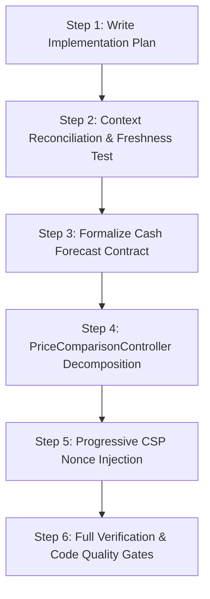

# IMPLEMENTATION PLAN: PRIORITY IMPROVEMENTS (P1 & P2 RECTIFICATIONS)

**Status:** Approved by Engineering Lead & Ready for Implementation  
**Date:** 2026-11-09  
**Target Environment:** Laravel 12.x / PHP 8.2 / MySQL 8.0 (`adasi_portal_test`)  
**Scope:** 4 High-Priority Tasks from Codebase & Architecture Audit

---

## 1. Executive Summary & Objective

This implementation plan executes four prioritized structural improvements across the ADASI Supplier Portal codebase:
1. **P1 — Cash Forecast Contract Decision & Formalization:** Align documentation (`AGENTS.md`, `context.md`), service docblocks, and test assertions to clarify that `PaymentForecastService` represents a **Ready-to-Pay Realization / Velocity Tracker** (titled *"Akumulasi Invoice Siap Dibayar"* in the UI), rather than a forward-looking cash outflow simulation.
2. **P1 — Progressive Content Security Policy (CSP) Hardening:** Introduce cryptographic per-request nonces (`App\Support\Security\CspNonce`), bind them to Vite (`Vite::useCspNonce()`), update `AddSecurityHeaders` middleware, annotate inline script tags in Blade layouts with `@nonce`, and reconcile outdated documentation.
3. **P2 — PriceComparisonController Decomposition:** Refactor the 2,133-line monster controller `app/Http/Controllers/Purchasing/PriceComparisonController.php` into four single-responsibility controllers and two domain query services (each well under the 800-line maintainability ceiling), while maintaining 100% backward compatibility for all HTTP routes, query parameters, and existing feature tests.
4. **P2 — Context Documentation Reconciliation & Freshness Gate:** Reconcile stale route listings in `context.md` (specifically the dead route `POST /finance/drp-groups/{group}/pay`), document closed decisions, and implement an automated architecture test (`tests/Feature/Architecture/ContextFreshnessTest.php`) to prevent documentation drift.

---

## 2. Architectural Analysis & Core Decisions

### 2.1 P1: Cash Forecast Contract Decision (Path A Adopted)
* **Codebase Evidence:**
  - `PaymentForecastService::eventInvoices()` queries Local Invoices strictly using `ready_to_pay_at` (with fallback to `approved_at`).
  - It intentionally ignores `due_date` and keeps already-`PAID` invoices in their historical Ready-to-Pay event period.
  - Returns `ga_amount: 0.0` and `drp_amount: 0.0` as legacy contract compatibility fields.
  - UI label in `resources/views/finance/dashboard.blade.php` displays `finance.labels.ready_accumulation` (*"Akumulasi Invoice Siap Dibayar"* / *"Cumulative Ready to Pay Invoices"*).
  - Feature test `PaymentForecastAndReportingTest::test_historical_paid_invoice_remains_in_its_ready_to_pay_period()` explicitly locks this behavior.
* **Decision:**
  - **Formalize Path A:** Do not change the financial logic or break historical accounting reports. The dashboard metric measures operational pipeline velocity ("when invoices became ready for payment"), not treasury cash outflow projections.
  - Update `AGENTS.md` (line 599) and `context.md` (Sections 7.8 and 11.2) to match this verified behavior and remove references to unimplemented DRP precedence.
  - Document the legacy nature of `ga_amount` and `drp_amount` zero-fill keys.

### 2.2 P1: Progressive CSP Hardening
* **Codebase Evidence:**
  - `AddSecurityHeaders.php` sets `Content-Security-Policy` directly when `config('auth_security.headers.csp_enforce')` is true (default is `true` in `config/auth_security.php`).
  - Current `script-src` directive uses `'unsafe-inline' 'unsafe-eval' https://cdn.jsdelivr.net`.
  - Alpine.js v3 is bundled locally via Vite (`resources/js/app.js`), but standard Alpine v3 relies on function evaluation for expressions (`x-data`, `x-init`, `@click`).
  - Layout `resources/views/layouts/app.blade.php` contains inline bootstrap scripts setting `window.AdasiLoginUrl`, `window.AdasiSession`, and theme preferences.
* **Decision:**
  - Introduce `App\Support\Security\CspNonce` singleton for generating a secure 128-bit (16-byte) base64-encoded nonce per request lifecycle.
  - Register a custom Blade directive `@nonce` returning `nonce="{{ app(\App\Support\Security\CspNonce::class)->get() }}"`.
  - Bind nonce to Vite via `Vite::useCspNonce($nonce)` in `AddSecurityHeaders` middleware.
  - Add `'nonce-{$nonce}'` to the CSP `script-src` directive.
  - Add `@nonce` to inline `<script>` tags in `resources/views/layouts/app.blade.php`.
  - Retain `'unsafe-eval'` for Alpine.js v3 expression parsing until an eval-free Alpine build is tested in a separate phase, but significantly harden script execution via strict nonce matching for all first-party inline scripts.
  - Update tests in `tests/Feature/Auth/SecurityHeadersTest.php`.

### 2.3 P2: PriceComparisonController Decomposition
* **Codebase Evidence:**
  - `PriceComparisonController.php` is 2,133 lines long, exceeding the 800-line soft maintainability ceiling.
  - It contains 4 distinct business sub-flows:
    1. Inter-Supplier Price Comparison (`interSupplier`, `showFromPr`)
    2. Historical Price Trends & Material Analytics (`historical`, `historicalMaterials`, `historicalForPr`)
    3. Vs-Best Price Comparison (`vsBestPrice`, `vsBestPriceData`)
    4. Item-Level Award Storage (`saveItemAwards`)
  - Extensive data aggregation logic for Historical and Vs-Best price calculations is mixed with HTTP handling.
* **Decision:**
  - Extract query & aggregation logic into two domain services:
    - `app/Services/Pricing/VsBestPriceQueryService.php`
    - `app/Services/Pricing/HistoricalPriceQueryService.php`
  - Decompose into four specialized controllers:
    - `app/Http/Controllers/Purchasing/InterSupplierComparisonController.php`
    - `app/Http/Controllers/Purchasing/HistoricalPriceComparisonController.php`
    - `app/Http/Controllers/Purchasing/VsBestPriceComparisonController.php`
    - `app/Http/Controllers/Purchasing/PriceComparisonAwardController.php`
  - Keep `PriceComparisonController.php` as a thin delegator class (<100 lines) forwarding calls to the new controllers for complete backward compatibility.
  - Update `routes/web.php` to point to the dedicated controllers.
  - Verify that all existing route names (`comparison.inter-supplier`, `comparison.historical`, `comparison.vs-best`, `comparison.save-awards`, etc.) remain identical.

### 2.4 P2: Context Documentation Reconciliation & Freshness Gate
* **Codebase Evidence:**
  - `context.md` line 615 lists dead route `POST /finance/drp-groups/{group}/pay` under open discrepancies.
  - `ConfigurationDefaultsTest.php` line 55 asserts that this route is already null/absent.
* **Decision:**
  - Move the dead route entry in `context.md` to Section 11.1 (Corrected).
  - Clarify the decimal precision rule in Section 11.2 (3 decimals for request validation vs `decimal(12,4)` in DB).
  - Create `tests/Feature/Architecture/ContextFreshnessTest.php` to lock down documented architectural invariants and prevent documentation drift.

---

## 3. Step-by-Step Implementation Sequence



### Step 1: Write Implementation Plan to Project Repository
- **Target File:** `docs/plans/IMPLEMENTATION-PLAN-PRIORITY-IMPROVEMENTS.md`
- **Output:** Fully documented plan in markdown.

### Step 2: Context Documentation Reconciliation & Freshness Gate
- **Target Files:**
  - `context.md`: Reconcile Section 7.8, Section 11.1, and Section 11.2.
  - `tests/Feature/Architecture/ContextFreshnessTest.php`: New automated architectural gate.
- **Verification:**
  ```bash
  php artisan test tests/Feature/ConfigurationDefaultsTest.php --compact
  php artisan test tests/Feature/Architecture/ContextFreshnessTest.php --compact
  ```

### Step 3: Formalize Cash Forecast Contract
- **Target Files:**
  - `app/Services/Payment/PaymentForecastService.php`: Class docblock and method documentation establishing the Ready-to-Pay Realization / Velocity contract.
  - `AGENTS.md`: Update line 599 to replace outdated DRP precedence with the verified Ready-to-Pay Realization contract.
- **Verification:**
  ```bash
  php artisan test tests/Feature/PaymentForecastAndReportingTest.php --compact
  ```

### Step 4: Decompose PriceComparisonController
- **Target Files:**
  - `app/Services/Pricing/VsBestPriceQueryService.php` [NEW]
  - `app/Services/Pricing/HistoricalPriceQueryService.php` [NEW]
  - `app/Http/Controllers/Purchasing/InterSupplierComparisonController.php` [NEW]
  - `app/Http/Controllers/Purchasing/HistoricalPriceComparisonController.php` [NEW]
  - `app/Http/Controllers/Purchasing/VsBestPriceComparisonController.php` [NEW]
  - `app/Http/Controllers/Purchasing/PriceComparisonAwardController.php` [NEW]
  - `app/Http/Controllers/Purchasing/PriceComparisonController.php` [REFACTOR to Delegator]
  - `routes/web.php` [UPDATE Controller references]
- **Verification:**
  ```bash
  php artisan test tests/Feature/PriceComparisonItemAwardTest.php --compact
  php artisan test tests/Feature/ItemLevelAwardTest.php --compact
  php artisan test tests/Feature/Purchasing/SplitAwardPoGenerationTest.php --compact
  ```

### Step 5: Progressive CSP Nonce Injection & Security Reconcile
- **Target Files:**
  - `app/Support/Security/CspNonce.php` [NEW]
  - `app/Providers/AppServiceProvider.php` [REGISTER `@nonce` Blade directive]
  - `app/Http/Middleware/AddSecurityHeaders.php` [BIND nonce to `Vite::useCspNonce()` and inject into `script-src`]
  - `resources/views/layouts/app.blade.php` [ADD `@nonce` to inline script tags]
  - `tests/Feature/Auth/SecurityHeadersTest.php` [ADD nonce assertions]
- **Verification:**
  ```bash
  php artisan test tests/Feature/Auth/SecurityHeadersTest.php --compact
  npm.cmd run build
  ```

### Step 6: Full Verification & Code Quality Gates
- **Actions:**
  - Run Pint linter on modified files.
  - Run purchasing, finance, and security test suites.
  - Verify zero regressions.

---

## 4. Verification & Testing Matrix

| Component | Target Test File | Expected Outcome |
|---|---|---|
| Architecture Freshness | `tests/Feature/Architecture/ContextFreshnessTest.php` | PASS (Dead routes absent, CSP enforce default true, controller bindings valid) |
| Configuration Defaults | `tests/Feature/ConfigurationDefaultsTest.php` | PASS (Original assertions preserved) |
| Payment Forecast | `tests/Feature/PaymentForecastAndReportingTest.php` | PASS (Realization contract and historical paid invoice assertions intact) |
| Price Comparison Awards | `tests/Feature/PriceComparisonItemAwardTest.php` | PASS (Item award storage, locking, validation) |
| Item Level Awards | `tests/Feature/ItemLevelAwardTest.php` | PASS (Comparison views, PR link preservation) |
| Split PO Generation | `tests/Feature/Purchasing/SplitAwardPoGenerationTest.php` | PASS (Award-to-PO conversion unaffected) |
| CSP & Security Headers | `tests/Feature/Auth/SecurityHeadersTest.php` | PASS (Nonce presence, CSP header enforcement) |
| Code Formatting | `vendor/bin/pint --test` | PASS (0 style violations) |

---

## 5. Risk Assessment & Mitigations

1. **Risk: Route Name Breakage during Controller Decomposition**  
   *Mitigation:* Keep existing route names intact in `routes/web.php`. Keep `PriceComparisonController` as a fallback delegator so any direct `action([PriceComparisonController::class, ...])` calls continue to function seamlessly.
2. **Risk: Inline Script Execution Blocked by CSP Nonce**  
   *Mitigation:* Retain `'unsafe-inline'` fallback alongside nonce in the initial stage so browsers supporting nonces ignore `'unsafe-inline'`, while older consumers do not break. Add `@nonce` explicitly to all inline script tags in `layouts/app.blade.php`.
3. **Risk: Database Connection or Concurrency Hazards in Price Comparison Awards**  
   *Mitigation:* Extract transactional logic directly into `PriceComparisonAwardController` preserving all `DB::transaction()` blocks, pessimistic locks (`lockForUpdate()`), and `PrItemAwardService` invocations verbatim.
