# ADASI Supplier Portal — Browser DevTools (F12) Security Audit & Hardening Implementation Plan

**Status Dokumen:** Siap Eksekusi (Menunggu Persetujuan User)  
**Standar Acuan:** OWASP Top 10 (2021/2025) & OWASP API Security Top 10 — `API3:2023 Broken Object Property Level Authorization (BOPLA / Excessive Data Exposure)`  
**Mode Sesi Audit:** Read-Only Audit + Implementation Plan (`0` perubahan pada kode produksi)  
**Target Direktori Aplikasi:** `c:\laragon\www\adasi_portal_supplier`

---

## 0. Prinsip Arsitektur Keamanan & Hard Invariants

> [!IMPORTANT]
> **Zero-Trust Client Boundary (Tanpa Gimmick Anti-F12)**
> 1. **DILARANG** menambahkan skrip pemblokir tombol `F12` / `Ctrl+Shift+I`, jebakan `debugger` loop, deteksi ukuran jendela DevTools, atau pemblokiran klik kanan global. Mekanisme tersebut adalah *security by obscurity* yang merusak aksesibilitas (WCAG) dan dapat dilewati sepenuhnya menggunakan `curl`, proxy intersep, atau menonaktifkan JavaScript.
> 2. File existing `resources/js/asset-protection.js` **dipertahankan apa adanya** karena terikat secara sempit hanya pada elemen gambar `.adasi-protected-asset` untuk perlindungan aset merek, bukan sebagai kontrol keamanan aplikasi.
> 3. **Definisi Aman terhadap F12:** Server **tidak pernah** mengirimkan secret key, kredensial, hash token autentikasi, stack trace, raw SQL, path sistem file privat, atau atribut model berlebih (*over-fetching* / BOPLA) ke browser; dan kode klien **tidak pernah** menyimpan PII finansial/pajak secara persisten di `localStorage` ataupun mencetak objek error/XHR internal ke `console.*` pada lingkungan produksi.

---

## 1. Ringkasan Eksekutif & Hasil Baseline Security Test (`[Verified]`)

### 1.1 Hasil Eksekusi Baseline Security Test Suite
Perintah yang dijalankan pada database pengujian terisolasi (`adasi_portal_test`):
```powershell
php artisan test --filter="TestingEnvironmentDatabaseSafetyTest|SecurityHeadersTest|LoginSecurityTest|SessionSecurityTest|ProfileSecurityTest|WorkspaceShellSecurityTest|DetailExportSecurityTest|HashidUrlSecurityTest|SupplierRegistrationSecurityTest"
```

- **Hasil Eksekusi Gabungan `[Verified]`:** `103 passed`, `16 failed` (`1.348 assertions`, durasi `88.93s`).
  - **8 Kelas Uji Lulus 100% (`95/95 tests PASS`):**
    - `Tests\Feature\TestingEnvironmentDatabaseSafetyTest` (`2/2 PASS` — terverifikasi kembali secara mandiri dalam `1.39s`)
    - `Tests\Feature\Auth\LoginSecurityTest` (`23/23 PASS`)
    - `Tests\Feature\Auth\SecurityHeadersTest` (`8/8 PASS`)
    - `Tests\Feature\Auth\SessionSecurityTest` (`26/26 PASS`)
    - `Tests\Feature\DetailExportSecurityTest` (`4/4 PASS`)
    - `Tests\Feature\HashidUrlSecurityTest` (`6/6 PASS`)
    - `Tests\Feature\ProfileSecurityTest` (`8/8 PASS`)
    - `Tests\Feature\WorkspaceShellSecurityTest` (`18/18 PASS`)
  - **Analisis Kausal `SupplierRegistrationSecurityTest` (`8 PASS`, `16 FAIL` saat digabung satu proses) `[Verified]`:**
    - `15 dari 16` kegagalan terjadi semata-mata pada asersi `assertSame(0, User::count())` (aktual: `3`) dan `assertSame(1, User::count())` (aktual: `4`) akibat kontaminasi urutan *test runner* dalam satu proses PHPUnit ketika kelas uji sebelumnya meninggalkan 3 baris `users` sebelum `SupplierRegistrationSecurityTest` (`use RefreshDatabase`) dieksekusi setelah `RefreshDatabaseState::$migrated` bernilai `true`.
    - `1 dari 16` kegagalan terjadi pada `test_production_registration_accepts_compliant_password_without_breach_lookup` (`L216`, HTTP 422 `password` uncompromised check) karena resolusi awal `UncompromisedVerifier` di proses gabungan sebelum mock diterapkan.
    - **Kesimpulan Baseline:** Seluruh kontrol header keamanan, sesi, MFA, Hashids, ekspor, dan workspace shell saat ini **hijau (`PASS`)**. Saat eksekusi Wave 1–2 nanti, `SupplierRegistrationSecurityTest` wajib diverifikasi pula dalam proses terpisah (`php artisan test tests/Feature/SupplierRegistration/SupplierRegistrationSecurityTest.php`) agar bebas polusi state antar-suite.

### 1.2 Distribusi Temuan per Tingkat Risiko

| Tingkat Risiko | Jumlah Temuan | Ringkasan Cakupan |
| :--- | :---: | :--- |
| **Critical** | **0** | Tidak ditemukan kebocoran `APP_KEY`, `DB_PASSWORD`, `PUSHER_APP_SECRET`, `TURNSTILE_SECRET_KEY`, `two_factor_secret`, source map `.map` produksi, maupun bypass autentikasi. |
| **High** | **4** | (1) Kebocoran raw SQL/path via jebakan hierarki `QueryException extends PDOException extends \RuntimeException` & `catch (\Throwable)` ke JSON 422/flash; (2) BOPLA pada 12 endpoint Yajra DataTables tanpa `->only(...)` (membocorkan `token_hash`, harga penawaran ke role QC, `file_path` privat, & state internal `User`); (3) Persistensi `nib`, `npwp` (NIK), dan `account_number` di `localStorage` + bug `beforeunload` yang menulis ulang draf pasca-submit; (4) 81 dari 82 model Eloquent tanpa `$hidden` + eksposur model mentah `PrItem`. |
| **Medium** | **5** | (1) Draf harga penawaran (`quotation_draft_*`) persisten di `localStorage`; (2) Celah `storageKeysToClear()` saat logout di perangkat bersama; (3) 26 titik `console.error`/`console.warn` yang mencetak objek XHR/Error di produksi; (4) Eksposur raw integer `sender_id` & `attachment.id` pada JSON chat supplier + `quotation->id`; (5) `vite.config.js` belum mengunci `sourcemap: false` & `drop: ['debugger']` + injeksi header dev `ngrok-skip-browser-warning` di produksi. |
| **Low** | **3** | (1) Normalisasi `Cache-Control: no-store` pada cache prerender `WrapWorkspaceShell`, route fallback tanpa grup `web`, dan rute registrasi/kredensial; (2) `@json(old())` tanpa filter allowlist di `admin/material-hs-code/_script.blade.php`; (3) Cookie `XSRF-TOKEN` non-`HttpOnly` bawaan Laravel yang tidak dipakai frontend + komentar HTML teknis di layout. |
| **Informational** | **3** | Kontrol positif yang sudah kuat dan wajib dipertahankan (`config/session.php` production-forced flags, sanitasi error async export & `/oauth/token`, isolasi Pusher public key). |

---

## 2. Matriks Temuan Terverifikasi (`[Verified]`)

### 2.1 Temuan Tingkat `High`

#### `F12-H01` — Kebocoran Pesan Exception Sistem / Raw SQL / Path Server ke Respons HTTP 422 JSON & Flash Session
- **Tingkat Risiko:** `High` (OWASP A10:2025 Mishandling of Exceptional Conditions / CWE-209)
- **Permukaan F12:** `Network` (Response JSON 422 & HTML Redirect Alert)
- **Bukti Kode `[Verified]`:**
  1. `app/Http/Controllers/Purchasing/MaterialReferencePriceController.php:190-198` (`importPreview`): menangkap `catch (\Throwable $e)` dan langsung mengembalikan `$e->getMessage()` ke `response()->json(['success' => false, 'message' => $e->getMessage()], 422)` serta `back()->with('error', $e->getMessage())`. Di baliknya, `app/Services/Pricing/ReferencePriceRuleImportService.php:24,27-35` dan `PhpSpreadsheet\IOFactory` melempar exception yang memuat path absolut file privat server (`storage/app/private/reference_price_imports/<hash>.xlsx`) atau detail struktur XML internal.
  2. **Jebakan Hierarki PHP `QueryException extends PDOException extends \RuntimeException`:** Di PHP/Laravel, `Illuminate\Database\QueryException` mewarisi `\PDOException` yang mewarisi `\RuntimeException`. Akibatnya, setiap blok `catch (\RuntimeException $e)` yang diletakkan sebelum `catch (\Exception|\Throwable)` **secara tidak sengaja menangkap error SQL mentah** dan membocorkannya ke klien:
     - `app/Http/Controllers/Supplier/ClaimController.php:143-152` (`respond` — **endpoint eksternal Supplier**): melempar `ValidationException::withMessages(['attachments' => $exception->getMessage()])` (HTTP 422 JSON di tab Network berisi `SQLSTATE[...] insert into ...`).
     - `app/Http/Controllers/Supplier/SupplierShipmentController.php:685-691` (`uploadDocument`) & `L730-736` (`uploadDocumentsBatch` — **endpoint eksternal Supplier**): menangkap `\InvalidArgumentException|\DomainException|\RuntimeException` tepat sebelum `catch (\Throwable $e)`, sehingga `QueryException` atau `UnableToWriteFile` (Flysystem `RuntimeException`) batal masuk ke handler generik dan bocor ke JSON 422 `errors.file[0]` / `errors.documents[0]`.
     - `app/Http/Controllers/Qc/QcInspectionController.php:169-175` (`store`): menangkap `\RuntimeException` sebelum `catch (\Exception $e)` (`L175`), mem-bypass `Log::error` + pesan generik di `L176-187`.
     - `app/Http/Controllers/Purchasing/MaterialClaimController.php:260-262` (`resolve`) & `app/Http/Controllers/Purchasing/ImportSupplierController.php:133-135, 151-153` (`approve`, `reject`): meneruskan `\RuntimeException::getMessage()` ke session flash `error`.
- **Skenario Eksploitasi Riil:** Saat terjadi kegagalan konstrain DB, *deadlock* transaksi, anomali encoding input, atau kegagalan tulis storage, pengguna eksternal (Supplier) yang memantau tab **F12 -> Network** memperoleh nama tabel, struktur kolom, nilai parameter query, dan path direktori akun cPanel.
- **Rekomendasi Perbaikan Minimal (Laravel-Native):**
  - Ganti pelemparan `\RuntimeException` bisnis di service/controller terkait dengan exception domain terjemahan yang sudah tersedia di proyek (`App\Exceptions\BusinessRuleViolation`, `App\Exceptions\BusinessRuleException`, atau `\DomainException`), lalu **hapus `\RuntimeException` dan `\Throwable` dari daftar catch yang menampilkan `$e->getMessage()` ke user**.
  - Pada `ReferencePriceRuleImportService.php:24`, hapus interpolasi `{$filePath}` dari pesan `InvalidArgumentException`; pada `MaterialReferencePriceController.php:190`, tangkap hanya `\InvalidArgumentException` untuk pesan validasi sheet/header (422), sementara `\Throwable` lainnya di-`report($e)` dan mengembalikan pesan terjemahan statis yang aman.

---

#### `F12-H02` — Broken Object Property Level Authorization (BOPLA) pada 12 Endpoint Yajra DataTables Tanpa Proyeksi `->only([...])`
- **Tingkat Risiko:** `High` (OWASP API3:2023 BOPLA / CWE-213)
- **Permukaan F12:** `Network` (XHR JSON payload `data[*]`)
- **Bukti Kode `[Verified]`:**
  Yajra `DataTables::eloquent($query)->make(true)` / `->toJson()` / `->toArray()` secara default memanggil `$model->toArray()` beserta seluruh relasi *eager-loaded* (`with(...)`) dan *lazy-loaded* yang tersentuh selama rendering kolom, kecuali dibatasi dengan `->only([...])`. Berbeda dengan 5 endpoint yang sudah aman memakai `->only([...])` (`PurchaseRequisitionController.php:163`, `PurchaseOrderController.php:195`, `Supplier\QuotationController.php:232`, `Supplier\SupplierPurchaseOrderController.php:172`, `LocalGoodsReceiptTableController.php:75`), ke-12 endpoint berikut **tidak memanggil `->only([...])`**:
  1. `app/Http/Controllers/SupplierRegistrationReviewController.php:52-85` (`index` AJAX): menyentuh `$attempt->user->registrationAccesses` (`L55`), sehingga setiap baris JSON membocorkan **`user.registration_accesses[*].token_hash`** (SHA-256 hash dari `access_key` registrasi supplier), **`submission_snapshot`** (berisi path file privat dokumen legal), `submission_checksum`, dan objek penuh `reviewer` (`User`).
  2. `app/Http/Controllers/Qc/QcInspectionController.php:39-71` (`dataWaiting`) & `L76-92` (`dataHistory`): role `qc` hanya bertugas memeriksa kualitas fisik barang, tetapi `dataWaiting` memuat `with(['supplier', 'quotations', 'shipmentItems.shipment', 'qcInspections'])` tanpa `->only(...)`, sehingga respons JSON ke browser QC membocorkan **seluruh atribut komersial `quotations`** (`currency`, `exchange_rate_id`, `payment_terms`, `reviewer_notes`, `general_notes`), `shipment.invoice_number`, serta atribut akun internal `supplier` & `inspector` (`email`, `two_factor_confirmed_at`, `two_factor_last_used_step`, `auth_session_version`).
  3. `app/Http/Controllers/Supplier/ClaimController.php:31-65` (`index` AJAX — **eksternal Supplier**): membocorkan kolom internal `PurchaseOrder` (`created_by`, `acknowledged_by`, `purchasing_sales_contract_uploaded_by`, `purchasing_sales_contract_attachment_id`, `sales_contract_notes`) dan `MaterialClaim.submitted_by` (raw integer ID staf Purchasing).
  4. `app/Http/Controllers/Supplier/SupplierShipmentController.php:50-154` (`index` AJAX — **eksternal Supplier**) & `app/Http/Controllers/Purchasing/ShipmentController.php:40-106`: membocorkan relasi `documents.latestAttachment` (termasuk `file_path` disk `private`, `file_inspection_id`, `uploaded_by`) dan raw integer ID seluruh relasi.
  5. `app/Http/Controllers/Purchasing/MaterialClaimController.php:44-81` (`dataActionNeeded`) & `L85-115` (`dataHistory`): membocorkan seluruh model `PurchaseOrder`, `User` (`supplier`), dan `QcInspection`.
  6. `app/Http/Controllers/Admin/UserController.php:31-78`: membocorkan seluruh kolom `Supplier` (`nib_fingerprint`, `tax_identity_fingerprint`, `compliance_questionnaire`) dan state keamanan internal `User` (`two_factor_last_used_step`, `auth_session_version`).
  7. `app/Http/Controllers/Admin/AuthAuditLogController.php:36-55`: membocorkan raw `user_id`, objek relasi `user`, dan `user_agent` mentah di luar kolom tabel yang ditampilkan.
  8. `app/Http/Controllers/Admin/HsCodeRuleController.php:36-74` & `app/Http/Controllers/Admin/MaterialMasterController.php:34-71`: membocorkan `created_by`, `updated_by`, `source_refs` mentah, `normalized_code`, `source_sheet`, `source_row`.
  9. `app/Http/Controllers/Purchasing/PeriodController.php:18-40`: me-load `Period::with('creator')` tanpa `->only(...)`, membocorkan objek penuh `User` milik Admin/pembuat periode (`email`, `two_factor_last_used_step`, `auth_session_version`) ke role `purchasing`.
  10. `app/Http/Controllers/Purchasing/VsBestPriceComparisonController.php:125-235`: `DataTables::query(...)` tanpa `->only(...)` mengekspos raw integer `current_pr_id`, `best_pr_id`, dan seluruh kolom agregat mentah subquery.
- **Skenario Eksploitasi Riil:** Pengguna terautentikasi dengan hak terbatas (Supplier eksternal atau staf QC) cukup membuka **F12 -> Network -> XHR** saat memuat tabel untuk memanen data komersial lintas-fungsi, jalur penyimpanan dokumen privat, ID integer internal (melemahkan kebijakan Hashids), serta metadata autentikasi akun pengguna lain.
- **Rekomendasi Perbaikan Minimal (Laravel-Native):**
  - Tambahkan `->only([...])` eksplisit pada seluruh 12 endpoint DataTables di atas sesuai daftar kolom yang benar-benar dikonsumsi konfigurasi DataTables pada view masing-masing.
  - Persempit *eager loading* relasi `User` menjadi `supplier:id,name`, `creator:id,name`, `inspector:id,name`, `reviewer:id,name`.

---

#### `F12-H03` — Persistensi PII Finansial/Pajak (`nib`, `npwp`, `account_number`) di `localStorage` pada Registrasi Supplier Publik + Bug Re-Persistensi `beforeunload` Pasca-Submit
- **Tingkat Risiko:** `High` (OWASP A04:2025 Sensitive Data Exposure in Client Storage / CWE-312 & CWE-922)
- **Permukaan F12:** `Application` (`Local Storage` -> `adasi_supplier_reg_draft`)
- **Bukti Kode `[Verified]`:**
  1. `resources/views/auth/supplier-register.blade.php:2065-2086`: Fungsi `persistDraft()` menyimpan objek `safePayload` dalam teks terang ke `localStorage.setItem('adasi_supplier_reg_draft', ...)` yang mencakup **`nib`**, **`npwp`** (16 digit yang pada rezim NIK-NPWP merupakan NIK KTP bagi wajib pajak orang pribadi/usaha tertentu), **`account_number`** (nomor rekening bank), **`account_holder_name`**, serta PII lengkap PIC (`email`, `pic_name`, `pic_email`, `pic_phone`, `address`, `phone`). Data di `localStorage` bertahan tanpa batas waktu meskipun browser ditutup.
  2. **Bug Siklus Hidup `beforeunload` (`L1939-1943` & `L2431-2436`) `[Verified]`:**
     ```javascript
     window.addEventListener('beforeunload', () => {
         if (this.isInitialized) {
             this.persistDraft();
         }
     });
     ```
     Saat pendaftar berhasil men-submit formulir (`this.isSubmitting = true` pada `L2431`), baik jalur async (`adasi:form-success`) maupun jalur fallback POST memanggil `clearStoredDraft()`. Namun sesaat kemudian ketika browser berpindah halaman menuju `/supplier/registration/success`, event `beforeunload` terpicu sementara `this.isInitialized` masih `true` dan `this.formData` masih berisi input lengkap. Akibatnya, **`this.persistDraft()` dieksekusi ulang dan menulis kembali seluruh NPWP, NIB, dan nomor rekening ke `localStorage` setelah registrasi selesai!**
  3. `resources/js/session-sync.js:22-31`: `storageKeysToClear()` tidak menghapus `adasi_supplier_reg_draft`.
- **Skenario Eksploitasi Riil:** Pada komputer bersama di kantor vendor/ekspedisi, pengguna berikutnya (atau skrip pihak ketiga pada origin yang sama) cukup membuka **F12 -> Application -> Local Storage** untuk menyalin NPWP/NIK, NIB, nomor rekening bank, dan identitas PIC perusahaan sebelumnya yang tetap tertinggal permanen meskipun pendaftaran telah berhasil dikirim.
- **Rekomendasi Perbaikan Minimal:**
  1. Pindahkan penyimpanan draf wizard registrasi dari `localStorage` ke **`sessionStorage`** (`adasi_supplier_reg_draft_v2`) dengan TTL (mis. `30 menit`) **DAN** keluarkan field sensitif tinggi (`nib`, `npwp`, `account_number`, `account_holder_name`) dari `safePayload` sehingga hanya field profil umum & progres kuesioner yang disimpan sementara dalam satu tab sesi.
  2. Tambahkan pembersihan warisan `localStorage.removeItem('adasi_supplier_reg_draft')` saat `init()`, `clearStoredDraft()`, dan di `resources/js/registration-receipt.js` (halaman `/supplier/registration/success`) serta `resources/js/session-sync.js` (`storageKeysToClear`).
  3. Perbaiki `clearStoredDraft()` agar memanggil `clearTimeout(this._draftTimer)` dan menandai `this.draftCleared = true`, serta tambahkan guard `if (this.isInitialized && !this.isSubmitting && !this.draftCleared)` pada listener `beforeunload` (`L1939`) dan `persistDraft()` (`L2049`), ditambah listener eksplisit `x-on:adasi:form-success="clearStoredDraft()"` pada elemen `<form id="supplierRegistrationForm">`.

---

#### `F12-H04` — Absennya Deklarasi `$hidden` pada 81 dari 82 Model Eloquent & Serialisasi Mentah Model pada `PrItemController`
- **Tingkat Risiko:** `High` (OWASP API3:2023 BOPLA — Defense-in-Depth Serialization Guardrail)
- **Permukaan F12:** `Network` (JSON Responses)
- **Bukti Kode `[Verified]`:**
  - Pemeriksaan menyeluruh atas 82 file di `app/Models/` membuktikan **hanya `app/Models/User.php:69-74`** yang memiliki properti `protected $hidden`.
  - `app/Models/User.php:69-74` menyembunyikan `password`, `remember_token`, `two_factor_secret`, `two_factor_recovery_codes`, tetapi **belum menyembunyikan** `two_factor_confirmed_at`, `two_factor_last_used_step` (step counter anti-replay TOTP!), `auth_session_version`, dan `must_change_password`.
  - Model sensitif lain yang sama sekali belum memiliki `$hidden`:
    - `SupplierRegistrationAccess`: `token_hash`
    - `AuthRememberToken`: `token_hash`, `session_id`, `device_hash`
    - `LocalProcurementImport`: `token_hash`, `owner_job_key`, `failure`
    - `Supplier`: `nib_fingerprint`, `tax_identity_fingerprint`
    - `SupplierRegistrationAttempt`: `submission_snapshot`, `submission_checksum`
    - `ExportJob`: `file_path`, `disk`, `export_class`, `export_args`, `export_options`, `error_message`
    - `ReferencePriceImport`: `private_storage_path`, `source_file_hash`
    - Model dokumen privat (`Attachment`, `SupplierMasterDocument`, `LocalInvoiceDocument`, `GaClaimDocument`, `PaymentVoucherDocument`, `ClaimAttachment`): `file_path`, `file_inspection_id`
  - `app/Http/Controllers/Purchasing/PrItemController.php:33,52`: mengembalikan `response()->json(['success' => true, 'item' => $item->fresh()])` (serialisasi mentah seluruh kolom `PrItem` termasuk foreign key internal `pr_id`, `material_master_id`, `hs_code_rule_id` tanpa proyeksi DTO/`only(...)`).
- **Rekomendasi Perbaikan Minimal (Laravel-Native):**
  - Tambahkan `protected $hidden` pada model-model sensitif di atas khusus untuk kolom hash kriptografis, state sesi/MFA internal, argumen job internal, dan path disk privat (pastikan tidak menyembunyikan kolom yang dipakai fitur bisnis lewat `toArray()`, serta verifikasi seluruh suite test).
  - Ubah respons `PrItemController@store` dan `PrItemController@update` agar mengembalikan proyeksi eksplisit `only([...])` + `hash => $item->getRouteKey()` alih-alih objek Eloquent mentah.

---

### 2.2 Temuan Tingkat `Medium`

#### `F12-M01` — Draf Penawaran Harga Komersial (`quotation_draft_*`) Tersimpan Persisten di `localStorage`
- **Tingkat Risiko:** `Medium` (OWASP A04:2025)
- **Permukaan F12:** `Application` (`Local Storage` -> `quotation_draft_<userId>_<prHash>`)
- **Bukti Kode `[Verified]`:** `resources/views/supplier/quotations/create.blade.php:2853, 2870, 2885, 2917, 2922, 2934`. Seluruh nilai form penawaran harga (`items[...][price_per_kg]`, `offered_weight_per_unit`, `payment_terms`, `general_notes`) disimpan ke `localStorage`. Bila sesi berakhir karena *idle timeout* atau pengguna menutup browser tanpa menekan tombol Logout, rincian harga penawaran komersial tetap tersimpan permanen di disk lokal. Selain itu, handler `$('#quotationForm').on('submit', ...)` pada `L2934` tidak menghapus key draf untuk skenario submit klasik.
- **Rekomendasi Perbaikan Minimal:** Migrasi `quotation_draft_*` dari `localStorage` ke **`sessionStorage`** (konsisten dengan `adasi_chat_draft_*` di `partials/chat-drawer.blade.php:146-170`), bersihkan residu lama `localStorage.removeItem(draftKey)` saat load/submit, dan batalkan `clearTimeout(autoSaveTimer)` saat `submit` (`L2934`).

#### `F12-M02` — Celah Pembersihan Storage Lintas-Pengguna pada `session-sync.js` (`storageKeysToClear`)
- **Tingkat Risiko:** `Medium` (OWASP A07:2025 Identification & Authentication Hygiene)
- **Permukaan F12:** `Application` (`Local Storage` & `Session Storage`)
- **Bukti Kode `[Verified]`:** `resources/js/session-sync.js:22-31` baru membersihkan 5 pola key saat logout. Key berikut **tertinggal** di browser bersama pasca-logout:
  - `adasi:export-download-claim:<exportJobId>` (`public/assets/js/async-export.js:347-361` — menyimpan klaim unduhan dengan Hashid job ekspor).
  - `adasi_supplier_reg_draft` / `adasi_supplier_reg_draft_v2` (`resources/views/auth/supplier-register.blade.php:2086`).
  - `adasi.po-documents.<actionUrl>` (`resources/js/po-document-upload.js:8,27` — menyimpan URL status batch dokumen PO lokal).
  - `adasi:workspace:<ver>:u-<userId>:*` (`resources/js/workspace-shell.js:1135-1188` — menyimpan daftar *bookmarks* berisi judul/URL halaman seperti nomor PO/invoice dan *usage map* di `localStorage`; padahal data ini sudah disinkronkan ke DB `user_preferences` melalui `shortcutsSyncUrl`, sedangkan regex di `session-sync.js:29` hanya menghapus `:guest`).
  - `finance_invoice_verify_scroll` (`resources/views/finance/invoices/show.blade.php:771,821`) & `TOAST_KEY` (`resources/js/local-procurement-import.js:34`).
- **Rekomendasi Perbaikan Minimal:** Perluas predikat `storageKeysToClear(keys)` di `resources/js/session-sync.js` (dan perbarui unit test `tests/js/session-sync.test.mjs`) agar membersihkan seluruh key ber-scope sesi/pengguna di atas saat logout, sambil membiarkan state `user_preferences` di-hydrate ulang secara aman dari server ketika pengguna login kembali.

#### `F12-M03` — 26 Titik `console.error` / `console.warn` Mencetak Objek Error, Stack JS, & Respons Gagal XHR di Produksi
- **Tingkat Risiko:** `Medium` (OWASP A02:2025 Security Misconfiguration / CWE-200)
- **Permukaan F12:** `Console`
- **Bukti Kode `[Verified]`:** Terdapat **26 pemanggilan `console.*`** aktif tanpa guard environment (`6` di `resources/js/`, `20` di `resources/views/` — rincian lengkap pada Lampiran B). Titik seperti `purchasing/comparison/_scripts.blade.php:1898` (`console.error('[vsBestTable] AJAX error:', error, thrown)`), `layouts/app.blade.php:1504` (`Pusher/Echo initialization failed:`, `error`), `finance/dashboard.blade.php:488`, `finance/invoices/show.blade.php:770,820`, `conversations/show.blade.php:348`, dan `partials/navbar.blade.php:266,499,573` mencetak objek `Error` / kegagalan jaringan langsung ke Console produksi padahal UI sudah menampilkan pesan status/toast ke pengguna.
- **Rekomendasi Perbaikan Minimal:**
  - Buat modul kecil `resources/js/debug-logger.js` (`devWarn`, `devError`) yang hanya meneruskan ke `console.warn`/`console.error` saat `import.meta.env.DEV === true` dan ekspos `window.AdasiDebug` (no-op saat produksi) untuk dipakai oleh skrip inline Blade.
  - Ganti ke-6 titik di `resources/js/*.js` dengan `devWarn`/`devError` dan ganti/hapus ke-20 titik di `resources/views/**/*.blade.php` sehingga produksi menghasilkan `0` dump objek error ke Console.

#### `F12-M04` — Eksposur Raw Integer ID (`sender_id`, `attachment.id`, `quotation->id`) pada JSON Chat & Pesan Error
- **Tingkat Risiko:** `Medium` (OWASP API3:2023 BOPLA — Hashid Boundary Leak)
- **Permukaan F12:** `Network` (XHR JSON `/conversations/{id}/drawer`, `/messages`, `/latest`, `/older`)
- **Bukti Kode `[Verified]`:**
  - `app/Http/Controllers/ConversationMessageController.php:308,311,322` (`formatMessage`): mengirimkan `'sender_id' => $message->sender_id`, `'sender' => ['id' => $message->sender_id, ...]`, serta `'attachments' => [['id' => $attachment->id, ...]]` (raw auto-increment integer `users.id` staf internal Purchasing dan `attachments.id`) ke browser **Supplier eksternal**. Padahal frontend chat hanya membutuhkan boolean `'is_me'`, `'sender_name'`, dan `'url' => route('attachments.show', $attachment)` yang sudah memakai Hashid (catatan: `message.id` tetap dipertahankan sebagai kursor paginasi `?after=` / `?before=` pada `L214,252` agar tidak memutus kontrak polling chat).
  - `app/Http/Controllers/Purchasing/PriceComparisonAwardController.php:106`: menampilkan integer `$quotation->id` dalam pesan error bisnis alih-alih `$quotation->getRouteKey()`.
- **Rekomendasi Perbaikan Minimal:** Hapus `sender_id` dan `sender.id` (atau ganti dengan Hashid `$message->sender?->getRouteKey()`), ubah `attachments[*].id` menjadi `$attachment->getRouteKey()` pada `ConversationMessageController::formatMessage()`, dan gunakan `$quotation->getRouteKey()` pada `PriceComparisonAwardController.php:106`.

#### `F12-M05` — `vite.config.js` Belum Mengunci `sourcemap: false` & `esbuild.drop` secara Eksplisit + Injeksi Header Dev `ngrok-skip-browser-warning` di Produksi
- **Tingkat Risiko:** `Medium` (OWASP A02:2025 Security Misconfiguration)
- **Permukaan F12:** `Sources` & `Network` (Request Headers) & `Elements`
- **Bukti Kode `[Verified]`:**
  1. `vite.config.js:61-90`: Objek `build` belum menyetel `sourcemap: false` secara eksplisit dan belum menyetel `esbuild: { drop: mode === 'production' ? ['debugger'] : [], legalComments: 'none' }`. Saat ini `public/build/` memiliki `0` file `.map` dan `VITE_APP_NAME="${APP_NAME}"` adalah satu-satunya variabel `VITE_*` di `.env.example:184`, tetapi konfigurasi eksplisit wajib dipasang agar perubahan preset build di masa depan tidak mempublikasikan kode sumber mentah ke tab **Sources**.
  2. `resources/views/layouts/app.blade.php:559-616`: Meng-override `window.fetch` dan `$.ajaxPrefilter` pada **semua environment termasuk produksi** untuk menyuntikkan header `ngrok-skip-browser-warning: true` ke setiap request XHR/fetch internal serta merender komentar `<!-- Ngrok browser warning bypass for internal async requests -->` di HTML produksi.
- **Rekomendasi Perbaikan Minimal:** Ubah `vite.config.js` menjadi fungsi `defineConfig(({ mode }) => ({ ... }))` dengan `build.sourcemap: false` dan `esbuild.drop` / `pure`, serta bungkus blok Ngrok di `layouts/app.blade.php:559-616` menggunakan `@unless(app()->isProduction()) ... @endunless`.

---

### 2.3 Temuan Tingkat `Low`

#### `F12-L01` — Normalisasi `Cache-Control: no-store, private` pada Prerender Cache `WrapWorkspaceShell`, Fallback Route, & Rute Registrasi/Kredensial
- **Tingkat Risiko:** `Low` (Defense-in-Depth Caching Boundary)
- **Permukaan F12:** `Network` (Response Headers) & `Application` (Disk Cache)
- **Bukti Kode `[Verified]`:**
  - `app/Http/Middleware/AddSecurityHeaders.php:30-33` secara global telah menyetel `Cache-Control: no-store, private` dan `Pragma: no-cache` untuk semua rute dalam grup `web` selama respons tidak memiliki direktif `public` (`0` penggunaan direktif `public` ditemukan di `app/`).
  - Namun:
    1. Pada `bootstrap/app.php:80-84`, `WrapWorkspaceShell` dieksekusi **di dalam** `AddSecurityHeaders`, sehingga `WrapWorkspaceShell.php:148` menyimpan header `Cache-Control` bawaan Symfony (`no-cache, private`) ke dalam cache prerender sebelum `AddSecurityHeaders` menimpanya.
    2. `PortalLegacyPathController` (`routes/web.php:1009-1012`) dijalankan dengan `->withoutMiddleware('web')`, sehingga respons `301` / `200 Allow` tidak menyertakan `Cache-Control: no-store, private` dan `X-Content-Type-Options: nosniff`.
    3. Grup rute publik registrasi supplier (`routes/web.php:368-395`: `supplier.register`, `supplier.registration.*`) serta endpoint mutasi kredensial (`routes/web.php:972`: `password.update` dan `L995`: `profile.two-factor.start`) belum mendeklarasikan alias eksplisit `no-store` sebagaimana rute autentikasi lainnya (`L912-1004`).
- **Rekomendasi Perbaikan Minimal:** Normalisasi `cache_control` pada `WrapWorkspaceShell` menjadi `'no-store, private'`, tambahkan header `Cache-Control: no-store, private` & `X-Content-Type-Options: nosniff` di `PortalLegacyPathController`, dan pasang middleware `no-store` secara eksplisit pada grup `supplier.register*` / `supplier.registration.*`, `password.update`, dan `profile.two-factor.start`.

#### `F12-L02` — Proyeksi `@json(old())` Tanpa Allowlist Field di `admin/material-hs-code/_script.blade.php`
- **Tingkat Risiko:** `Low` (DOM Data Minimization)
- **Permukaan F12:** `Elements` (Inline `<script>`)
- **Bukti Kode `[Verified]`:** `resources/views/admin/material-hs-code/_script.blade.php:15` mencetak `const oldInput = @json(old());` (seluruh payload flash input termasuk `_token` dan parameter ekstra), padahal kode di `L402-423` hanya membaca 10 key spesifik (`record_id`, `hs_category`, `density_profile`, `manufacturer_scope`, `is_active`, `material_category`, `shape`, `priority`, `status`, `conditions_json`).
- **Rekomendasi Perbaikan Minimal:** Batasi dengan `\Illuminate\Support\Arr::only((array) old(), [...10 keys...])`.

#### `F12-L03` — Cookie `XSRF-TOKEN` Non-`HttpOnly` Default Laravel yang Tidak Digunakan Frontend & Komentar HTML Teknis
- **Tingkat Risiko:** `Low` (Surface Minimization di Tab Cookies & Elements)
- **Permukaan F12:** `Application` (`Cookies`) & `Elements`
- **Bukti Kode `[Verified]`:**
  - Hasil pencarian menyeluruh (`git grep -i xsrf`) memastikan **nol** kode JS/PHP di ADASI Supplier Portal membaca cookie `XSRF-TOKEN` (seluruh proteksi CSRF berjalan melalui `<meta name="csrf-token">`, input `_token`, dan header `X-CSRF-TOKEN`). Namun middleware bawaan `Illuminate\Foundation\Http\Middleware\ValidateCsrfToken` memiliki `$addHttpCookie = true`, sehingga browser selalu menerima cookie `XSRF-TOKEN` **tanpa flag `HttpOnly`** yang dapat dibaca lewat `document.cookie` di F12 Console/Application.
  - Terdapat 20 komentar HTML `<!-- ... -->` di `layouts/app.blade.php`, `layouts/guest.blade.php`, `purchasing/periods/index.blade.php`, dan `welcome.blade.php` (seperti `<!-- Tailwind design foundation + Alpine entry (hybrid compatibility phase) -->`).
- **Rekomendasi Perbaikan Minimal:**
  - Buat `app/Http/Middleware/ValidateCsrfToken.php` yang mewarisi `Illuminate\Foundation\Http\Middleware\ValidateCsrfToken` dengan `protected $addHttpCookie = false;`, lalu daftarkan lewat container singleton `$this->app->singleton(\Illuminate\Foundation\Http\Middleware\ValidateCsrfToken::class, \App\Http\Middleware\ValidateCsrfToken::class)` di `AppServiceProvider::register()`. *(Penting: binding via singleton pada class framework menjaga `->withoutMiddleware([ValidateCsrfToken::class])` di `routes/web.php:952` tetap bekerja identik tanpa mengubah definisi rute `session.reconnect`!)*
  - Ubah komentar HTML `<!-- ... -->` di Blade menjadi komentar server-side Blade `{{-- ... --}}` agar tidak dikirim dalam payload HTML ke browser.

---

### 2.4 Observasi Positif (`Informational` — Wajib Dipertahankan)

- **`F12-I01` `[Verified]` — Hardening Cookie Sesi & Cookie Autentikasi Kustom Sudah Optimal:**
  `config/session.php:50-52, 174-210` mengunci paksa `encrypt = true`, `secure = true`, `http_only = true`, dan `same_site = 'lax'` ketika `APP_ENV === 'production'`. Cookie kustom `adasi_known_device` (`app/Services/Auth/KnownDeviceService.php:160-170`) dan cookie grant rekoneksi sesi (`app/Services/Auth/SessionReconnectService.php:61-71`, payload terenkripsi `Crypt::encryptString`) keduanya sudah menggunakan `httpOnly: true`, `secure: (bool) config('session.secure')`, dan `sameSite: 'lax'`.
- **`F12-I02` `[Verified]` — Isolasi Secret Server pada DOM & Broadcasting:**
  Pemeriksaan seluruh `@json(...)`, `@js(...)`, `window.*`, `.env.example`, dan `routes/channels.php` mengonfirmasi `PUSHER_APP_SECRET`, `TURNSTILE_SECRET_KEY`, `APP_KEY`, dan kredensial DB tidak pernah dirender ke klien (`layouts/app.blade.php:1442` hanya merender `$pusherClient['key']` publik dan mengotorisasi channel privat `App.Models.User.{id}` secara ketat di `routes/channels.php:5-7`).
- **`F12-I03` `[Verified]` — Sanitasi Error Worker Export & Endpoint OAuth Token:**
  `ExportDownloadController.php:249-266` (`safeFailureMessage`) dan `bootstrap/app.php:57-60` (`/oauth/token`) telah memetakan error internal menjadi pesan generik aman sebelum dikirim sebagai JSON.

---

## 3. Rencana Implementasi Bertahap (2 Waves — Siap Eksekusi)

```mermaid
flowchart LR
    subgraph W1["Wave 1 — High Priority (Server & Storage Boundary)"]
        T11["1.1 Sanitasi Exception Leak\n(Controller & Import Service)"]
        T12["1.2 Proyeksi DataTables ->only()\n& JSON DTO Minimization"]
        T13["1.3 Model $hidden Guardrails\n(User, Token, Docs, ExportJob)"]
        T14["1.4 Isolasi Web Storage\n(sessionStorage + beforeunload Fix)"]
    end
    subgraph W2["Wave 2 — Medium/Low Priority (Console, Build, Headers & Tests)"]
        T21["2.1 Redaksi 26 console.*\n& Guard Ngrok/HTML Comments"]
        T22["2.2 Vite Production Hardening\n(sourcemap:false, drop debugger)"]
        T23["2.3 No-Store Parity &\nDisable Non-HttpOnly XSRF Cookie"]
        T24["2.4 Regression Guardrails\n(PHPUnit + Node Static Guard)"]
    end
    T11 --> T12 --> T13 --> T14 --> T21 --> T22 --> T23 --> T24
```



---

### Wave 1 — Server Serialization, Exception Boundary & Sensitive Web Storage (`High` & Related `Medium`)

#### Task 1.1 — Sanitasi Exception Leak di Controller & Service (`F12-H01`)
1. **`app/Services/Pricing/ReferencePriceRuleImportService.php` (`L23-25`):**
   - Ganti `throw new InvalidArgumentException("Excel file not found: {$filePath}");` menjadi pesan bebas path sistem file: `throw new InvalidArgumentException('Uploaded Excel workbook could not be found.');`.
2. **`app/Http/Controllers/Purchasing/MaterialReferencePriceController.php` (`L188-198`):**
   - Pisahkan penangkapan exception pada `importPreview`:
     ```php
     try {
         $parsed = $this->ruleImportService->parseWorkbook($fullPath, $sheetName);
     } catch (\InvalidArgumentException $e) {
         Storage::delete($path);
         return $request->wantsJson()
             ? response()->json(['success' => false, 'message' => $e->getMessage()], 422)
             : back()->with('error', $e->getMessage());
     } catch (\Throwable $e) {
         Storage::delete($path);
         report($e);
         $msg = __('purchasing.copy.the_spreadsheet_could_not_be_read_verify_the_file_and_try_again');
         return $request->wantsJson()
             ? response()->json(['success' => false, 'message' => $msg], 422)
             : back()->with('error', $msg);
     }
     ```
3. **Eliminasi Jebakan `QueryException extends PDOException extends \RuntimeException`:**
   - **`app/Http/Controllers/Supplier/ClaimController.php` (`L116-157`):** Ubah `throw new \RuntimeException(__('claims.copy.this_claim_can_no_longer_accept_a_supplier_response'))` (`L117`) menjadi `throw new \DomainException(...)` (dan periksa apakah `FileInspectionService::storeUpload` melempar `ValidationException` / `BusinessRuleException`). Di blok catch (`L143`), tangkap `\DomainException|\InvalidArgumentException|BusinessRuleException` (BUKAN `\RuntimeException`), sementara `\Throwable` membersihkan file `$staged`, memanggil `report($exception)`, dan mengembalikan pesan aman generik (JSON 500/422 terjemahan tanpa SQL).
   - **`app/Http/Controllers/Supplier/SupplierShipmentController.php` (`L685-698` & `L730-743`):** Hapus `\RuntimeException` dari daftar `catch (\InvalidArgumentException|\DomainException $e)` (verifikasi apakah `ShipmentService::uploadDocument` / `uploadDocumentsBatch` melempar `\RuntimeException` bisnis; jika ada, ubah di `ShipmentService` menjadi `\DomainException` atau `BusinessRuleException`), dan pada blok `catch (\Throwable $e)` pastikan cabang `$request->expectsJson()` melakukan `report($e)` lalu mengembalikan `response()->json(['message' => __('shipments.copy.an_unexpected_error_occurred_while_uploading_the_document_please_try_again')], 500)` agar konsisten tidak bocor saat `APP_DEBUG` apa pun.
   - **`app/Http/Controllers/Qc/QcInspectionController.php` (`L169-188` & `L239-249`):** Verifikasi exception domain yang dilempar `QcInspectionSubmissionService` (ubah `\RuntimeException` bisnis di service tersebut menjadi `\DomainException` / `BusinessRuleViolation`), lalu ubah `catch (\RuntimeException $e)` (`L169`) menjadi `catch (\DomainException|BusinessRuleViolation $e)`. Pada `catch (\Exception $e)` (`L175`) dan `storeAttachments` (`L239`), jangan me-rethrow raw `$e` mentah tanpa pelaporan aman; kembalikan JSON 500 pesan generik terjemahan untuk request AJAX non-`ValidationException`.
   - **`app/Http/Controllers/Purchasing/MaterialClaimController.php` (`L248, L260`):** Ubah `throw new \RuntimeException(...)` pada `L248` menjadi `throw new \DomainException(...)` dan tangkap `catch (\DomainException $exception)` pada `L260`.
   - **`app/Http/Controllers/Purchasing/ImportSupplierController.php` (`L133, L151`):** Periksa `VendorChangeRequestService::approve` & `reject`; ubah `\RuntimeException` bisnis menjadi `\DomainException` (atau tangkap `InvalidArgumentException|\DomainException`) sehingga `QueryException` tidak pernah tertangkap sebagai pesan flash user.

#### Task 1.2 — Proyeksi Eksplisit `->only([...])` pada DataTables & Sanitasi JSON DTO (`F12-H02`, `F12-H04`, `F12-M04`)
> [!WARNING]
> **Aturan Kompatibilitas UI sebelum Menambahkan `->only([...])`:** Untuk setiap endpoint DataTables di bawah, baca konfigurasi `columns: [{ data: '...' }]` dan callback `render` / `rowCallback` pada file Blade pasangannya terlebih dahulu agar seluruh field yang dipakai UI (seperti `DT_RowIndex`, `DT_RowId`, `DT_RowAttr`, `status`, dll.) tetap disertakan 100%.

1. **Tambahkan `->only([...])` dan batasi kolom relasi `with(...)` pada 12 endpoint DataTables:**
   - `app/Http/Controllers/SupplierRegistrationReviewController.php:52-85` (`index`): batasi ke `['DT_RowIndex', 'company_name', 'reference', 'nib', 'npwp', 'pic', 'status_badge', 'submitted_date', 'reviewer_name', 'action']` + eager-load `reviewer:id,name` dan `user.registrationAccesses:id,user_id,registration_reference`.
   - `app/Http/Controllers/Qc/QcInspectionController.php:47-71` (`dataWaiting`): batasi `supplier:id,name` dan tambahkan `->only(['po_number_display', 'supplier_name', 'arrival_date', 'item_count', 'action'])` (menutup kebocoran `quotations` komersial ke role QC).
   - `app/Http/Controllers/Qc/QcInspectionController.php:81-92` (`dataHistory`): batasi `purchaseOrder.supplier:id,name`, `inspector:id,name`, dan tambahkan `->only(['po_number', 'supplier_name', 'inspected_date', 'status_badge', 'inspector_name', 'action'])`.
   - `app/Http/Controllers/Supplier/ClaimController.php:36-65` (`index`): batasi `purchaseOrder:id,po_number,supplier_id` dan tambahkan `->only(['claim_id', 'po_number', 'created_date', 'deadline_display', 'status_badge', 'action'])`.
   - `app/Http/Controllers/Supplier/SupplierShipmentController.php:79-154` (`index`) & `app/Http/Controllers/Purchasing/ShipmentController.php:46-106` (`index`): tambahkan `->only([...])` sesuai kolom tabel pengiriman (`shipment_number_display`, `po_references` / `consolidated_pos`, `supplier_name`, `supplier_reference_display`, `items_count`, `total_qty`, `actual_weight`, `total_weight`, `shipment_date`, `shipment_date_display`, `estimated_arrival`, `actual_arrival`, `missing_documents`, `status_badge`, `action` — pastikan `DT_RowId` di `Purchasing\ShipmentController` tetap bekerja untuk `PurchasingNavigation::rememberRecordWindowFromDataTable`, karena Yajra tetap menyertakan `DT_RowId` dari `setRowId()` meskipun `->only(...)` aktif; verifikasi lewat `HashidUrlSecurityTest`!).
   - `app/Http/Controllers/Purchasing/MaterialClaimController.php:57-80` (`dataActionNeeded`) & `L88-115` (`dataHistory`): tambahkan `->only([...])` sesuai kolom tabel klaim.
   - `app/Http/Controllers/Admin/UserController.php:33-78` (`index`): tambahkan `->only(['DT_RowIndex', 'name_display', 'email', 'role_badge', 'status_badge', 'mfa_badge', 'created_date', 'action'])` (sesuaikan dengan `resources/views/admin/users/index.blade.php`).
   - `app/Http/Controllers/Admin/AuthAuditLogController.php:45-54` (`data`): tambahkan `->only(['created_at', 'event_display', 'user_display', 'email_attempted', 'ip_address', 'metadata'])` (verifikasi terhadap `resources/views/admin/auth-audit-logs/index.blade.php`).
   - `app/Http/Controllers/Admin/HsCodeRuleController.php:36-73` & `app/Http/Controllers/Admin/MaterialMasterController.php:34-70`: tambahkan `->only([...])` sesuai kolom yang dipakai `resources/views/admin/material-hs-code/_script.blade.php:27-80`.
   - `app/Http/Controllers/Purchasing/PeriodController.php:18-40`: ubah `Period::with('creator:id,name')` dan tambahkan `->only(['name_display', 'month_display', 'year_display', 'status_badge', 'creator_name', 'action'])` (verifikasi terhadap `resources/views/purchasing/periods/index.blade.php`).
   - `app/Http/Controllers/Purchasing/VsBestPriceComparisonController.php:135-235`: tambahkan `->only(['material_display', 'current_price_display', 'best_price_display', 'diff_display', 'potential_difference_display', 'status_badge', 'action'])` (verifikasi terhadap `resources/views/purchasing/comparison/_scripts.blade.php:1904-1915`).
2. **Proyeksi DTO pada Endpoint JSON Non-DataTables:**
   - `app/Http/Controllers/Purchasing/PrItemController.php:33,52`: ganti `'item' => $item->fresh()` dengan array proyeksi eksplisit berisi atribut bisnis material (`hash`, `material_name`, `shape`, dimensi, `quantity`, `unit`, `weight_needed`, `hs_code`, `hs_code_status`, `remarks`).
   - `app/Http/Controllers/ConversationMessageController.php:304-328` (`formatMessage`): hapus `'sender_id'` integer mentah, ubah `'sender' => ['name' => ...]` (tanpa raw `users.id`), dan ubah `'attachments' => [['id' => $attachment->getRouteKey(), 'name' => ..., 'type' => ..., 'url' => ...]]` (verifikasi `conversations/show.blade.php` & `partials/chat-drawer.blade.php` hanya memakai `is_me`, `sender_name` / `sender.name`, dan `attachment.url`/`name`).
   - `app/Http/Controllers/Purchasing/PriceComparisonAwardController.php:106`: ganti `$quotation->id` menjadi `$quotation->getRouteKey()`.

#### Task 1.3 — Hardening `$hidden` pada Model Eloquent Sensitif (`F12-H04`)
Tambahkan/perluas `protected $hidden` secara defensif pada model berikut:
- `app/Models/User.php`: tambahkan `'two_factor_confirmed_at'`, `'two_factor_last_used_step'`, `'auth_session_version'`, `'must_change_password'` ke `$hidden` (tetap dapat dibaca langsung via `$user->two_factor_confirmed_at` / `$user->hasTwoFactorAuthentication()` di PHP, hanya disembunyikan saat `toArray()` / `toJson()`).
- `app/Models/SupplierRegistrationAccess.php`: `protected $hidden = ['token_hash'];`
- `app/Models/AuthRememberToken.php`: `protected $hidden = ['token_hash', 'session_id', 'device_hash'];`
- `app/Models/LocalProcurementImport.php`: `protected $hidden = ['token_hash', 'owner_job_key', 'failure'];`
- `app/Models/Supplier.php`: `protected $hidden = ['nib_fingerprint', 'tax_identity_fingerprint'];`
- `app/Models/SupplierRegistrationAttempt.php`: `protected $hidden = ['submission_snapshot', 'submission_checksum'];` *(Catatan: `SupplierRegistrationSecurityTest.php:76,77` memanggil `getAttributes()`, bukan `toArray()`, sehingga tetap kompatibel 100%.)*
- `app/Models/ExportJob.php`: `protected $hidden = ['file_path', 'disk', 'export_class', 'export_args', 'export_options', 'error_message'];`
- `app/Models/ReferencePriceImport.php`: `protected $hidden = ['private_storage_path', 'source_file_hash'];`
- `app/Models/Attachment.php`, `SupplierMasterDocument.php`, `LocalInvoiceDocument.php`, `GaClaimDocument.php`, `PaymentVoucherDocument.php`, `ClaimAttachment.php`: `protected $hidden = ['file_path', 'file_inspection_id'];`

#### Task 1.4 — Isolasi & Sanitasi Web Storage serta Allowlist `@json(old())` (`F12-H03`, `F12-M01`, `F12-M02`, `F12-L02`)
1. **`resources/views/auth/supplier-register.blade.php` (`L1808-2090`, `L2431-2437`) & `resources/js/registration-receipt.js`:**
   - Ganti media simpan draf dari `localStorage` ke **`sessionStorage`** dengan key `adasi_supplier_reg_draft_v2` dan metadata `saved_at: Date.now()` (kedaluwarsa otomatis `30 * 60 * 1000` ms).
   - **Keluarkan** `nib`, `npwp`, `account_number`, dan `account_holder_name` (serta tetap keluarkan `password` dan `password_confirmation`) dari `safePayload` sehingga nol nomor rekening maupun NPWP/NIK pernah ditulis ke Web Storage browser. Perbarui juga `restoreDraft()` agar mengabaikan key sensitif tersebut jika disuntikkan manual.
   - Bersihkan key lama `localStorage.removeItem('adasi_supplier_reg_draft')` pada `init()`, `clearStoredDraft()`, dan saat `bootRegistrationReceipt()` di `resources/js/registration-receipt.js` dieksekusi.
   - Tambahkan properti state `draftCleared: false`; di dalam `clearStoredDraft()` panggil `clearTimeout(this._draftTimer); this.draftCleared = true;` dan hapus baik `sessionStorage.removeItem('adasi_supplier_reg_draft_v2')` maupun `localStorage.removeItem('adasi_supplier_reg_draft')`.
   - Pada listener `beforeunload` (`L1939`) dan awal `persistDraft()` (`L2049`), tambahkan guard `if (!this.isInitialized || this.isSubmitting || this.draftCleared) return;`, serta pastikan elemen `<form id="supplierRegistrationForm">` memiliki `x-on:adasi:form-success="clearStoredDraft()"`.
2. **`resources/views/supplier/quotations/create.blade.php` (`L2850-2936`) & `resources/js/quotation-availability-guard.js`:**
   - Pindahkan penyimpanan `draftKey` (`quotation_draft_<userId>_<prHash>`) dari `localStorage` ke **`sessionStorage`** dan selaraskan `quotation-availability-guard.js` agar membersihkan `sessionStorage` serta `localStorage` warisan saat `lock()` / `adasi:form-success`.
   - Panggil pembersihan migrasi `try { localStorage.removeItem(draftKey); } catch (e) {}` saat inisialisasi, pada `adasi:quotation-cancelled`, `adasi:form-success`, dan pada `$('#quotationForm').on('submit', ...)` (`clearTimeout(autoSaveTimer)` + `sessionStorage.removeItem(draftKey)`).
3. **`resources/js/session-sync.js` (`L22-31`):**
   - Perbarui `storageKeysToClear(keys)` agar mencakup:
     - `key === PENDING_EXPORT_STORAGE_KEY`
     - `key === 'adasi_supplier_reg_draft' || key === 'adasi_supplier_reg_draft_v2'`
     - `key === 'finance_invoice_verify_scroll' || key === 'adasi:local-import-toast' || key === 'adasi:local-procurement-import-toast'`
     - `/^adasi:export-download-claim:/`
     - `/^adasi\.po-documents\./`
     - `/^quotation_draft_\d+(?:_[A-Za-z0-9]+)?$/`
     - `/^adasi_chat_draft_/`
     - `/^adasi:workspace:recently-closed:/` dan `/^adasi:workspace:[^:]+:guest(?::|$)/` *(mempertahankan kontrak `AGENTS.md:814, 891` agar preferensi `usage`/`favorites`/`bookmarks`/`shortcuts-layout`/`pinned` per-user tidak hilang saat logout)*.
   - Perbarui cakupan unit test di `tests/js/session-sync.test.mjs`.
4. **`resources/views/admin/material-hs-code/_script.blade.php` (`L15`):**
   - Ganti `const oldInput = @json(old());` menjadi:
     ```blade
     const oldInput = @json(\Illuminate\Support\Arr::only((array) old(), [
         'record_id', 'hs_category', 'density_profile', 'manufacturer_scope',
         'is_active', 'material_category', 'shape', 'priority', 'status', 'conditions_json',
     ]));
     ```

---

### Wave 2 — Console Hygiene, Vite Build Hardening, `no-store` / Cookie Parity & Regression Guardrails (`Medium` & `Low`)

#### Task 2.1 — Redaksi 26 Titik `console.*`, Guard Script Ngrok, & Pembersihan Komentar HTML (`F12-M03`, `F12-M05`, `F12-L03`)
1. **Buat Helper `resources/js/debug-logger.js` dan daftarkan di `resources/js/app.js` & `resources/js/auth.js`:**
   ```javascript
   const isDev = Boolean(import.meta.env?.DEV);

   export function devWarn(...args) {
       if (isDev) console.warn(...args);
   }

   export function devError(...args) {
       if (isDev) console.error(...args);
   }

   if (typeof window !== 'undefined') {
       window.AdasiDebug = Object.freeze({ warn: devWarn, error: devError });
   }
   ```
2. **Ganti 6 titik `console.warn`/`console.error` di `resources/js/`** (`adasi-loader.js:614`, `file-upload.js:120`, `server-tabs.js:106,530,626`, `workspace-shell.js:1857`) dengan `devWarn` / `devError`.
3. **Ganti 20 titik `console.warn`/`console.error` di `resources/views/`** (`auth/supplier-register.blade.php:2033`, `conversations/show.blade.php:348`, `finance/dashboard.blade.php:488`, `finance/invoices/show.blade.php:770,820`, `layouts/app.blade.php:1504`, `local-invoices/scripts.blade.php:53`, `partials/chat-drawer.blade.php:1006`, `partials/navbar.blade.php:266,499,573`, `purchasing/comparison/_scripts.blade.php:291,302,311,325,980,1841,1898`, `supplier/price-history/historical.blade.php:501`, `supplier/quotations/create.blade.php:2397`) dengan `window.AdasiDebug?.warn(...)` / `window.AdasiDebug?.error(...)` (atau penghapusan di blok `catch` yang sudah menampilkan `AdasiToast`).
4. **Guard Blok Ngrok & Komentar HTML:**
   - Di `resources/views/layouts/app.blade.php:559-616`, bungkus blok `ngrok-skip-browser-warning` dengan `@unless(app()->isProduction()) ... @endunless`.
   - Konversi 20 komentar HTML `<!-- ... -->` di `layouts/app.blade.php`, `layouts/guest.blade.php`, `purchasing/periods/index.blade.php`, dan `welcome.blade.php` menjadi komentar Blade `{{-- ... --}}`.

#### Task 2.2 — Hardening Produksi `vite.config.js` (`F12-M05`)
Ubah `vite.config.js` agar menerima `{ mode }` dan mengunci opsi build produksi secara eksplisit:
```javascript
export default defineConfig(({ mode }) => ({
    css: {
        // ... pertahankan plugin postcss adasi-tailwind-v3-compatibility existing ...
    },
    esbuild: {
        drop: mode === 'production' ? ['debugger'] : [],
        pure: mode === 'production' ? ['console.log', 'console.debug', 'console.info'] : [],
        legalComments: 'none',
    },
    build: {
        sourcemap: false,
        rollupOptions: {
            // ... pertahankan manualChunks portal-core & portal-forms existing ...
        },
    },
    plugins: [
        // ... pertahankan tailwindcss() & laravel(...) existing ...
    ],
}));
```

#### Task 2.3 — Pemerataan `Cache-Control: no-store, private` & Eliminasi Cookie Non-`HttpOnly` `XSRF-TOKEN` (`F12-L01`, `F12-L03`)
1. **`app/Http/Middleware/WrapWorkspaceShell.php` (`L47, L148`):**
   - Pastikan cache prerender menyimpan dan mengembalikan `'Cache-Control' => 'no-store, private'` secara konsisten ketika tidak ada direktif `public`.
2. **`app/Http/Controllers/PortalLegacyPathController.php` (`L37, L52`):**
   - Tambahkan header `'Cache-Control' => 'no-store, private'` dan `'X-Content-Type-Options' => 'nosniff'` pada respons `RedirectResponse` (`301`) dan `options` (`200`).
3. **`routes/web.php` (`L368-395`, `L972`, `L995`):**
   - Tambahkan middleware `'no-store'` secara eksplisit pada grup publik `supplier/register` & `supplier/registration/*`, serta pada rute `password.update` dan `profile.two-factor.start`.
4. **Eliminasi Cookie `XSRF-TOKEN` Non-`HttpOnly`:**
   - Buat `app/Http/Middleware/ValidateCsrfToken.php`:
     ```php
     <?php

     namespace App\Http\Middleware;

     use Illuminate\Foundation\Http\Middleware\ValidateCsrfToken as Middleware;

     class ValidateCsrfToken extends Middleware
     {
         protected $addHttpCookie = false;
     }
     ```
   - Di `app/Providers/AppServiceProvider.php` (`register()`):
     ```php
     $this->app->singleton(
         \Illuminate\Foundation\Http\Middleware\ValidateCsrfToken::class,
         \App\Http\Middleware\ValidateCsrfToken::class,
     );
     ```
   - Dengan demikian: (a) seluruh cookie aplikasi (`laravel-session`, `adasi_known_device`, `adasi_session_reconnect`) 100% bertanda `HttpOnly`, sehingga `document.cookie` di F12 Console kosong total; dan (b) `->withoutMiddleware([ValidateCsrfToken::class])` pada `routes/web.php:952` (`session.reconnect`) tetap cocok secara eksak terhadap class name framework.

#### Task 2.4 — Spesifikasi 2 Regression Guardrail Tests Baru (Permukaan 6)

##### 1. `[NEW]` `tests/Feature/Security/DevToolsPayloadLeakSecurityTest.php`
Menguji secara otomatis pada `adasi_portal_test` bahwa:
- **Zero Secret / Trace / SQL Leak pada HTML & DOM Globals:** Respons HTML halaman login, registrasi supplier, dashboard per role (`admin`, `purchasing`, `supplier`, `qc`, `finance`), dan halaman detail/perbandingan harga **tidak pernah** mengandung nilai `config('app.key')`, `config('broadcasting.connections.pusher.secret')`, `config('auth_security.turnstile.secret_key')`, `config('database.connections.mysql.password')`, komentar HTML `<!-- Ngrok`, header request bypass Ngrok saat `env = production`, maupun pola stack trace (`#0 `, `vendor/laravel`, `SQLSTATE[`).
- **Exception Sanitization pada Simulasi Kegagalan 422/500:** Simulasi pelemparan `QueryException` (`SQLSTATE[23000] ... insert into ...`) pada endpoint sensitif (`Supplier\ClaimController@respond`, `Supplier\SupplierShipmentController@uploadDocument`, `Qc\QcInspectionController@store`, dan `MaterialReferencePriceController@importPreview` dengan file rusak) **tidak pernah** membocorkan string `SQLSTATE`, nama tabel, atau `storage_path()` ke body JSON maupun session flash.
- **BOPLA Guard pada DataTables & JSON Chat:**
  - Endpoint `qc.inspections.data-waiting` dan `qc.inspections.data-history` mengembalikan JSON `data[*]` yang **tidak memiliki key** `quotations`, `supplier`, `inspector`, `two_factor_last_used_step`, `auth_session_version`, atau integer `id`.
  - Endpoint `supplier.claims.index` dan `supplier.shipments.index` (AJAX) **tidak membocorkan** `purchasing_sales_contract_attachment_id`, `sales_contract_notes`, `file_path`, atau `submitted_by`.
  - Endpoint `supplier-registrations.index` (AJAX) **tidak membocorkan** `token_hash` atau `submission_snapshot`.
  - Endpoint `conversations.drawer.show` **tidak membocorkan** raw integer `sender_id`.
- **Cookie & Cache-Control Guard:** Seluruh endpoint sensitif (login, registrasi supplier, profil keamanan, finance invoice, perbandingan harga, chat drawer, unread notifications, export status) mengembalikan `Cache-Control` yang memuat `no-store` dan `private`, serta **tidak ada** header `Set-Cookie` bernama `XSRF-TOKEN` tanpa `HttpOnly`.

##### 2. `[NEW]` `tests/js/devtools-leak-guard.test.mjs`
Menggunakan `node:test` dan `node:assert/strict` untuk memverifikasi secara statis & deterministik:
- **Vite Bundle & Source Map Guard (`public/build/`):**
  - Memastikan `public/build/manifest.json` tersedia dan jumlah file `*.map` di seluruh pohon `public/build/` adalah **`0`**.
  - Memindai seluruh chunk `.js` di `public/build/assets/` untuk memastikan **`0`** kemunculan `sourceMappingURL=`, statement `debugger`, serta nama/pola variabel rahasia (`PUSHER_APP_SECRET`, `TURNSTILE_SECRET_KEY`, `AWS_SECRET_ACCESS_KEY`, `DB_PASSWORD`, `APP_KEY`).
- **Vite Config Guard (`vite.config.js`):**
  - Memverifikasi `sourcemap: false` dan konfigurasi `drop` untuk `'debugger'` pada mode produksi tetap terpasang.
- **Web Storage & Registration Draft Guard (`resources/views/auth/supplier-register.blade.php` & `supplier/quotations/create.blade.php`):**
  - Memastikan `supplier-register.blade.php` **tidak** memanggil `localStorage.setItem` dan objek `safePayload` **tidak** memuat properti `password`, `password_confirmation`, `access_key`, `account_number`, `account_holder_name`, `npwp`, atau `nib`.
  - Memastikan listener `beforeunload` memiliki guard `!this.isSubmitting` / `draftCleared`.
  - Memastikan `supplier/quotations/create.blade.php` menyimpan draf ke `sessionStorage`, bukan `localStorage.setItem`.
- **Console Hygiene Guard (`resources/js/` & `resources/views/`):**
  - Memastikan satu-satunya file di `resources/js/` yang boleh memanggil `console.warn` / `console.error` secara langsung hanyalah `resources/js/debug-logger.js` (di balik `import.meta.env?.DEV`), dan `0` pemanggilan `console.log|debug|warn|error` mentah tersisa di `resources/views/**/*.blade.php`.

---

## 4. Daftar Oracle Verifikasi & Checklist Manual F12 (cPanel Production)

### 4.1 Perintah Verifikasi Otomatis Wajib (`exit 0`) saat Eksekusi Plan
Seluruh perintah berikut wajib dijalankan secara berurutan (tidak paralel untuk PHPUnit karena berbagi `adasi_portal_test`) dan lulus `exit 0`:

```powershell
# 1. Build aset produksi Vite & verifikasi 0 file source map (.map)
npm.cmd run build
if ((Get-ChildItem -Recurse -File public/build -Filter "*.map").Count -ne 0) { throw "Source map terdeteksi di public/build!" }

# 2. Kompilasi seluruh Blade template untuk menjamin 0 syntax error dari perubahan @json/@js/@unless/{{-- --}}
php artisan view:cache
php artisan view:clear

# 3. Jalankan guardrail statis JS baru + regresi JS terkait storage, session, tabs, dan workspace shell
node --test tests/js/devtools-leak-guard.test.mjs tests/js/session-sync.test.mjs tests/js/server-tabs.test.mjs tests/js/workspace-shell.test.mjs tests/js/registration-receipt.test.mjs

# 4. Jalankan test keamanan F12 baru + baseline security suite
php artisan test --filter="TestingEnvironmentDatabaseSafetyTest|DevToolsPayloadLeakSecurityTest|SecurityHeadersTest|LoginSecurityTest|SessionSecurityTest|ProfileSecurityTest|WorkspaceShellSecurityTest|DetailExportSecurityTest|HashidUrlSecurityTest"

# 5. Jalankan SupplierRegistrationSecurityTest dalam proses terisolasi + regresi modul DataTables yang disentuh
php artisan test tests/Feature/SupplierRegistration/SupplierRegistrationSecurityTest.php
php artisan test --filter="QcInspection|MaterialClaim|ReferencePrice|Conversation"

# 6. Verifikasi gaya kode Laravel Pint pada seluruh file PHP yang dimodifikasi/ditambahkan
vendor/bin/pint --test
```

### 4.2 Checklist Pengecekan Manual 5 Tab DevTools (F12) Pasca-Deploy di cPanel

| Tab F12 | Langkah Pemeriksaan Manual di Browser Produksi (`https://...`) | Kriteria Lulus (`Pass`) |
| :--- | :--- | :--- |
| **1. Network** | 1. Buka tabel QC Inspections, Supplier Shipments, Supplier Claims, Admin Users, dan Chat Drawer; periksa tab **Preview/Response** XHR.<br>2. Uji unggah file Excel tidak valid pada Import Reference Price.<br>3. Periksa **Request Headers** dan **Response Headers** pada halaman dashboard & profil. | - JSON `data[*]` hanya memuat kolom tampilan tabel (`0` `token_hash`, `0` `file_path`, `0` `quotations` di akun QC, `0` `sender_id` integer di chat).<br>- Error upload menampilkan pesan validasi ramah pengguna (`0` path `/home/...` atau `SQLSTATE`).<br>- Tidak ada request header `ngrok-skip-browser-warning`.<br>- Response header memuat `Cache-Control: no-store, private` & `Content-Security-Policy` dengan nonce. |
| **2. Elements** | 1. Tekan `Ctrl+F` di panel Elements, cari `<!--`, `PUSHER`, `SECRET`, `AdasiSession`, `oldInput`. | - `0` komentar HTML teknis/Ngrok ter-render.<br>- `window.Echo` hanya memuat public key Pusher (`0` secret).<br>- Tidak ada data supplier/tenant lain di blok `<script type="application/json">`. |
| **3. Console** | 1. Navigasi lintas tab Workspace Shell, buka perbandingan harga, picu validasi 422 pada form verifikasi invoice, dan ketik `document.cookie` di Console. | - `0` pesan `console.log`, `console.warn`, atau dump objek `Error`/XHR merah dari skrip aplikasi.<br>- Evaluasi `document.cookie` menghasilkan string kosong `""` (seluruh cookie bersifat `HttpOnly`). |
| **4. Application** | 1. Isi Step 1–3 pada `/supplier/register` (termasuk NIB, NPWP, No. Rekening), periksa **Local Storage** & **Session Storage**.<br>2. Submit registrasi sampai halaman sukses, periksa ulang storage.<br>3. Login ke portal, buka draf Quotation, lalu klik **Logout**. | - `Local Storage` kosong dari `adasi_supplier_reg_draft` & `quotation_draft_*`.<br>- `Session Storage` draf registrasi tidak menyimpan `nib`, `npwp`, `account_number`, atau `password`, dan langsung terhapus bersih setelah submit.<br>- Pasca-logout, seluruh key draf/klaim export/workspace dibersihkan.<br>- Semua cookie di panel **Cookies** memiliki centang `HttpOnly`, `Secure`, dan `SameSite=Lax`. |
| **5. Sources** | 1. Buka pohon `public/build/assets/*.js` di panel **Sources**. | - Hanya bundel ter-minifikasi yang terlihat; tidak ada folder `resources/js` asli (source map `.map` tidak tersedia), tidak ada `debugger`, dan tidak ada string secret `.env`. |

---

## Lampiran A — Klasifikasi Lengkap Titik `getMessage()` / `getTraceAsString()` di `app/Http/Controllers/` & `app/Exceptions/` (`[Verified]`)

| File & Baris | Exception yang Ditangkap | Tujuan Output Saat Ini | Status Keamanan & Tindakan |
| :--- | :--- | :--- | :--- |
| `app/Exceptions/PoShipmentDocumentBatchRefused.php:31` | Subclass `BusinessRuleException` | JSON payload `message` | **Aman** — hanya diinstansiasi dengan pesan terjemahan domain di `PoShipmentDocumentStatusService`. |
| `Auth/AuthenticatedSessionController.php:50` | `ValidationException` | JSON 422 `message` (`X-Auth-Splash-Client`) | **Aman** — pesan standar kegagalan login *indistinguishable* (`LoginSecurityTest` lulus). |
| `Finance/FinanceInvoiceController.php:93,99,139,145` | `InvalidArgumentException \| BusinessRuleViolation` | JSON 422 / `withErrors` | **Aman** — pesan aturan bisnis terjemahan dari `InvoiceVerificationService` (tidak menangkap `PDOException`/`QueryException`). |
| `Purchasing/AwardConsolidationController.php:82` | `InvalidArgumentException` | `ValidationException` (`award_ids`) | **Aman** — pesan domain dari `PurchaseOrderGenerationService`. |
| `Purchasing/ImportSupplierController.php:119` | `InvalidArgumentException` | Flash `error` | **Aman** — validasi domain kontak. |
| `Purchasing/ImportSupplierController.php:134,152` | `InvalidArgumentException \| RuntimeException` | Flash `error` | **Wajib Diperbaiki (`F12-H01`)** — `RuntimeException` ikut menangkap `QueryException` (`PDOException`). Ganti ke `\DomainException` / `BusinessRuleViolation`. |
| `Purchasing/MaterialClaimController.php:261` | `\RuntimeException` | Flash `error` | **Wajib Diperbaiki (`F12-H01`)** — ubah `L248` & `L260` ke `\DomainException`. |
| `Purchasing/MaterialReferencePriceController.php:194,197` | `\Throwable` | JSON 422 & Flash `error` | **Wajib Diperbaiki (`F12-H01`)** — menangkap semua `\Throwable` termasuk path file privat & error parser internal. |
| `Purchasing/PriceComparisonAwardController.php:153` | `\InvalidArgumentException` | Flash `error` | **Perbaiki Minor (`F12-M04`)** — pesan domain aman, tetapi `L106` menyertakan raw `$quotation->id` (ganti ke `$quotation->getRouteKey()`). |
| `Purchasing/PurchaseOrderController.php:465,494,497,525` | `BusinessRuleArgumentException \| BusinessRuleException \| InvalidArgumentException` | JSON 422 & Flash `error` | **Aman** — seluruhnya berasal dari `PoAcknowledgementService` dengan string `__(...)`. |
| `Purchasing/PurchaseRequisitionController.php:445,447,452` | `DomainException` | JSON 422 & Flash `error` | **Aman** — pesan terjemahan dari `PurchaseRequisitionCancellationService`. |
| `Purchasing/QuotationListController.php:295,352,400,479` | `InvalidArgumentException` | Flash `error` (`L297,304` sudah `report()` + generik untuk DB/Throwable) | **Aman** — teladan pemisahan `InvalidArgumentException` vs `UniqueConstraintViolationException` / `\Throwable`. |
| `Purchasing/ShipmentController.php:185,231,265,330` | `InvalidArgumentException \| DomainException`, `PoShipmentDocumentBatchRefused` | Flash `error` (`L187` sudah generik untuk `\Throwable`) | **Aman** — tidak menangkap `RuntimeException`/`PDOException`. |
| `Qc/QcInspectionController.php:171,174` | `\RuntimeException` | `ValidationException` (JSON 422) & Flash `error` | **Wajib Diperbaiki (`F12-H01`)** — berada sebelum `catch (\Exception)` (`L175`), sehingga membocorkan `QueryException` ke JSON 422. |
| `Qc/QcInspectionController.php:179,180,245` | `\Exception` / `\Throwable` | `Log::error(...)` di server, namun `L184` & `L241` melakukan `throw $e` jika `expectsJson()` | **Perkuat (`F12-H01`)** — `Log::error` aman di sisi server, tetapi cabang `expectsJson()` sebaiknya mengembalikan JSON 500 generik setelah `Log::error`/`report()`. |
| `Supplier/ClaimController.php:148,151` | `\RuntimeException` | `ValidationException` (JSON 422) & Flash `error` ke **Supplier** | **Wajib Diperbaiki (`F12-H01`)** — membocorkan `QueryException` (`SQLSTATE`) ke klien eksternal. |
| `Supplier/GoodsLocationController.php:86,88,93` | `BusinessRuleArgumentException` | JSON 422 & Flash `error` | **Aman** — batas kuota lokasi barang dengan string terjemahan. |
| `Supplier/QuotationController.php:370,394,419,504` | `ProcurementAvailabilityException` | JSON / Redirect terjemahan | **Aman** — exception domain terstruktur dengan `errorCode`. |
| `Supplier/SupplierCompanyProfileController.php:38` | `InvalidArgumentException` | `ValidationException` (`pic_name`) | **Aman** — pesan validasi bisnis dari `VendorChangeRequestService`. |
| `Supplier/SupplierPurchaseOrderController.php:244,273,276` | `BusinessRuleArgumentException \| BusinessRuleException \| InvalidArgumentException` | JSON 422 & Flash `error` | **Aman** — pesan terjemahan `PoAcknowledgementService`. |
| `Supplier/SupplierShipmentController.php:354,357,394,397,431,434,483,506,526,543` | `InvalidArgumentException \| DomainException` | `ValidationException` & Flash `error` | **Aman** — tidak menangkap `RuntimeException`/`PDOException`; `\Throwable` ditangani generik. |
| `Supplier/SupplierShipmentController.php:687,690,732,735` | `InvalidArgumentException \| DomainException \| RuntimeException` | `ValidationException` (JSON 422) & Flash `error` ke **Supplier** | **Wajib Diperbaiki (`F12-H01`)** — hapus `\RuntimeException` dari catch ini dan kembalikan JSON 500 generik pada `catch (\Throwable)`. |
| `SupplierRegistrationReviewController.php:196,219,257` | `\DomainException` | Flash `error` (`\Throwable` ditangani generik di `L198,221,259`) | **Aman** — pemisahan `\DomainException` vs `\Throwable` sudah tepat. |

---

## Lampiran B — Inventaris Lengkap 26 Titik `console.*` yang Diremediasi pada Wave 2 (`[Verified]`)

1. `resources/js/adasi-loader.js:614` — `console.error('Download error:', error)`
2. `resources/js/file-upload.js:120` — `console.warn('DataTransfer sync notice:', err)`
3. `resources/js/server-tabs.js:106` — `console.warn('[AdasiServerTabs] Container not found: ...')`
4. `resources/js/server-tabs.js:530` — `console.warn('[AdasiServerTabs] Missing [data-server-tabs-content] inside container.')`
5. `resources/js/server-tabs.js:626` — `console.error('[AdasiServerTabs] Fetch failed:', err)`
6. `resources/js/workspace-shell.js:1857` — `console.warn('[AdasiWorkspaceShell] navigation failed', { ... })`
7. `resources/views/auth/supplier-register.blade.php:2033` — `console.warn('Failed to restore draft:', e)`
8. `resources/views/conversations/show.blade.php:348` — `.catch(err => console.error(err))`
9. `resources/views/finance/dashboard.blade.php:488` — `console.error('Failed to load forecast for month', month, err)`
10. `resources/views/finance/invoices/show.blade.php:770` — `console.error('Section A save error:', err)`
11. `resources/views/finance/invoices/show.blade.php:820` — `console.error('Section B save error:', err)`
12. `resources/views/layouts/app.blade.php:1504` — `console.error('Pusher/Echo initialization failed:', error)`
13. `resources/views/local-invoices/scripts.blade.php:53` — `console.error('Failed to copy text: ', err)`
14. `resources/views/partials/chat-drawer.blade.php:1006` — `console.error('Failed to toggle mute state', e)`
15. `resources/views/partials/navbar.blade.php:266` — `console.error(error)`
16. `resources/views/partials/navbar.blade.php:499` — `console.error(error)`
17. `resources/views/partials/navbar.blade.php:573` — `console.error('Failed to mark notification:', error)`
18. `resources/views/purchasing/comparison/_scripts.blade.php:291` — `console.warn('Error destroying chart:', e)`
19. `resources/views/purchasing/comparison/_scripts.blade.php:302` — `console.warn('Error destroying DataTable:', e)`
20. `resources/views/purchasing/comparison/_scripts.blade.php:311` — `console.warn('Error closing active calendar:', e)`
21. `resources/views/purchasing/comparison/_scripts.blade.php:325` — `console.error('Invalid interSupplierConfig JSON', e)`
22. `resources/views/purchasing/comparison/_scripts.blade.php:980` — `console.error('Invalid historicalConfig JSON', e)`
23. `resources/views/purchasing/comparison/_scripts.blade.php:1841` — `console.error('Invalid vsBestConfig JSON', e)`
24. `resources/views/purchasing/comparison/_scripts.blade.php:1898` — `console.error('[vsBestTable] AJAX error:', error, thrown)`
25. `resources/views/supplier/price-history/historical.blade.php:501` — `console.error('Supplier price history chart initialization failed:', error)`
26. `resources/views/supplier/quotations/create.blade.php:2397` — `console.error('DataTransfer copy failed:', err)`
